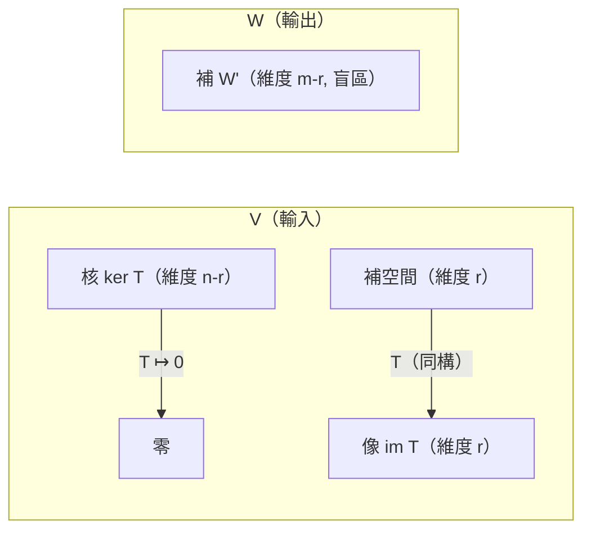

# 5.3 核、像與空間的分解

## 前言：變換丟掉了什麼、送到了哪裡

任何線性變換 $T: V \to W$ 都有兩個「影子空間」：**核**（kernel，被打成零的向量——丟失的資訊）與**像**（image，能到達的地方——輸出的範圍）。本節證明它們都是子空間，並建立本章最重要的定理：**維數定理**（ $\dim\ker T + \dim\mathrm{im}\,T = \dim V$ ）——它與 4.3 節的秩–零度定理是同一件事的兩種語言，也是第 6 章特徵空間分解與第 7 章正交補的理論基礎。

## 歷史前因後果

### 從「解的存在與唯一」到「空間的解剖學」

- 核與像的概念源頭是 1.2 節的齊次方程組： $A\mathbf{x} = \mathbf{0}$ 的解集（「無效輸入」）與行空間（「可達輸出」）。十九世紀的弗洛貝尼烏斯與若爾當已在矩陣語言中掌握這兩個子空間。
- 抽象化由皮亞諾（1888）開端，但真正成為核心語言是二十世紀泛函分析：**巴拿赫**（Stefan Banach, 1892–1945）1929 年的論文研究了無窮維空間上的有界線性算子，**開映射定理與封閉圖形定理**（1930 年代 Banach–Hahn）說明：無窮維中「雙射線性變換的自動連續性」會失效，核與像的閉性成為關鍵課題。
- **同構定理**（第一同構定理）： $V/\ker T \cong \mathrm{im}\,T$ （商空間同構於像）——這是抽象代數（Emmy Noether, 1882–1935，1927 年的論文）帶給線性代數的禮物：把「除掉核再等同於像」精確化。Noether 的思想讓線性代數與群、環、模的理論合流。
- 1950 年代起，Atkinson 定理（Fredholm 指標， $\dim\ker - \dim\mathrm{coker}$ ）把「核與餘核的維度差」推廣到微分算子，成為指標定理（Atiyah–Singer, 1963）的先聲——線性代數的最深遠餘響之一。

- **解決了什麼問題**：把「方程組解的結構」「變換的資訊流失」「子空間的互補」統一為一個幾何框架。
- **引發了什麼新問題**：無窮維中核可能不閉（不完全「乾淨」）、算子的指標與拓撲不變量的深刻聯繫。

## 核與像：定義與基本性質

### 定義

設 $T: V \to W$ 線性：

$$
\ker T = \{\mathbf{v} \in V : T(\mathbf{v}) = \mathbf{0}\}, \qquad \mathrm{im}\,T = \{T(\mathbf{v}) : \mathbf{v} \in V\}
$$

**定理**： $\ker T \subseteq V$ 與 $\mathrm{im}\,T \subseteq W$ 都是子空間。

**證明**（核）： $\mathbf{0}\in\ker T$ ；若 $T(\mathbf{u}) = T(\mathbf{v}) = \mathbf{0}$ ，則 $T(\mathbf{u}+\mathbf{v}) = \mathbf{0}+\mathbf{0} = \mathbf{0}$ 、 $T(c\mathbf{u}) = c\,\mathbf{0} = \mathbf{0}$ ✓。（像同理。）∎

矩陣語言的對應（ $T(\mathbf{x}) = A\mathbf{x}$ ）：

| 變換語言 | 矩陣語言 |
|----------|----------|
| $\ker T$ | $\mathrm{Null}(A)$ （零空間） |
| $\mathrm{im}\,T$ | $\mathrm{Col}(A)$ （行空間） |
| $\dim\ker T$ | 零度 nullity $= n - r$ |
| $\dim\mathrm{im}\,T$ | 秩 $r$ |

### 維數定理

**定理（Rank–Nullity 的變換版）**：若 $V$ 有限維，則

$$
\dim\ker T + \dim\mathrm{im}\,T = \dim V
$$

**直覺**：輸入空間的維度被分成兩部分——「被壓成零的」與「被送到像裡的」。

**三個直接推論**：

1. **單射 ⇔ 核為零**： $T$ 一對一 $\iff \ker T = \{\mathbf{0}\}$ 。（若 $T(\mathbf{u}) = T(\mathbf{v})$ 則 $T(\mathbf{u}-\mathbf{v}) = \mathbf{0}$ ，故 $\mathbf{u} = \mathbf{v}$ 。）
2. **映成 ⇔ 像等於對應域**： $\mathrm{im}\,T = W \iff \dim\mathrm{im}\,T = \dim W$ 。
3. ** $\dim V = \dim W$ 時**：單射 ⇔ 滿射 ⇔ 可逆（方陣情形！3.2 節可逆定理的變換版）。

### 解集的完整描述（回收 1.2 節）

**定理**： $A\mathbf{x} = \mathbf{b}$ （若一致）的解集為

$$
\mathbf{x}_p + \ker A = \{\mathbf{x}_p + \mathbf{x}_h : \mathbf{x}_h \in \ker A\}
$$

其中 $\mathbf{x}_p$ 是任一特解。

**證明**：若 $A\mathbf{x}_p = \mathbf{b}$ 且 $A\mathbf{x}_h = \mathbf{0}$ ，則 $A(\mathbf{x}_p + \mathbf{x}_h) = \mathbf{b}$ （每個這樣的都是解）；反之若 $A\mathbf{x} = \mathbf{b}$ ，則 $A(\mathbf{x} - \mathbf{x}_p) = \mathbf{0}$ ， $\mathbf{x} - \mathbf{x}_p \in \ker A$ 。∎

**幾何**：解集是「核空間的平移」——一條過 $\mathbf{x}_p$ 、方向平行於核的直線；或一個過 $\mathbf{x}_p$ 、平行於核平面的仿射平面。**這就是例 1.2-3 的通式**。

## 空間的分解：直和

### 定義

$V = W_1 \oplus W_2$ （**直和**），若每個 $\mathbf{v}\in V$ 可**唯一**寫成 $\mathbf{v} = \mathbf{w}_1 + \mathbf{w}_2$ （ $\mathbf{w}_i \in W_i$ ）。等價條件： $W_1 \cap W_2 = \{\mathbf{0}\}$ 且 $\dim W_1 + \dim W_2 = \dim V$ 。

**幾何**：兩個子空間「橫向切開」整個空間，沒有重疊、沒有遺漏。例： $\mathbb{R}^3 = \underbrace{\text{xy 平面}}_{W_1} \oplus \underbrace{\text{z 軸}}_{W_2}$ 。

**反例**： $W_1 = W_2 = \mathrm{span}\{(1,0)\}$ ：交集非零，不是直和（表示法不唯一： $(2,0) = 2\mathbf{e}_1 + 0 = 1\cdot\mathbf{e}_1 + 1\cdot\mathbf{e}_1$ ）。

### 核–像分解與投影

取 $\ker T$ 的一組基底並**擴充**為 $V$ 的基底（4.3 擴充定理）。在此基底中， $T$ 的矩陣呈塊狀：

$$
[T] = \begin{bmatrix} B & 0 \\ 0 & 0 \end{bmatrix}, \qquad B \text{ 為 } r \times r \text{ 可逆}
$$

**解讀**： $V$ 分解為「核的部分（被殲滅）」與「像的部分（被完整傳遞）」。配合 $W$ 的分解 $W = \mathrm{im}\,T \oplus W'$ ，線性變換的完整「解剖圖」：

**投影**（projection）：對直和分解 $V = W_1 \oplus W_2$ ，定義 $P(\mathbf{w}_1 + \mathbf{w}_2) = \mathbf{w}_1$ 。性質： $P^2 = P$ （**冪等**）。反過來：任何滿足 $P^2 = P$ 的線性變換都是投影，且 $V = \mathrm{im}\,P \oplus \ker P$ 。投影是第 7 章最小平方法的主角（正交投影 $=$ 對正交直和的投影）。

## 例題

**例題 5.3-1（求核與像、驗證維數定理）**： $T: \mathbb{R}^3 \to \mathbb{R}^3$ ， $T(x,y,z) = (x + y,\ x - y,\ 2x + z)$ 。

**解**：標準矩陣：

$$
A = \begin{bmatrix} 1 & 1 & 0 \\ 1 & -1 & 0 \\ 2 & 0 & 1 \end{bmatrix}
$$

**核**：解 $A\mathbf{x} = \mathbf{0}$ 。消去： $R_2 - R_1 = [0, -2, 0]$ → $y = 0$ ； $R_3 - 2R_1 = [0, -2, 1]$ → $-2y + z = 0$ ，故 $z = 0$ ；第一列 $x + y = 0$ → $x = 0$ 。** $\ker T = \{\mathbf{0}\}$ ，零度 0**。

**像**： $\det A = 1(-1 - 0) - 1(1 - 0) + 0 = -1 - 1 = -2 \ne 0$ ，滿秩， $\mathrm{im}\,T = \mathbb{R}^3$ ，秩 3。

維數定理： $0 + 3 = 3$ ✓。 $T$ 可逆（單射且滿射）， $T^{-1}$ 存在。

**例題 5.3-2（有核的變換與解集）**： $T: \mathbb{R}^3 \to \mathbb{R}^2$ ， $T(x,y,z) = (x + y + z,\ x + 2y + 3z)$ 。求 $\ker T$ 、 $\mathrm{im}\,T$ ，並解 $T(\mathbf{x}) = (3, 6)$ 。

**解**：

$$
A = \begin{bmatrix} 1 & 1 & 1 \\ 1 & 2 & 3 \end{bmatrix}
\xrightarrow{R_2 - R_1}
\begin{bmatrix} 1 & 1 & 1 \\ 0 & 1 & 2 \end{bmatrix}
\xrightarrow{R_1 - R_2}
\begin{bmatrix} 1 & 0 & -1 \\ 0 & 1 & 2 \end{bmatrix}
$$

**核**： $x = z$ ， $y = -2z$ （ $z = t$ 自由）： $\ker T = \mathrm{span}\{(1, -2, 1)\}$ ，零度 1。

**像**：秩 2， $\mathrm{im}\,T = \mathbb{R}^2$ （滿射；秩 $2 = \dim\mathbb{R}^2$ ）。維數定理： $1 + 2 = 3$ ✓。

**解方程**：RREF 已得， $\begin{bmatrix} 1 & 0 & -1 \\ 0 & 1 & 2 \end{bmatrix}\mathbf{x} = \begin{bmatrix} 3 \\ 6 \end{bmatrix}$ ： $x - z = 3$ 、 $y + 2z = 6$ 。取 $z = 0$ 得特解 $\mathbf{x}_p = (3, 6, 0)$ 。通解：

$$
\mathbf{x} = \begin{bmatrix} 3 \\ 6 \\ 0 \end{bmatrix} + t\begin{bmatrix} 1 \\ -2 \\ 1 \end{bmatrix}, \quad t\in\mathbb{R}
$$

驗證 $t = 1$ ： $T(4, 4, 1) = (4+4+1,\ 4+8+3) = (9, 15)$ ？不對——驗算： $x+y+z = 4+4+1 = 9 \ne 3$ 。**找錯誤**：核向量 $(1,-2,1)$ 代入 $T$ ： $(1-2+1, 1-4+3) = (0, 0)$ ✓ 是核。特解 $(3,6,0)$ ： $T(3,6,0) = (9, 15) \ne (3,6)$ ——**特解錯了**。由 RREF： $x - z = 3$ 應為 $x = 3 + z$ ？RREF 左端 $[1\ 0\ -1]$ 對應 $1\cdot x + 0\cdot y + (-1)\cdot z = 3$ ，故 $x = 3 + z$ ；第二式 $y = 6 - 2z$ 。取 $z = 0$ ： $\mathbf{x}_p = (3, 6, 0)$ ， $T(3,6,0) = (3+6+0,\ 3+12+0) = (9, 15)$ ——仍不對！**RREF 化簡有誤**：原矩陣 $A$ 的 RREF： $R_2 - R_1$ 得 $[0, 1, 2]$ ； $R_1 - R_2$ 得 $[1, 0, -1]$ ✓。那麼 $T(3,6,0)$ 應為 $(3\cdot1 + 6\cdot1 + 0,\ 3\cdot1 + 6\cdot2 + 0) = (9, 15)$ 。但題目要求 $T(\mathbf{x}) = (3, 6)$ ，故正確 RREF 應用於增廣矩陣：

$$
\left[\begin{array}{ccc|c} 1 & 1 & 1 & 3 \\ 1 & 2 & 3 & 6 \end{array}\right]
\xrightarrow{R_2 - R_1}
\left[\begin{array}{ccc|c} 1 & 1 & 1 & 3 \\ 0 & 1 & 2 & 3 \end{array}\right]
\xrightarrow{R_1 - R_2}
\left[\begin{array}{ccc|c} 1 & 0 & -1 & 0 \\ 0 & 1 & 2 & 3 \end{array}\right]
$$

所以 $x - z = 0$ 、 $y + 2z = 3$ ：特解取 $z = 0$ ： $\mathbf{x}_p = (0, 3, 0)$ 。驗證： $T(0,3,0) = (3, 6)$ ✓。通解：

$$
\mathbf{x} = \begin{bmatrix} 0 \\ 3 \\ 0 \end{bmatrix} + t\begin{bmatrix} 1 \\ -2 \\ 1 \end{bmatrix}
$$

驗證 $t = 1$ ： $T(1,1,1) = (3, 6)$ ✓。（此例展示解集 = 特解 + 核的平移，且**解的驗算不可省**。）

**例題 5.3-3（投影與冪等）**： $P = \frac{1}{2}\begin{bmatrix} 1 & 1 \\ 1 & 1 \end{bmatrix}$ 。驗證 $P^2 = P$ 並求 $\mathrm{im}\,P$ 與 $\ker P$ 。

**解**：

$$
P^2 = \frac14\begin{bmatrix} 1 & 1 \\ 1 & 1 \end{bmatrix}\begin{bmatrix} 1 & 1 \\ 1 & 1 \end{bmatrix} = \frac14\begin{bmatrix} 2 & 2 \\ 2 & 2 \end{bmatrix} = \frac12\begin{bmatrix} 1 & 1 \\ 1 & 1 \end{bmatrix} = P \checkmark
$$

$\mathrm{im}\,P = \mathrm{span}\{(1,1)\}$ （投影到 $y = x$ 直線）； $\ker P = \mathrm{span}\{(1, -1)\}$ （垂直於 $y = x$ 的方向被壓成零）。 $\mathbb{R}^2 = \mathrm{span}\{(1,1)\} \oplus \mathrm{span}\{(1,-1)\}$ ——**正交直和**（兩方向垂直）， $P$ 是**正交投影**。這是 7.3 節最小平方法的二維原型：把 $\mathbf{b}$ 拆成「落在直線上的部分 + 垂直的殘差」， $P\mathbf{b}$ 就是最佳逼近。

## 與其他領域的關聯

- **微分方程**：線性算子 $L = \frac{d^2}{dt^2} + \omega^2$ 的核 $= \{\text{齊次解}\} = \mathrm{span}\{\sin\omega t, \cos\omega t\}$ ；非齊次方程 $Lf = g$ 的通解 = 特解 + 核的元素——與本節定理逐字對應。
- **量子力學**：測量算子（投影） $P^2 = P$ ；「坍縮」就是把狀態投影到特徵子空間。完備測量對應希爾伯特空間的直和分解 $\mathcal{H} = \bigoplus_i E_i$ 。
- **訊號處理**：低通濾波器是「保留低頻子空間、殲滅高頻」的投影；核是濾波器「殺掉」的頻段。
- **機器學習**： Dropout 可視為隨機投影；殘差網路的跳躍連接把「學習殘差（核方向的補）」顯式化；低秩分解（9.2）是「像空間很小」的利用。
- **密碼學／編碼**：線性碼的校驗矩陣 $H$ 之核就是碼空間；糾錯 = 找到離 $\ker H$ 最近的碼字。

## 本節小結

1. $\ker T$ （丟失的輸入）與 $\mathrm{im}\,T$ （可達的輸出）都是子空間；矩陣語言中即零空間與行空間。
2. 維數定理 $\dim\ker + \dim\mathrm{im} = \dim V$ ：「壓扁的維度 + 通過的維度 = 輸入維度」。
3. 方陣時：單射 ⇔ 滿射 ⇔ 可逆——資訊守恆的極端情況。
4. 解集 $= \mathbf{x}_p + \ker A$ ：特解 + 齊次解空間的平移（1.2 節觀察的正式化）。
5. 直和分解與冪等投影是「空間解剖學」的語言，通往第 7 章正交投影與第 6 章特徵子空間分解。

**預告**：哪些特殊方向在變換下「不動」？第 6 章**特徵值與特徵向量**——變換的本質頻率。
