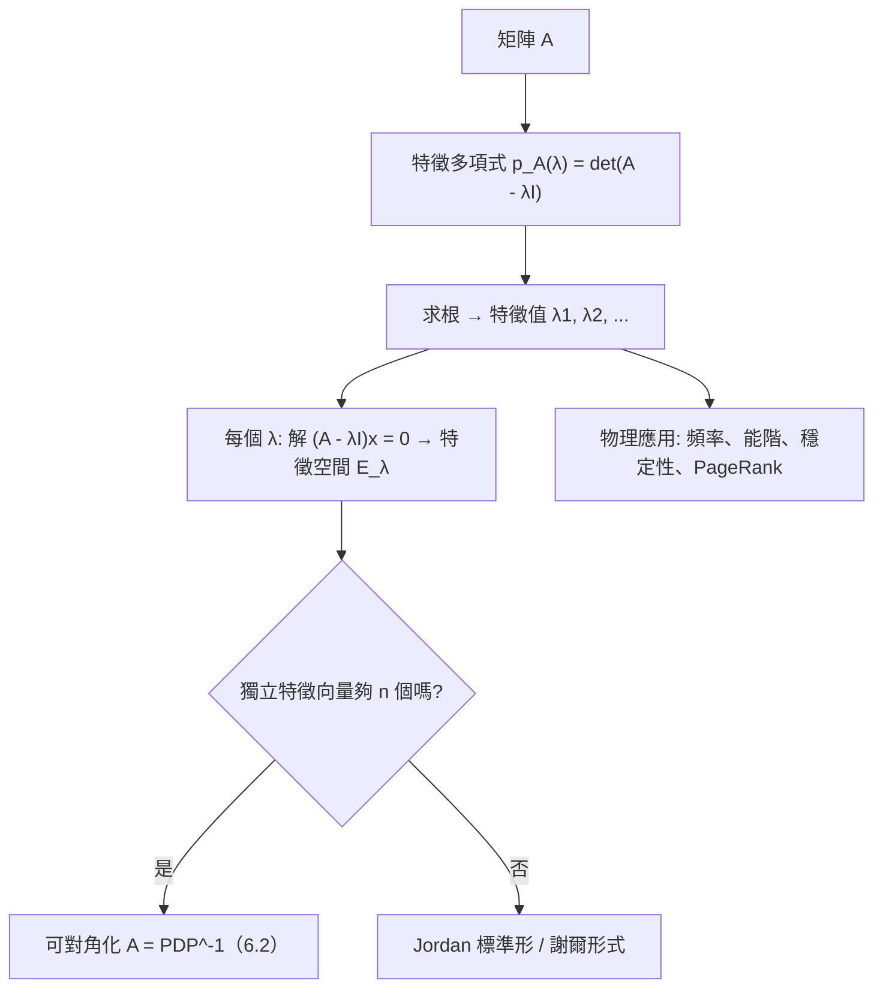

# 6.1 特徵值問題的來源

## 前言：變換中的「不動方向」

把一張圖片旋轉 45°，大部分箭都轉向了，但沒有任何方向保持不動（除了原點）。把同一張圖片做「沿 x 軸的剪切」，x 軸上的每支箭都紋風不動——它們只是被拉伸或縮短。這些「在變換下方向不變、只被縮放」的特殊方向，就是**特徵向量**；縮放的倍率就是**特徵值**。特徵值是線性變換的「固有頻率」，是矩陣的本質指紋（5.2 節相似不變量的核心）。本節追溯特徵值問題的歷史來源——從振動的弦到氫原子——並建立基本理論。

## 歷史前因後果

### 從琴弦到量子：特徵值的物理血統

- **1759 年**，拉格朗日（Joseph-Louis Lagrange, 1736–1813）研究**耦合振子**（多個質點由彈簧相連）時發現：運動可分解為若干「簡正模式」，各模式以固定頻率振動——這些頻率的平方正是系統矩陣的特徵值。**「簡正模式 = 特徵向量」**是特徵值的第一個偉大應用。
- **1828 年**，柯西在研究行星軌道攝動（天體力學的久期方程 secular equation）時，首次系統地研究對稱矩陣的特徵值，證明實對稱矩陣的特徵值全為實數。
- **1846–1858**，「eigen」一詞來自德語「自身的」：希爾伯特在 1904 年左右把「Eigenwert」（特徵值）、「Eigenfunktion」（特徵函數）引入積分方程理論；凱萊 1858 年的矩陣論已包含特徵多項式（他稱 characteristic）。
- **1926 年**，薛丁格（Erwin Schrödinger, 1887–1961）發表波動力學：氫原子的能階 $E_n$ 正是哈密頓算子的**特徵值**。「量子化」不是憑空假設，而是「特徵值問題的邊界條件解只有離散解」的數學必然。同年 Heisenberg–Born–Jordan 的矩陣力學中，能階是矩陣的特徵值——兩種表述由相似變換（5.2）連接。
- **1931 年**，**Perron–Frobenius 定理**完備：正矩陣有最大的正特徵值。1950 年 Google PageRank（Brin & Page, 1998）的數學核心就是 web 轉移矩陣的 Perron 特徵向量。

- **解決了什麼問題**：振動模式、量子能階、系統穩定性、長期行為預測——這些「本質量」的計算。
- **引發了什麼新問題**：如何**算**特徵值？ $n$ 大時特徵多項式不可解（阿貝爾–魯菲尼定理禁止五次以上根式解），催生了數值方法（QR 演算法，10.1）。

## 特徵值與特徵向量：定義

### 定義與特徵方程

**定義**：方陣 $A$ ，非零向量 $\mathbf{v}$ 滿足

$$
A\mathbf{v} = \lambda\mathbf{v} \qquad (\mathbf{v} \ne \mathbf{0})
$$

則 $\lambda$ 稱**特徵值**（eigenvalue）， $\mathbf{v}$ 稱對應的**特徵向量**（eigenvector）。

**幾何**： $\mathbf{v}$ 在變換 $A$ 下方向不變（或反向， $\lambda < 0$ ），只被縮放 $\lambda$ 倍。

把定義改寫為齊次方程：

$$
(A - \lambda I)\mathbf{v} = \mathbf{0}
$$

要有非零解，係數矩陣必須奇異（3.2 節），即

$$
\det(A - \lambda I) = 0
$$

這是 $\lambda$ 的 $n$ 次多項式，稱**特徵多項式** $p_A(\lambda)$ 。特徵值 = 特徵多項式的根。

### 特徵空間

對應特徵值 $\lambda$ 的所有特徵向量加上零向量：

$$
E_\lambda = \ker(A - \lambda I)
$$

是 $A\mathbf{x}=\mathbf{0}$ 型的解空間——**子空間**（5.3 節）。 $E_\lambda$ 的維度稱 $\lambda$ 的**幾何重數**（geometric multiplicity）； $\lambda$ 作為 $p_A$ 根的重數稱**代數重數**（algebraic multiplicity）。恆有

$$
1 \le \text{幾何重數} \le \text{代數重數} \le n
$$

**關鍵事實（6.2 節的主角）**： $A$ 可對角化 ⇔ 每個特徵值幾何重數 = 代數重數（特徵向量湊滿 $n$ 個獨立）。

### 兩個立即可用的公式

由 5.2 節：

$$
\mathrm{tr}(A) = \sum \lambda_i, \qquad \det A = \prod \lambda_i
$$

**用途**：不展開特徵多項式就能快速驗算。例如 $2\times2$ 矩陣特徵值必滿足 $\lambda_1 + \lambda_2 = \mathrm{tr}$ 、 $\lambda_1\lambda_2 = \det$ 。

## 特徵值的物理與應用語境

### 振動與簡正模式

耦合振子方程 $M\ddot{\mathbf{x}} = -K\mathbf{x}$ ，設 $\mathbf{x}(t) = \mathbf{v}e^{i\omega t}$ ，代入得

$$
K\mathbf{v} = \omega^2 M\mathbf{v}
$$

——**廣義特徵值問題**。每個特徵對 $(\omega^2, \mathbf{v})$ 是一個簡正模式：所有質點以同頻率、固定相位關係振動。吉他弦、橋樑共振、分子光譜（紅外吸收頻率 = 振動模式的特徵頻率）皆是。

### 穩定性分析

離散系統 $\mathbf{x}_{t+1} = A\mathbf{x}_t$ ：若 $|\lambda_i| < 1$ 對所有 $i$ ，則 $A^t\mathbf{x} \to \mathbf{0}$ （穩定）；有 $|\lambda_i| > 1$ 則發散。連續系統 $\mathbf{x}' = A\mathbf{x}$ ：穩定 ⇔ 所有 $\mathrm{Re}(\lambda_i) < 0$ 。**特徵值是系統的命運判決書**（6.3 節複特徵值 → 螺旋振盪）。

### PageRank：最大特徵向量的商業帝國

網頁排序： $\mathbf{r} = G\mathbf{r}$ ， $G$ 是隨機遊走的轉移矩陣（含 damping）。PageRank 向量是 $G$ 對應 $\lambda = 1$ 的特徵向量（Perron 向量）。Google 的億萬帝國建立在一個特徵向量上。

### 量子力學：能量量子化

定態薛丁格方程 $\hat{H}\psi = E\psi$ ——**字面上的特徵值方程**。能階離散化來自「特徵值問題在邊界條件下只有離散解」。光譜線（氫的 Balmer 系列）就是特徵值差的直接觀測。

## 例題

**例題 6.1-1（2×2 完整流程）**：求 $A = \begin{bmatrix} 4 & 1 \\ 2 & 3 \end{bmatrix}$ 的特徵值與特徵空間。

**解**：

$$
\det(A - \lambda I) = \det\begin{bmatrix} 4-\lambda & 1 \\ 2 & 3-\lambda \end{bmatrix} = (4-\lambda)(3-\lambda) - 2 = \lambda^2 - 7\lambda + 10 = (\lambda - 5)(\lambda - 2)
$$

特徵值 $\lambda = 5, 2$ 。**快速驗算**： $\mathrm{tr}(A) = 7 = 5 + 2$ ✓； $\det A = 10 = 5\cdot2$ ✓。

**特徵空間**：

- $\lambda = 5$ ： $(A - 5I)\mathbf{x} = \begin{bmatrix} -1 & 1 \\ 2 & -2 \end{bmatrix}\mathbf{x} = \mathbf{0} \Rightarrow x_1 = x_2$ ， $E_5 = \mathrm{span}\{(1, 1)\}$ 。
- $\lambda = 2$ ： $\begin{bmatrix} 2 & 1 \\ 2 & 1 \end{bmatrix}\mathbf{x} = \mathbf{0} \Rightarrow 2x_1 + x_2 = 0$ ， $E_2 = \mathrm{span}\{(1, -2)\}$ 。

驗證： $A(1,1) = (5, 5) = 5(1,1)$ ✓； $A(1,-2) = (4-2,\ 2-6) = (2, -4) = 2(1,-2)$ ✓。

**例題 6.1-2（不可對角化的預告：重根）**： $A = \begin{bmatrix} 2 & 1 \\ 0 & 2 \end{bmatrix}$ 。

$$
p_A(\lambda) = (2-\lambda)^2, \quad \lambda = 2 \text{（代數重數 2）}
$$

特徵空間： $(A - 2I)\mathbf{x} = \begin{bmatrix} 0 & 1 \\ 0 & 0 \end{bmatrix}\mathbf{x} = \mathbf{0} \Rightarrow x_2 = 0$ ， $E_2 = \mathrm{span}\{(1, 0)\}$ ——**幾何重數 1 < 代數重數 2**。獨立特徵向量只有一個，湊不滿兩個—— $A$ 不可對角化（只能化為若爾當塊，恰為原形）。這類「缺陷矩陣」（defective matrix）是 6.2 節的關鍵反例。

**例題 6.1-3（3×3 與物理直覺）**：求 $A = \begin{bmatrix} 2 & 0 & 0 \\ 0 & 3 & 4 \\ 0 & 4 & 9 \end{bmatrix}$ 的特徵值。

**解**：第一行是「孤立的」——沿第一列展開：

$$
\det(A - \lambda I) = (2 - \lambda)\det\begin{bmatrix} 3-\lambda & 4 \\ 4 & 9-\lambda \end{bmatrix} = (2-\lambda)\left[(3-\lambda)(9-\lambda) - 16\right]
$$

$$
= (2-\lambda)\left[\lambda^2 - 12\lambda + 27 - 16\right] = (2-\lambda)(\lambda^2 - 12\lambda + 11) = (2-\lambda)(\lambda - 1)(\lambda - 11)
$$

特徵值 $\lambda = 1, 2, 11$ 。驗算： $\mathrm{tr} = 14 = 1+2+11$ ✓； $\det = 2(27-16) = 22 = 1\cdot2\cdot11$ ✓。

**策略提示**：本例「先觀察結構再展開」——塊對角（2.3 節）使行列式可分解；一般 3×3 若無結構，可先用跡與行列式輔助因式分解。

**例題 6.1-4（動力系統預測）**： $\mathbf{x}_{t+1} = A\mathbf{x}_t$ ， $A = \begin{bmatrix} 0.9 & 0.2 \\ 0.1 & 0.8 \end{bmatrix}$ （人口遷移模型）。長期會怎樣？

**解**：特徵方程： $(0.9-\lambda)(0.8-\lambda) - 0.02 = \lambda^2 - 1.7\lambda + 0.7$ ，判別式 $2.89 - 2.8 = 0.09$ ， $\lambda = \frac{1.7 \pm 0.3}{2} = 1, 0.7$ 。

- $\lambda = 1$ ：穩態方向（長期分布不變）—— $(A - I)\mathbf{x} = \begin{bmatrix} -0.1 & 0.2 \\ 0.1 & -0.2 \end{bmatrix}\mathbf{x} = \mathbf{0} \Rightarrow \mathbf{v}_1 = (2, 1)$ ；
- $\lambda = 0.7$ ：衰減方向。

長期行為： $\mathbf{x}_t \to c\,(2, 1)^T$ ——無論初始分布，人口終將按 $2:1$ 分布於兩地。**最大特徵值 $= 1$ 的特徵向量就是系統的宿命**。這正是馬可夫鏈平穩分布與 PageRank 的數學。

## 與其他領域的關聯

- **微分方程**： $\mathbf{x}' = A\mathbf{x}$ 的解 $\mathbf{x}(t) = \sum c_i e^{\lambda_i t}\mathbf{v}_i$ ——特徵值是指數增長率（6.2 節細講）；Sturm–Liouville 理論把特徵值推廣到微分算子（弦振動、熱傳導的模態）。
- **量子力學**： $\hat{H}\psi = E\psi$ ；測量值只能是特徵值（量子化）；對稱（自伴）算子的特徵值必實（柯西 1828 → 第 8 章譜定理）。
- **統計／機器學習**：協方差矩陣特徵值 = 主成分變異量（PCA，9.2）；核矩陣的譜決定泛化能力；Hessian 特徵值判斷損失面的曲率（極大、極小、鞍點——第 8 章二次型）。
- **圖論／網路**：鄰接矩陣特徵值（圖譜）決定連通性、二部性；譜聚類用最小特徵值的特徵向量切分圖。
- **結構工程**：橋樑的固有頻率（特徵值）避免共振——塔科馬海峽橋坍塌（1940）的教訓。

## 本節小結

1. 特徵對 $(\lambda, \mathbf{v})$ ： $A\mathbf{v} = \lambda\mathbf{v}$ ——變換的「不動方向與縮放倍率」；來源是振動、軌道與量子化的物理需求。
2. 計算路線：特徵多項式 $\det(A - \lambda I) = 0$ 求特徵值；解 $(A - \lambda I)\mathbf{x} = \mathbf{0}$ 求特徵空間。
3. 跡與行列式 = 特徵值之和與積，是最快的驗算工具。
4. 幾何重數 ≤ 代數重數；相等才可對角化（6.2 節的判準預告）。
5. 特徵值的應用橫跨振動、穩定性、PageRank、量子能階——「本質頻率」無所不在。

**預告**：有了足夠的特徵向量，就能把矩陣「拆解」成 $A = PDP^{-1}$ ——**對角化**，讓冪運算、微分方程、長期預測全部化為初等計算。見 6.2。
