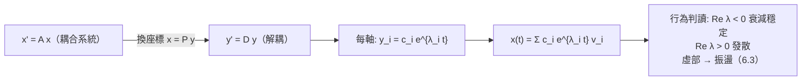

# 6.2 對角化

## 前言：選對座標，問題就消失了

剪切矩陣 $\begin{bmatrix} 1 & 1 \\ 0 & 1 \end{bmatrix}$ 的十次冪要連乘十次；但換到特徵向量座標系後，它只是「一個方向不動、另一個方向平移」，冪運算變成簡單的加法。**對角化**（diagonalization）是線性代數中最有生產力的技術：把 $A = PDP^{-1}$ 之後，冪、矩陣指數、微分方程的解全部化為「逐座標的標量計算」。本節給出可對角化的完整判準、計算流程與失敗案例（缺陷矩陣）。

## 歷史前因後果

### 從凱萊–哈密頓到若爾當

- **1858 年**，凱萊證明 $2\times2$ 矩陣滿足自己的特徵多項式；**弗洛貝尼烏斯**（1878）把**凱萊–哈密頓定理**推廣到一般 $n$ 階： $p_A(A) = O$ 。這是「矩陣服從自身特徵多項式」的深刻事實，把高次冪化為低次組合。
- **1870 年**，**若爾當**（Camille Jordan, 1838–1922）發表**若爾當標準形**：任何複方陣相似於塊對角矩陣，塊為 $\lambda$ 在對角線、1 在超對角線的「若爾當塊」。對角化是它的特例（全部是 $1\times1$ 塊）。若爾當形回答了「不能對角化時，最簡能到哪裡」。
- 二十世紀初，**譜定理**（對稱矩陣的對角化，Hilbert 1906、Weyl 1908）與**酉對角化**（正規矩陣）完善了理論；**數值版本**（QR 演算法，Francis 1961–62）讓特徵值計算在電腦上穩定可行（10.1 節）。

- **解決了什麼問題**：矩陣冪與矩陣函數的計算；線性微分方程組的解耦；馬可夫鏈、振動系統、量子系統的長期行為。
- **引發了什麼新問題**：缺陷矩陣在數值上「接近缺陷」時（條件數問題）對角化不穩定——9.3 節；非對稱矩陣需要 Schur/QR 技術——10.1 節。

## 對角化的定理與判準

### 主定理

**定理**： $n$ 階方陣 $A$ **可對角化**（存在可逆 $P$ 使 $P^{-1}AP = D$ 對角）⇔ $A$ 有 $n$ 個**線性獨立**的特徵向量。

此時 $P$ 的行是特徵向量、 $D$ 的對角線是對應特徵值：

$$
A = PDP^{-1}, \qquad D = \mathrm{diag}(\lambda_1, \dots, \lambda_n), \quad P = [\mathbf{v}_1\ \cdots\ \mathbf{v}_n]
$$

**證明（兩側）**： $AP = PD$ 逐行讀出：第 $j$ 行 $A\mathbf{v}_j = \lambda_j\mathbf{v}_j$ 。故 $AP = PD$ ⇔ $P$ 的行全是特徵向量； $P$ 可逆 ⇔ 這些行獨立。∎

**判準（充分條件）**：

1. $n$ 個**相異**特徵值 ⇒ 可對角化（每個代數重數 1，自動幾何重數 1）。
2. 一般判準：對每個特徵值 $\lambda$ ，**幾何重數 = 代數重數**（例 6.1-2 的缺陷矩陣不滿足）。
3. 特徵空間的直和蓋滿 $\mathbb{R}^n$ ： $\mathbb{R}^n = E_{\lambda_1} \oplus \cdots \oplus E_{\lambda_k}$ 。

### 對角化之後：冪與矩陣函數

**冪**：

$$
A^k = (PDP^{-1})^k = PD^kP^{-1} \qquad (P^{-1}P \text{ 兩兩抵消})
$$

而 $D^k = \mathrm{diag}(\lambda_1^k, \dots, \lambda_n^k)$ ——**難題解體為標量乘方**。

**矩陣多項式**： $p(A) = P\,p(D)\,P^{-1}$ 。

**矩陣指數**（微分方程的鑰匙）：

$$
e^{At} = \sum_{k=0}^{\infty} \frac{(At)^k}{k!} = P\,e^{Dt}\,P^{-1} = P\,\mathrm{diag}(e^{\lambda_1 t}, \dots, e^{\lambda_n t})\,P^{-1}
$$

**函數的一般原則**：任何能定義在標量上的函數 $f$ ，都可透過對角化「矩陣化」： $f(A) = P\,f(D)\,P^{-1}$ 。矩陣平方根、三角函數、對數……全都適用（在 $D$ 可定義的前提下）。

### 凱萊–哈密頓定理

**定理**： $p_A(A) = O$ 。

$2\times 2$ 的應用： $A^2 - (\mathrm{tr}A)A + (\det A)I = O$ ，於是

$$
A^2 = (\mathrm{tr}A)A - (\det A)I
$$

任何 $A^k$ 都可化為 $a_kA + b_kI$ —— $2\times2$ 冪運算只需追蹤兩個數列（遞迴關係由特徵多項式給出）。這在斐波那契數列的矩陣表示中有漂亮應用。

## 線性微分方程組：對角化的加冕禮

**系統**： $\mathbf{x}' = A\mathbf{x}$ ， $\mathbf{x}(0) = \mathbf{x}_0$ 。令 $\mathbf{x} = P\mathbf{y}$ ：

$$
P\mathbf{y}' = AP\mathbf{y} = PDP^{-1}P\mathbf{y} = PD\mathbf{y} \Rightarrow \mathbf{y}' = D\mathbf{y}
$$

**解耦為 $n$ 個標量方程**： $y_i' = \lambda_i y_i$ ，解 $y_i = c_ie^{\lambda_i t}$ 。通解：

$$
\mathbf{x}(t) = P\mathbf{y}(t) = c_1e^{\lambda_1 t}\mathbf{v}_1 + \cdots + c_ne^{\lambda_n t}\mathbf{v}_n
$$

**結論**：解 = 特徵模式（ $e^{\lambda_i t}\mathbf{v}_i$ ）的疊加。 $\lambda_i$ 決定時間行為（增長/衰減/振盪）， $\mathbf{v}_i$ 決定空間形狀。初值決定係數 $c_i$ 。

## 例題

**例題 6.2-1（完整對角化與冪）**： $A = \begin{bmatrix} 4 & 1 \\ 2 & 3 \end{bmatrix}$ （例 6.1-1： $\lambda = 5, 2$ ， $\mathbf{v}_5 = (1,1)$ ， $\mathbf{v}_2 = (1,-2)$ ）。計算 $A^5$ 。

**解**： $P = \begin{bmatrix} 1 & 1 \\ 1 & -2 \end{bmatrix}$ ， $D = \begin{bmatrix} 5 & 0 \\ 0 & 2 \end{bmatrix}$ ， $P^{-1} = \frac{1}{-3}\begin{bmatrix} -2 & -1 \\ -1 & 1 \end{bmatrix} = \frac{1}{3}\begin{bmatrix} 2 & 1 \\ 1 & -1 \end{bmatrix}$ 。

$$
A^5 = PD^5P^{-1} = \begin{bmatrix} 1 & 1 \\ 1 & -2 \end{bmatrix}\begin{bmatrix} 3125 & 0 \\ 0 & 32 \end{bmatrix}\cdot\frac13\begin{bmatrix} 2 & 1 \\ 1 & -1 \end{bmatrix}
$$

$$
= \frac13\begin{bmatrix} 3125 & 32 \\ 3125 & -64 \end{bmatrix}\begin{bmatrix} 2 & 1 \\ 1 & -1 \end{bmatrix} = \frac13\begin{bmatrix} 6250 + 32 & 3125 - 32 \\ 6250 - 64 & 3125 + 64 \end{bmatrix} = \frac13\begin{bmatrix} 6282 & 3093 \\ 6186 & 3189 \end{bmatrix}
$$

$$
A^5 = \begin{bmatrix} 2094 & 1031 \\ 2062 & 1063 \end{bmatrix}
$$

**驗算（小冪檢查）**： $A^2 = \begin{bmatrix} 4 & 1 \\ 2 & 3 \end{bmatrix}^2 = \begin{bmatrix} 16+2 & 4+3 \\ 8+6 & 2+9 \end{bmatrix} = \begin{bmatrix} 18 & 7 \\ 14 & 11 \end{bmatrix}$ 。用凱萊–哈密頓驗： $A^2 = 7A - 10I = \begin{bmatrix} 28-10 & 7 \\ 14 & 21-10 \end{bmatrix} = \begin{bmatrix} 18 & 7 \\ 14 & 11 \end{bmatrix}$ ✓。再用 $A^5 = A^4\cdot A$ 抽驗 $(1,1)$ 元： $A^3 = A^2 A = \begin{bmatrix} 18\cdot4+7\cdot2 & 18+21 \\ 56+22 & 14+33 \end{bmatrix} = \begin{bmatrix} 86 & 39 \\ 78 & 47 \end{bmatrix}$ ； $A^5(1,1) = (A^3\cdot A^2)(1,1) = 86\cdot18 + 39\cdot14 = 1548 + 546 = 2094$ ✓。

**例題 6.2-2（微分方程組）**：解 $\begin{cases} x' = x + 2y \\ y' = 4x + 3y \end{cases}$ ， $\mathbf{x}(0) = (1, 0)$ 。

**解**： $A = \begin{bmatrix} 1 & 2 \\ 4 & 3 \end{bmatrix}$ 。特徵方程： $(1-\lambda)(3-\lambda) - 8 = \lambda^2 - 4\lambda - 5 = (\lambda-5)(\lambda+1)$ ， $\lambda = 5, -1$ 。

- $\lambda = 5$ ： $\begin{bmatrix} -4 & 2 \\ 4 & -2 \end{bmatrix}\mathbf{v} = \mathbf{0} \Rightarrow \mathbf{v}_1 = (1, 2)$ ；
- $\lambda = -1$ ： $\begin{bmatrix} 2 & 2 \\ 4 & 4 \end{bmatrix}\mathbf{v} = \mathbf{0} \Rightarrow \mathbf{v}_2 = (1, -1)$ 。

通解： $\mathbf{x} = c_1e^{5t}(1,2) + c_2e^{-t}(1,-1)$ 。初值： $c_1 + c_2 = 1$ 、 $2c_1 - c_2 = 0$ → $c_1 = \frac13$ 、 $c_2 = \frac23$ 。

$$
\mathbf{x}(t) = \frac13 e^{5t}\begin{bmatrix} 1 \\ 2 \end{bmatrix} + \frac23 e^{-t}\begin{bmatrix} 1 \\ -1 \end{bmatrix}
$$

**判讀**： $e^{5t}$ 項爆炸增長（方向 $(1,2)$ ）， $e^{-t}$ 項消失。長期系統沿 $(1,2)$ 方向爆炸——不穩定（有正特徵值）。**一個矩陣讀出系統的命運**。

**例題 6.2-3（缺陷矩陣：失敗案例）**： $A = \begin{bmatrix} 2 & 1 \\ 0 & 2 \end{bmatrix}$ （例 6.1-2： $\lambda = 2$ 重根， $E_2$ 一維）。

**解**：只有一個獨立特徵向量，不可對角化。**降級方案**：解 $(A - 2I)\mathbf{w} = \mathbf{v}_1$ （ $\mathbf{v}_1 = (1,0)$ ）： $\begin{bmatrix} 0 & 1 \\ 0 & 0 \end{bmatrix}\mathbf{w} = \begin{bmatrix} 1 \\ 0 \end{bmatrix}$ 要求 $w_2 = 1$ ——**無解**！改解 $(A-2I)\mathbf{w} = \mathbf{v}_1$ 的正確形式： $\mathbf{v}_1$ 必須取 $(0,1)$ （檢查： $(A-2I)(0,1)^T = (1,0)^T$ ✓，即 $\mathbf{v}_1 = (0,1)$ 是特徵向量？驗證 $A(0,1) = (1,2) \ne 2(0,1)$ ——不是！）。

細算： $(A - 2I) = \begin{bmatrix} 0 & 1 \\ 0 & 0 \end{bmatrix}$ 。核 $= \{(x, 0)\}$ ，特徵向量 $\mathbf{v} = (1, 0)$ 。廣義特徵向量：解 $(A-2I)\mathbf{w} = \mathbf{v}$ ： $\begin{bmatrix} 0 & 1 \\ 0 & 0 \end{bmatrix}\begin{bmatrix} w_1 \\ w_2 \end{bmatrix} = \begin{bmatrix} 1 \\ 0 \end{bmatrix}$ ⇒ $w_2 = 1$ ， $w_1$ 自由，取 $\mathbf{w} = (0, 1)$ 。

以 $P = [\mathbf{v}\ \mathbf{w}] = \begin{bmatrix} 1 & 0 \\ 0 & 1 \end{bmatrix} = I$ （本例 $A$ 本身已是若爾當形 $J = \begin{bmatrix} 2 & 1 \\ 0 & 2 \end{bmatrix}$ ）。**冪的計算**：二項式（因 $A = 2I + N$ ， $N^2 = O$ ）：

$$
A^k = (2I + N)^k = 2^k I + k\,2^{k-1}N = \begin{bmatrix} 2^k & k\,2^{k-1} \\ 0 & 2^k \end{bmatrix}
$$

**教訓**：缺陷矩陣的冪會出現多項式因子 $k\,2^{k-1}$ ——這正是若爾當塊的特徵行為（共振、臨界阻尼的數學根源）。

## 對角化在日常計算中的地位

| 任務 | 對角化的角色 | 備註 |
|------|--------------|------|
| 矩陣冪 $A^k$ | $PD^kP^{-1}$ | 馬可夫鏈、遞迴數列 |
| 微分方程組 | $e^{At} = Pe^{Dt}P^{-1}$ | 6.2 主題 |
| 二次型分類 | 特徵值符號 → 正定性 | 第 8 章 |
| PCA | 協方差矩陣的譜分解 | 9.2 節 |
| 頻譜分析 | 周期矩陣的特徵基 | 傅立葉思想 |
| 量子力學 | 能量表象 | 特徵值 = 能階 |

## 與其他領域的關聯

- **微分方程**：本節解耦技術是線性系統理論的核心；偏微分方程（分離變數）把 PDE 化為 Sturm–Liouville 特徵值問題——特徵函數展開（傅立葉級數的推廣）。
- **量子力學**：對角化哈密頓算子 = 求能階；「選能量表象」就是選特徵向量為基底（5.2 節的物理實現）。
- **機器學習**：PCA 是「協方差矩陣的對角化」；圖卷積網路的譜方法用圖拉普拉斯的特徵分解。
- **控制理論**：可對角化系統的模式分解；極點配置（pole placement）就是把特徵值移到想要的位置。
- **數論**：斐波那契 $F_n \approx \frac{\varphi^n}{\sqrt5}$ （ $\varphi = \frac{1+\sqrt5}{2}$ 黃金比）——來自 $\begin{bmatrix} 1 & 1 \\ 1 & 0 \end{bmatrix}$ 的特徵值。

## 本節小結

1. $A = PDP^{-1}$ ⇔ $n$ 個獨立特徵向量 ⇔ 每個特徵值幾何重數 = 代數重數；相異特徵值是充分的捷徑。
2. 對角化的報酬： $A^k = PD^kP^{-1}$ 、 $e^{At} = Pe^{Dt}P^{-1}$ 、多項式函數化——難題降維為標量計算。
3. 微分方程組解耦為 $y_i' = \lambda_iy_i$ ，解 = 特徵模式疊加；特徵值符號決定系統命運。
4. 缺陷矩陣（幾何重數不足）不可對角化，冪中出現多項式因子；若爾當標準形（1870）是最簡形式。
5. 凱萊–哈密頓（1858/1878）提供「矩陣服從自身特徵多項式」的降冪工具。

**預告**：特徵值可以是複數嗎？旋轉矩陣的特徵值在哪裡？複特徵值如何解釋振盪與螺旋？見 6.3——**複特徵值與實應用**。
