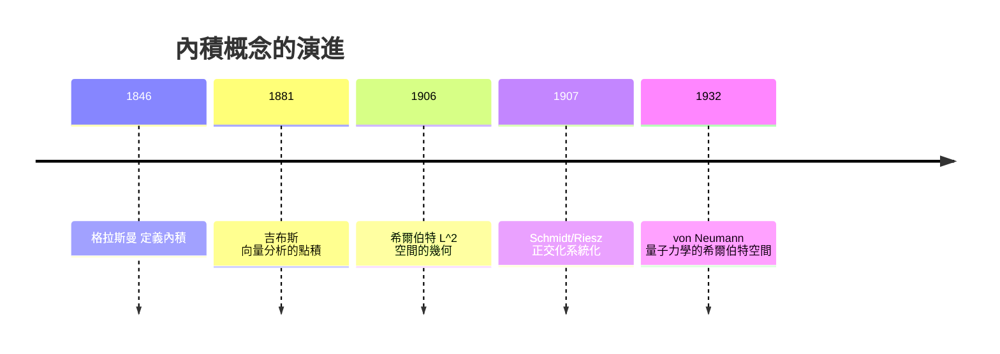
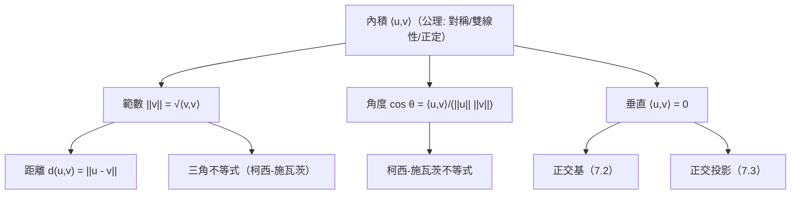

# 7.1 內積：把長度與角度公理化

## 前言：給抽象空間裝上尺與量角器

第四至六章的向量空間只有「加法與縮放」，能談直線、平面、維度，卻不能問「兩向量夾幾度」「這向量多長」——抽象空間沒有幾何。**內積**（inner product）補上這一塊：一個把一對向量映成純量的運算，繼承 $\mathbb{R}^n$ 點積的所有幾何職能——長度、角度、垂直、投影。更驚人的是，它讓**函數**也有了長度與角度：傅立葉級數、量子力學、訊號處理都是「函數空間裡的幾何」。

## 歷史前因後果

### 從點積到希爾伯特空間

- 點積的根源在力學：**功** $W = \mathbf{F}\cdot\mathbf{d} = \|\mathbf{F}\|\|\mathbf{d}\|\cos\theta$ ；1846 年格拉斯曼的「內積」（他稱「inner product」）首次給出代數定義 $\sum u_iv_i$ 。
- 1881 年吉布斯確立向量分析中的點積與叉積。
- **1885 年**起，希爾伯特（David Hilbert, 1862–1943）在積分方程研究中把 $L^2$ 函數空間視為「無窮維歐氏空間」：內積 $\langle f, g\rangle = \int f g\,dx$ 、正交基、Bessel 不等式。1907 年 **Schmidt**（Erhard Schmidt, 1876–1959）與 **Riesz** 把幾何語言系統化；「希爾伯特空間」一詞由 **von Neumann**（1929）提出並公理化。
- **1925–1932 年**，量子力學的數學框架完成：狀態是希爾伯特空間向量，可觀測量是自伴算子，測量機率由 $\langle\psi, \phi\rangle^2$ 給出——**內積是量子機率的定義者**。
- **1932 年**，巴拿赫空間（只有範數、無內積）理論完備；「內積空間」是其中最幾何化的特例。

- **解決了什麼問題**：把歐氏幾何（長度、角度、垂直）推廣到函數與無窮維，統一傅立葉分析、積分方程與量子力學。
- **引發了什麼新問題**：完備性（Cauchy 列收斂）的必要性——不完備的內積空間需「補全」；無窮維中基底的正交化、譜的連續部分等分析課題。

## 內積的公理

**定義**：實向量空間 $V$ 上的**內積**是函數 $\langle \cdot, \cdot \rangle : V\times V \to \mathbb{R}$ ，滿足：

| # | 公理 | 名稱 |
|---|------|------|
| 1 | $\langle \mathbf{u}, \mathbf{v}\rangle = \langle \mathbf{v}, \mathbf{u}\rangle$ | 對稱 |
| 2 | $\langle \mathbf{u}+\mathbf{v}, \mathbf{w}\rangle = \langle\mathbf{u},\mathbf{w}\rangle + \langle\mathbf{v},\mathbf{w}\rangle$ | 第一變數線性 |
| 3 | $\langle c\mathbf{u}, \mathbf{v}\rangle = c\langle\mathbf{u},\mathbf{v}\rangle$ | 齊次 |
| 4 | $\langle \mathbf{v}, \mathbf{v}\rangle \ge 0$ ，等號 ⇔ $\mathbf{v} = \mathbf{0}$ | 正定 |

（複空間中對稱改為共軛對稱 $\langle\mathbf{u},\mathbf{v}\rangle = \overline{\langle\mathbf{v},\mathbf{u}\rangle}$ ，量子力學的標準設定。）

### 內積誘生長度與角度

**範數**： $\|\mathbf{v}\| = \sqrt{\langle\mathbf{v},\mathbf{v}\rangle}$ ；**距離**： $d(\mathbf{u},\mathbf{v}) = \|\mathbf{u}-\mathbf{v}\|$ 。

**角度**（由餘弦定律反推）：兩非零向量夾角 $\theta$ 定義為

$$
\cos\theta = \frac{\langle\mathbf{u},\mathbf{v}\rangle}{\|\mathbf{u}\|\,\|\mathbf{v}\|}
$$

**垂直**： $\langle\mathbf{u},\mathbf{v}\rangle = 0$ ，記 $\mathbf{u} \perp \mathbf{v}$ 。

### 最重要的定理：柯西–施瓦茨不等式

**定理**： $|\langle\mathbf{u},\mathbf{v}\rangle| \le \|\mathbf{u}\|\,\|\mathbf{v}\|$ ，等號 ⇔ 線性相依。

**證明**（Lagrange 恆等式路線）：考慮 $f(t) = \|\mathbf{u} + t\mathbf{v}\|^2 = \|\mathbf{u}\|^2 + 2t\langle\mathbf{u},\mathbf{v}\rangle + t^2\|\mathbf{v}\|^2 \ge 0$ 對一切 $t$ 。二次式非負 ⇒ 判別式 $\le 0$ ：

$$
4\langle\mathbf{u},\mathbf{v}\rangle^2 - 4\|\mathbf{u}\|^2\|\mathbf{v}\|^2 \le 0 \Rightarrow |\langle\mathbf{u},\mathbf{v}\rangle| \le \|\mathbf{u}\|\,\|\mathbf{v}\| \checkmark
$$

**推論（三角不等式）**： $\|\mathbf{u}+\mathbf{v}\| \le \|\mathbf{u}\| + \|\mathbf{v}\|$ （證：展開 $\|\mathbf{u}+\mathbf{v}\|^2$ 用柯西–施瓦茨）。1.1 節「三角形兩邊之和大於第三邊」至此獲得一般證明。

## 常見內積空間

| 空間 | 內積 | 幾何職能 |
|------|------|----------|
| $\mathbb{R}^n$ | $\sum u_iv_i$ （點積） | 標準歐氏幾何 |
| $\mathbb{C}^n$ | $\sum \bar u_iv_i$ | 量子態空間 |
| $P_n$ | $\langle p, q\rangle = \int_{-1}^{1} p(x)q(x)\,dx$ | 多項式的長度與正交（Legendre） |
| $C[0,1]$ | $\int_0^1 fg\,dx$ （ $L^2$ ） | 傅立葉分析 |
| 加權 | $\int w(x)fg\,dx$ | 切比雪夫、Hermite 多項式 |
| 矩陣 | $\langle A, B\rangle = \mathrm{tr}(A^TB)$ | Frobenius 內積，矩陣近似 |

**矩陣的 Frobenius 內積例**： $\langle A, B\rangle = \sum_{ij}a_{ij}b_{ij}$ ——把矩陣「攤平」當向量點積； $\|A\|_F = \sqrt{\langle A, A\rangle}$ 是矩陣的「長度」，在 9.2 節低秩逼近中是誤差度量。

**函數內積例**： $\langle \sin mx, \sin nx\rangle_{[0,2\pi]} = \int_0^{2\pi}\sin mx\sin nx\,dx = 0$ （ $m \ne n$ ）——**正弦函數彼此正交**！傅立葉級數本質上就是「在正交基 $\{1, \cos, \sin\}$ 上展開座標」——這是「函數幾何化」最偉大的收穫。

## 範數、距離與正交的公理化圖像

## 例題

**例題 7.1-1（點積與角度）**： $\mathbf{u} = (2, 1, -2)$ 、 $\mathbf{v} = (1, -2, 2)$ 。求 $\|\mathbf{u}\|$ 、夾角、並判斷是否垂直。

**解**：

$$
\langle\mathbf{u},\mathbf{v}\rangle = 2 - 2 - 4 = -4, \qquad \|\mathbf{u}\| = \sqrt{4+1+4} = 3, \qquad \|\mathbf{v}\| = \sqrt{1+4+4} = 3
$$

$$
\cos\theta = \frac{-4}{9} \Rightarrow \theta \approx 116.4°
$$

非零內積 → 不垂直。**力學解讀**：若 $\mathbf{v}$ 是位移、 $\mathbf{u}$ 是力，則做功 $-4$ （負功——力阻礙位移）。

**例題 7.1-2（多項式空間的內積）**： $P_2$ 配內積 $\langle p, q\rangle = \int_{-1}^{1}pq\,dx$ 。求 $\|1\|$ 、 $\|x\|$ ，並判斷 $1, x, x^2 - \frac13$ 是否正交。

**解**：

$$
\langle 1, 1\rangle = \int_{-1}^{1}1\,dx = 2 \Rightarrow \|1\| = \sqrt2; \qquad \langle x, x\rangle = \int_{-1}^{1}x^2\,dx = \frac23 \Rightarrow \|x\| = \sqrt{\tfrac23}
$$

**正交檢查**： $\langle 1, x\rangle = \int_{-1}^1 x\,dx = 0$ ✓（奇函數）； $\langle 1, x^2 - \tfrac13\rangle = \int_{-1}^{1}\left(x^2 - \tfrac13\right)dx = \tfrac23 - \tfrac23 = 0$ ✓； $\langle x, x^2 - \tfrac13\rangle = \int_{-1}^{1}\left(x^3 - \tfrac{x}{3}\right)dx = 0$ ✓（奇函數）。

**三個多項式正交**——這正是 **Legendre 多項式** $P_0 = 1, P_1 = x, P_2 = \frac12(3x^2-1)$ 的誕生地（正規化後）。Legendre 多項式是球諧函數、電磁多極展開、量子角動量的基石。

**例題 7.1-3（正交與畢氏定理的推廣）**：驗證 $\mathbf{u} = (1, 2, 2)$ 與 $\mathbf{v} = (2, -1, 0)$ 垂直，並驗證 $\|\mathbf{u}+\mathbf{v}\|^2 = \|\mathbf{u}\|^2 + \|\mathbf{v}\|^2$ 。

**解**： $\langle\mathbf{u},\mathbf{v}\rangle = 2 - 2 + 0 = 0$ ✓ 垂直。

$$
\|\mathbf{u}\|^2 = 9, \quad \|\mathbf{v}\|^2 = 5, \quad \mathbf{u}+\mathbf{v} = (3, 1, 2), \quad \|\mathbf{u}+\mathbf{v}\|^2 = 9 + 1 + 4 = 14 = 9 + 5 \checkmark
$$

**一般定理（畢氏定理）**： $\mathbf{u} \perp \mathbf{v} \Rightarrow \|\mathbf{u}+\mathbf{v}\|^2 = \|\mathbf{u}\|^2 + \|\mathbf{v}\|^2$ 。

證明一行： $\|\mathbf{u}+\mathbf{v}\|^2 = \|\mathbf{u}\|^2 + 2\langle\mathbf{u},\mathbf{v}\rangle + \|\mathbf{v}\|^2 = \|\mathbf{u}\|^2 + \|\mathbf{v}\|^2$ 。∎

這條「勾股」推廣到任意內積空間（含函數），是 Parseval 恆等式（傅立葉級數的能量守恆）的胚胎。

## 與其他領域的關聯

- **微積分**： $L^2$ 內積連接積分與幾何；傅立葉級數 = 函數的正交展開；Parseval 定理 = 能量守恆。
- **量子力學**： $\langle\phi|\psi\rangle$ 是振幅，模方是機率（Born 規則，1926）；正交態 = 完全可分辨；不確定性原理的證明核心是柯西–施瓦茨。
- **機器學習**：核方法（kernel trick）把內積 $\langle\phi(x), \phi(y)\rangle$ 抽象化——「有內積就能做幾何」；注意力機制中的 $\mathbf{q}\cdot\mathbf{k}$ 相似度就是點積（10.2 節）。
- **統計**：相關係數 $r = \frac{\langle\mathbf{x}-\bar{x}\mathbf{1}, \mathbf{y}-\bar{y}\mathbf{1}\rangle}{\|\mathbf{x}-\bar{x}\mathbf{1}\|\|\mathbf{y}-\bar{y}\mathbf{1}\|}$ ——**就是夾角餘弦**！ $r = \pm1$ （共線）⇔ 完全線性相關，柯西–施瓦茨的統計化身。
- **訊號處理**：內積 = 匹配濾波（相關接收）；正交碼（CDMA 手機通訊）讓多路訊號互不干擾。

## 本節小結

1. 內積 = 四條公理（對稱、雙線性、正定）；由它誘生長度、角度、垂直——**幾何的公理化安裝**。
2. 柯西–施瓦茨不等式是最重要的定理：保證角度良定義，推出三角不等式，化身為統計的相關係數。
3. 函數空間配積分內積後，「正弦正交」「Legendre 多項式」等現象成為幾何事實——傅立葉分析 = 函數的正交幾何。
4. 歷史：格拉斯曼（1846）→ 吉布斯（1881）→ 希爾伯特（1906）→ 馮紐曼（1932，量子力學）。

**預告**：正交是「最省力的座標系」——正交基讓座標計算只需一次內積。如何把任意基底**正交化**？見 7.2：Gram–Schmidt。
