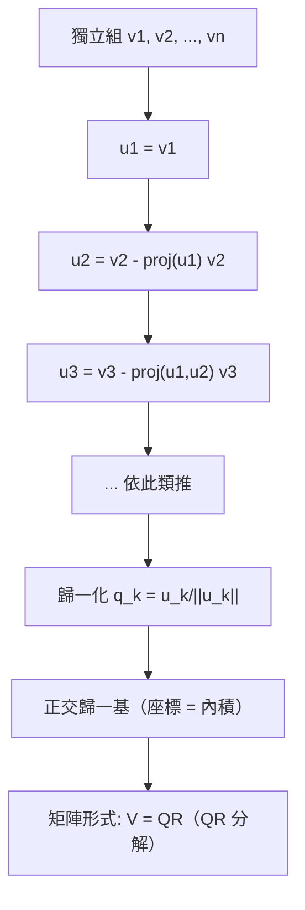

# 7.2 正交基與 Gram–Schmidt

## 前言：最舒服的座標系

一般基底的座標要解聯立方程（例 4.3-2 的教訓）；**正交基**的座標只需一次內積：$c_i = \frac{\langle\mathbf{v},\mathbf{b}_i\rangle}{\|\mathbf{b}_i\|^2}$。若再**歸一化**（單位長），就是 $c_i = \langle\mathbf{v},\mathbf{q}_i\rangle$——讀座標像「量影子」。**Gram–Schmidt 正交化**是把任意基底機械地轉成（正交）歸一基底的演算法；它的數值改良版 QR 分解是所有穩定演算法（最小平方、特徵值、SVD）的引擎。

## 歷史前因後果

### 從勒壤得到 Gram 與 Schmidt

- **1805 年**，勒壤得（Adrien-Marie Legendre, 1752–1833）發表最小平方法，已隱含正交化思想；**1806 年**高斯獨立提出（與行星軌道計算，見 1.3 節）。他們的「正規方程」本質上依賴正交結構。
- **1883 年**，丹麥測量學家**格拉姆**（Jørgen Pedersen Gram, 1850–1916）在處理最小平方擬合時系統化了正交化程序。
- **1907 年**，**施密特**（Erhard Schmidt, 1876–1959）在積分方程理論（希爾伯特學派）中把演算法寫成現在的形式，應用於函數空間——故冠名 **Gram–Schmidt**。
- **1958 年起**，**Householder**（Alston Householder, 1904–1993）與 **Givens**（Wallace Givens, 1910–1993）發明反射/旋轉式的正交化變換，數值穩定性遠超原始 Gram–Schmidt——QR 分解成為 LAPACK 的基本建設（10.1 節）。

- **解決了什麼問題**：座標計算的最簡化；最小平方的穩定求解；函數正交展開（傅立葉、正交多項式）的系統生成。
- **引發了什麼新問題**：捨入誤差使 Gram–Schmidt 逐漸失去正交性（「古典版」vs「修正版」CGS/MGS）；正交化成本 $O(n^3)$ 在超大規模下需迭代法（Lanczos, 1950）。

## 正交基的威力

### 定義與座標公式

**定義**：基底 $\{\mathbf{q}_1, \dots, \mathbf{q}_n\}$ **正交**，若 $\langle\mathbf{q}_i, \mathbf{q}_j\rangle = 0$（$i\ne j$）；**正交歸一**（orthonormal），若再 $\|\mathbf{q}_i\| = 1$。

**座標公式**：對正交基，

$$
\mathbf{v} = \sum_i c_i\mathbf{q}_i \Rightarrow c_i = \frac{\langle\mathbf{v}, \mathbf{q}_i\rangle}{\|\mathbf{q}_i\|^2}; \qquad \text{歸一時 } c_i = \langle\mathbf{v}, \mathbf{q}_i\rangle
$$

**證明**：兩邊與 $\mathbf{q}_j$ 內積：$\langle\mathbf{v},\mathbf{q}_j\rangle = \sum_i c_i\langle\mathbf{q}_i,\mathbf{q}_j\rangle = c_j\|\mathbf{q}_j\|^2$。∎

**對比**：一般基底的座標需解 $n\times n$ 線性系統（$O(n^3)$）；正交基只需 $n$ 次內積（$O(n^2)$，甚至可並行）。**正交 = 免除解方程**。

### 正交矩陣

**定義**：$Q^TQ = I$ 的方陣 $Q$（列＝正交歸一組）。性質：

| 性質 | 意義 |
|------|------|
| $Q^{-1} = Q^T$ | 求逆免費！ |
| $\|Q\mathbf{x}\| = \|\mathbf{x}\|$ | 保長度（剛體） |
| $\langle Q\mathbf{u}, Q\mathbf{v}\rangle = \langle\mathbf{u},\mathbf{v}\rangle$ | 保角度 |
| $|\det Q| = 1$；$\det = +1$ 旋轉、$-1$ 反射 | 定向分類（3.3 節） |
| 特徵值模為 1 | 旋轉角（6.3 節） |

**例子**：旋轉矩陣 $R(\theta)$（第 6 章反覆出現）滿足 $R^TR = I$ 且 $\det = 1$；鏡射矩陣 $\det = -1$。**每個正交矩陣 = 旋轉與鏡射的合成**。

## Gram–Schmidt 正交化

### 演算法

給定獨立組 $\mathbf{v}_1, \dots, \mathbf{v}_n$，逐個「減去已正交方向的影子」：

$$
\begin{aligned}
\mathbf{u}_1 &= \mathbf{v}_1 \\
\mathbf{u}_k &= \mathbf{v}_k - \sum_{i=1}^{k-1} \frac{\langle\mathbf{v}_k, \mathbf{u}_i\rangle}{\|\mathbf{u}_i\|^2}\,\mathbf{u}_i \qquad (k = 2, \dots, n)
\end{aligned}
$$

歸一化得正交歸一基：$\mathbf{q}_k = \mathbf{u}_k / \|\mathbf{u}_k\|$。

**幾何**：$\mathbf{u}_k$ 是 $\mathbf{v}_k$ 減掉它在「已建構子空間」上的投影——剩下的部分垂直於該子空間。**「新方向的純化」**。

**正確性**：$\mathrm{span}\{\mathbf{u}_1,\dots,\mathbf{u}_k\} = \mathrm{span}\{\mathbf{v}_1,\dots,\mathbf{v}_k\}$（逐步張成不變），且 $\mathbf{u}_k \perp \mathbf{u}_i$（$i<k$）——因為 $\mathbf{u}_k = \mathbf{v}_k - \mathrm{proj}_{\mathrm{span}\{\mathbf{u}_1..\mathbf{u}_{k-1}\}}\mathbf{v}_k$，而「向量減去其在子空間上的投影」與該子空間垂直（證明即 7.3 節投影定理的核心）。

### QR 分解

把 Gram–Schmidt 寫成矩陣：$A = [\mathbf{v}_1\ \cdots\ \mathbf{v}_n] = [\mathbf{q}_1\ \cdots\ \mathbf{q}_n]\,R = QR$，其中

$$
R = \begin{bmatrix} \langle\mathbf{v}_1,\mathbf{q}_1\rangle & \langle\mathbf{v}_2,\mathbf{q}_1\rangle & \cdots \\ 0 & \langle\mathbf{v}_2,\mathbf{q}_2\rangle & \cdots \\ \vdots & & \ddots \end{bmatrix} \text{（上三角）}
$$

**QR 分解**的用途：

- **穩定解最小平方**：$A\mathbf{x} \approx \mathbf{b}$ 變成 $R\mathbf{x} = Q^T\mathbf{b}$（上三角，回代即解）——避開正規方程的條件數平方問題（9.3 節）；
- **特徵值演算法**：QR 演算法反覆 $A_k = Q_kR_k$、$A_{k+1} = R_kQ_k$ 收斂到特徵值（Francis 1961，10.1 節）；
- 數值上以 **Householder 反射**實現（比原始 Gram–Schmidt 穩定）。

## 例題

**例題 7.2-1（三向量正交化）**：$\mathbf{v}_1 = (1, 1, 0)$、$\mathbf{v}_2 = (1, 0, 1)$、$\mathbf{v}_3 = (0, 1, 1)$。求正交歸一基。

**解**：

$$
\mathbf{u}_1 = (1, 1, 0), \quad \|\mathbf{u}_1\|^2 = 2
$$

$$
\mathbf{u}_2 = \mathbf{v}_2 - \frac{\langle\mathbf{v}_2,\mathbf{u}_1\rangle}{2}\mathbf{u}_1 = (1,0,1) - \frac{1}{2}(1,1,0) = \left(\tfrac12, -\tfrac12, 1\right)
$$

$\|\mathbf{u}_2\|^2 = \frac14 + \frac14 + 1 = \frac32$。

$$
\langle\mathbf{v}_3, \mathbf{u}_1\rangle = 1, \qquad \langle\mathbf{v}_3, \mathbf{u}_2\rangle = 0 - \tfrac14 + 1 = \tfrac34
$$

$$
\mathbf{u}_3 = (0,1,1) - \frac{1}{2}(1,1,0) - \frac{3/4}{3/2}\left(\tfrac12, -\tfrac12, 1\right) = (0,1,1) - \left(\tfrac12,\tfrac12,0\right) - \tfrac12\left(\tfrac12,-\tfrac12,1\right) = \left(-\tfrac34, \tfrac34, \tfrac12\right)
$$

**正交驗證**：$\langle\mathbf{u}_3, \mathbf{u}_1\rangle = -\frac34 + \frac34 + 0 = 0$ ✓；$\langle\mathbf{u}_3, \mathbf{u}_2\rangle = -\frac38 - \frac38 + \frac12 = -\frac14$？——**檢查**：$-\frac34\cdot\frac12 + \frac34\cdot(-\frac12) + \frac12\cdot1 = -\frac38 - \frac38 + \frac12 = -\frac14 \ne 0$。有錯！重算 $\langle\mathbf{v}_3, \mathbf{u}_2\rangle$：$\mathbf{v}_3 = (0,1,1)$、$\mathbf{u}_2 = (\frac12, -\frac12, 1)$：$0\cdot\frac12 + 1\cdot(-\frac12) + 1\cdot1 = \frac12$（**不是** $\frac34$——先前誤算）。重算 $\mathbf{u}_3$：

$$
\mathbf{u}_3 = (0,1,1) - \frac{1}{2}(1,1,0) - \frac{1/2}{3/2}\left(\tfrac12, -\tfrac12, 1\right) = (0,1,1) - \left(\tfrac12,\tfrac12,0\right) - \tfrac13\left(\tfrac12,-\tfrac12,1\right)
$$

$$
= \left(0 - \tfrac12 - \tfrac16,\ 1 - \tfrac12 + \tfrac16,\ 1 - 0 - \tfrac13\right) = \left(-\tfrac23, \tfrac23, \tfrac23\right)
$$

**驗證**：$\langle\mathbf{u}_3, \mathbf{u}_1\rangle = -\frac23 + \frac23 = 0$ ✓；$\langle\mathbf{u}_3, \mathbf{u}_2\rangle = -\frac23\cdot\frac12 + \frac23\cdot(-\frac12) + \frac23\cdot1 = -\frac13 - \frac13 + \frac23 = 0$ ✓。

**歸一化**：

$$
\mathbf{q}_1 = \frac{1}{\sqrt2}(1,1,0), \quad \mathbf{q}_2 = \frac{1}{\sqrt{3/2}}\left(\tfrac12,-\tfrac12,1\right) = \frac{1}{\sqrt6}(1,-1,2), \quad \mathbf{q}_3 = \frac{1}{\sqrt3}(-1,1,1)
$$

（再次印證：**中間步驟的驗算能攔截錯誤**；這也是為什麼實務用電腦程式與 Householder 演算法。）

**例題 7.2-2（正交矩陣的辨識與應用）**：判斷 $Q = \frac13\begin{bmatrix} 2 & -2 & 1 \\ 1 & 2 & 2 \\ 2 & 1 & -2 \end{bmatrix}$ 是否正交，並說明其幾何。

**解**：$Q^TQ = \frac19\begin{bmatrix} 4+1+4 & -4+2+2 & 2+2-2 \\ -4+2+2 & 4+4+1 & -2+4-2 \\ 2+2-2 & -2+4-2 & 1+4+4 \end{bmatrix} = \frac19\begin{bmatrix} 9 & 0 & 2 \\ 0 & 9 & 0 \\ 2 & 0 & 9 \end{bmatrix}$？計算 $(1,3)$ 元：$2\cdot1 + (-2)\cdot2 + 1\cdot(-2) = 2 - 4 - 2 = -4$。重算：$Q^TQ$ 的 $(1,3)$ 元 = 第一列 $\cdot$ 第三行 = $(2, -2, 1)\cdot(1, 2, -2) = 2 - 4 - 2 = -4 \ne 0$——**非正交**？

**仔細重算**：$Q = \frac13\begin{bmatrix} 2 & -2 & 1 \\ 1 & 2 & 2 \\ 2 & 1 & -2 \end{bmatrix}$。行 1 = $\frac13(2,1,2)$，行 2 = $\frac13(-2,2,1)$，行 3 = $\frac13(1,2,-2)$。行 1·行 2 $= \frac19(-4+2+2) = 0$ ✓；行 1·行 3 $= \frac19(2+2-4) = 0$ ✓；行 2·行 3 $= \frac19(-2+4-2) = 0$ ✓；各行長度平方 $= \frac19(4+1+4) = 1$ ✓。**是正交矩陣**（先前把行誤當列重算）。

$\det Q$：$\det = \frac1{27}[2(2\cdot(-2) - 2\cdot1) - (-2)(1\cdot(-2) - 2\cdot2) + 1(1\cdot1 - 2\cdot2)] = \frac1{27}[2(-6) + 2(-6) + (1-4)] = \frac{-12-12-3}{27} = -1$。**$\det = -1$：含一次反射的剛體變換**。

**例題 7.2-3（函數空間的正交化：Legendre 預演）**：在 $\langle p,q\rangle = \int_{-1}^1 pq\,dx$ 下，把 $1, x, x^2$ 正交化。

**解**：$\mathbf{u}_1 = 1$，$\|1\|^2 = 2$。

$$
\mathbf{u}_2 = x - \frac{\langle x, 1\rangle}{2}\cdot1 = x - 0 = x \quad (\text{奇函數自動正交})
$$

$$
\mathbf{u}_3 = x^2 - \frac{\langle x^2, 1\rangle}{2}\cdot1 - \frac{\langle x^2, x\rangle}{\langle x, x\rangle}x = x^2 - \frac{2/3}{2} = x^2 - \frac13
$$

（$\langle x^2, x\rangle = 0$，奇函數。）得到 $1, x, x^2 - \frac13$——與例 7.1-2 一致；歸一化後正是 Legendre 多項式 $P_0, P_1, P_2$ 的常數倍。**Gram–Schmidt 在函數空間 = 正交多項式的生成機**。

## 正交投影的預告

Gram–Schmidt 的每一步都用到「投影」：

$$
\mathrm{proj}_{\mathbf{u}}\mathbf{v} = \frac{\langle\mathbf{v},\mathbf{u}\rangle}{\|\mathbf{u}\|^2}\,\mathbf{u}
$$

而 $\mathbf{v} - \mathrm{proj}_{\mathbf{u}}\mathbf{v}$ 垂直於 $\mathbf{u}$（驗證：$\langle\mathbf{v} - \mathrm{proj}, \mathbf{u}\rangle = \langle\mathbf{v},\mathbf{u}\rangle - \frac{\langle\mathbf{v},\mathbf{u}\rangle}{\|\mathbf{u}\|^2}\|\mathbf{u}\|^2 = 0$ ✓）。**「分解為平行 + 垂直」**是 7.3 節最小平方法的全部幾何——把資料點投影到模型子空間。

## 與其他領域的關聯

- **微積分／數學物理**：正交多項式家族（Legendre、Chebyshev、Hermite、Laguerre）由加權 Gram–Schmidt 生成，是特殊函數理論的主幹（球座標、量子諧振子）。
- **量子力學**：測量基底的「正交化」對應可分辨態；量子位元計算基 $\{|0\rangle, |1\rangle\}$ 是最簡正交歸一基。
- **訊號處理**：正交頻分多工（OFDM，Wi-Fi/5G）用正交載波避免子通道干擾——Gram–Schmidt 的工程化身。
- **統計／機器學習**：迴歸的「Frisch–Waugh 定理」逐變數正交化；神經網路中的 whitening（白化）= 正交歸一化座標；QR 分解是線性層的穩定參數化（保證正交權重）。
- **數值線性代數**：Householder QR、Lanczos（對稱特徵值的迭代正交化）、GMRES（Krylov 子空間的正交基）——10.1 節的主角。

## 本節小結

1. 正交基讓座標 = 內積（免解方程）；正交歸一基讓正交矩陣 $Q^TQ = I$，求逆免費、保長度角度。
2. Gram–Schmidt（Gram 1883、Schmidt 1907）：逐次減投影，機械生成正交歸一基；矩陣形式即 QR 分解。
3. QR 分解是數值線性代數的支柱：穩定解最小平方、驅動 QR 特徵值演算法。
4. 函數空間的 Gram–Schmidt 生成正交多項式（Legendre 等）——傅立葉理論的基底工程。
5. 投影 $\mathrm{proj}_{\mathbf{u}}\mathbf{v}$ 是核心積木，「平行 + 垂直」分解通往最小平方法。

**預告**：當 $A\mathbf{x} = \mathbf{b}$ 無解（資料不一致）時怎麼辦？把 $\mathbf{b}$ **投影**到行空間，解最接近的問題。見 7.3——最小平方法，統計與機器學習的起點。
