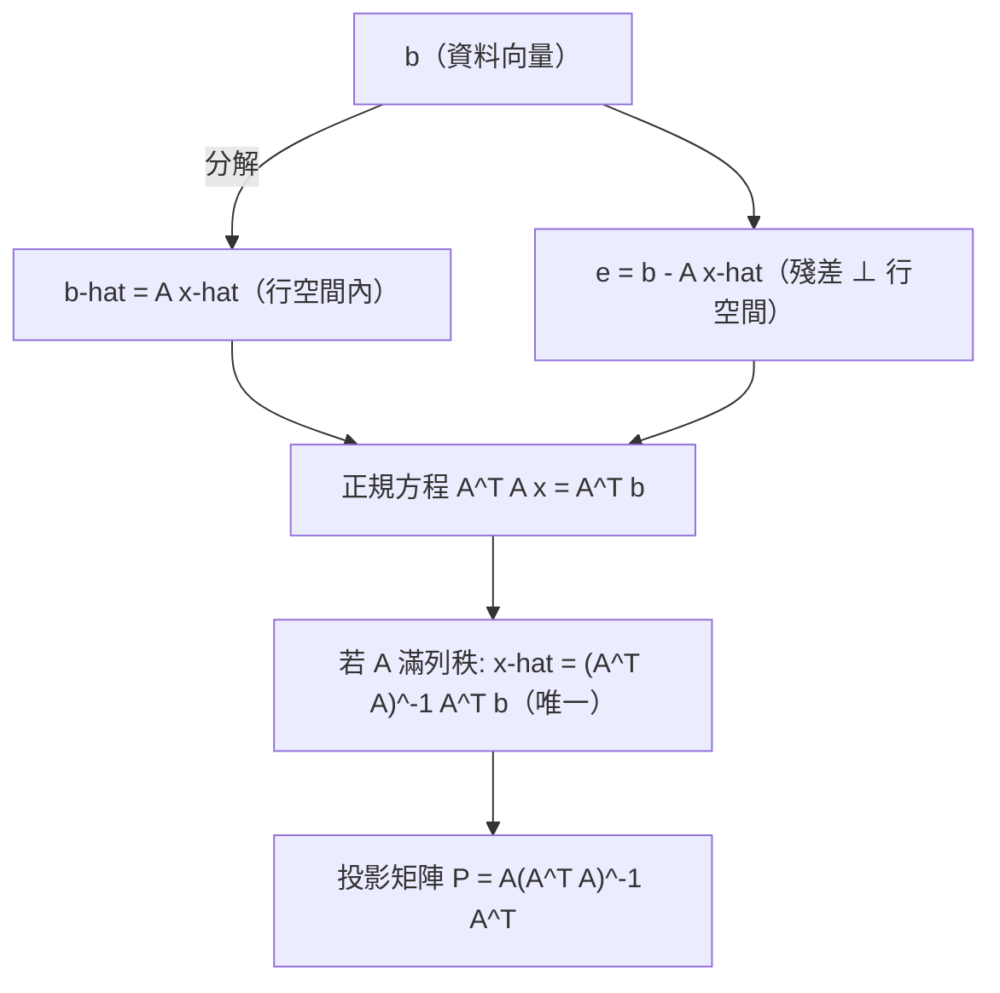

# 7.3 最小平方法與投影

## 前言：沒有解，就找最接近的解

三筆資料擬合直線，通常沒有一條線同時穿過三點——方程組無解（方程比未知數多、彼此矛盾）。高斯（1805）與勒壤得（1806）的答案改變了科學：**別要求零誤差，求誤差平方和最小**。幾何上，這就是把 $\mathbf{b}$ **正交投影**到 $A$ 的行空間。最小平方法是統計迴歸、訊號處理、機器學習的共同祖先；本節用第 7 章的正交工具給它完整的幾何證明。

## 歷史前因後果

### 天文測量的世紀難題

- 1801 年，高斯用其最小平方法**預測**了失蹤的矮行星**穀神星**（Ceres）的位置，天文學家據此重新找到它——高斯一舉成名（並因此被聘為哥廷根天文台長）。勒壤得 1806 年率先發表方法，兩人有優先權之爭；高斯聲稱 1795 年已在使用。
- **為什麼提出**：天文觀測必有誤差；多個觀測「超定」（overdetermined）方程組沒有精確解。需要一個「最佳折衷」的定義與算法。
- **高斯的兩大貢獻**：(1) 幾何—代數的投影解法（本節主題）；(2) **機率論基礎**：假設誤差服從常態分布，則「極大概似估計」恰為最小平方解——**常態分布的「平方」與最小平方在數學上同源**，這是「高斯分布」名稱的由來。
- **馬可夫定理**（Andrey Markov, 1900）：在高斯–馬可夫假設下，最小平方估計是最佳線性無偏估計（BLUE）——統計學的理論封印。
- **引發的新問題**：當 $A^TA$ 奇異（共線性）或病態時怎麼辦？——嶺迴歸（Hoerl & Kennard, 1970）與 SVD/偽逆（9.3 節）。

## 正交投影理論

### 問題設定

$A$ 為 $m\times n$ （ $m > n$ 常見）， $A\mathbf{x} = \mathbf{b}$ 通常無解。目標：

$$
\min_{\mathbf{x}} \|\mathbf{b} - A\mathbf{x}\|^2
$$

**幾何洞察**： $A\mathbf{x}$ 走遍行空間 $\mathrm{Col}(A)$ （ $m$ 維空間中的一個子空間）。要讓 $\|\mathbf{b} - A\mathbf{x}\|$ 最小， $A\mathbf{x}$ 必須是 $\mathbf{b}$ 在 $\mathrm{Col}(A)$ 上的**正交投影** $\hat{\mathbf{b}}$ ——因為「垂線最短」。

### 投影定理與正規方程

**定理（正交分解）**：任何 $\mathbf{b}$ 可唯一分解 $\mathbf{b} = \hat{\mathbf{b}} + \mathbf{e}$ ，其中 $\hat{\mathbf{b}} \in \mathrm{Col}(A)$ 、 $\mathbf{e} \perp \mathrm{Col}(A)$ 。此時 $\hat{\mathbf{b}} = A\hat{\mathbf{x}}$ 是最佳逼近，殘差 $\mathbf{e} = \mathbf{b} - A\hat{\mathbf{x}}$ 。

**最佳解的方程**： $\mathbf{e} \perp \mathrm{Col}(A)$ ⇔ $\mathbf{e}$ 與每個行向量垂直 ⇔ $A^T(\mathbf{b} - A\mathbf{x}) = \mathbf{0}$ ：

$$
\boxed{A^TA\,\hat{\mathbf{x}} = A^T\mathbf{b}} \qquad \text{（正規方程，Normal Equations）}
$$

**殘差恆等式**： $\|\mathbf{b}\|^2 = \|\hat{\mathbf{b}}\|^2 + \|\mathbf{e}\|^2$ （勾股定理， $\hat{\mathbf{b}} \perp \mathbf{e}$ ）——「總變差 = 解釋變差 + 未解釋變差」，統計 $R^2$ 的線性代數根源。

### 投影矩陣

$\hat{\mathbf{b}} = P\mathbf{b}$ ，其中（ $A$ 滿列秩時）

$$
P = A(A^TA)^{-1}A^T
$$

性質： $P^2 = P$ （冪等，5.3 節）、 $P^T = P$ （對稱）——**正交投影的特徵**。投影到 $\mathrm{Col}(A)$ 的**正交補**（垂直方向）用 $I - P$ 。

## 例題

**例題 7.3-1（直線擬合）**：資料 $(0, 1), (1, 2), (2, 4)$ 。求最佳直線 $y = c_0 + c_1 x$ 。

**解**：方程組（三條方程、兩個未知數）：

$$
\begin{cases} c_0 = 1 \\ c_0 + c_1 = 2 \\ c_0 + 2c_1 = 4 \end{cases} \qquad A = \begin{bmatrix} 1 & 0 \\ 1 & 1 \\ 1 & 2 \end{bmatrix},\ \mathbf{b} = \begin{bmatrix} 1 \\ 2 \\ 4 \end{bmatrix}
$$

**正規方程**：

$$
A^TA = \begin{bmatrix} 3 & 3 \\ 3 & 5 \end{bmatrix}, \qquad A^T\mathbf{b} = \begin{bmatrix} 7 \\ 10 \end{bmatrix}
$$

$$
\begin{bmatrix} 3 & 3 \\ 3 & 5 \end{bmatrix}\begin{bmatrix} c_0 \\ c_1 \end{bmatrix} = \begin{bmatrix} 7 \\ 10 \end{bmatrix} \Rightarrow \det = 15 - 9 = 6,\ \begin{bmatrix} c_0 \\ c_1 \end{bmatrix} = \frac16\begin{bmatrix} 5 & -3 \\ -3 & 3 \end{bmatrix}\begin{bmatrix} 7 \\ 10 \end{bmatrix} = \frac16\begin{bmatrix} 35 - 30 \\ -21 + 30 \end{bmatrix} = \begin{bmatrix} 5/6 \\ 3/2 \end{bmatrix}
$$

最佳直線： $y = \frac56 + \frac32 x$ 。**殘差**： $x = 0, 1, 2$ 時預測 $\frac56, \frac{7}{3}, \frac{23}{6}$ ，殘差 $\frac16, -\frac13, \frac16$ ，平方和 $= \frac{1}{36} + \frac{4}{36} + \frac{1}{36} = \frac16$ 。驗證殘差垂直行空間： $\mathbf{e} = (\frac16, -\frac13, \frac16)$ ， $A^T\mathbf{e} = (\frac16 - \frac13 + \frac16,\ -\frac13 + \frac13) = (0, 0)$ ✓。

**例題 7.3-2（QR 路線解同一題）**：對 $A$ 做 Gram–Schmidt 得 $Q, R$ ，驗證 $R\hat{\mathbf{x}} = Q^T\mathbf{b}$ 。

**解**： $\mathbf{a}_1 = (1,1,1)$ 、 $\mathbf{a}_2 = (0,1,2)$ 。 $\mathbf{u}_1 = (1,1,1)$ ， $\|\mathbf{u}_1\|^2 = 3$ ；

$$
\mathbf{u}_2 = (0,1,2) - \frac{3}{3}(1,1,1) = (-1, 0, 1), \quad \|\mathbf{u}_2\|^2 = 2
$$

$$
Q = \begin{bmatrix} \frac{1}{\sqrt3} & -\frac{1}{\sqrt2} \\ \frac{1}{\sqrt3} & 0 \\ \frac{1}{\sqrt3} & \frac{1}{\sqrt2} \end{bmatrix}, \quad R = \begin{bmatrix} \sqrt3 & \sqrt3 \\ 0 & \sqrt2 \end{bmatrix}
$$

（ $R_{11} = \|\mathbf{u}_1\| = \sqrt3$ ； $R_{12} = \langle\mathbf{a}_2, \mathbf{q}_1\rangle = \sqrt3$ ； $R_{22} = \|\mathbf{u}_2\| = \sqrt2$ 。驗證 $QR = A$ ：第一行 $\sqrt3\cdot\frac{1}{\sqrt3}(1,1,1) = (1,1,1)$ ✓；第二行 $\sqrt3\cdot\frac{1}{\sqrt3}(1,1,1) + \sqrt2\cdot\frac{1}{\sqrt2}(-1,0,1) = (0,1,2)$ ✓。）

$$
Q^T\mathbf{b} = \begin{bmatrix} \frac{1+2+4}{\sqrt3} \\ \frac{-1 + 4}{\sqrt2} \end{bmatrix} = \begin{bmatrix} \frac{7}{\sqrt3} \\ \frac{3}{\sqrt2} \end{bmatrix}
$$

回代 $R\hat{\mathbf{x}} = Q^T\mathbf{b}$ ： $\sqrt2\,c_1 = \frac{3}{\sqrt2} \Rightarrow c_1 = \frac32$ ✓； $\sqrt3\,c_0 + \sqrt3\cdot\frac32 = \frac{7}{\sqrt3} \Rightarrow c_0 = \frac73 - \frac32 = \frac{14 - 9}{6} = \frac56$ ✓。與正規方程結果一致——**QR 路線避免形成 $A^TA$ （條件數平方）**，數值上更穩（9.3 節）。

**例題 7.3-3（投影矩陣與幾何驗證）**：對例 7.3-1 的 $A$ ，計算 $P$ 並驗證 $P^2 = P$ 、 $P^T = P$ 。

**解**： $(A^TA)^{-1} = \frac16\begin{bmatrix} 5 & -3 \\ -3 & 3 \end{bmatrix}$ 。

$$
P = A(A^TA)^{-1}A^T = \frac16\begin{bmatrix} 1 & 0 \\ 1 & 1 \\ 1 & 2 \end{bmatrix}\begin{bmatrix} 5 & -3 \\ -3 & 3 \end{bmatrix}\begin{bmatrix} 1 & 1 & 1 \\ 0 & 1 & 2 \end{bmatrix}
$$

先算中間： $\begin{bmatrix} 5 & -3 \\ -3 & 3 \end{bmatrix}\begin{bmatrix} 1 & 1 & 1 \\ 0 & 1 & 2 \end{bmatrix} = \begin{bmatrix} 5 & 2 & -1 \\ -3 & 0 & 3 \end{bmatrix}$ 。

$$
P = \frac16\begin{bmatrix} 1 & 0 \\ 1 & 1 \\ 1 & 2 \end{bmatrix}\begin{bmatrix} 5 & 2 & -1 \\ -3 & 0 & 3 \end{bmatrix} = \frac16\begin{bmatrix} 5 & 2 & -1 \\ 2 & 2 & 2 \\ -1 & 2 & 5 \end{bmatrix}
$$

**驗證**： $P^T = P$ ✓（對稱）。 $P^2$ ： $(1,1)$ 元 $= \frac1{36}(25 + 4 + 1) = \frac{30}{36} = \frac56 = P_{11}$ ✓； $(1,2)$ 元 $= \frac1{36}(10 + 4 - 2) = \frac{12}{36} = \frac13 = P_{12}$ ✓； $(1,3)$ 元 $= \frac1{36}(-5 + 4 - 5) = \frac{-6}{36} = -\frac16 = P_{13}$ ✓。 $P^2 = P$ ✓。

**應用**： $\hat{\mathbf{b}} = P\mathbf{b} = \frac16(5 + 4 - 4,\ 2 + 4 + 8,\ -1 + 4 + 20) = \frac16(5, 14, 23) = (\frac56, \frac73, \frac{23}{6})$ ——正是例 7.3-1 的預測值 ✓。

## 最小平方法的統計化身

| 線性代數語言 | 統計語言 |
|--------------|----------|
| $\hat{\mathbf{b}} = A\hat{\mathbf{x}}$ | 擬合值 $\hat{y}$ |
| $\mathbf{e} = \mathbf{b} - \hat{\mathbf{b}}$ | 殘差 |
| $\|\mathbf{e}\|^2/\|\mathbf{b}\|^2$ | 未解釋變異（ $1 - R^2$ ） |
| $\hat{\mathbf{x}}$ | 迴歸係數（OLS 估計） |
| $A^TA$ 可逆性 | 無共線性 |
| 條件數（9.3） | 估計的變異數膨脹 |

**馬可夫定理**：誤差獨立、等變異、零均值（且線性模型正確）⇒ OLS 是最佳線性無偏估計。**相關係數** $r$ 與擬合斜率的關係： $c_1 = r\frac{s_y}{s_x}$ ——兩個領域在此合流。

## 與其他領域的關聯

- **微積分**： $\min\|\mathbf{b}-A\mathbf{x}\|^2$ 的微分（梯度 $= 2A^T(A\mathbf{x}-\mathbf{b})$ ）正是正規方程——「投影定理 = 多變數微積分的臨界點條件」。
- **機器學習**：線性迴歸是最簡神經網路；梯度下降每步解「局部線性化」的最小平方（高斯–牛頓法）；注意力機制 $\mathrm{softmax}(QK^T)V$ 是廣義的加權投影。
- **訊號處理**：匹配濾波、Wiener 濾波（1949）都是最小平方估計；GPS 定位解超定測距方程組。
- **控制理論**：卡爾曼濾波（1960）= 遞迴最小平方——太空船導航（阿波羅計畫）的核心。
- **量子力學**：態估計（quantum state tomography）用最小平方從測量數據重建密度矩陣。

## 本節小結

1. 超定系統無解時，最小平方解 = 把 $\mathbf{b}$ 正交投影到 $\mathrm{Col}(A)$ ：垂線最短。
2. 正規方程 $A^TA\hat{\mathbf{x}} = A^T\mathbf{b}$ ；滿列秩時 $\hat{\mathbf{x}} = (A^TA)^{-1}A^T\mathbf{b}$ 。
3. 投影矩陣 $P = A(A^TA)^{-1}A^T$ ：對稱、冪等； $\|\mathbf{b}\|^2 = \|\hat{\mathbf{b}}\|^2 + \|\mathbf{e}\|^2$ 是 $R^2$ 的幾何根源。
4. QR 路線數值更穩（避免 $A^TA$ 條件數平方）；歷史上高斯 1805 年為穀神星軌道而生。
5. 最小平方法是統計迴歸、卡爾曼濾波、機器學習的共同祖先。

**預告**：投影的對象「行空間」若是**對稱矩陣**的特徵空間，一切會更漂亮：特徵值全實、特徵向量可正交歸一、二次型有符號分類。第 8 章——**對稱矩陣與譜定理**。
