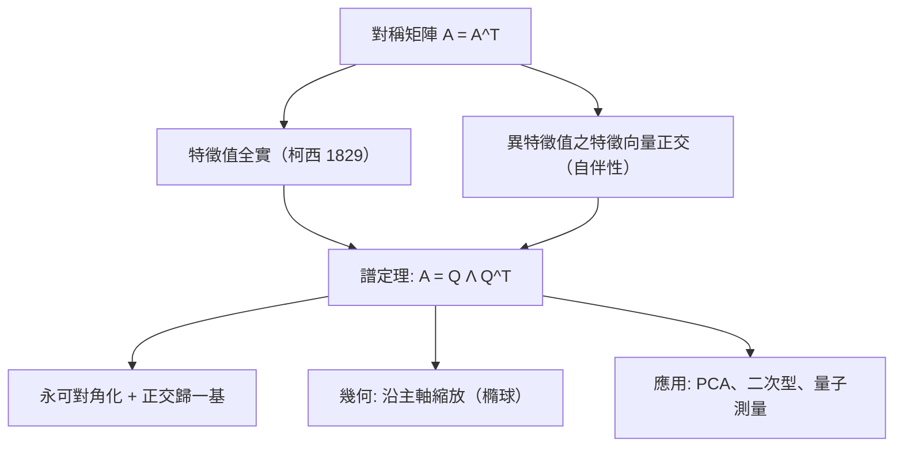

# 8.1 對稱矩陣的特殊性

## 前言：矩陣世界的貴族

對稱矩陣（ $A = A^T$ ）是線性代數中行為最優雅的矩陣：特徵值必為實數、特徵向量可組成正交歸一基、永遠可對角化——而且是**用正交矩陣**對角化（ $A = Q\Lambda Q^T$ ）。這一切由**譜定理**（spectral theorem）保證。協方差矩陣、圖的拉普拉斯、哈密頓算子、二次型——科學與工程中最重要的矩陣幾乎都是對稱的。本節證明譜定理，並解釋對稱性為何如此「值錢」。

## 歷史前因後果

### 從柯西到希爾伯特：「譜」的誕生

- **1829 年**，柯西在研究二次型的主軸變換時證明：**實對稱矩陣的特徵值全為實數**，且存在正交的特徵向量系——譜定理的 $n$ 維版本實質上已完成（他以行列式語言表述）。
- **1854–55 年**，凱萊與西爾維斯特以矩陣語言重述；**主軸定理**（principal axis theorem）——二次型可正交對角化——成為解析幾何的標準工具（橢球的主軸，8.2 節）。
- **1906 年**，希爾伯特在積分方程研究中把「特徵值集合」命名為**譜**（spectrum，借自光譜——分光儀把光按頻率分解，正如算子把函數按特徵值分解）。譜定理的無窮維版本（緊自伴算子）由希爾伯特完成，一般有界自伴算子由 **von Neumann**（1929–30）與 **Riesz** 完成。
- **1926 年起**，量子力學把譜定理變成物理公理：可觀測量的可能值 = 自伴算子的譜；測量的統計由特徵向量基底決定。

- **解決了什麼問題**：二次型的分類、振動模態的解耦、統計主成分的提取、量子測量的數學基礎。
- **引發了什麼新問題**：非對稱但「良好」的矩陣（正規矩陣 $AA^T = A^TA$ ）的推廣；數值上如何在浮點環境可靠地算譜（對稱 QR、Jacobi 法，10.1 節）。

## 對稱矩陣的基本性質

### 什麼是對稱矩陣？

$A = A^T$ ： $a_{ij} = a_{ji}$ ，對角線兩側鏡像。物理與統計中的天然來源：

| 來源 | 對稱的原因 |
|------|------------|
| 二次型/能量 | $x^TSx$ 只依賴對稱部分： $\frac12(S + S^T)$ |
| 協方差矩陣 | $\mathrm{Cov}(X,Y) = \mathrm{Cov}(Y,X)$ |
| 圖拉普拉斯 | 無向圖的鄰接對稱 |
| 彈簧系統（勁度矩陣） | 作用力 = 反作用力 |
| Hessian（二階導數） | $f_{xy} = f_{yx}$ （Schwarz 定理） |
| 正規方程矩陣 $A^TA$ | 構造即對稱 |

**任何矩陣都可對稱化**： $S = \frac{A + A^T}{2}$ ；反對稱部分 $\frac{A - A^T}{2}$ 對二次型零貢獻。這解釋了為何二次型理論只需對稱矩陣。

### 特徵值必為實數

**定理**：對稱矩陣的特徵值全為實數。

**證明**：設 $A\mathbf{v} = \lambda\mathbf{v}$ （允許複 $\mathbf{v}$ ）。取與 $\bar{\mathbf{v}}$ 的內積（複內積 $\langle\mathbf{u},\mathbf{v}\rangle = \bar{\mathbf{u}}^T\mathbf{v}$ ）：

$$
\bar{\mathbf{v}}^TA\mathbf{v} = \lambda\|\mathbf{v}\|^2
$$

左端取共軛： $\overline{\bar{\mathbf{v}}^TA\mathbf{v}} = \mathbf{v}^TA\bar{\mathbf{v}} = (A\mathbf{v})^T\bar{\mathbf{v}} = (\lambda\mathbf{v})^T\bar{\mathbf{v}} = \lambda\bar{\mathbf{v}}^T\mathbf{v}$ ——**與原式相等**，故 $\lambda\|\mathbf{v}\|^2 = \bar\lambda\|\mathbf{v}\|^2$ ，而 $\|\mathbf{v}\|^2 \ne 0$ ，得 $\lambda = \bar\lambda$ ， $\lambda \in \mathbb{R}$ 。∎

**對比 6.3 節**：旋轉矩陣（不對稱）有 $\pm i$ ；對稱矩陣的「旋轉」成分被結構性排除——複特徵值需要「非對稱性」。

### 不同特徵值的特徵向量自動正交

**定理**： $A = A^T$ ， $A\mathbf{v} = \lambda\mathbf{v}$ 、 $A\mathbf{w} = \mu\mathbf{w}$ 、 $\lambda \ne \mu$ ⇒ $\mathbf{v} \perp \mathbf{w}$ 。

**證明**： $\lambda\langle\mathbf{v},\mathbf{w}\rangle = \langle A\mathbf{v},\mathbf{w}\rangle = (A\mathbf{v})^T\mathbf{w} = \mathbf{v}^TA^T\mathbf{w} = \mathbf{v}^TA\mathbf{w} = \langle\mathbf{v}, A\mathbf{w}\rangle = \mu\langle\mathbf{v},\mathbf{w}\rangle$ 。故 $(\lambda - \mu)\langle\mathbf{v},\mathbf{w}\rangle = 0$ ，而 $\lambda\ne\mu$ ，得 $\langle\mathbf{v},\mathbf{w}\rangle = 0$ 。∎

**注意用到的正是不對稱矩陣不具備的**： $\langle A\mathbf{v}, \mathbf{w}\rangle = \langle\mathbf{v}, A\mathbf{w}\rangle$ ——**自伴性**（self-adjointness）。這也是量子力學要求可觀測量自伴的原因（不同能量的態可分辨、機率守恆）。

## 譜定理

**定理（譜定理）**：實對稱 $n$ 階矩陣 $A$ 必可正交對角化：存在正交矩陣 $Q$ （ $Q^TQ = I$ ）與實對角矩陣 $\Lambda$ 使

$$
A = Q\Lambda Q^T = \sum_{i=1}^{n}\lambda_i\,\mathbf{q}_i\mathbf{q}_i^T
$$

其中 $\mathbf{q}_i$ 是正交歸一的特徵向量。最後的「譜分解」形式（外積之和）在 9.1 節將與 SVD 呼應。

**意義**：

1. **永遠可對角化**（6.2 節的判準自動滿足：對稱性排除缺陷）；
2. 特徵向量可**順便正交歸一**——最好的基底（7.2 節）；
3. $A$ 的作用 = 沿 $n$ 個互相垂直的主軸分別縮放 $\lambda_i$ ——**幾何上無比清晰**；
4. 譜分解 $\sum\lambda_i\mathbf{q}_i\mathbf{q}_i^T$ 是 $n$ 個「秩一層」的疊加——低秩逼近（9.2 節）的理論基礎。

## 對稱矩陣的實用計算特權

| 特權 | 為什麼重要 |
|------|------------|
| 特徵值全實 | 無複數困擾；可排序後取最大/最小（瑞利商，8.3） |
| 正交特徵基 | 座標 = 內積；PCA 直接可讀 |
| 病態風險低 | 特徵向量條件數好；數值演算法穩定 |
| 特殊演算法更快 | 對稱 QR、Jacobi 法、Lanczos 只需存一半 |
| $A = Q\Lambda Q^T$ | 冪 $A^k = Q\Lambda^kQ^T$ 、逆 $= Q\Lambda^{-1}Q^T$ （若無零特徵值） |
| 迹與譜 | $\mathrm{tr}(A) = \sum\lambda_i$ ， $\mathrm{rank} =$ 非零 $\lambda$ 個數 |

## 例題

**例題 8.1-1（完整的正交對角化）**： $A = \begin{bmatrix} 2 & 1 \\ 1 & 2 \end{bmatrix}$ 。求 $Q, \Lambda$ 並解釋幾何。

**解**：特徵方程 $(2-\lambda)^2 - 1 = 0 \Rightarrow \lambda = 1, 3$ 。

- $\lambda = 3$ ： $\begin{bmatrix} -1 & 1 \\ 1 & -1 \end{bmatrix}\mathbf{v} = \mathbf{0} \Rightarrow \mathbf{v}_1 = (1, 1)$ ；
- $\lambda = 1$ ： $\begin{bmatrix} 1 & 1 \\ 1 & 1 \end{bmatrix}\mathbf{v} = \mathbf{0} \Rightarrow \mathbf{v}_2 = (1, -1)$ 。

驗證正交： $\mathbf{v}_1\cdot\mathbf{v}_2 = 1 - 1 = 0$ ✓（定理自動保證）。歸一化：

$$
Q = \frac{1}{\sqrt2}\begin{bmatrix} 1 & 1 \\ 1 & -1 \end{bmatrix}, \qquad \Lambda = \begin{bmatrix} 3 & 0 \\ 0 & 1 \end{bmatrix}, \qquad A = Q\Lambda Q^T
$$

**驗證**： $Q\Lambda = \frac{1}{\sqrt2}\begin{bmatrix} 3 & 1 \\ 3 & -1 \end{bmatrix}$ ； $Q\Lambda Q^T = \frac12\begin{bmatrix} 3 & 1 \\ 3 & -1 \end{bmatrix}\begin{bmatrix} 1 & 1 \\ 1 & -1 \end{bmatrix} = \frac12\begin{bmatrix} 4 & 2 \\ 2 & 4 \end{bmatrix} = \begin{bmatrix} 2 & 1 \\ 1 & 2 \end{bmatrix}$ ✓。

**幾何**： $A$ 把單位圓變成橢圓——主軸沿 $y = x$ （放大 3 倍）與 $y = -x$ （放大 1 倍）。**主軸定理**的 $2\times2$ 版本。

**例題 8.1-2（三階與物理）**： $S = \begin{bmatrix} 5 & 2 & 0 \\ 2 & 5 & 0 \\ 0 & 0 & 1 \end{bmatrix}$ 。利用塊結構快速求譜。

**解**： $S = \mathrm{diag}\left(\begin{bmatrix} 5 & 2 \\ 2 & 5 \end{bmatrix}, 1\right)$ （塊對角，2.3 節）——特徵值 = 各塊特徵值聯集。上塊： $\lambda = 5 \pm 2 = 7, 3$ ；下塊： $\lambda = 1$ 。**譜 $\{7, 3, 1\}$ **。特徵向量： $(1,1,0)$ （ $\lambda=7$ ）、 $(1,-1,0)$ （ $\lambda=3$ ）、 $(0,0,1)$ （ $\lambda=1$ ）——自動正交 ✓。跡驗算： $11 = 7+3+1$ ✓；行列式 $= (25-4)\cdot1 = 21 = 7\cdot3\cdot1$ ✓。

**例題 8.1-3（非對稱的反例）**： $B = \begin{bmatrix} 0 & 1 \\ 0 & 0 \end{bmatrix}$ 。它的「對稱化」 $\frac{B+B^T}{2} = \frac12\begin{bmatrix} 0 & 1 \\ 1 & 0 \end{bmatrix}$ 譜為 $\pm\frac12$ ；而 $B$ 本身特徵值只有 $0$ （二重、缺陷）。**對稱化的譜 ≠ 原矩陣的譜**——但對二次型 $\mathbf{x}^TB\mathbf{x} = x_1x_2$ 而言，只有對稱部分貢獻： $\mathbf{x}^T\frac{B+B^T}{2}\mathbf{x} = x_1x_2$ 相同。這說明：**二次型只「看見」對稱部分**，故二次型理論（8.2 節）在對稱矩陣上進行毫無損失。

## 與其他領域的關聯

- **統計／機器學習**：協方差矩陣對稱半正定；PCA = 其譜分解（9.2）；相關矩陣、核矩陣（Gram 矩陣）皆對稱。
- **物理**：應力張量、慣性張量、介電張量都是實對稱——「能量泛函的二階導數必對稱」（Schwarz 定理）；主軸即對角化。
- **量子力學**：自伴算子 = 實矩陣對稱的無窮維推廣；譜定理保證測量結果實值、機率守恆。
- **圖論**：鄰接矩陣與拉普拉斯對稱；譜圖理論用特徵值讀出連通性、二部性、擴張性（譜聚類，9.2）。
- **最佳化**：Hessian 對稱；極值判準靠其譜的符號（8.2 節正定性）——牛頓法每步解對稱系統。

## 本節小結

1. 對稱矩陣的三大特權：特徵值全實（柯西 1829）、異值特徵向量正交（自伴性）、永可正交對角化（譜定理 $A = Q\Lambda Q^T$ ）。
2. 譜分解 $A = \sum\lambda_i\mathbf{q}_i\mathbf{q}_i^T$ ：秩一層的疊加，幾何上是「沿主軸縮放」——橢圓/橢球的主軸定理。
3. 二次型只依賴矩陣的對稱部分——對稱理論涵蓋全部二次型世界。
4. 對稱性帶來數值特權：演算法更快更穩，是工程與統計中譜方法的現實基礎。

**預告**：特徵值的**符號**分類二次型：正定、半正定、不定——決定能量的極小值、凸性與 Hessian 判別。見 8.2。
