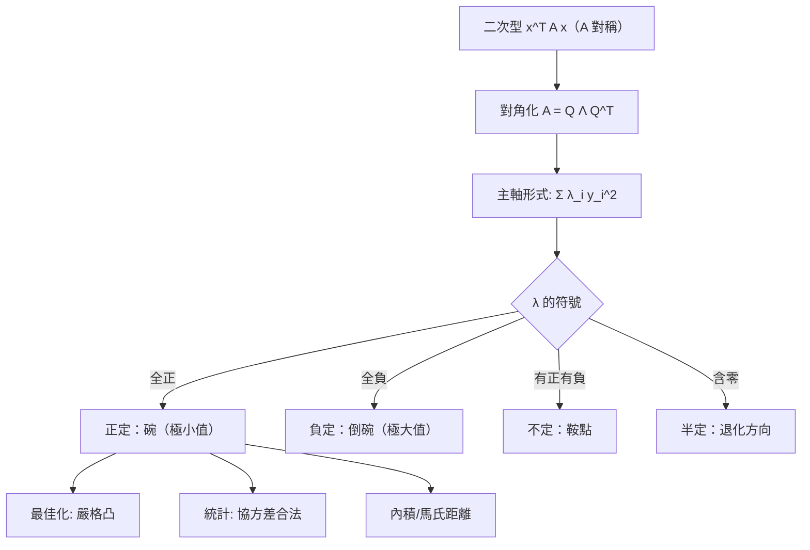

# 8.2 二次型與正定性

## 前言：用一個矩陣讀出一個曲面

$f(x, y) = 2x^2 + 4xy + 5y^2$ 這樣的純二次函數，開口朝哪、有沒有極小值、是不是「碗」——答案藏在係數矩陣的**特徵值符號**裡。**二次型**（quadratic form）是線性代數與微積分（極值判準）、統計（馬氏距離）、物理（能量）的交會點；**正定性**是它的核心分類。本節建立二次型理論、正定判準與 Sylvester 慣性定律。

## 歷史前因後果

### 從圓錐曲線到慣性定律

- 二次型的幾何源頭是阿波羅尼奧斯（Apollonius，約西元前 200 年）的圓錐曲線與十七世紀解析幾何中的二次曲面分類——「變數變換把一般二次方程化為標準形」的問題。
- **1828 年**，柯西用特徵值方法嚴格化**主軸定理**：任何實二次型可由正交變換化為 $\sum\lambda_i y_i^2$ ——係數就是特徵值。
- **1852 年**，**西爾維斯特**發表**慣性定律**（law of inertia）：合同變換下二次型正、負、零係數的**個數不變**——這三個數（慣性指標）是二次型的本質分類。證明依賴子空間維度論證，正是第 4 章的工具。
- **1855 年**，**雅可比**（Carl Jacobi）給出用主子式判定正定的準則（Sylvester 判準）。
- **1899 年**，**閔考夫斯基**（Hermann Minkowski）發展凸體與二次型的幾何；1908 年他的四維時空度規 $x^2 + y^2 + z^2 - c^2t^2$ 是「不定二次型」最著名的舞台——相對論的數學結構就是不定性 $(-,+,+,+)$ 。
- 現代：最佳化中 Hessian 正定性 ⇔ 凸性；統計中協方差正定性 ⇔ 機率密度良定義；核方法中核矩陣半正定性（Mercer 條件）。

- **解決了什麼問題**：極值分類、能量有界性、距離/內積的合法性（正定 ⇔ 真內積）。
- **引發了什麼新問題**：半正定規劃（SDP，1990 年代）把「正定約束」變成優化範式；低秩半正定矩陣補全（推薦系統）。

## 二次型：定義與矩陣表示

**定義**： $Q(\mathbf{x}) = \mathbf{x}^TA\mathbf{x} = \sum_{i,j}a_{ij}x_ix_j$ ， $A$ 取對稱（只影響對稱部分，8.1 節例 8.1-3）。

**展開**（ $2\times2$ ）：

$$
\mathbf{x}^T\begin{bmatrix} a & b \\ b & c \end{bmatrix}\mathbf{x} = ax^2 + 2bxy + cy^2
$$

交叉項係數的一半進入矩陣非對角位置——記住這個「對半」。

**主軸定理的二次型形式**：正交變換 $\mathbf{x} = Q\mathbf{y}$ 使

$$
Q(\mathbf{x}) = \mathbf{y}^T\Lambda\mathbf{y} = \lambda_1y_1^2 + \cdots + \lambda_ny_n^2
$$

**幾何**：把座標軸轉到橢球（或雙曲面）的主軸上，交叉項消失——只看 $\lambda_i$ 的符號即可分類曲面。

## 正定性：定義與判準

**定義**：對稱矩陣 $A$ （及其二次型）：

| 分類 | 條件 | 特徵值 | 幾何 |
|------|------|--------|------|
| 正定（PD） | $\mathbf{x}^TA\mathbf{x} > 0\ (\mathbf{x}\ne\mathbf{0})$ | 全 $> 0$ | 碗（橢球） |
| 半正定（PSD） | $\ge 0$ | 全 $\ge 0$ | 槽（含零方向的碗） |
| 負定 | $< 0$ | 全 $< 0$ | 倒扣的碗 |
| 不定 | 有正有負 | 有正有負 | 鞍面 |
| 半負定 | $\le 0$ | 全 $\le 0$ | 倒槽 |

**判準一（特徵值）**：看譜的符號——最直接。
**判準二（Sylvester 主子式）**： $A$ 正定 ⇔ 所有**前導主子式** $> 0$ ： $\det[a_{11}] > 0$ 、 $\det\begin{bmatrix} a_{11} & a_{12} \\ a_{21} & a_{22}\end{bmatrix} > 0$ 、……、 $\det A > 0$ 。
**判準三（分解）**： $A$ 正定 ⇔ 存在可逆 $B$ 使 $A = B^TB$ （Cholesky 分解 $A = LL^T$ ， $L$ 下三角）——數值線性代數的正定專用演算法。

**正定的等價身份**（非常重要）：

$$
A \text{ 正定} \iff \langle\mathbf{u},\mathbf{v}\rangle_A = \mathbf{u}^TA\mathbf{v} \text{ 定義內積} \iff \|A^{1/2}\mathbf{x}\| > 0
$$

——**每個正定矩陣都自帶一套幾何**（自訂的長度與角度）。協方差矩陣正是如此：馬氏距離 $d^2 = (\mathbf{x}-\boldsymbol\mu)^T\Sigma^{-1}(\mathbf{x}-\boldsymbol\mu)$ 的「橢圓等高線」由 $\Sigma$ 的譜決定。

## 微積分聯結：極值判準

多變數函數 $f$ 在臨界點 $\nabla f = \mathbf{0}$ 的 Hessian $H = \left[\frac{\partial^2f}{\partial x_i\partial x_j}\right]$ （對稱，Schwarz）：

| $H$ 在臨界點的符號 | 結論 |
|--------------------|------|
| 正定 | 嚴格**局部極小** |
| 負定 | 嚴格**局部極大** |
| 不定 | **鞍點** |
| 半定（退化） | 判準失效，需高階項 |

**泰勒展開**： $f(\mathbf{x}_0 + \mathbf{h}) \approx f(\mathbf{x}_0) + \nabla f\cdot\mathbf{h} + \frac12\mathbf{h}^TH\mathbf{h}$ ——臨界點附近 $f$ 的形狀由二次型 $\frac12\mathbf{h}^TH\mathbf{h}$ 決定，特徵值就是**各主軸方向的曲率**。8.3 節的瑞利商將給出「最大/最小曲率」的精確公式。

## 慣性定律

**定理（Sylvester，1852）**：二次型經任何可逆變換 $\mathbf{x} = C\mathbf{y}$ 化為對角形 $\sum d_iy_i^2$ 後，正係數個數 $p$ 、負係數個數 $q$ 、零係數個數 $z$ **不變**（與變換選擇無關）。三元組 $(p, q, z)$ 稱**慣性**。

**對比**：特徵值本身會隨非正交變換改變（相似性只保特徵值——但合同變換 $C^TAC$ 不保），**但符號個數永不變**。這是二次型的「拓撲不變量」。例： $Q = x^2 - y^2$ 與 $u^2 - 4v^2$ （ $x = u, y = 2v$ ）慣性同為 $(1,1,0)$ 。

## 例題

**例題 8.2-1（分類與化簡）**： $Q(x,y,z) = 2x^2 + 4xy + 5y^2 + z^2$ 。寫出矩陣、求譜、分類。

**解**：矩陣 $A = \begin{bmatrix} 2 & 2 & 0 \\ 2 & 5 & 0 \\ 0 & 0 & 1 \end{bmatrix}$ （交叉項 $4xy$ → $b = 2$ ）。塊對角： $z^2$ 塊給 $\lambda = 1$ ；上塊 $\det\begin{bmatrix} 2-\lambda & 2 \\ 2 & 5-\lambda\end{bmatrix} = \lambda^2 - 7\lambda + 6 = (\lambda-1)(\lambda-6)$ ， $\lambda = 1, 6$ 。

**譜 $\{6, 1, 1\}$ 全正 → 正定**。 $Q$ 是「碗」，原點是嚴格極小。特徵向量： $\lambda=6$ ： $(1, 2, 0)$ ； $\lambda=1$ （二重）： $(2,-1,0)$ 與 $(0,0,1)$ 。主軸形式：

$$
Q = 6y_1^2 + y_2^2 + y_3^2 \qquad (\mathbf{y} = Q^T\mathbf{x})
$$

**Sylvester 判準驗證**： $a_{11} = 2 > 0$ ； $\det\begin{bmatrix}2&2\\2&5\end{bmatrix} = 6 > 0$ ； $\det A = 6 > 0$ ✓ 正定。

**例題 8.2-2（鞍點）**： $Q(x, y) = x^2 - 4xy + y^2$ 。

**解**： $A = \begin{bmatrix} 1 & -2 \\ -2 & 1 \end{bmatrix}$ ，特徵值 $1 \pm 2 = 3, -1$ 。**不定**（ $(1,1)$ 有 $Q = 3y_1^2 - y_2^2$ ）。曲面是雙曲拋物面（馬鞍）。微積分意義：若 $Q$ 是某函數的 Hessian 二次型，臨界點為**鞍點**——神經網路損失面中大量存在（比局部極小更常見），影響優化動力學。

**例題 8.2-3（協方差與馬氏距離）**：資料的協方差 $\Sigma = \begin{bmatrix} 2 & 1 \\ 1 & 1 \end{bmatrix}$ 。判斷正定並計算點 $(2, 2)$ 的馬氏距離平方（ $\boldsymbol\mu = \mathbf{0}$ ）。

**解**： $\det = 2 - 1 = 1 > 0$ ， $a_{11} = 2 > 0$ ——正定 ✓（ $\lambda = \frac{3\pm\sqrt5}{2} > 0$ ）。

$$
d^2 = (2,2)\Sigma^{-1}(2,2)^T = (2,2)\begin{bmatrix} 1 & -1 \\ -1 & 2 \end{bmatrix}\begin{bmatrix} 2 \\ 2 \end{bmatrix} = (2,2)\begin{bmatrix} 0 \\ 2 \end{bmatrix} = 4
$$

（ $\Sigma^{-1} = \frac{1}{1}\begin{bmatrix} 1 & -1 \\ -1 & 2 \end{bmatrix}$ 。）歐氏距離平方是 $8$ ，馬氏距離只有 $4$ ——因為資料在 $(1,1)$ 方向相關性強（ $\lambda_{\max}$ 沿 $(1, \frac{\sqrt5-1}{2})$ 方向大變異），該方向的偏差「不稀奇」。**橢圓等高線 = 正定二次型；PCA = 它的軸**（9.2 節）。

## 與其他領域的關聯

- **微積分**：二階導數判準的多變數版本；凸函數 ⇔ Hessian 半正定——最佳化理論的基石。
- **統計**：協方差/相關矩陣必半正定（否則不是合法分布）；高斯過程的核函數半正定性；PCA（9.2）。
- **物理**：動能 $\frac12\mathbf{v}^TM\mathbf{v}$ 正定（質量矩陣）；勢能極小 ⇔ 剛體平衡穩定；閔考夫斯基度規的不定性。
- **機器學習**：核矩陣半正定（Mercer 定理）；正定約束出現於協方差學習、矩陣補全；牛頓法/擬牛頓法（BFGS）維護正定近似 Hessian。
- **最佳化**：半正定規劃（SDP）——「 $X \succeq 0$ 約束下的線性目標」，組合優化鬆弛（MaxCut）的現代武器。

## 本節小結

1. 二次型 $Q = \mathbf{x}^TA\mathbf{x}$ （ $A$ 對稱）由特徵值完全分類：主軸定理把 $Q$ 化為 $\sum\lambda_iy_i^2$ 。
2. 正定（譜全正 / 主子式全正 / $A = B^TB$ ）⇔ 碗形 ⇔ 可定義內積與合法協方差。
3. Hessian 的正定性是極值判準：正定極小、負定極大、不定鞍點——微積分與線性代數在此深度融合。
4. Sylvester 慣性定律（1852）：正/負/零係數個數是合同變換不變量。

**預告**：最大與最小特徵值如何「被」二次型逼出來？瑞利商 $\frac{\mathbf{x}^TA\mathbf{x}}{\mathbf{x}^T\mathbf{x}}$ 的極值理論——Courant–Fischer 極小極大原理，以及 Google 特徵值問題的變分解。見 8.3。
