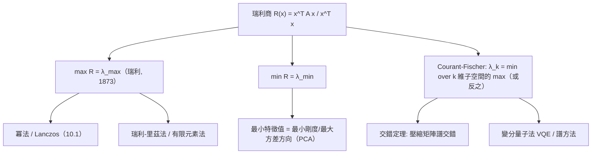

# 8.3 瑞利商與極小極大原理

## 前言：用「優化」讀出整個譜

前兩節我們「解」特徵值；本節換一種強大的視角：**特徵值是泛函的極值**。瑞利商（Rayleigh quotient）

$$
R(\mathbf{x}) = \frac{\mathbf{x}^TA\mathbf{x}}{\mathbf{x}^T\mathbf{x}}
$$

把每個方向 $\mathbf{x}$ 映成「該方向的平均特徵值」；它的最大值與最小值正是 $\lambda_{\max}$ 與 $\lambda_{\min}$ 。再深入一層，Courant–Fischer 極小極大原理用「子空間上的極值」逐個夾出所有特徵值——這是變分原理，是瑞利–里茲法、有限元素法、PCA、量子變分法（VQE）共同的思想源頭。

## 歷史前因後果

### 從聲學到變分原理

- **1873 年**，**瑞利**（John William Strutt, 3rd Baron Rayleigh, 1842–1919）在《聲學理論》中提出：系統的固有頻率可使「動能與位能之商」達到極值——瑞利商的原型。他證明了**瑞利原理**：第一特徵值是瑞利商的最小值；用「近似的」特徵函數算出的瑞利商**永遠高估**基頻的平方。
- **1870 年**，**Routh** 與稍後 **Courant–Fischer（1920）** 把逐個特徵值的變分刻畫嚴格化：**Courant–Fischer 極小極大定理**—— $\lambda_k$ 是「 $k$ 維子空間上的最大值，再對子空間取最小」。
- **1908–09 年**，**Walter Ritz**（1878–1909）把瑞利思想系統化為**瑞利–里茲法**：在有限的試探函數空間中解變分問題——有限元素法（1940–60 年代，Courant 1943 的先驅論文、Turner/Clough 1956）的直系祖先。
- **1904 年起**，希爾伯特把這套「變分特徵值」推廣到積分算子；**Weyl（1911）**證明漸近分布（Weyl 定律）——高維特徵值的統計規律，通往譜幾何（「能聽出鼓的形狀嗎？」Kac 1966）。
- **現代**：量子變分本徵解（VQE）、PageRank 的冪法收斂分析、機器學習的譜方法（InfoMax、譜聚類），全是瑞利商視角。

- **解決了什麼問題**：不用解多項式就能估計/逼近特徵值；把特徵值問題變成優化問題——可借力數值優化。
- **引發了什麼新問題**：收斂速率、子空間迭代的誤差界（Lanczos、Arnoldi，10.1 節）。

## 瑞利商

### 定義與基本性質

$$
R(\mathbf{x}) = \frac{\mathbf{x}^TA\mathbf{x}}{\mathbf{x}^T\mathbf{x}} = \frac{\langle\mathbf{x}, A\mathbf{x}\rangle}{\|\mathbf{x}\|^2}, \qquad \mathbf{x} \ne \mathbf{0}
$$

（ $A$ 對稱， $R$ 才是實值泛函。）性質：

1. **齊次**： $R(c\mathbf{x}) = R(\mathbf{x})$ ——只看方向，不看長度；
2. **特徵方向取值特徵值**： $A\mathbf{v} = \lambda\mathbf{v} \Rightarrow R(\mathbf{v}) = \lambda$ ；
3. **夾在譜之間**： $\lambda_{\min} \le R(\mathbf{x}) \le \lambda_{\max}$ 。

**證明（性質 3）**：正交對角化 $A = Q\Lambda Q^T$ ，令 $\mathbf{y} = Q^T\mathbf{x}$ （ $\|\mathbf{y}\| = \|\mathbf{x}\|$ ）：

$$
R = \frac{\sum\lambda_iy_i^2}{\sum y_i^2}
$$

——**特徵值的加權平均**（權重 $w_i = y_i^2/\|\mathbf{x}\|^2$ ， $\sum w_i = 1$ ）。加權平均必落在最小與最大權重之間。∎

### 極值定理

**定理（瑞利）**： $\displaystyle\lambda_{\max} = \max_{\mathbf{x}\ne\mathbf{0}} R(\mathbf{x})$ ，最大值在 $\lambda_{\max}$ 的特徵向量取得； $\lambda_{\min}$ 同理取最小。

**證明**：由加權平均表示， $R \le \lambda_{\max}$ （權重全在最大值方向時取等）。∎

**重要推論（瑞利原理的估算版）**：**任何**向量 $\mathbf{x}$ 的 $R(\mathbf{x})$ 都是 $\lambda_{\max}$ 的**下界**估計、 $\lambda_{\min}$ 的**上界**估計。這使得「猜一個方向、算一個商」就能**夾住**特徵值——變分法的實用靈魂。

### 梯度與迭代：冪法的理論

$R$ 的梯度：

$$
\nabla R(\mathbf{x}) = \frac{2}{\|\mathbf{x}\|^2}\left(A\mathbf{x} - R(\mathbf{x})\,\mathbf{x}\right)
$$

駐點（ $\nabla R = \mathbf{0}$ ）⇔ $A\mathbf{x} = R\mathbf{x}$ ——**臨界點恰為特徵對**。沿 $-\nabla R$ 迭代即「冪法 + 正交化」的雛形，是 Lanczos/共軛梯度法（10.1）的思想胚胎。

## Courant–Fischer 極小極大原理

**定理**：對對稱 $A$ ，特徵值排序 $\lambda_1 \ge \lambda_2 \ge \cdots \ge \lambda_n$ ：

$$
\lambda_k = \max_{\dim S = k}\ \min_{\mathbf{x}\in S,\ \mathbf{x}\ne\mathbf{0}} R(\mathbf{x}) = \min_{\dim T = n-k+1}\ \max_{\mathbf{x}\in T} R(\mathbf{x})
$$

**解讀**：第 $k$ 大特徵值 = 「在所有 $k$ 維子空間中，選一個使其內最差方向仍最好」。 $k = 1$ 時退化為瑞利定理； $k = n$ 給 $\lambda_{\min}$ 。

**強大的推論**（Cauchy 交錯定理的來源）：若 $B$ 是 $A$ 刪去一行一列（或任何壓縮），則特徵值交錯：

$$
\lambda_1(A) \ge \mu_1(B) \ge \lambda_2(A) \ge \mu_2(B) \ge \cdots
$$

**應用**：增加自由度只會把 $\lambda_{\max}$ 推高、 $\lambda_{\min}$ 推低（有限元素網格加密的收斂方向；PCA 增加主成分時變異單調不減）。

## 例題

**例題 8.3-1（瑞利商的極值）**： $A = \begin{bmatrix} 2 & 1 \\ 1 & 2 \end{bmatrix}$ （例 8.1-1， $\lambda = 3, 1$ ）。計算 $R(1, 0)$ 、 $R(1, 1)$ 、 $R(1, -1)$ 並驗證範圍。

**解**：

$$
R(1,0) = \frac{2}{1} = 2; \qquad R(1,1) = \frac{(1,1)A(1,1)^T}{2} = \frac{(1,1)(3,3)^T}{2} = \frac{6}{2} = 3; \qquad R(1,-1) = \frac{(1,-1)(1,-1)^T}{2} = \frac{2}{2} = 1
$$

驗證： $1 \le R \le 3$ ✓； $R(1,1) = 3 = \lambda_{\max}$ （ $(1,1)$ 是 $\lambda_{\max}$ 特徵向量）✓； $R(1,-1) = 1 = \lambda_{\min}$ ✓。 $R(1,0) = 2$ 是「平均」—— $A(1,0) = (2,1)$ 偏向特徵方向 $(1,1)$ ，故商落在中間。**用任意向量即可夾譜**： $1 \le R(1,0) = 2 \le 3$ 。

**例題 8.3-2（用瑞利商逼近特徵值）**： $A = \begin{bmatrix} 4 & 1 \\ 1 & 2 \end{bmatrix}$ （真譜： $\lambda = \frac{6 \pm \sqrt{4+4}}{2}\cdot$ ？——特徵方程 $\lambda^2 - 6\lambda + 7 = 0$ ， $\lambda = 3 \pm \sqrt2$ ，即 $\lambda_{\max} \approx 4.414$ ， $\lambda_{\min} \approx 1.586$ ）。取試探向量 $\mathbf{x} = (1, 0.4)$ 計算瑞利商。

**解**： $A\mathbf{x} = (4 + 0.4,\ 1 + 0.8) = (4.4, 1.8)$ 。

$$
\mathbf{x}^TA\mathbf{x} = 1\cdot4.4 + 0.4\cdot1.8 = 5.12; \qquad \mathbf{x}^T\mathbf{x} = 1 + 0.16 = 1.16
$$

$$
R = \frac{5.12}{1.16} \approx 4.414 \text{？驗算: } 5.12/1.16 = 4.4138\ldots
$$

（ $5.12 / 1.16 = 4.4138$ ，與 $\lambda_{\max} = 3 + \sqrt2 \approx 4.4142$ 驚人接近！）——因為 $(1, 0.4)$ 已相當接近 $\lambda_{\max}$ 的特徵向量 $(1, \frac{\sqrt2-2}{1})$ ？特徵向量： $(A - \lambda I)\mathbf{v} = \mathbf{0}$ ， $\lambda = 3+\sqrt2$ ： $(1-\sqrt2)v_1 + v_2 = 0 \Rightarrow v_2 = (\sqrt2-1)v_1 \approx 0.414v_1$ 。試探向量 $(1, 0.4)$ 偏差僅 $3\%$ ，瑞利商的誤差是**二階**的（在特徵向量附近 $\Delta R = O(\|\Delta\mathbf{x}\|^2)$ ）——**這是變分法「超線性收斂」的秘密**。

**例題 8.3-3（交錯定理驗證）**： $A = \begin{bmatrix} 2 & 1 & 0 \\ 1 & 2 & 1 \\ 0 & 1 & 2 \end{bmatrix}$ ，刪去最後行列得 $B = \begin{bmatrix} 2 & 1 \\ 1 & 2 \end{bmatrix}$ 。驗證交錯。

**解**： $A$ 的特徵值（三對角 Toeplitz）： $\lambda_k = 2 + 2\cos\frac{k\pi}{4}$ ： $k=1$ ： $2+\sqrt2 \approx 3.414$ ； $k=2$ ： $2$ ； $k=3$ ： $2-\sqrt2 \approx 0.586$ 。 $B$ 的譜： $3, 1$ 。

交錯檢查： $3.414 \ge 3 \ge 2 \ge 1 \ge 0.586$ ✓ 完美成立。

**例題 8.3-4（PCA 觀點）**：對稱 $A$ 的 $\lambda_{\max}$ 特徵向量 = 「 $A$ 下最會被拉伸的方向」；對協方差矩陣 $\Sigma$ ，瑞利商

$$
R(\mathbf{u}) = \mathbf{u}^T\Sigma\mathbf{u} = \mathrm{Var}(\mathbf{u}^T\mathbf{x})
$$

——**沿方向 $\mathbf{u}$ 的資料變異數**。最大化 $R$ 的 $\mathbf{u}$ 就是**第一主成分**（最大變異方向）。 $\lambda_{\max}$ = 該方向的變異量。**瑞利商把 PCA 變成一句話：找變異數最大的投影方向**——9.2 節的序章。

## 與其他領域的關聯

- **微積分**：瑞利商是「廣義特徵值的 Lagrange 乘子」：約束 $\|\mathbf{x}\| = 1$ 下最大化 $\mathbf{x}^TA\mathbf{x}$ ，Lagrange 條件恰好 $A\mathbf{x} = \lambda\mathbf{x}$ ——**特徵值問題 = 約束優化**。
- **微分方程／物理**：瑞利–里茲法與有限元素法把 PDE 特徵值問題（膜振動、量子基態）化為矩陣特徵值；瑞利原理保證網格加密時頻率單調收斂。
- **量子力學**：變分原理——任何試探波函數的能量期望值 $\ge$ 真基態能量 $E_0$ （氦原子的 Chandrasekhar/黃昆估算）；VQE 量子演算法直接最佳化瑞利商。
- **統計／機器學習**：PCA（9.2）、譜聚類、典型相關分析（CCA）都是廣義瑞利商 $\max\frac{\mathbf{u}^TA\mathbf{u}}{\mathbf{u}^TB\mathbf{u}}$ ；圖論的 Fiedler 向量（ $\lambda_2$ 的特徵向量）切割圖。
- **數值分析**：Lanczos 用 Krylov 子空間上的瑞利–里茲提取極值特徵值——大規模科學計算（10.1）的引擎。

## 本節小結

1. 瑞利商 $R(\mathbf{x}) = \frac{\mathbf{x}^TA\mathbf{x}}{\mathbf{x}^T\mathbf{x}}$ 是「方向的平均特徵值」，恆夾在 $\lambda_{\min}$ 與 $\lambda_{\max}$ 之間；極值在特徵向量處取得（Rayleigh 1873）。
2. Courant–Fischer 極小極大定理用子空間逐個刻畫所有特徵值；推論交錯定理。
3. 瑞利商在特徵向量附近誤差為二階——試探方向的小偏差換來高精度估值（變分法效率之謎）。
4. 變分視角把特徵值問題變成優化問題：冪法、Lanczos、有限元素、PCA、VQE 共享同一思想。

**預告**：對稱矩陣的譜理論已完備；但「非方陣」呢？資料矩陣 $X$ （ $m$ 樣本 × $n$ 特徵）不是方陣，卻最需要分解。**奇異值分解（SVD）**——把對稱譜理論推廣到一切矩陣——見 9.1。
