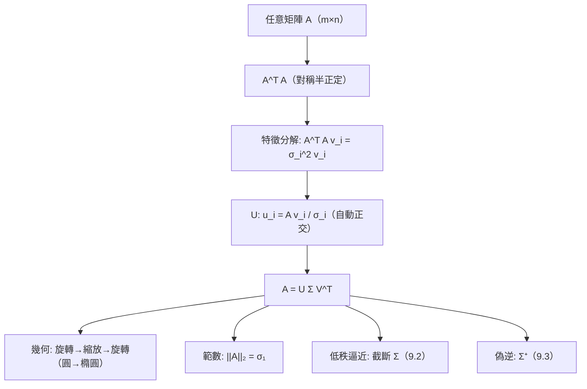

# 9.1 SVD：萬能分解

## 前言：任何矩陣都能「對角化」

特徵值分解要求方陣、甚至（最好）對稱；但資料矩陣是 $m\times n$ 長方形——10 億用戶 × 2 萬部電影的評分矩陣不會是方陣。**奇異值分解**（Singular Value Decomposition, SVD）填補這個缺口：**任何**實矩陣都有分解 $A = U\Sigma V^T$，其中 $U, V$ 正交、$\Sigma$ 對角非負。奇異值是「廣義特徵值」：$\sigma_i^2$ 是 $A^TA$（對稱半正定）的特徵值。SVD 是線性代數的皇冠——幾何、代數、統計、數值計算在此會師。

## 歷史前因後果

### 三位發現者與一個世紀的等待

- **1873 年**，**貝爾特拉米**（Eugenio Beltrami, 1835–1900）為研究雙線性形式首先給出（方陣的）奇異值分解。
- **1874 年**，**若爾當**（Camille Jordan，即 5.2 節那位）獨立推廣到任意方陣。
- **1936 年**，**埃卡特**（Carl Eckart, 1902–1973）與**揚**（Gale Young）在地球物理論文中把 SVD 推廣到**長方形矩陣**並連接低秩逼近（即 Eckart–Young 定理，9.2 節）——但學界反應冷淡。
- **1965 年**，**戈盧布**（Gene Golub, 1932–2007）與 Kahan 發展出數值穩定的 SVD 演算法（Golub–Reinsch 1970 版），SVD 從理論珍品變成計算主力。Golub 常被稱為「SVD 的推銷員」——他讓整個科學計算界相信：**先做 SVD，再想問題**。
- **應用爆發**：Karhunen–Loève 變換（統計，1940s）= PCA = SVD；影像壓縮（JPEG 的理論近親）、隱含語意索引（LSA, 1988）、推薦系統、Google 的 HITS、量子資訊的 Schmidt 分解——SVD 無所不在。

- **解決了什麼問題**：長方形矩陣的「譜」；任意矩陣的幾何完全刻畫；最佳低秩逼近的唯一解。
- **引發了什麼新問題**：大規模 SVD 的計算（隨機化 SVD，2006 年後）；秩選擇（奇異值斷崖）；隱私與穩定性。

## SVD 的定理與構造

### 主定理

**定理**：任何 $m\times n$ 實矩陣 $A$（秩 $r$）可分解為

$$
A = U\Sigma V^T = \sum_{i=1}^{r}\sigma_i\,\mathbf{u}_i\mathbf{v}_i^T
$$

其中 $U$（$m\times m$）、$V$（$n\times n$）正交，$\Sigma$ 對角且

$$
\sigma_1 \ge \sigma_2 \ge \cdots \ge \sigma_r > 0 = \cdots
$$

$\sigma_i$ 稱**奇異值**，$\mathbf{u}_i$ 稱左奇異向量，$\mathbf{v}_i$ 稱右奇異向量。

### 與 $A^TA$ 的關係（構造的鑰匙）

**關鍵事實**：$A^TA$ 對稱半正定，故可正交對角化（第 8 章）：

$$
A^TA\mathbf{v}_i = \sigma_i^2\mathbf{v}_i \qquad (\sigma_i = \sqrt{\text{特徵值}} \ge 0)
$$

左奇異向量：$\mathbf{u}_i = \frac{A\mathbf{v}_i}{\sigma_i}$（自動正交歸一——驗證：$\langle\mathbf{u}_i,\mathbf{u}_j\rangle = \frac{\mathbf{v}_i^TA^TA\mathbf{v}_j}{\sigma_i\sigma_j} = \frac{\sigma_j^2}{\sigma_i\sigma_j}\langle\mathbf{v}_i,\mathbf{v}_j\rangle = \delta_{ij}$ ✓）。

**關係總表**：

| 關係 | 公式 |
|------|------|
| 右奇異向量 | $A^TA$ 的特徵向量（$V$） |
| 左奇異向量 | $AA^T$ 的特徵向量（$U$） |
| 奇異值 | $A^TA$ 與 $AA^T$ 共享，$= \sqrt{\lambda}$ |
| 對稱矩陣特例 | $A = A^T$ 時 $U = V$、$\sigma_i = |\lambda_i|$ |
| 範數 | $\|A\|_2 = \sigma_1$（最大拉伸率）；$\|A\|_F^2 = \sum\sigma_i^2$ |
| 秩 | $r = $ 非零奇異值個數 |
| 行列式（方陣） | $|\det A| = \prod\sigma_i$ |

### 幾何：SVD 是「三步走」的變換

$$
A = U\Sigma V^T: \quad \text{旋轉/反射 } V^T \to \text{沿主軸縮放 } \Sigma \to \text{旋轉/反射 } U
$$

**任何線性變換 = 旋轉 + 軸對齊縮放 + 旋轉**。單位圓被映成橢圓（可能在高維退化）——半軸長 $\sigma_i$、主軸方向 $\mathbf{u}_i$。**這是 3.3 節「行列式＝體積」與 8.1 節「主軸定理」的完全推廣**：$\det = 0$ 的「壓扁」現在被量化為小奇異值。

## SVD 的四大身份

| 身份 | 內容 | 應用 |
|------|------|------|
| 幾何分解 | 旋轉–縮放–旋轉 | 電腦視覺（Procrustes、姿態估計） |
| 譜推廣 | $\sigma_i^2$ = $A^TA$ 特徵值 | PCA、白化 |
| 最佳逼近 | 截斷 SVD = 最佳低秩（9.2） | 壓縮、去噪、推薦 |
| 求解工具 | 偽逆 $A^+ = V\Sigma^+U^T$（9.3） | 最小平方、病態系統 |

## 例題

**例題 9.1-1（完整計算 2×2 的 SVD）**：$A = \begin{bmatrix} 3 & 0 \\ 0 & 2 \end{bmatrix}$ 太簡單；取 $A = \begin{bmatrix} 4 & 0 \\ 3 & 0 \end{bmatrix}$（秩 1）。

**解**：$A^TA = \begin{bmatrix} 4 & 3 \\ 0 & 0 \end{bmatrix}\begin{bmatrix} 4 & 0 \\ 3 & 0 \end{bmatrix} = \begin{bmatrix} 25 & 0 \\ 0 & 0 \end{bmatrix}$。特徵值 $25, 0$ → $\sigma_1 = 5$，秩 1。

右奇異向量：$\mathbf{v}_1 = (1, 0)$（$\lambda = 25$）、$\mathbf{v}_2 = (0, 1)$（$\lambda = 0$）。

左奇異向量：$\mathbf{u}_1 = \frac{A\mathbf{v}_1}{\sigma_1} = \frac{(4, 3)}{5} = (\frac45, \frac35)$。$\mathbf{u}_2$ 取其正交補：$(-\frac35, \frac45)$。

$$
A = U\Sigma V^T = \begin{bmatrix} \tfrac45 & -\tfrac35 \\ \tfrac35 & \tfrac45 \end{bmatrix}\begin{bmatrix} 5 & 0 \\ 0 & 0 \end{bmatrix}\begin{bmatrix} 1 & 0 \\ 0 & 1 \end{bmatrix}
$$

**驗證**：$U\Sigma = \begin{bmatrix} 4 & 0 \\ 3 & 0 \end{bmatrix}$，乘 $V^T = I$ 得 $A$ ✓。

**幾何**：$A$ 把單位圓壓成一條線段——沿方向 $\mathbf{u}_1 = (\frac45,\frac35)$、長 $2\sigma_1 = 10$ 的線段（$V = I$ 表示輸入不需旋轉）。$\sigma_2 = 0$：一個方向被完全殲滅——**奇異矩陣的 SVD 讀法：有零奇異值**。

**例題 9.1-2（對稱矩陣的 SVD 與特徵值）**：$A = \begin{bmatrix} 2 & 1 \\ 1 & 2 \end{bmatrix}$（例 8.1-1，$\lambda = 3, 1$）。

**解**：$A^TA = A^2 = \begin{bmatrix} 5 & 4 \\ 4 & 5 \end{bmatrix}$，特徵值 $9, 1$ → $\sigma = 3, 1 = |\lambda|$ ✓。$U = V = \frac{1}{\sqrt2}\begin{bmatrix} 1 & 1 \\ 1 & -1 \end{bmatrix}$，$\Sigma = \mathrm{diag}(3, 1)$。

**比較**：特徵分解 $A = Q\Lambda Q^T$ 帶符號（$\lambda$ 可負）；SVD 帶絕對值（$\sigma \ge 0$）但兩邊旋轉不同。**對稱矩陣的 SVD = 特徵分解的「無符號版」**。

**例題 9.1-3（SVD 讀矩陣：四大子空間）**：從 $A = U\Sigma V^T$（秩 $r$）讀出 4.3 節的四大子空間：

| 子空間 | 基底 | 維度 |
|--------|------|------|
| $\mathrm{Col}(A)$ | $\mathbf{u}_1, \dots, \mathbf{u}_r$ | $r$ |
| $\mathrm{Null}(A)$ | $\mathbf{v}_{r+1}, \dots, \mathbf{v}_n$ | $n - r$ |
| $\mathrm{Row}(A)$ | $\mathbf{v}_1, \dots, \mathbf{v}_r$ | $r$ |
| $\mathrm{Null}(A^T)$ | $\mathbf{u}_{r+1}, \dots, \mathbf{u}_m$ | $m - r$ |

**驗證（例 9.1-1 的 $A$）**：$\mathrm{Col}(A) = \mathrm{span}\{(\frac45,\frac35)\}$（檢查：$(4,3) = 5(\frac45,\frac35)$ ✓）；$\mathrm{Null}(A) = \mathrm{span}\{(0,1)\}$ ✓（$A(0,1) = \mathbf{0}$）。**SVD 同時給出所有子空間的正交歸一基——一次分解，全圖盡收**。

## 量子資訊的 Schmidt 分解

純量子態 $\psi \in \mathbb{C}^m \otimes \mathbb{C}^n$ 的係數矩陣 $A$ 做 SVD：$\psi = \sum_i\sigma_i\,\mathbf{u}_i\otimes\mathbf{v}_i$（**Schmidt 分解**）。非零奇異值個數（Schmidt 秩）：

- $= 1$：可分離態（無糾纏）；
- $\ge 2$：**糾纏態**；$\sigma_i^2$ 是測量子系統的機率分布。

**糾纏的度量（Schmidt 數）就是矩陣的秩**——SVD 讓「量子糾纏」成為可計算的線性代數量。貝爾態 $(|00\rangle + |11\rangle)/\sqrt2$ 的係數矩陣 $\frac12\begin{bmatrix}1&0\\0&1\end{bmatrix}$ 有兩個相等奇異值 $\frac{1}{\sqrt2}$——最大糾纏。

## 與其他領域的關聯

- **統計／機器學習**：PCA = 資料矩陣的 SVD（9.2）；推薦系統的矩陣補全（Netflix 獎）；詞向量的 LSA。
- **電腦視覺**：影像配準（Kabsch/Procrustes 問題：求旋轉矩陣最佳對齊——解在 SVD 中）；本質矩陣估計。
- **數值計算**：SVD 求解各種最小平方、總最小平方；條件數 $\kappa = \sigma_1/\sigma_n$（9.3）。
- **訊號處理**：濾波器組、陣列訊號（MUSIC 演算法用奇異向量子空間分離訊號與噪聲）。
- **微積分／幾何**：微分同胚的變形分析（形變梯度的奇異值 = 局部拉伸比）；連續介質力學的應變橢球。

## 本節小結

1. SVD $A = U\Sigma V^T$ 對**任何**矩陣成立：奇異值 = $A^TA$ 特徵值的平方根（Beltrami 1873、Eckart–Young 1936、Golub 1965）。
2. 幾何：任意線性變換 = 旋轉 + 主軸縮放 + 旋轉；$\sigma_1$ 是最大拉伸、$\sigma_1/\sigma_n$ 是條件數。
3. SVD 一次給出秩、四大子空間正交基、2-範數、Frobenius 範數、偽逆的全部材料。
4. 對稱矩陣的 SVD 是特徵分解的無符號版；量子糾纏的 Schmidt 分解就是 SVD。

**預告**：丟掉小的奇異值，得到「最好的低秩近似」——Eckart–Young 定理、影像壓縮與主成分分析（PCA）。見 9.2。
