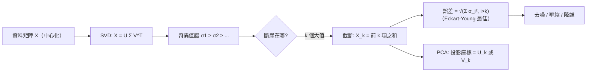

# 9.2 低秩逼近與 PCA

## 前言：資料的核心維度

一千萬筆客戶資料有 500 個特徵，但真正「活著」的方向可能只有 10 個——剩下的都是噪聲與冗餘。**低秩逼近**（low-rank approximation）回答：用秩 $k$ 的矩陣最接近原矩陣，能好到什麼程度？答案由 SVD 一錘定音（Eckart–Young 定理）。**主成分分析**（PCA）是它在統計學的化身：把資料旋轉到「變異最大」的方向，保留前幾個——資料科學最常用的降維技術。本節建立理論並完成影像壓縮與 PCA 的實作演練。

## 歷史前因後果

### 三條路，同一個山頂

- **1901 年**，**皮爾森**（Karl Pearson, 1857–1936）提出「在最小平方意義下找直線與平面最佳擬合點集」——PCA 的統計起源。
- **1933 年**，**Hotelling**（Harold Hotelling, 1895–1973）獨立發展「主成分分析法」，以變異數最大化表述——名稱由此而定。
- 同一時期的**Karhunen–Loève 變換**（隨機過程的正交展開，1940s）在訊號處理獨立重現同一數學；影像處理稱 **Hotelling 變換**或 KL 變換。
- **1936 年**，**Eckart–Young 定理**：截斷 SVD 是 Frobenius 範數下的**最佳**低秩逼近（後由 Mirsky 1960 推廣到所有酉不變範數）——「最佳性」從此有唯一解。
- **應用史**：1970–80 年代影像壓縮與氣象資料（EOF 分析）；1988 年 Deerwester 等的**隱含語意分析**（LSA）把 SVD 帶進文字探勘；2006 年 **Netflix 獎**讓矩陣補全（低秩 + 缺值）成為顯學；2010 年代**隨機化 SVD**（Halko–Martinsson–Tropp 2011）使十億級資料可算。

- **解決了什麼問題**：降維、去噪、壓縮、特徵提取——「用更少的數字保存更多資訊」。
- **引發了什麼新問題**：非線性結構（流形學習 t-SNE、UMAP）；解釋性（成分不代表單一特徵）；隱私（重構攻擊）。

## Eckart–Young 定理

**定理**：設 $A$ 的 SVD 為 $A = \sum_{i=1}^{r}\sigma_i\mathbf{u}_i\mathbf{v}_i^T$，秩 $r$。對 $k < r$，定義

$$
A_k = \sum_{i=1}^{k}\sigma_i\mathbf{u}_i\mathbf{v}_i^T \quad (\text{截斷 SVD，秩 } k)
$$

則在所有秩 $\le k$ 的矩陣 $B$ 中，$A_k$ 最小化 $\|A - B\|_F$（也最小化 $\|A - B\|_2$），且

$$
\|A - A_k\|_F = \sqrt{\sigma_{k+1}^2 + \cdots + \sigma_r^2}, \qquad \|A - A_k\|_2 = \sigma_{k+1}
$$

**意義**：誤差恰好是「丟掉的奇異值」——**奇異值序列就是逼近價值表**。若譜有明顯斷崖（$\sigma_{k+1}$ 遠小於 $\sigma_k$），$k$ 就是天然的「本質維度」。

**能量比例**：$\frac{\sum_{i=1}^k\sigma_i^2}{\sum_i\sigma_i^2}$ = 前 $k$ 個成分保留的「能量」（變異）比例。

## PCA：統計學的 SVD

### 標準流程

給定資料矩陣 $X$（$m$ 筆樣本 × $n$ 個特徵，或其轉置，本書取列為樣本）：

1. **中心化**：每個特徵減去平均值（$\tilde{X} = X - \bar{\mathbf{x}}\mathbf{1}^T$）；
2. **（可選）標準化**：除以標準差（特徵尺度不同時）；
3. **SVD**：$\tilde{X} = U\Sigma V^T$；
4. **主成分**：$V$ 的行（右奇異向量）= 主軸方向；投影座標 = $\tilde{X}V = U\Sigma$；
5. **解釋變異**：第 $i$ 主成分的變異 $= \frac{\sigma_i^2}{m - 1}$。

**與協方差的關係**：樣本協方差 $S = \frac{1}{m-1}\tilde{X}^T\tilde{X} = \frac{1}{m-1}V\Sigma^2V^T$——**PCA = 協方差矩陣的特徵分解 = 資料矩陣的 SVD**（8.3 節瑞利商觀點：第一主成分 = 變異數最大的方向）。

### 為什麼「變異最大」？

統計理由：變異 = 資訊量（熵的代理）；低變異方向近似常數，可捨棄。幾何理由：投影後的重構誤差 = 被丟掉的變異——**最大化保留變異 ⇔ 最小化重構誤差**（兩種動機，同一答案；皮爾森的幾何動機與 Hotelling 的變異動機殊途同歸）。

## 例題

**例題 9.2-1（手算小 PCA）**：四筆二維資料：$(0,0), (2,0), (0,2), (2,2)$。求第一主成分。

**解**：中心化（均值 $(1,1)$）：$(-1,-1), (1,-1), (-1,1), (1,1)$。資料矩陣（列為樣本）：

$$
\tilde{X} = \begin{bmatrix} -1 & -1 \\ 1 & -1 \\ -1 & 1 \\ 1 & 1 \end{bmatrix}, \qquad \tilde{X}^T\tilde{X} = \begin{bmatrix} 4 & 0 \\ 0 & 4 \end{bmatrix}
$$

協方差 $S = \frac{4}{3}I$——**各方向變異相同**（完美對稱的資料），沒有主導方向。這提醒我們：**PCA 的意義取決於資料的各向異性**。改資料為 $(0,0), (2,0.2), (1,0.6), (3,0.8)$？為保持手算簡潔，取 $(0,0), (2,1), (4,2), (6,3)$（完全共線！）：中心化後 $( -3, -\frac32), (-1, -\frac12), (1, \frac12), (3, \frac32)$：

$$
\tilde{X}^T\tilde{X} = \begin{bmatrix} 20 & 10 \\ 10 & 5 \end{bmatrix} = 25\begin{bmatrix} 0.8 & 0.4 \\ 0.4 & 0.2 \end{bmatrix}
$$

特徵值：$\lambda = 25(1)\cdot$？——$\det\begin{bmatrix} 20-\lambda & 10 \\ 10 & 5-\lambda \end{bmatrix} = \lambda^2 - 25\lambda = \lambda(\lambda - 25)$，$\lambda = 25, 0$。$\sigma = 5, 0$——**秩 1**（資料共線，必然）。第一主成分（$\lambda = 25$）：$(20-25)v_1 + 10v_2 = 0 \Rightarrow v_2 = \frac12 v_1$，方向 $(2, 1)$——正是資料所在直線 $y = x/2$ ✓。第二奇異值為 0：資料本質上是一維的。

**例題 9.2-2（低秩逼近與誤差）**：$A = \begin{bmatrix} 3 & 0 \\ 0 & 2 \\ 0 & 0 \end{bmatrix}$（$\sigma = 3, 2$，秩 2）。求最佳秩 1 逼近及其誤差。

**解**：$A_1 = \sigma_1\mathbf{u}_1\mathbf{v}_1^T = 3\begin{bmatrix} 1 \\ 0 \\ 0\end{bmatrix}\begin{bmatrix} 1 & 0 \end{bmatrix} = \begin{bmatrix} 3 & 0 \\ 0 & 0 \\ 0 & 0 \end{bmatrix}$。

誤差（Eckart–Young）：$\|A - A_1\|_2 = \sigma_2 = 2$；$\|A - A_1\|_F = 2$。

**若不用截斷 SVD 而亂砍**，例如 $B = \begin{bmatrix} 3 & 0 \\ 0 & 0 \\ 0 & 0 \end{bmatrix}$ 恰好同為秩 1（本例湊巧最優）；但取 $B' = \begin{bmatrix} 3 & 0 \\ 1 & 0 \\ 0 & 0 \end{bmatrix}$（秩 1）：$\|A - B'\|_F^2 = 1 + 4 = 5 > 4 = \sigma_2^2$——**比最佳解差**，印證截斷 SVD 的最優性。

**例題 9.2-3（影像壓縮的算術）**：一張 $1000\times1000$ 灰階影像 $= 10^6$ 個像素。用秩 $k$ 逼近需儲存：$U_k$（$1000\times k$）+ $\Sigma_k$（$k$ 個數）+ $V_k$（$1000\times k$）$= 2000k + k$ 個數。

| $k$ | 儲存量 | 壓縮比 | 保留能量（假設譜快速衰減） |
|-----|--------|--------|------------------------------|
| 1000（原始） | $10^6$ | 1:1 | 100% |
| 50 | $100{,}050$ | ~10:1 | 視譜而定 |
| 20 | $40{,}020$ | ~25:1 | |

**判準**：若奇異值譜在第 20 個後斷崖（$\sigma_{21}$ 之後可忽略），壓縮 25 倍仍幾乎無損。真實照片的譜通常緩慢衰減（人臉等特定類別資料則快速——「eigenfaces」方法， Turk & Pentland 1991）。

**例題 9.2-4（PCA 去噪）**：訊號矩陣 $X = X_{\text{true}} + N$，$X_{\text{true}}$ 秩 3、$N$ 是小噪聲（各方向均勻）。$X$ 的奇異值：前 3 個大（訊號），其後是噪聲的「地板」（數量級相同、緩慢下降）。取 $X_3$：訊號保留、噪聲平均掉——**截斷 SVD 的去噪原理**。隨機矩陣理論（Marchenko–Pastur 分布，1967）提供噪聲地板的理論位置，用於自動選 $k$。

## 與其他領域的關聯

- **統計**：PCA 之於相關結構；因子分析、多重對應分析的近親；迴歸中的主成分迴歸（PCR）對抗共線性。
- **機器學習**：特徵降維加速訓練；自編碼器（autoencoder）是「非線性 PCA」；譜聚類用圖拉普拉斯的低秩特徵向量。
- **影像／訊號**：JPEG（DCT 壓縮）與 SVD 壓縮同屬「變換編碼」；陣列訊號處理的子空間法。
- **推薦系統**：用戶–物品矩陣低秩假設（口味由少數因子決定）；Netflix 獎（2006–09）的矩陣補全理論（Candès–Recht 2009：欠採樣也能唯一補全，條件是低秩與不變性）。
- **量子力學**：Schmidt 截斷 = 保留最大奇異值項——量子模擬中的 DMRG 演算法（1992）核心操作。

## 本節小結

1. Eckart–Young：截斷 SVD 是最佳低秩逼近；誤差 = 丟棄的奇異值（Frobenius：平方和開根；2-範數：首項）。
2. 奇異值譜是資料的「能譜」：斷崖處即本質維度；能量比例決定保留多少成分。
3. PCA = 中心化 + SVD：主成分是協方差的特徵向量；「變異最大」與「重構誤差最小」是同一件事。
4. 應用鏈：壓縮、去噪、降維、推薦、eigenfaces——低秩是現代資料科學的默認假設。

**預告**：當矩陣病態（$\sigma_{\min}$ 趨近 0）或不可逆時，最小平方怎麼辦？**偽逆** $A^+ = V\Sigma^+U^T$ 與條件數理論——數值計算的生死線。見 9.3。
