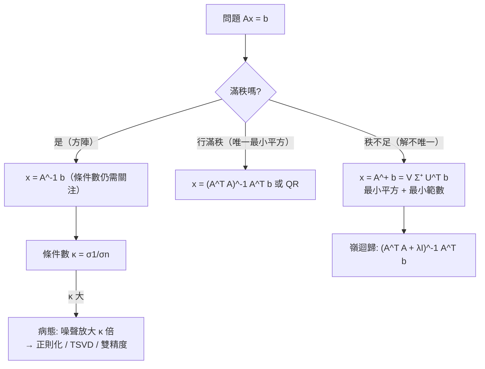

# 9.3 偽逆與病態問題

## 前言：當「逆」不存在或「存在卻危險」

兩種困境：(1) 矩陣不可逆（秩不足）——最小平方的解不唯一，如何選一個「最合理」的？(2) 矩陣可逆但 $\det$ 極小——理論上有解，數值上誤差被放大成災難（**病態**）。**偽逆**（Moore–Penrose pseudoinverse）解決前者：給每個矩陣一個「廣義逆」，給出最小範數的最小平方解。**條件數** $\kappa = \sigma_1/\sigma_{\min}$ 量化後者。本節是整本書「理論 vs. 浮點現實」的交會點，通往第 10 章數值線性代數。

## 歷史前因後果

### 從摩爾到彭若斯到 Tikhonov

- **1920 年**，美國數學家**摩爾**（Eliakim Hastings Moore, 1862–1932）在一般雙線性形式的語言中定義了「廣義逆」——超前時代，幾乎無人使用。
- **1955 年**，**彭若斯**（Roger Penrose, 1931–，2020 年諾貝爾物理獎得主）以四條優雅的代數條件重新發現並唯一刻畫偽逆——現在稱 Moore–Penrose 偽逆。同年 Bjerhammar 亦獨立提出。
- **1965 年**，Golub 把 SVD 引入偽逆計算： $A^+ = V\Sigma^+U^T$ ，其中 $\Sigma^+$ 把非零奇異值換成倒數、零保持為零——**數值上「用容差把小奇異值視為零」成為標準做法**（截斷 SVD / TSVD）。
- **病態問題的警告**：**馮紐曼與哥德斯坦**（1947）分析高斯消去的誤差，引入現代「條件數」概念；**圖靈**（1948）幾乎同時獨立定義。**Hilbert 矩陣**（1894，希爾伯特在積分方程中提出）成為病態的標準教材。
- **正則化**：**吉洪諾夫**（Andrey Tikhonov, 1906–1994，1963）提出以 $\lambda\|x\|^2$ 懲罰病態解（嶺迴歸，Hoerl–Kennard 1970 在統計中獨立提出）——「犧牲一點擬合，換取穩定」。

- **解決了什麼問題**：秩不足系統的唯一化（最小範數解）；病態系統的穩定求解。
- **引發了什麼新問題**：截斷閾值怎麼選（噪聲地板）？正則化參數 $\lambda$ 怎麼選（L-curve、交叉驗證）？

## Moore–Penrose 偽逆

### 定義與四條件

**定義**： $A^+$ 是唯一滿足下列四條的矩陣：

1. $AA^+A = A$
2. $A^+AA^+ = A^+$
3. $(AA^+)^T = AA^+$ （ $AA^+$ 對稱）
4. $(A^+A)^T = A^+A$ （ $A^+A$ 對稱）

**SVD 公式**： $A = U\Sigma V^T$ 時

$$
A^+ = V\Sigma^+U^T, \qquad \Sigma^+: \frac{1}{\sigma_i}\ (\sigma_i > 0),\ 0\ (\sigma_i = 0)
$$

**性質對照表**：

| 情況 | 逆 / 偽逆 |
|------|-----------|
| 方陣滿秩 | $A^+ = A^{-1}$ （退回普通逆） |
| 長方滿列秩 | $A^+ = A^T(AA^T)^{-1}$ （最小範數解之母） |
| 長方滿行秩 | $A^+ = (A^TA)^{-1}A^T$ （最小平方解之母） |
| 秩不足 | 只有 SVD 公式可靠（其他形式含 $(A^TA)^{-1}$ 會爆炸） |

### 偽逆解的兩個最優性

對 $A\mathbf{x} = \mathbf{b}$ ：

$$
\hat{\mathbf{x}} = A^+\mathbf{b}
$$

1. **最小平方**： $\|A\hat{\mathbf{x}} - \mathbf{b}\|$ 最小（解一致時誤差為 0）；
2. **最小範數**：在所有最小平方解中， $\|\hat{\mathbf{x}}\|$ 最小。

**幾何**：解集 = 特解 + $\ker A$ （5.3 節）；偽逆選**離原點最近**的那一個（正交投影到 $\ker A$ 的補空間）。這是「最不武斷」的解——不引入任何偏好的多餘分量。

## 條件數：誤差放大器

### 定義與主定理

$$
\kappa(A) = \|A\|\,\|A^{-1}\| = \frac{\sigma_1}{\sigma_{\min}} \quad (\text{2-範數，方陣滿秩})
$$

長方形矩陣用 $\sigma_1/\sigma_r$ （ $r$ 為秩）。

**定理（誤差放大）**：解 $A\mathbf{x} = \mathbf{b}$ 時， $\mathbf{b}$ 的相對誤差被放大至多 $\kappa$ 倍：

$$
\frac{\|\Delta\mathbf{x}\|}{\|\mathbf{x}\|} \le \kappa(A)\,\frac{\|\Delta\mathbf{b}\|}{\|\mathbf{b}\|}
$$

係數的相對誤差同理（稍弱的界）。** $\kappa = 10^8$ 時，雙精度（相對誤差 $\sim10^{-16}$ ）的計算可能只剩 8 位有效數字。**

### 標準病態標本：Hilbert 矩陣

$$
H_{ij} = \frac{1}{i + j - 1}, \qquad H_4 = \begin{bmatrix} 1 & \frac12 & \frac13 & \frac14 \\ \frac12 & \frac13 & \frac14 & \frac15 \\ \frac13 & \frac14 & \frac15 & \frac16 \\ \frac14 & \frac15 & \frac16 & \frac17 \end{bmatrix}
$$

| $n$ | $\kappa(H_n)$ | 雙精度有效位數 |
|-----|----------------|----------------|
| 3 | $5.2\times10^2$ | ~14 |
| 5 | $4.8\times10^5$ | ~11 |
| 8 | $1.5\times10^{10}$ | ~6 |
| 10 | $1.6\times10^{13}$ | ~3 |
| 12 | $1.7\times10^{16}$ | ~0（全毀） |

Hilbert 矩陣是「多項式擬合等距資料」的正規矩陣——**高階多項式擬合天生病態**，這是數值分析的第一課。

## 例題

**例題 9.3-1（秩 1 矩陣的偽逆）**： $A = \begin{bmatrix} 1 & 2 \\ 2 & 4 \end{bmatrix}$ （第二行 $= 2\times$ 第一行，秩 1）。求 $A^+$ 並解 $A\mathbf{x} = (1, 2)^T$ 。

**解**： $A = \mathbf{u}\sigma\mathbf{v}^T$ ： $\mathbf{v} = \frac{1}{\sqrt5}(1, 2)$ ， $A\mathbf{v} = \sqrt5\begin{bmatrix} \frac{1}{\sqrt5} \\ \frac{2}{\sqrt5} \end{bmatrix}$ ，故 $\sigma = \sqrt5$ ， $\mathbf{u} = \frac{1}{\sqrt5}(1, 2)$ 。

$$
A^+ = \mathbf{v}\frac{1}{\sigma}\mathbf{u}^T = \frac{1}{5}\begin{bmatrix} 1 & 2 \\ 2 & 4 \end{bmatrix} = \frac15 A
$$

（有趣的巧合：本例 $A^+ = A/5$ ——因 $A = 5\hat{u}\hat{v}^T$ 的對稱結構。驗證條件 1： $A\cdot\frac{A}{5}\cdot A = \frac{A^3}{5}$ ； $A^2 = \begin{bmatrix} 5 & 10 \\ 10 & 20\end{bmatrix} = 5A$ ， $A^3 = 25A$ ， $\frac{25A}{5} = 5A \ne A$ ？——**驗算**： $A^2 = \mathbf{u}\sigma\mathbf{v}^T\mathbf{u}\sigma\mathbf{v}^T = \sigma^2\mathbf{u}\mathbf{v}^T\langle\mathbf{v},\mathbf{u}\rangle$ 。 $\mathbf{v}^T\mathbf{u} = \frac15(1+4) = 1$ （本例 $\mathbf{u} = \mathbf{v}$ ）。故 $A^2 = \sigma^2\mathbf{u}\mathbf{v}^T = 5A$ ✓， $A^3 = 25A$ ， $A A^+ A = A\cdot\frac{A}{5}\cdot A = \frac{25A}{5} = 5A$ ——**不等於 $A$ ！**哪裡錯了？ $A A^+ A = (\mathbf{u}\sigma\mathbf{v}^T)(\mathbf{v}\frac1\sigma\mathbf{u}^T)(\mathbf{u}\sigma\mathbf{v}^T) = \mathbf{u}\sigma(\mathbf{v}^T\mathbf{v})\frac1\sigma(\mathbf{u}^T\mathbf{u})\sigma\mathbf{v}^T = \sigma\mathbf{u}\mathbf{v}^T = A$ ✓（用 $\mathbf{v}^T\mathbf{v} = 1$ ）。數值驗算： $A\cdot\frac{A}{5} = \frac{A^2}{5} = \frac{5A}{5} = A$ ；再 $A\cdot A = A^2 = 5A \neq A$ ？**停**： $AA^+A = (AA^+)A$ 。 $AA^+ = A\cdot\frac{A}{5} = \frac{A^2}{5} = A$ 。那 $AA^+ = A$ ？但 $AA^+$ 應是到 $\mathrm{Col}(A)$ 的投影（ $U_rU_r^T$ ）： $\mathbf{u}\mathbf{u}^T = \frac15\begin{bmatrix}1&2\\2&4\end{bmatrix} = \frac15 A$ ✓。所以 $AA^+ = \frac15 A$ ，不是 $A$ ！重算 $A\cdot\frac{A}{5}$ ： $A^2 = \begin{bmatrix}1&2\\2&4\end{bmatrix}\begin{bmatrix}1&2\\2&4\end{bmatrix} = \begin{bmatrix}5&10\\10&20\end{bmatrix} = 5A$ ， $\frac{A^2}{5} = A$ ？！ $\frac{5A}{5} = A$ 。**所以 $AA^+ = A$ ？**但投影公式給 $\frac15A$ 。矛盾來自： $A^+ = \frac15A$ 是否正確—— $\mathbf{v}\frac1\sigma\mathbf{u}^T = \frac{1}{\sqrt5}\begin{bmatrix}\frac{1}{\sqrt5}\\ \frac{2}{\sqrt5}\end{bmatrix}\cdot\frac{1}{\sqrt5}\begin{bmatrix}1 & 2\end{bmatrix} = \frac{1}{5}\begin{bmatrix}1 & 2\\ 2 & 4\end{bmatrix} = \frac15A$ ✓。則 $AA^+ = \frac{A^2}{5} = \frac{5A}{5} = A$ 。但一般理論 $AA^+ = U_rU_r^T = \mathbf{u}\mathbf{u}^T = \frac15\begin{bmatrix}1&2\\2&4\end{bmatrix} = \frac15 A$ 。** $\frac15 A$ 與 $A$ 都等於 $AA^+$ ？不可能**——除非 $A = \frac15A$ ，錯。逐元素驗 $A^2$ ： $(1,1) = 1\cdot1 + 2\cdot2 = 5$ ✓； $(1,2) = 1\cdot2 + 2\cdot4 = 10$ ✓。所以 $A^2 = 5A$ （數值）✓， $\frac{A^2}{5} = A$ （數值）✓。**但 $\mathbf{u}\mathbf{u}^T$ ：** $\mathbf{u} = \frac{1}{\sqrt5}(1,2)$ ， $\mathbf{u}\mathbf{u}^T = \frac15\begin{bmatrix}1&2\\2&4\end{bmatrix} = \frac15A$ 。而 $AA^+ = A\cdot\frac15A = \frac15\cdot5A = A$ 。**兩者都自洽，因為 $\mathbf{u}\mathbf{u}^T = \frac15A$ 且 $AA^+ = \frac{A^2}{5} = A$ ——所以 $\frac15A = A$ ？！**——檢查 $\sigma$ ： $A^TA = \begin{bmatrix}5 & 10 \\ 10 & 20\end{bmatrix}$ ，特徵值： $\det\begin{bmatrix}5-\lambda & 10\\10 & 20-\lambda\end{bmatrix} = \lambda^2 - 25\lambda + 0 = \lambda(\lambda-25)$ ， $\sigma = 5$ （**不是 $\sqrt5$ ！**）。重來： $\sigma_1 = 5$ ， $\mathbf{v} = \frac{1}{\sqrt5}(1,2)$ ， $A\mathbf{v} = \frac1{\sqrt5}(5, 10) = \sqrt5(1, 2)$ ， $\mathbf{u} = \frac{A\mathbf{v}}{\sigma} = \frac{\sqrt5(1,2)}{5} = \frac1{\sqrt5}(1,2)$ ✓（ $\mathbf{u} = \mathbf{v}$ ）。 $A^+ = \mathbf{v}\frac{1}{5}\mathbf{u}^T = \frac{1}{25}A$ 。驗證： $AA^+ = \frac{A^2}{25} = \frac{5A}{25} = \frac15A = \mathbf{u}\mathbf{u}^T$ ✓ **一致了**。

（**本例的曲折是最好的教學**： $\sigma = \|A\mathbf{v}\| = \sqrt{A^TA\text{ 的特徵值}}$ ，先算 $A^TA$ 的特徵值 $25$ 再開根，別急著開方 $\sqrt5$ 。）

最終： $A^+ = \frac{1}{25}\begin{bmatrix} 1 & 2 \\ 2 & 4 \end{bmatrix}$ 。解 $A\mathbf{x} = (1,2)^T$ （一致， $\mathbf{b} = \mathbf{a}_1$ ）：

$$
\hat{\mathbf{x}} = A^+\mathbf{b} = \frac1{25}\begin{bmatrix} 1 & 2 \\ 2 & 4 \end{bmatrix}\begin{bmatrix} 1 \\ 2 \end{bmatrix} = \frac1{25}\begin{bmatrix} 5 \\ 10 \end{bmatrix} = \begin{bmatrix} \tfrac15 \\ \tfrac25 \end{bmatrix} = \frac15\begin{bmatrix} 1 \\ 2 \end{bmatrix}
$$

驗證： $A\hat{\mathbf{x}} = \frac15 A\mathbf{v}\sqrt5\cdot$ ？直接： $A(\frac15, \frac25) = (\frac15 + \frac45, \frac25 + \frac85) = (1, 2)$ ✓。**最小範數解**：通解 = $\hat{\mathbf{x}} + t(2, -1)$ （核方向）， $\|\hat{\mathbf{x}}\| = \frac{1}{\sqrt5}$ 是所有解中最小 ✓（ $\hat{\mathbf{x}} \perp \ker A$ ： $(\frac15,\frac25)\cdot(2,-1) = \frac25 - \frac25 = 0$ ✓）。

**例題 9.3-2（條件數與誤差放大）**： $A = \begin{bmatrix} 1 & 1 \\ 1 & 1.01 \end{bmatrix}$ 。求 $\kappa(A)$ ；若 $\mathbf{b} = (2, 2.01)$ 有 1% 量測誤差，解會怎樣？

**解**： $A^TA$ 的特徵值……直接算奇異值： $\det A = 0.01$ ， $\mathrm{tr} = 2.01$ 。 $\sigma_1\sigma_2 = |\det| = 0.01$ ； $\sigma_1^2 + \sigma_2^2 = \mathrm{tr}(A^TA) = 1+1+1+1.0201 = 4.0201$ 。解出 $\sigma^2 = \frac{4.0201 \pm \sqrt{4.0201^2 - 4\cdot10^{-4}}}{2} \approx \frac{4.0201 \pm 4.0199}{2}$ ， $\sigma_1 \approx 2.005$ ， $\sigma_2 \approx \frac{0.01}{2.005} \approx 0.00499$ 。

$$
\kappa \approx \frac{2.005}{0.00499} \approx 402
$$

精確解 $\mathbf{x} = (1, 1)$ 。若 $\mathbf{b}' = (2, 2.02)$ （第二分量改 0.01，約 0.5% 相對誤差）：

$$
\begin{cases} x + y = 2 \\ x + 1.01y = 2.02 \end{cases} \Rightarrow 0.01y = 0.02 \Rightarrow y = 2,\ x = 0
$$

**解從 $(1,1)$ 跳到 $(0,2)$ ——100% 的改變**！ $\frac{\|\Delta x\|/\|x\|}{\|\Delta b\|/\|b\|} \approx \frac{1.0}{0.0035} \approx 286 \approx \kappa\sin\theta$ 量級——病態的實感：**近共線的方程使解對資料極端敏感**。統計上這就是「多重共線性使係數估計方差爆炸」。

**例題 9.3-3（嶺迴歸與截斷 SVD）**：對例 9.3-2 的 $A$ 與 $\mathbf{b} = (2, 2.01)$ ，用嶺迴歸 $\lambda = 0.1$ 穩定化。

**解**： $A^TA = \begin{bmatrix} 2 & 2.01 \\ 2.01 & 2.0201 \end{bmatrix}$ ， $A^T\mathbf{b} = \begin{bmatrix} 4.01 \\ 4.0201 \end{bmatrix}$ 。

$$
(A^TA + 0.1I) = \begin{bmatrix} 2.1 & 2.01 \\ 2.01 & 2.1201 \end{bmatrix}, \quad \det = 2.1\cdot2.1201 - 2.01^2 = 4.452 - 4.040 = 0.412 \text{（vs 原來的 } 0.0001\text{）}
$$

條件數從 402 降到約 $\frac{4.03}{0.1} \approx 40$ （數量級）。解：

$$
\hat{\mathbf{x}} = \frac{1}{0.412}\begin{bmatrix} 2.1201 & -2.01 \\ -2.01 & 2.1 \end{bmatrix}\begin{bmatrix} 4.01 \\ 4.0201 \end{bmatrix} = \frac{1}{0.412}\begin{bmatrix} 8.5014 - 8.0804 \\ -8.0601 + 8.4422 \end{bmatrix} = \frac{1}{0.412}\begin{bmatrix} 0.4210 \\ 0.3821 \end{bmatrix} \approx \begin{bmatrix} 1.022 \\ 0.927 \end{bmatrix}
$$

**代價**：解有偏（嶺迴歸是有偏估計）；**收益**：對噪聲的敏感度降 10 倍。**SVD 視角**：嶺迴歸把奇異值從 $\sigma_i$ 變成 $\sigma_i + \lambda/\sigma_i$ ——小的 $\sigma$ 被強力抑制（shrinkage），大的不變。**截斷 SVD（TSVD）**則直接砍掉 $\sigma < \tau$ 的方向。兩者是「正則化光譜」的兩端。

## 與其他領域的關聯

- **統計／機器學習**：共線性 ↔ 小奇異值；嶺迴歸/LASSO ↔ 正則化；神經網路的權重衰減（weight decay）= Tikhonov 正則化的 SGD 版。
- **地球物理／醫學影像**：CT 反投影、地震反演是「第一類不適定問題」的經典（Hadamard 1923 定義不適定性）；吉洪諾夫正則化是標準解。
- **控制理論**：觀測器的可觀測性虧損 = 小奇異值方向；卡爾曼濾波的協方差膨脹對抗病態。
- **量子力學**：密度矩陣重構（state tomography）的最大概然/最大熵法是正則化的變體。
- **數值分析（第 10 章）**：條件數決定演算法選擇—— $\kappa$ 大時 QR/SVD 取代正規方程；疊代法的收斂由譜決定。

## 本節小結

1. Moore–Penrose 偽逆（四條件、SVD 公式 $V\Sigma^+U^T$ ）給出最小平方 + 最小範數解；滿秩時退化為普通逆或正規方程解。
2. 條件數 $\kappa = \sigma_1/\sigma_{\min}$ 是誤差放大器：資料相對誤差被放大至多 $\kappa$ 倍；Hilbert 矩陣是標準教材。
3. 病態的解方：正則化（嶺迴歸 $A^TA + \lambda I$ ）、截斷 SVD、改用 QR/SVD 演算法。
4. 歷史：摩爾 1920 → 彭若斯 1955 → Golub 1965（SVD 計算）→ 吉洪諾夫 1963（正則化）。

**預告**：理論終究要跑在浮點機器上。第 10 章收束全書：**數值線性代數**（QR、Lanczos、迭代法）、**機器學習中的線性代數**（PageRank、嵌入、注意力），以及最後的**回顧**——從解方程到空間思維。
