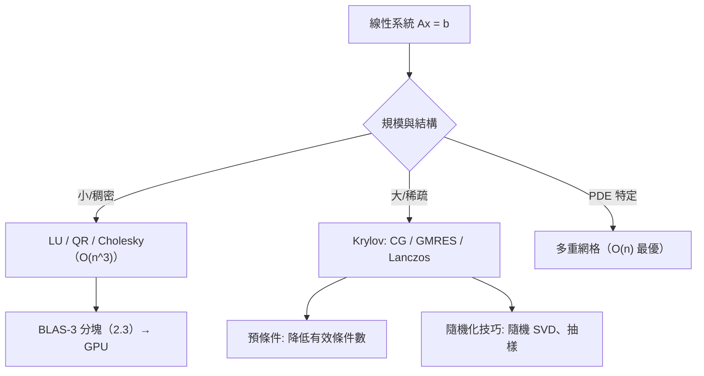

# 10.1 數值線性代數

## 前言：理論落地的地方

前三章的演算法在紙上無懈可擊；在浮點機器上，捨入誤差、條件數、計算量、記憶體存取模式決定成敗。**數值線性代數**（numerical linear algebra）是把線性代數變成可靠軟體的學科：矩陣的 $O(n^3)$ 與 $O(n^2)$ 之別、QR 代替正規方程、迭代法征服十億維稀疏系統——這些工程決策背後全是前九章的數學。本節回顧核心演算法的設計邏輯，並預見其現代挑戰。

## 歷史前因後果

### 從手搖計算機到 LAPACK

- **1946 年**，ENIAC 問世；**馮紐曼與哥德斯坦**（1947）的報告首次嚴格分析高斯消去的浮點誤差——數值分析誕生的標誌。**圖靈**（1948）獨立發展條件數概念。
- **1951–61 年**，**Householder**（反射矩陣）、**Givens**（旋轉矩陣）建立正交化演算法；**Wilkinson**（James H. Wilkinson, 1919–1986，1969/1970 圖靈獎）完成向後誤差分析（backward error analysis）：證明高斯消去（帶選主元）的誤差等價於「稍微擾動過的問題的精確解」——**穩定性理論的奠基之作**（1963《The Algebraic Eigenvalue Problem》）。
- **1961–62 年**，**Francis** 的**隱式雙移 QR 演算法**——至今仍是稠密非對稱特徵值問題的標準（LAPACK 的核心）。
- **1970–80 年代**：**Lanczos**（1950）與 **Arnoldi**（1951）的 Krylov 子空間法復興，配合稀疏矩陣征服大規模問題；**共軛梯度法**（Hestenes–Stiefel 1952）成為對稱正定系統的迭代標準。
- **1979–至今**：BLAS → LINPACK → **LAPACK**（1992）→ ScaLAPACK/PLASMA/MAGMA——分塊（2.3 節）與快取友好設計；**NumPy/SciPy/MATLAB** 讓這一切觸手可及。

- **解決了什麼問題**：讓「理論上有解」變成「機器上算得準、算得快」。
- **引發了什麼新問題**：GPU 時代的混合精度、隨機化演算法（隨機化 SVD、Hutchinson 迹估計）、量子線性系統演算法（HHL, 2009）的理論疆界。

## 稠密問題的三大演算法

| 任務 | 標準演算法 | 成本 | 穩定性 |
|------|------------|------|--------|
| 解 $A\mathbf{x}=\mathbf{b}$ | LU + 部分選主元 | $\frac23n^3$ | 良好（Wilkinson 界） |
| 最小平方 | Householder QR | $2n^2m$ | 優於正規方程（條件數不平方） |
| 特徵值（對稱） | 三對角化 + 分治/QR | $O(n^3)$ | 優（對稱 QR 無需選主元） |
| 特徵值（一般） | Hessenberg + 雙移 QR | $O(n^3)$ | 良好 |
| SVD | 雙邊 Jacobi / Golub–Kahan | $O(n^3)$ | 最穩健 |

**設計哲學**：所有稠密演算法都建立在**正交變換**（Householder 反射、Givens 旋轉）之上——因為正交矩陣的條件數為 1，**不放大誤差**（7.2 節的數值回報）。

### 向後穩定性

**定義**：演算法**向後穩定**，若浮點輸出是「稍微擾動的輸入」的精確解： $\hat{\mathbf{x}} = (A + \Delta A)^{-1}\mathbf{b}$ ， $\|\Delta A\| \lesssim \epsilon\|A\|$ 。

**組合公式**：總誤差 $\lesssim$ （演算法誤差）×（問題條件數）：

$$
\frac{\|\hat{\mathbf{x}} - \mathbf{x}\|}{\|\mathbf{x}\|} \lesssim \kappa(A)\cdot\epsilon\cdot c(n)
$$

**兩件事分開**：演算法的穩定性（ $\epsilon$ 層級）與問題的條件數（ $\kappa$ ）——**病態是問題的屬性，不是演算法的錯**（9.3 節）。選對演算法只能保證「不比理論極限更糟」。

## 稀疏與大規模：迭代法

### 為什麼需要迭代法

偏微分方程的有限差分/元素離散產生 $n = 10^7 \sim 10^9$ 的矩陣，但每列只有 $\sim5$ 個非零元素。直接法（LU）的成本 $O(n^3)$ 與**填充**（fill-in，消去產生新非零元）都不可承受。迭代法只用「矩陣–向量乘」（ $O(\text{非零元數})$ ），每步 $O(n)$ 。

### 三大族系

**（1）Krylov 子空間法**：在 $\mathrm{span}\{\mathbf{b}, A\mathbf{b}, A^2\mathbf{b}, \dots\}$ 中找最佳解。

- **共軛梯度（CG，1952）**：對稱正定系統；收斂理論（ $\|\mathbf{e}_k\|_A \le 2\left(\frac{\sqrt\kappa - 1}{\sqrt\kappa + 1}\right)^k\|\mathbf{e}_0\|_A$ ）——瑞利商/最速下降的優化視角（8.3 節）；實務上 $\sqrt\kappa$ 意味著**預條件**（preconditioning，改善條件數）是成敗關鍵。
- **GMRES（1986）**：一般矩陣，Arnoldi 正交化（Gram–Schmidt 的 Krylov 版）。
- **Lanczos（1950）**：Krylov 子空間中的瑞利–里茲（8.3 節）——大矩陣的少數極值特徵值（PageRank、量子化學）。

**（2）古典定常迭代**：Jacobi、Gauss–Seidel、SOR——逐點更新，易並行（Jacobi），是多重網格的平滑器。

**（3）多重網格（multigrid, 1960s–70s）**：粗細網格穿梭，達到**最優** $O(n)$ ——偏微分方程求解的王者。

## 例題

**例題 10.1-1（正規方程 vs QR 的條件數）**： $A = \begin{bmatrix} 1 & 1 \\ 0.001 & 0 \\ 0 & 0.001 \end{bmatrix}$ 。比較兩條路線。

**解**： $A^TA = \begin{bmatrix} 1 + 10^{-6} & 1 \\ 1 & 1 + 10^{-6} \end{bmatrix}$ ，特徵值 $2 + 10^{-6}, 10^{-6}$ ，故 $\kappa(A^TA) \approx \frac{2}{10^{-6}} = 2\times10^6$ ，而 $\kappa(A) = \sqrt{\kappa(A^TA)} \approx 1414$ 。

**正規方程路線**把條件數**平方**： $10^{6}$ vs $10^3$ ——雙精度（ $10^{-16}$ ）下，正規方程路線可能丟失約 6 位、QR 路線丟約 3 位。**這就是「最小平方一律用 QR（或 SVD）」的數值理由**——7.3 節的工程註腳。

**例題 10.1-2（共軛梯度一次手算）**：解 $A\mathbf{x} = \mathbf{b}$ ， $A = \begin{bmatrix} 4 & 1 \\ 1 & 3 \end{bmatrix}$ （正定： $\lambda = 4\pm\frac{1}{\sqrt2}\cdot$ ？——特徵方程 $\lambda^2 - 7\lambda + 11$ ，判別式 $49-44 = 5$ ， $\lambda = \frac{7\pm\sqrt5}{2} > 0$ ✓）， $\mathbf{b} = (1, 2)^T$ ， $\mathbf{x}_0 = \mathbf{0}$ 。

**解**： $\kappa = \lambda_{\max}/\lambda_{\min} = \frac{7+\sqrt5}{7-\sqrt5} \approx \frac{9.236}{4.764} \approx 1.94$ ——良態，CG 應迅速收斂。

- 初始殘差 $\mathbf{r}_0 = \mathbf{b} - A\mathbf{x}_0 = (1, 2)$ ，搜尋方向 $\mathbf{p}_0 = \mathbf{r}_0$ 。
- 步長 $\alpha_0 = \frac{\mathbf{r}_0^T\mathbf{r}_0}{\mathbf{p}_0^TA\mathbf{p}_0}$ ： $A\mathbf{p}_0 = (4+2, 1+6) = (6, 7)$ ， $\mathbf{p}_0^TA\mathbf{p}_0 = 6 + 14 = 20$ ， $\alpha_0 = \frac{5}{20} = \frac14$ 。
- $\mathbf{x}_1 = \frac14(1, 2) = (\frac14, \frac12)$ ； $\mathbf{r}_1 = \mathbf{r}_0 - \alpha_0A\mathbf{p}_0 = (1,2) - \frac14(6,7) = (-\frac12, \frac14)$ 。
- $\beta_0 = \frac{\|\mathbf{r}_1\|^2}{\|\mathbf{r}_0\|^2} = \frac{\frac14 + \frac1{16}}{5} = \frac{5/16}{5} = \frac1{16}$ ； $\mathbf{p}_1 = \mathbf{r}_1 + \frac1{16}\mathbf{p}_0 = (-\frac12 + \frac1{16}, \frac14 + \frac18) = (-\frac7{16}, \frac38)$ 。
- $\alpha_1 = \frac{\|\mathbf{r}_1\|^2}{\mathbf{p}_1^TA\mathbf{p}_1}$ ： $A\mathbf{p}_1 = (4\cdot(-\frac7{16}) + \frac38,\ -\frac7{16} + \frac98) = (-\frac74 + \frac38, \frac{11}{16}) = (-\frac{11}{8}, \frac{11}{16})$ ； $\mathbf{p}_1^TA\mathbf{p}_1 = (-\frac7{16})(-\frac{11}{8}) + \frac38\cdot\frac{11}{16} = \frac{77}{128} + \frac{33}{128} = \frac{110}{128} = \frac{55}{64}$ 。 $\alpha_1 = \frac{5/16}{55/64} = \frac{5\cdot64}{16\cdot55} = \frac{4}{11}$ 。
- $\mathbf{x}_2 = \mathbf{x}_1 + \frac{4}{11}\mathbf{p}_1 = (\frac14 - \frac{28}{176}, \frac12 + \frac{12}{88}) = (\frac14 - \frac7{44}, \frac12 + \frac3{22}) = (\frac{11 - 7}{44}, \frac{11 + 3}{22}) = (\frac1{11}, \frac7{11})$ 。

**驗證**： $A\mathbf{x}_2 = (4/11 + 7/11,\ 1/11 + 21/11) = (1, 2)$ ✓ **精確解**（CG 對 $2\times2$ 系統最多 2 步收斂——Krylov 理論： $\dim\mathcal{K}_2 = 2$ ）。這是「迭代法在理論上有限步精確、實務上受浮點限制」的縮影。

**例題 10.1-3（冪法與收斂率）**：用冪法求 $A = \begin{bmatrix} 2 & 1 \\ 1 & 2 \end{bmatrix}$ （ $\lambda = 3, 1$ ）的主特徵值，從 $\mathbf{x}_0 = (1, 0)$ 開始。

**解**： $\mathbf{x}_0 = (1, 0) = \frac12\mathbf{v}_+ + \frac12\mathbf{v}_-$ （分解到特徵基， $\mathbf{v}_\pm = (1, \pm1)$ ）。

$$
A^k\mathbf{x}_0 = \frac12\cdot3^k\mathbf{v}_+ + \frac12\cdot1^k\mathbf{v}_- = 3^k\left(\frac12\mathbf{v}_+ + \frac{3^{-k}}{2}\mathbf{v}_-\right)
$$

**收斂率 $= |\lambda_2/\lambda_1| = 1/3$ **：每次迭代誤差縮為 1/3。 $k = 10$ 時 $\mathbf{x}_{10} \approx \mathbf{v}_+$ 偏差 $\sim 3^{-10} \approx 1.7\times10^{-5}$ 。**瑞利商在此給特徵值的二階精度估計**（8.3 節）。若 $|\lambda_2| \approx |\lambda_1|$ （如 PageRank 中 damping 之外的譜），收斂會極慢——**譜隙（spectral gap）決定一切**，這是 10.2 節 PageRank 分析的核心。

## 與其他領域的關聯

- **微分方程**：CG/GMRES/多重網格是偏微分方程數值解的標配；預條件子的設計（不完全分解、代數多重網格）是活躍研究。
- **機器學習**：SGD 是「隨機化的最速下降」；Krylov 方法出現於內核方法與 Hessian-free 優化；隨機化 SVD 是大規模 LSA/PCA 的引擎。
- **量子計算**：HHL 演算法（2009）宣稱指數加速解線性系統——但受條件數、稀疏性、讀出問題限制，是「量子優勢」討論的經典案例。
- **圖計算**：PageRank 的冪法收斂、圖分割的 Lanczos——10.2 節。
- **科學計算倫理**：浮點誤差曾導致愛國者飛彈攔截失敗（1991，定點累積誤差）、阿麗亞娜 5 號爆炸（1996，溢位）——數值紀律是工程安全的一部分。

## 本節小結

1. 浮點世界的兩個基本量：**條件數**（問題的敏感性）與**向後穩定性**（演算法的可信度）；總誤差 ≈ 兩者之積。
2. 稠密演算法的正交變換哲學（Householder/Givens）：不放大誤差；正規方程的條件數平方使其被 QR 淘汰。
3. 大規模稀疏系統靠 Krylov 迭代（CG/GMRES/Lanczos）+ 預條件 + 多重網格；譜隙與條件數決定收斂。
4. Wilkinson（圖靈獎 1970）、Golub、Francis 建立的 LAPACK 生態是今日科學計算的地基。

**預告**：線性代數不只是工程底層，更是機器學習的母語。10.2：PageRank、詞向量、注意力機制、矩陣補全——**機器學習中的線性代數**。
