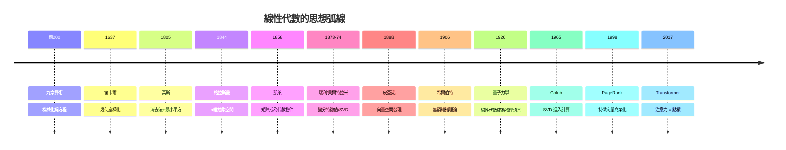
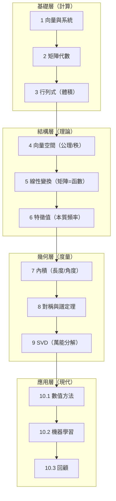

# 10.3 迴顧：從解方程到空間思維

## 前言：一條兩千年的思想弧線

本書從《九章算術》的算籌開始，在 GPT 的注意力矩陣結束。回望這條路，我們看到線性代數經歷了**三次視角的躍遷**：從「解方程的計算」到「矩陣的代數」，再到「空間的幾何」，最後成為「結構的語言」。本節把全書織成一張圖，重訪幾條最深刻的思想線索，並指出這套語言在當代數學與科學中的延伸。

## 三次躍遷的編年史

**躍遷一（計算 → 代數）**：高斯消去法（1.3）是「程序」；凱萊（1858）把係數表升格為「物件」，矩陣乘法由變換合成**逼出**（2.1），非交換性後來成為量子力學的本質（1925）。
**躍遷二（代數 → 幾何）**：格拉斯曼（1844）的 $n$ 維空間讓「向量」脫離具體數組；皮亞諾（1888）的公理使**多項式、函數、矩陣都是向量**（4.1）；秩–零度定理（4.3）把解方程的經驗凝結為維度守恆。
**躍遷三（幾何 → 語言）**：譜定理（第 8 章）與 SVD（第 9 章）提供「任何矩陣都有譜」的普適視角；當量子力學（1926）與機器學習（2017）都選擇線性代數作為母語時，它已不只是數學分支，而是**描述結構的通用文法**。

## 全書知識地圖

## 五條貫穿全書的思想線索

### 線索一：可逆矩陣定理——等價網的統一

3.2 節的清單（可逆 ⇔ $\det \ne 0$ ⇔ 僅零解 ⇔ 獨立 ⇔ 滿秩 ⇔ $0$ 非特徵值）在第 4 章後獲得完整版。**教學意義**：線性代數不是一列孤立主題，而是一張等價網——任何一條線索都能通向全部真理。這種「等價網思維」是數學成熟度的標誌。

### 線索二：秩–零度定理——維度守恆

$\dim\ker + \dim\mathrm{im} = \dim V$（4.3、5.3）以不同面目反覆出現：解的參數個數（1.2）、四大子空間、投影的正交補（7.3）、SVD 的零奇異值（9.1）。**它是「資訊守恆」的線性代數版**：變換可以分配維度，但不能憑空產生或消滅。

### 線索三：換基底使問題變簡單

- 對角化（6.2）：微分方程解耦；
- 傅立葉基底：卷積對角化；
- 正交歸一基（7.2）：座標 = 內積；
- 特徵基（8.1）：對稱矩陣的主軸；
- 表象變換（5.2）：量子力學的 Schrödinger vs Heisenberg。

**哲學**：矩陣的「難」往往是座標的「錯」。選對基底，困難蒸發。這是數學中最普遍的問題解決策略之一。

### 線索四：變分視角——特徵值是優化的解

瑞利商（8.3）把特徵值變成泛函極值：瑞利–里茲法、有限元素、PCA（9.2）、VQE、Lanczos（10.1）共用此思想。**「解方程」與「求極值」是同一件事的兩面**——變分原理是十九世紀留給二十一世紀的最大遺產之一。

### 線索五：低秩結構——世界的冗餘性

SVD 的斷崖譜（9.2）、Eckart–Young 最優性、PCA 的主成分、Netflix 補全、LoRA 微調（10.2）——都依賴一個經驗事實：**真實資料的有效維度遠低於標稱維度**。線性代數把「簡單」量化為「秩」。

## 各章的「歷史人物名錄」

| 章 | 關鍵人物 | 年代 | 貢獻 |
|----|----------|------|------|
| 1 | 劉徽註九章／高斯 | 前 200／1810 | 消去法 |
| 2 | 凱萊、西爾維斯特 | 1850–58 | 矩陣代數誕生 |
| 3 | 關孝和、萊布尼茨、柯西 | 1683–1812 | 行列式 |
| 4 | 格拉斯曼、皮亞諾、Steinitz | 1844–1910 | 公理化與維度 |
| 5 | 莫比烏斯、若爾當 | 1827–1870 | 變換與標準形 |
| 6 | 拉格朗日、柯西、薛丁格 | 1759–1926 | 特徵值 |
| 7 | 格拉姆、施密特、希爾伯特 | 1883–1907 | 正交與內積 |
| 8 | 柯西、西爾維斯特、瑞利 | 1829–1873 | 譜與變分 |
| 9 | 貝爾特拉米、Eckart–Young、Golub | 1873–1965 | SVD |
| 10 | Wilkinson、Page–Brin、Vaswani | 1961–2017 | 計算與應用 |

## 例題：一道「全書總複習」題

**例題 10.3-1**：設對稱矩陣 $A = \begin{bmatrix} 3 & 1 \\ 1 & 3 \end{bmatrix}$。用**一題串起全書**：

**(1) 行列式與可逆（第 3 章）**：$\det A = 9 - 1 = 8 \ne 0$——可逆。

**(2) 特徵結構（第 6 章）**：$\lambda = 4, 2$（$\mathrm{tr} = 6$ ✓、$\det = 8$ ✓）；特徵向量 $(1,1)$、$(1,-1)$。

**(3) 譜分解（第 8 章）**：

$$
A = Q\Lambda Q^T = \frac12\begin{bmatrix} 1 & 1 \\ 1 & -1 \end{bmatrix}\begin{bmatrix} 4 & 0 \\ 0 & 2 \end{bmatrix}\begin{bmatrix} 1 & 1 \\ 1 & -1 \end{bmatrix}
$$

**(4) SVD（第 9 章）**：$A$ 對稱正定 → $\sigma = 4, 2$，$U = V = Q$。

**(5) 正定性（第 8.2 章）**：$\lambda$ 全正 → 正定；$Q(x, y) = 3x^2 + 2xy + 3y^2 = 4y_1^2 + 2y_2^2$ 是碗。

**(6) 瑞利商（8.3）**：$R(1,0) = 3$，夾在 $[2, 4]$；$R(1,1) = 4 = \lambda_{\max}$。

**(7) 條件數（9.3）**：$\kappa = 4/2 = 2$——良態，數值計算安全。

**(8) 二次逼近（10.2）**：若 $A$ 是損失面的 Hessian，牛頓法條件數 2，收斂健康。

**一個 $2\times2$ 矩陣，八個章節的光**——這就是線性代數的整體性。

## 這套語言的去向：延伸閱讀地圖

| 方向 | 核心延伸 | 建議起點 |
|------|----------|----------|
| 泛函分析 | 無窮維譜理論、Banach/Hilbert 空間 | Kreyszig《Introductory Functional Analysis》 |
| 微分幾何 | 流形、張量、微分形式 | do Carmo 或 Lee |
| 量子力學 | 自伴算子、譜理論 | Sakurai 或 Shankar |
| 數值線性代數 | Trefethen–Bau《Numerical Linear Algebra》 | 與本書 10.1 銜接 |
| 隨機矩陣／統計學習 | Marchenko–Pastur、雙下降 | Vershynin《High-Dimensional Probability》 |
| 張量與多方陣 | 張量分解、量子多體 | Kolda–Bader 綜述 |
| 圖與網路 | 譜圖理論 | Chung《Spectral Graph Theory》 |

**給讀者的最後建議**：線性代數的深刻之處不在任何單一定理，而在**同一組概念的無限復用**——線性組合、基底、秩、正交、譜，在微分方程、量子、統計、學習中反覆現身。當你下次遇到「看起來不像線性代數的問題」，先問：**這裡的向量是什麼？空間是什麼？哪個方向是本質的？**——這就是本書想留給你的「空間思維」。

## 本節小結

1. 兩千年弧線：解方程（《九章算術》）→ 矩陣代數（凱萊 1858）→ 空間幾何（格拉斯曼/皮亞諾）→ 結構語言（量子力學 1926、機器學習 2017）。
2. 五條主線：等價網（可逆定理）、維度守恆（秩–零度）、換基底化簡、變分特徵值、低秩冗餘。
3. 一題串全書：一個 $2\times2$ 對稱矩陣照亮行列式、譜、SVD、正定、瑞利商、條件數與機器學習應用。
4. 下一程：泛函分析、微分幾何、譜圖理論、張量網路——線性代數的各條支流仍在壯大。

**全書終**。願你帶走的不只是演算法與定理，而是那副「把世界看成向量空間」的眼鏡。
