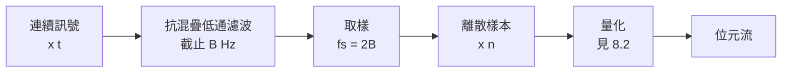

# 1.2 Bell 電話與 Nyquist 取樣（1928）

## 導言：從「碼本」到「數學」

電報解決了「文字」的傳輸，但人類最自然的通訊媒介是語音。1876 年，Alexander Graham Bell 取得電話專利，聲音透過麥克風轉成連續變化的電流，直接沿線傳送。電話與電報的根本差異在於：**電報傳的是離散符號，電話傳的是連續波形**。連續訊號在數學上是實數函數 $x(t)$，有無限多個「數字」，似乎需要無限多的資訊。可是電話明明只有 $3000$ Hz 左右的頻寬，聽起來卻能完整傳遞語義。

這個矛盾直到二十世紀才被釐清。1928 年，Bell 實驗室的 Harry Nyquist 發表《Certain Topics in Telegraph Transmission Theory》，證明了一個驚人的結論：**帶限訊號可以用有限個取樣點完全重建**。同一年，他的同事 Ralph Hartley 發表《Transmission of Information》，首次提出「資訊量 = $\log$（可能訊息數）」的度量。這兩篇論文構成了 Shannon 1948 年論文的直接前身。

## Nyquist 取樣定理

### 定理陳述

設連續訊號 $x(t)$ 的傅立葉轉換 $X(f)$ 滿足帶限條件：

$$
X(f) = 0 \quad \text{當} \quad |f| \ge B
$$

即訊號沒有 $B$ Hz 以上的頻率成分。若以取樣率

$$
f_s = \frac{1}{T} \ge 2B
$$

等間距取樣，得樣本序列 $x[n] = x(nT)$，則 $x(t)$ 可由樣本**完全重建**，重建公式（Whittaker–Shannon 內插公式）為：

$$
x(t) = \sum_{n=-\infty}^{\infty} x[n] \, \mathrm{sinc}\!\left(\frac{t - nT}{T}\right),
\qquad
\mathrm{sinc}(u) = \frac{\sin(\pi u)}{\pi u}
$$

關鍵常數 $2B$ 稱為 **Nyquist 率**。若取樣率低於 $2B$，會發生**混疊（aliasing）**：高頻成分偽裝成低頻成分，且無法事後挽救。

### 直觀理解：樣本數與自由度

帶限訊號在每秒內的「自由度」有限。頻寬 $B$ 的訊號，每秒至多有 $2B$ 個獨立自由度（複數頻譜在 $(-B, B)$ 內的解析函數）。取樣就是把連續函數的無限維問題，化約為有限維的數列問題。這一化約是所有**數位通訊**的前提：唯有先取樣，才能量化（8.2 節），才能編碼（第 5、6 章），才能談「每秒傳多少位元」（第 4 章）。

### 例題：電話與 CD 的取樣率

**例 1（電話語音）**：電話通道頻寬約 $B = 3400$ Hz（實際系統在 $300$–$3400$ Hz）。取樣率需 $\ge 2 \times 3400 = 6800$ Hz。實際的電話數位化標準取 $8000$ Hz，留出保護帶（guard band）以便實作可實現的濾波器（理想低通濾波器不存在，見 8.1 節的討論）。每秒 $8000$ 樣本 × 每樣本 $8$ 位元 = **64 kbps**，這就是著名的 DS0 通道速率，第 4.2 節會看到它正好嵌入 Shannon 容量公式。

**例 2（CD 音訊）**：人耳聽覺上限約 $20$ kHz，故 $B = 20000$ Hz，Nyquist 率 $40000$ Hz。CD 標準取 $44100$ Hz，略高於理論值並留保護帶。為什麼不是正好 $40000$？因為理想磚牆濾波器需要無限長的 sinc 脈衝，實際系統必須妥協——這是理論與工程的典型落差。

### 頻域視角：為什麼是 2B？

對取樣訊號做傅立葉分析。以週期 $T$ 的脈衝串（Dirac comb）$s(t) = \sum_n \delta(t - nT)$ 相乘：

$$
x_s(t) = x(t)\,s(t) = \sum_{n} x(nT)\,\delta(t-nT)
$$

由頻域的摺積定理，取樣後的頻譜是原頻譜的**週期性複製**：

$$
X_s(f) = \frac{1}{T} \sum_{k=-\infty}^{\infty} X\!\left(f - \frac{k}{T}\right)
$$

複製譜的中心間距為 $f_s = 1/T$。若 $f_s \ge 2B$，各複製品互不重疊，用一個理想低通濾波器取出 $k=0$ 項即還原原譜；若 $f_s < 2B$，複製品重疊——混疊發生，資訊永久混雜。這個「頻譜複製」圖像在 8.3 節調變理論中會再次出現，兩者共用同一套傅立葉工具。

## Hartley 的資訊度量：對數的登場

1928 年，Ralph Hartley 在《Transmission of Information》中提出一個樸素卻深刻的問題：**應該如何客觀地度量「一則訊息傳遞了多少資訊」？**

### Hartley 的三個公理

設訊息來自 $M$ 個等可能符號的集合。Hartley 主張資訊度量 $H(M)$ 應滿足：

1. **非負且單調**：$M$ 越大，資訊越多。
2. **可加性**：兩個獨立選擇串聯，資訊量相加。若第一選擇有 $M_1$ 個可能、第二有 $M_2$ 個，合計 $M_1 M_2$ 個組合，應有 $H(M_1 M_2) = H(M_1) + H(M_2)$。
3. **連續性**：$H$ 隨 $M$ 平滑變化。

由可加性：$H(M) = H(2 \cdot 2 \cdots 2) = H(2) \cdot \log_2 M$（對二元系統每一步貢獻 $H(2)$）。取 $H(2)=1$ 為單位（即 **bit**），得：

$$
H = \log_2 M
$$

### 例題：Hartley 度量的計算

一個電傳打字機有 $26$ 個字母 + $6$ 個控制碼 = $32$ 個符號。每個符號攜帶

$$
H = \log_2 32 = 5 \text{ bits}
$$

若機器每秒傳 $10$ 個符號，資訊率為 $50$ bits/s。Hartley 進一步指出：若通道雜訊導致接收端只能區分 $M'$ 個可靠電平（而非發送的 $M$ 個），則可靠資訊率為 $\log_2 M'$ bits/symbol——**這是通道容量的原始形態**，Shannon 後來把它推廣到統計雜訊下的極限。

### Hartley 的局限

Hartley 的度量假設所有符號**等可能**。但正如 Morse 與 Vail 所知（1.1 節），真實信源的符號機率極不均勻：E 出現遠比 Z 頻繁。等可能性假設浪費了統計結構。這個缺口要等 Shannon 用**自資訊** $I(x) = -\log_2 p(x)$ 與**熵** $H(X) = -\sum_x p(x)\log_2 p(x)$ 來補上（2.2、3.1 節）。可以驗證：當所有 $M$ 個符號等可能時，Shannon 熵退化為 Hartley 度量 $\log_2 M$——Hartley 是 Shannon 的特例。

## 歷史前因後果

### Bell 實驗室的時代背景

1915 年，AT&T 完成紐約—舊金山的橫貫大陸電話（需要加感線圈與放大器）。1920 年代，Bell 系統面臨工程問題：多路復用（一條線載多路通話）、電報速率極限、載波電話的頻寬分配。這些實際問題迫使 AT&T 成立數學研究部門，Nyquist、Hartley、後來的 Shannon 都在這個環境中工作。

### Nyquist 的兩篇關鍵論文

- **1924 年《Certain Factors Affecting Telegraph Speed》**：指出電報速率正比於「符號區分數目的對數」。
- **1928 年《Certain Topics in Telegraph Transmission Theory》**：完整論述帶限訊號與取樣率的關係，並給出升餘弦脈衝成形（避免符號間干擾）的理論基礎。

### 解決了什麼問題

1. **混疊問題**：說明了為什麼電話線上直接取樣語音必須先濾波。
2. **符號間干擾（ISI）**：Nyquist 準則——若脈衝成形滿足特定條件，取樣瞬間無 ISI，電報速率可達 $2B$ baud 極限。
3. **多路復用**：頻譜複製的圖像直接支持了 FDM（分頻多工）的設計。

### 引發什麼新問題

1. 樣本是連續實數，**如何量化**才最省位元？——率失真理論（8.2 節）。
2. 帶限脈衝的 sinc 拖尾無限長，實際上**如何成形**？——部分響應、升餘弦設計。
3. Hartley 度量不含機率，**如何納入統計**？——Shannon 熵（第 3 章）。
4. 帶限 + 可靠電平數，**根本極限在哪**？——Shannon 容量公式（4.2 節）。

## 與其他領域的關聯

### 傅立葉分析

取樣定理是傅立葉理論的勝利：Dirac comb 的頻譜仍是 Dirac comb；頻域摺積定理給出複製譜；Poisson 求和公式是嚴格證明的骨幹。學習取樣定理等於複習整個傅立葉分析的實戰應用。

### 線性代數

$\mathrm{sinc}$ 函數族 $\{\mathrm{sinc}((t-nT)/T)\}_n$ 構成帶限訊號空間的一組**正交基底**（在 $L^2$ 內積下），取樣值就是訊號在這組基底上的座標。帶限訊號空間是無限維希爾伯特空間，但每秒只有 $2B$ 個自由度——「維度」的物理化。

### 機率統計

Hartley 度量是離散均勻分佈的熵。把「等可能」放開後，最大熵分佈即均勻分佈（3.1 節將證明 $H(X) \le \log_2 M$），這個不等式連接了 Hartley 與 Shannon。

## 小結與思考題

1928 年是資訊理論的「前夜」：Nyquist 把連續世界離散化（取樣定理），Hartley 把資訊數量化（對數度量）。剩下的最後一塊拼圖——**機率**——要等二十年後 Shannon 補上。

**思考題**

1. 語音頻寬 $4$ kHz、取樣率 $8000$ Hz、每樣本量化成 $256$ 電平。用 Hartley 度量估計其位元率；這個值與實際 DS0 的 64 kbps 相比如何？
2. 以 $f_s = 1000$ Hz 取樣含 $600$ Hz 成分的訊號，混疊後聽起來像幾 Hz？（提示：$600$ 超過 $f_s/2 = 500$，混疊頻率為 $f_s - 600 = 400$ Hz。）
3. Hartley 可加性公理對應機率論中獨立事件的哪條性質？這條性質在 2.3 節的聯合機率中扮演什麼角色？

下一節，我們來到 1948 年：Claude Shannon 一篇論文，把電報、電話、取樣、對數全部熔鑄成一門統一的科學。

---

## 深入探討：1928 年的雙重革命，工程與數學的並行線

### 一、Bell 系統的組織性科學

Nyquist 與 Hartley 的成果並非孤立的靈感，而是**組織化工業研究**的產物。理解這一點對看清資訊理論的誕生土壤至關重要：

- **1925 年**：Western Electric 工程部改組為 Bell Telephone Laboratories，成為當時世界最大的工業實驗室。AT&T 的壟斷利潤（受管制的資本回報率與費率掛鉤）提供了一個意外的誘因：**投入越多研發成本，允許的利潤越高**——因此 Bell 系統有制度性的動機做長期基礎研究。
- **數學諮詢部門**：Bell 實驗室刻意僱用純數學家（如後來的 Tukey、Hamming、Shannon）與工程師並肩。Hartley 本人是電機工程師但以「度量問題」的抽象化聞名；Nyquist 是瑞典移民、耶魯物理博士，以數學嚴謹處理電報工程。
- **內部研討會文化**：Shannon 回憶 1940 年代初在 Bell 的討論環境時說，工程師與數學家的界線在那裡是模糊的。這個環境孕育了「把工程問題寫成定理」的風格。

### 二、Nyquist 準則的工程深層：符號間干擾的精確刻劃

1.2 節提到 Nyquist 準則，這裡給出它的完整形式與一個可手算的例子。設系統脈衝響應 $p(t)$（發送脈衝經通道與接收濾波後的總響應），符號週期 $T$。在取樣時刻 $kT$ 接收：

$$
y(kT) = \sum_{m} a_m \, p((k-m)T) + n(kT)
$$

若 $p(0) = 1$ 且 $p(mT) = 0$ 對所有 $m \ne 0$，則 $y(kT) = a_k + n(kT)$——無符號間干擾（ISI）。**奈奎斯特第一準則**的頻域形式：

$$
\sum_{k=-\infty}^{\infty} P\!\left(f - \frac{k}{T}\right) = T \quad \text{對所有 } f
$$

即：把 $P(f)$ 以 $1/T$ 平移疊加後必須是常數。**升餘弦族**是滿足此條件的最常用脈衝（詳見 8.3 節）。

**例題：過量頻寬與拖尾長度**。升餘弦滾降係數 $\beta = 0.5$、符號率 $1000$ baud：

- 所需頻寬 $B = (1+\beta)/(2T) = 750$ Hz（相對理想 sinc 的 500 Hz 多付 50%）。
- 時域拖尾按 $t^{-3}$ 衰減（sinc 是 $t^{-1}$）——**頻寬多付一點，時域拖尾快得多**，對定時抖動的容忍度大增。工程上 $\beta = 0.2$–$0.35$ 是常見工作點。

這條「頻寬 ↔ 拖尾」的交換律在 8.3 節 OFDM 的循環前綴選擇中再次出現，是頻域-時域不確定性的工程體現。

### 三、Hartley 度量的深入：從可加性到對數的必然性

Hartley 的公理值得用更現代的語言重述一遍，因為它預告了 3.1 節 Shannon 熵的公理化：

**設** $H(M)$ 為從 $M$ 個等可能結果中辨識其一所得的資訊量。**公理**：

1. $H(M_1 M_2) = H(M_1) + H(M_2)$（獨立串聯的可加性）。
2. $H(M)$ 對 $M$ 單調遞增（更多結果 = 更多資訊）。

**唯一性證明**（Cauchy 函數方程式路線）：令 $g(n) = H(a^n)$。由公理 1，$g(n+m) = g(n) + g(m)$，對正整數的該方程式唯一解為 $g(n) = cn$。故 $H(a^n) = cn$；對一般 $M$，取 $n$ 使 $a^{n-1} \le M \le a^n$，配合單調性夾逼，得 $H(M) = c \log_a M$。**對數形式是可加性 + 單調性的邏輯必然，而非巧合**。

Hartley 選 2 為底（單位 bit）的動機很工程：繼電器與電鍵都是二態元件，「二元選擇」是最自然的原子操作。這個單位選擇使 $\log_2 M$ 直接對應「需要幾個繼電器狀態編碼」——**度量單位與硬體的對齊**是 Hartley 論文最深遠的實用決定。

### 四、取樣定理的三個獨立發現者與優先權之謎

教科書常稱「Whittaker–Shannon 取樣定理」或「Kotelnikov 定理」，因為它被獨立發現了至少三次：

| 人物 | 年代 | 語境 | 為何未被廣泛引用 |
|---|---|---|---|
| E. T. Whittaker | 1915 | 純數學：內插級數理論 | 發表在數學期刊，工程界不讀 |
| V. A. Kotelnikov | 1933 | 蘇聯博士論文（通訊工程） | 蘇聯封閉，西方戰後才知 |
| H. Nyquist / C. Shannon | 1928 / 1949 | Bell 實驗室工程與理論 | 直接成為工程標準 |

Shannon 1949 年論文中明確感謝了 Kotelnikov 的工作。這段歷史是「科學的平行發現」現象的教科書案例：當一個問題的工程需求與數學工具同時成熟，發現會在多處同時爆發。它也提醒我們：**理論的「發明日期」往往取決於誰的語境讓它被使用**，而非誰第一個寫下它。

### 五、取樣定理的時域視角：再生核與正交展開

對熟悉線性代數的讀者，取樣定理還有一個優雅的幾何讀法：

- 帶限訊號全體構成 $L^2(\mathbb{R})$ 的閉子空間 $V_B$。
- $\{\mathrm{sinc}(2Bt - n)\}_{n \in \mathbb{Z}}$ 是 $V_B$ 的**正交基底**（因為 $\mathrm{sinc}$ 的傅立葉轉換是矩形，平移對應頻域相位旋轉，內積為 $\delta_{mn}$）。
- 取樣值 $x(n/2B)$ 是 $x$ 在這組基底上的**座標**（由正交性直接驗證：$\langle x, \mathrm{sinc}(\cdot - n)\rangle = x(n/2B)$）。

因此「取樣」就是「座標投影」：連續訊號 $x(t)$ 與其樣本列 $\{x_n\}$ 透過一個酉映射一一對應。**沒有資訊損失**不再是奇怪的性質，而是線性代數中「基底表示」的必然。這個觀點在 8.1 節將以希爾伯特空間語言嚴格化，並在壓縮感知（8.1 節末）中推廣為「稀疏基底上的座標」。

### 六、1928 年的第三項遺產：Johnson–Nyquist 雜訊

同一年，J. B. Johnson 實驗測得、Nyquist 理論推導了導體的熱雜訊：

$$
\overline{v^2} = 4 k T R \Delta f \quad \text{（電阻 } R \text{、溫度 } T \text{、頻寬 } \Delta f\text{）}
$$

這是統計力學（能量均分定理）在電子工程的直接應用：每個自由度分得 $\frac{1}{2}kT$ 的熱能量，電磁模式密度的積分給出功率譜密度 $kT$（單邊）。**意義**：

1. 雜訊不是工程缺陷，而是**物理定律**——任何通道都有 $kT$ 量級的雜訊地板。
2. 它為 4.2 節的 AWGN 容量公式提供了 $N = kTW$ 的實體來源。
3. 它與 Landauer 極限（3.1 節）遙相呼應：資訊處理的兩個 $kT \ln 2$，一個限制雜訊、一個限制擦除。

### 七、跨節連結：1928 → 1948 的二十年空窗

為什麼從 Nyquist/Hartley 到 Shannon 之間隔了二十年？三個條件需要同時成熟：

1. **機率論的公理化**（Kolmogorov 1933）：讓「信源是隨機過程」有嚴格數學語言——1.2 節的 Hartley 度量正是缺這塊（等可能假設）。
2. **隨機過程理論**（Wiener 1930s、Khintchine）：濾波、預測與功率譜的數學。
3. **戰時的保密通訊實務**：Shannon 在 Bell 的密碼分析中被迫用機率與熵思考「秘密量」，1945 年密碼報告已是熵的完整練習——1948 論文只是把「隱藏資訊」的數學反轉成「傳遞資訊」的數學。

**思考題（補充）**

6. 用第三節的函數方程式法證明：滿足可加性與單調性的 Hartley 度量必為 $c \log M$，且單位選擇等價於選 $c$。
7. 升餘弦 $\beta = 0.2$、符號率 2400 baud：計算所需頻寬，並比較 $\beta = 0$ 時的拖尾衰減率差異。
8. 以 2.5 節的正交性論證手算：訊號 $x(t) = \sin(2\pi t)$（$B = 1.5$ Hz 帶限）在 $f_s = 4$ Hz 下的樣本，驗證內插公式在 $t = 0.25$ 處還原 $\sin(\pi/2) = 1$（取前 5 項近似）。
