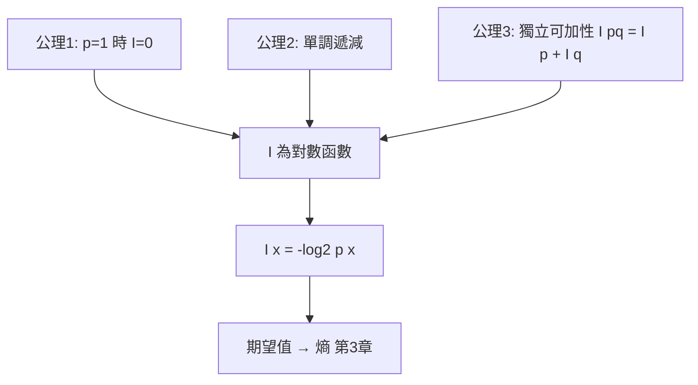

# 2.2 自資訊與機率的對數

## 導言：把「驚訝程度」數量化

上一節確立了不確定性隨機率分散而增。現在要為**單一結果** $x$ 定義一個數：事件 $X = x$ 發生時，我們獲得多少資訊？這個量稱為**自資訊（self-information）**，也稱資訊量、驚訝度（surprisal）：

$$
I(x) = \log_2 \frac{1}{p(x)} = -\log_2 p(x)
$$

單位是位元（bit，binary digit 的縮寫）。若以 $e$ 為底，單位是奈特（nat）；若以 10 為底，單位是哈特萊（Hartley，紀念 1.2 節的 Hartley）。本書慣用 $\log_2$ ，換算： $1$ nat $= \log_2 e \approx 1.443$ bits， $1$ Hartley $= \log_2 10 \approx 3.322$ bits。

## 為什麼是對數：三條公理

要設計函數 $I(p)$ 把「機率 $p$ 的事件的資訊量」對應到實數，最起碼要滿足：

1. **零機率極限**： $p \to 0^+$ 時 $I(p) \to \infty$ （極罕見的事，資訊極大）； $p = 1$ 時 $I(1) = 0$ （必然事件，零資訊）。
2. **單調遞減**： $p$ 越小， $I$ 越大。
3. **可加性**：兩個**獨立**事件同時發生的資訊，等於各自資訊之和：

$$
I(p \cdot q) = I(p) + I(q)
$$

函數方程 $f(pq) = f(p) + f(q)$ 加上單調性，唯一解是對數：

$$
I(p) = -c \log p, \qquad c > 0
$$

取 $c = 1/\log 2$ （底 2），得到自資訊公式。**對數不是任意的選擇，而是可加性公理的邏輯必然**。這也回頭解釋了 Hartley 度量 $\log_2 M$ 的來源：等可能 $M$ 個結果，每個自資訊 $I(1/M) = \log_2 M$ 。

### 可加性的深意

獨立事件的可加性正是機率論的乘法法則 $P(A \cap B) = P(A)P(B)$ 的鏡像：機率相乘、資訊相加。這種「乘 ↔ 加」的對偶是資訊理論處理長序列的利器： $n$ 個獨立樣本的聯合自資訊是 $n$ 個自資訊之和，於是資訊量隨序列長度**線性**成長——定理才有可能證明。

## 直觀驗證

### 例題 1：擲銅板

公平銅板出現正面： $I(H) = -\log_2 0.5 = 1$ bit。一個二元結果恰好花 1 位元描述——這就是「bit」作為單位的直觀來源。

### 例題 2：骰子

公平骰子擲出 6： $I(6) = \log_2 6 \approx 2.585$ bits。需要 2.585 位元才能指定六選一的結果（3 個位元的碼可編 8 種，2 個位元只能編 4 種，介於其間）。

### 例題 3：樂透

大樂透中頭獎機率約 $1/13{,}980{,}016$ ：

$$
I = \log_2 13{,}980{,}016 \approx 23.7 \text{ bits}
$$

中頭獎這個事件攜帶約 24 位元的資訊——聽起來不多？因為**位元是資訊量而非重要性**。資訊理論刻意不談「價值」與「意義」（1.3 節），只談可從多少等可能選項中指認出這個結果。

### 例題 4：不均勻信源

信源 $P(a)=0.99$ 、 $P(b)=0.01$ ：

| 事件 | $p$ | 自資訊（bits） |
|---|---|---|
| $a$ | 0.99 | $0.0145$ |
| $b$ | 0.01 | $6.644$ |

$a$ 幾乎不給資訊（早已料到）， $b$ 給 6.64 位元（大吃一驚）。兩者的期望（下一節的熵）為 $0.99 \times 0.0145 + 0.01 \times 6.644 \approx 0.0808$ bits/symbol——這個信源**平均**極易壓縮。

## 自資訊的期望：通往熵

把自資訊對分佈取期望，得到**熵**（第 3 章主角）：

$$
H(X) = E[I(X)] = \sum_x p(x) \left(-\log_2 p(x)\right)
$$

這個觀點——「熵 = 平均驚訝度」——比任何代數定義都直觀。學完第 3 章後回來看，所有熵的性質（ $0 \le H \le \log_2 |\mathcal{X}|$ 、鏈法則、凹性）都能從「平均自資訊」讀出。

## 長序列與漸近等分性質

考慮 i.i.d. 信源的長度 $n$ 序列 $x^n = (x_1, \dots, x_n)$ 。由獨立可加性：

$$
I(x^n) = -\log_2 p(x^n) = -\log_2 \prod_{i=1}^n p(x_i) = \sum_{i=1}^n I(x_i)
$$

自資訊是 $n$ 個 i.i.d. 隨機變數之和，由**大數法則**：

$$
\frac{1}{n} I(x^n) \xrightarrow{P} H(X)
$$

即：幾乎所有長度 $n$ 的序列，其自資訊都接近 $nH(X)$ ；等價地，其機率都接近 $2^{-nH(X)}$ 。這就是**漸近等分性質（Asymptotic Equipartition Property, AEP）**——「等分」意指典型序列的機率幾乎相等。AEP 是信源編碼定理（第 5 章）與通道編碼定理（第 4 章）的共同地基。

### 例題：典型集的規模

延續 2.1 節的信源 $P(a) = 0.75$ 、 $P(b) = 0.25$ ， $H \approx 0.811$ bits。取 $n = 100$ ：

- 每個典型序列機率約 $2^{-81.1}$ 。
- 典型集元素數約 $2^{81.1} \approx 2.4 \times 10^{24}$ 。
- 全部可能序列 $2^{100} \approx 1.27 \times 10^{30}$ 。

典型集只佔所有序列的 $2^{-18.9} \approx 0.000002$ ，卻承載了幾乎全部的機率質量。**編碼只需照顧典型集**，這就是所有壓縮與編碼定理的「取巧」之處。

## 連續情況的警告

對連續隨機變數， $p(x)$ 是機率密度，自資訊 $-\log_2 f(x)$ 可以是負數（當 $f(x) > 1$ ，例如小方差高斯在均值附近），其期望（微分熵，8.2 節）也可為負。**連續自資訊不是真正的資訊量**——連續精確值需要無限多位元描述。資訊理論處理連續量的正道是：先取樣、再量化，回到離散世界；或用率失真理論描述失真下的極限（8.2 節）。這是初學者最常見的陷阱，務必警惕。

## 歷史前因後果

### 對數度量的譜系

- **1928 Hartley**： $\log_2 M$ ，等可能假設（1.2 節）。
- **1948 Shannon**： $-\log_2 p(x)$ ，納入機率。Shannon 在論文中明確列出與 Hartley 相同的三條公理，並補充「度量應對機率分佈敏感」。
- **1953 Good、1955 Kullback**：自資訊與相對熵在統計學中的系統化（3.3 節）。
- **1965 Kolmogorov**： $K(x)$ ——不是對機率取對數，而是對「最短描述程式」取長度。對 i.i.d. 信源兩者期望一致，但概念上更根本（10.3 節）。

### 為什麼「驚訝度」一詞重要

Tribus（1961）指出 Shannon 原本苦於為 $-\log p$ 找名字，讀到 physicist 的 work 概念後採用「entropy」。後來的學者（如 Myron Tribus、E. T. Jaynes）推廣「surprisal」一詞，強調自資訊的主觀面：它是**觀察者**對事件的驚訝程度。這提醒我們：資訊量相對於一個機率模型而存在；模型錯了，資訊量的計算就錯了。

### 解決了什麼、引發了什麼

自資訊解決了「單一結果的資訊量」定義問題，使熵、互資訊、率失真全部可定義。新問題：對相依符號（英文單字內的字母相依）自資訊如何推廣？——條件自資訊 $I(x|y) = -\log_2 p(x|y)$ 與互資訊（3.3 節）；對連續量？——微分熵及其陷阱（8.2 節）；對無限結果集？——測度論與熵的奇異點（進階議題）。

## 與其他領域的關聯

### 統計學

假設檢定中，觀察值 $x$ 在假設 $H_0$ 下的 $-\log p(x)$ 稱為**統計量**；序貫檢定（Wald 的 SPRT）的停止規則正是「累積對數似然比」超過門檻——累積自資訊的應用。

### 統計力學

Boltzmann 分佈 $p(x) \propto e^{-\beta E(x)}$ 的自資訊 $-\log p(x) = \beta E(x) + \text{常數}$ ——自資訊與能量成正比。「最小化資訊 = 最大化機率」對應「能量最小」狀態，這是最大熵方法（Jaynes）與變分推論的基礎。

### 機器學習

機器學習的損失函數**交叉熵** $-\sum_x q(x)\log p(x)$ 就是「真實分佈為 $q$ 、模型分佈為 $p$ 下的平均自資訊」。分類網路輸出的 softmax + cross-entropy 訓練，本質上是最小化模型對資料的驚訝度（3.3 節將以相對熵嚴格刻劃）。

## 小結與思考題

自資訊 $I(x) = -\log_2 p(x)$ 是資訊理論的原子：由三條公理唯一決定，可加性使其沿序列累加，期望值給出熵，大數法則給出典型集。整座資訊理論大廈的第一塊磚已經就位。

**思考題**

1. 計算 $p = 0.001$ 的自資訊（以 bits 與 nats 兩種單位）。
2. 兩個獨立事件的自資訊分別為 3 bits 與 2 bits。它們同時發生的機率是多少？（ $I = 5$ bits $\Rightarrow p = 2^{-5} = 1/32$ 。）
3. 為什麼 $-\log_2 p(x)$ 在連續情形可能為負？舉一個具體分佈與一個 $x$ 值說明。
4. 信源 $P(a)=0.8, P(b)=0.2$ ，長度 $n=1000$ 。估計典型集大小與每個典型序列的機率。
5. 資訊論為何「不談意義」？用樂透的例子（24 bits 的資訊、巨大的價值差異）寫一段你的論證。

下一節，我們把自資訊放到多個隨機變數的世界：聯合、條件與獨立。

---

## 深入探討：自資訊的計算技術與推廣

### 一、對數底的選擇與單位換算的完整表

自資訊的底數選擇是純單位問題，但工程與科學社群各有偏好，換算必須熟練：

| 底 | 單位 | 1 單位等於 | 使用場景 |
|---|---|---|---|
| 2 | bit | — | 資訊理論、通訊、儲存 |
| $e$ | nat | 1.4427 bits | 統計力學、機器學習（交叉熵） |
| 10 | Hartley（ban/dit） | 3.3219 bits | 老式文獻、密碼學歷史（deciban） |

換算恆等式： $I_{\text{bit}}(x) = \frac{\ln p^{-1}}{\ln 2} = 1.4427 \, I_{\text{nat}}(x)$ 。**實用口訣**： $-\log_2 p$ 中把 $p$ 寫成 $2^{-k}$ 型最方便，如 $p = 0.125 = 2^{-3} \Rightarrow I = 3$ bits。

### 二、自資訊的逐點性質與一個常見誤區

**誤區**：認為「自資訊的平均 = 熵」意味著每個事件都攜帶熵量位元。實際上自資訊的**方差**可能很大：

$$
\mathrm{Var}[I(X)] = E[I^2] - H^2
$$

**例題**： $p = \{0.99, 0.01\}$ 。 $I(a) = 0.0145$ 、 $I(b) = 6.644$ 、 $H = 0.0808$ 。

$$
E[I^2] = 0.99(0.0145)^2 + 0.01(6.644)^2 \approx 0.4407
$$

$$
\mathrm{Var}[I] \approx 0.4407 - 0.0065 = 0.434, \quad \sigma_I \approx 0.659 \text{ bits}
$$

標準差是均值的 8 倍！這個方差在 4.3 節有正式名字——**通道色散（dispersion）**的近親，它控制有限碼長下壓縮率對熵的偏離：方差越大，需要越長的塊才能把平均碼長穩定在熵附近。

### 三、條件自資訊的鏈式計算練習

補充 2.2 節的計算技巧，做多步條件的自資訊分解：

**例題**： $X, Y, Z$ 構成馬可夫鏈（ $Z$ 只依賴 $Y$ ），條件分佈 $p(y|x=0) = (0.8, 0.2)$ 、 $p(z|y=0) = (0.9, 0.1)$ 、 $p(z|y=1) = (0.3, 0.7)$ 。求 $I(z=1 | x=0)$ 。

先算 $p(z=1|x=0) = 0.8 \times 0.1 + 0.2 \times 0.7 = 0.08 + 0.14 = 0.22$ 。

$$
I(z=1|x=0) = -\log_2 0.22 \approx 2.184 \text{ bits}
$$

**教學點**：條件自資訊可以直接對**任意已知的條件**定義（不必只條件於緊鄰前一變數），只需正確計算條件機率。馬可夫結構只是讓計算可以逐段進行（全機率公式展開）。

### 四、自資訊在假設檢定中的角色（預告 3.3）

統計學中，觀察到 $x$ 時對兩個假設 $H_0: p$ vs $H_1: q$ 的對數似然比：

$$
\Lambda(x) = \log \frac{q(x)}{p(x)} = I_p(x) - I_q(x)
$$

**自資訊的差 = 似然比**。Neyman–Pearson 最佳檢定以 $\Lambda$ 超門檻為準；序貫檢定（Wald SPRT）累積 $\Lambda$ 直到超上下門檻。3.3 節將證明： $H_1$ 為真時 $E[\Lambda] = D(q\|p)$ ——**相對熵就是每樣本的平均似然比**，檢定的錯誤率由相對熵指數控制（Chernoff–Stein）。這是自資訊從通訊跨入統計的同一座橋。

### 五、資訊量的「驚訝度」心理學驗證

Tribus（1961）與後續的心理物理學研究指出，人類對事件「意外程度」的排序與 $-\log p$ 高度相關：

- 擲出 10 次銅板全是正面： $I = 10$ bits。主觀感受：「極端罕見」。
- 擲出 HTTHTHHHTT 的特定序列：同樣 $I = 10$ bits，但主觀感受「平常」。

**這個差異不是自資訊的失敗，而是「模式」的問題**：前者屬於低熵的模式集（全同），後者屬於高熵模式集。區分兩者需要 Kolmogorov 複雜度（描述「序列本身」的資訊，而非「事件類」的資訊）—— $K(\text{HHHHHHHHHH}) \ll K(\text{HTTHTHHHTT})$ 。**Shannon 資訊量度「事件類的機率」，Kolmogorov 資訊量度「個體的描述長度」**，兩者在 10.3 節統一（ $E[K] \approx nH$ ），但逐樣本可以天差地遠。初學者最容易混淆的就是這一點。

### 六、連續自資訊的嚴格處理（預告 8.2）

2.2 節警告過連續情況的陷阱，這裡把細節補齊：

- 連續隨機變數取**精確值**的機率為零，故「事件 $X = x$ 的自資訊」必須以**機率密度**重新詮釋： $I(x) = -\log_2 f(x)$ 度量的是「落在 $x$ 附近單位長度區間」的資訊量。
- 因 $f(x)$ 可以大於 1（分佈集中時）， $I(x)$ 可以為負——**負資訊**看似悖論，實則是「密度 > 1」的反映：該點附近的可能性比離散單位還高。
- 期望（微分熵 $h(X)$ ）可以為負： $h(\mathcal{N}(0, \sigma^2)) = \frac12 \log_2(2\pi e \sigma^2)$ ， $\sigma < \frac{1}{\sqrt{2\pi e}} \approx 0.242$ 時為負。
- **微分熵不是資訊量**：它隨座標縮放變化（ $X$ 乘 2 則 $h$ 加 1 bit），不具有離散熵的平移不變性。真正有意義的是**差**： $h(Y) - h(Y|X) = I(X;Y)$ （互資訊），它在座標變換下不變。

這個「只有差才有意義」的原則是 8.2 節率失真理論的數學基礎：高斯容量公式（4.2 節）中出現的 $\frac12\log(1+P/N)$ 正是兩個微分熵之差。

### 七、自資訊的工程應用速覽

| 應用 | 自資訊的用法 | 本書位置 |
|---|---|---|
| 壓縮 | 理論碼長 = 自資訊之和 | 5.3 算術編碼 |
| 解碼 | LLR = 對數似然比 = 自資訊差 | 6.3、9.2、10.1 |
| 假設檢定 | 似然比 = 自資訊差 | 3.3 |
| 保密 | 泄漏 = 互資訊（自資訊的期望差） | 9.3 |
| 統計力學 | $-\log p = \beta E + \text{常數}$ （正則系綜） | 3.1 |
| 序貫決策 | 累積似然比 = 累積自資訊 | 3.3 |

### 八、補充思考題

6. 計算 $p = \{0.5, 0.25, 0.25\}$ 的自資訊、熵與自資訊方差。
7. 兩個獨立觀測的自資訊各為 $I_1, I_2$ 。它們之**和**的意義是什麼？與聯合自資訊 $I(x_1, x_2)$ 的關係？
8. 用第五節的框架解釋：為什麼「中頭獎」資訊量只有 24 bits 卻對人生影響巨大？資訊理論為什麼「拒絕」討論價值？這個拒絕的代價是什麼（預告語義通訊，10.3）？
9. 序貫檢定中若真實分佈為 $p$ （即 $H_0$ 為真），累積似然比 $\sum \Lambda$ 的期望增長率是什麼？（ $-D(p\|q)$ ，負增長——錯誤告警的指數抑制。）
