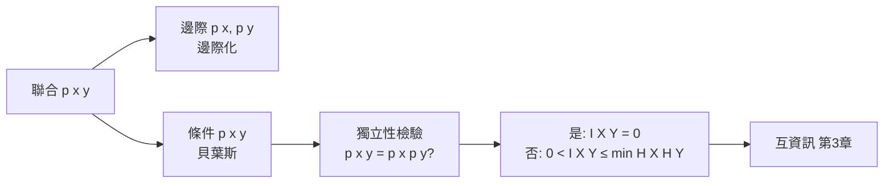

# 2.3 聯合、條件與獨立

## 導言：兩個信源的相遇

真實系統中，資訊幾乎從不孤立：麥克風訊號與雜訊混在一起、傳送的位元與接收的位元透過通道相連、明天天氣與今天雲量相關。要刻劃「一個隨機變數告訴我們多少關於另一個的事」，需要把自資訊推廣到**聯合**與**條件**的語言。本節建立三組概念：聯合自資訊、條件自資訊、以及最重要的「獨立」判準。這些是第 3 章互資訊、第 4 章通道模型的直接地基。

## 聯合機率與聯合自資訊

兩個離散隨機變數 $X$ （值域 $\mathcal{X}$ ）與 $Y$ （值域 $\mathcal{Y}$ ）的**聯合 pmf**：

$$
p(x, y) = P(X = x, Y = y), \qquad \sum_{x}\sum_{y} p(x,y) = 1
$$

事件 $(X=x, Y=y)$ 的自資訊：

$$
I(x, y) = -\log_2 p(x, y)
$$

### 邊際機率

由聯合分佈可邊際化：

$$
p(x) = \sum_{y} p(x, y), \qquad p(y) = \sum_{x} p(x, y)
$$

### 例題：骰子與其奇偶

$X$ 為骰子點數， $Y$ 為奇偶（ $Y=0$ 偶、 $Y=1$ 奇）。聯合表：

| $p(x,y)$ | $y=0$ （偶） | $y=1$ （奇） | 邊際 $p(x)$ |
|---|---|---|---|
| $x=1$ | 0 | $1/6$ | $1/6$ |
| $x=2$ | $1/6$ | 0 | $1/6$ |
| $x=3$ | 0 | $1/6$ | $1/6$ |
| $x=4$ | $1/6$ | 0 | $1/6$ |
| $x=5$ | 0 | $1/6$ | $1/6$ |
| $x=6$ | $1/6$ | 0 | $1/6$ |
| 邊際 $p(y)$ | $1/2$ | $1/2$ | 1 |

聯合自資訊 $I(x=2, y=0) = -\log_2 (1/6) = 2.585$ bits。

## 條件機率與條件自資訊

**條件機率**（Bayes 定理的基礎）：

$$
p(x \mid y) = \frac{p(x, y)}{p(y)} \quad (p(y) > 0)
$$

**條件自資訊**：已知 $Y = y$ 後，事件 $X = x$ 的剩餘不確定性：

$$
I(x \mid y) = -\log_2 p(x \mid y)
$$

關鍵恆等式——**自資訊的鏈法則**：

$$
I(x, y) = I(y) + I(x \mid y) = I(x) + I(y \mid x)
$$

證明： $p(x,y) = p(y)\,p(x|y)$ ，兩邊取 $-\log_2$ 即得。直觀：**「兩件事同時發生」的驚訝 = 先聽到 $y$ 的驚訝 + 在 $y$ 已知下 $x$ 的驚訝**。

### 例題：通道中的條件資訊

二元輸入 $X \in \{0,1\}$ 等可能，透過錯誤率 $p=0.1$ 的二元對稱通道得 $Y$ 。條件分佈：

| $p(y \mid x)$ | $y = 0$ | $y = 1$ |
|---|---|---|
| $x = 0$ | 0.9 | 0.1 |
| $x = 1$ | 0.1 | 0.9 |

- $I(y=0 \mid x=0) = -\log_2 0.9 \approx 0.152$ bits（幾乎不驚訝）。
- $I(y=1 \mid x=0) = -\log_2 0.1 \approx 3.322$ bits（錯誤發生，很驚訝）。
- $I(y=0 \mid x=1)$ 、 $I(y=1 \mid x=1)$ 對稱同理。

這個條件分佈表 $p(y|x)$ 就是**通道模型**的完整描述（4.1 節的主題）；通道容量 $C = \max_{p(x)} I(X;Y)$ 的計算將完全依賴它。

## 貝葉斯定理：資訊的往返

由條件機率定義直接推出**貝葉斯定理**：

$$
p(x \mid y) = \frac{p(y \mid x)\, p(x)}{p(y)}
$$

在通訊中的角色： $p(x)$ 是**先驗**（發送端的符號分佈）、 $p(y|x)$ 是**通道**、 $p(x|y)$ 是**後驗**（接收端對發送符號的信念）。解碼器的工作就是貝葉斯更新：由收到的 $y$ 推算各候選 $x$ 的後驗，選最大者（最大後驗解碼，MAP）——第 6、10 章的解碼演算法都建立在這條公式上。

### 例題：接收端如何反推

延續上例， $p(x=0) = p(x=1) = 0.5$ ，收到 $y = 1$ ：

$$
p(x=0 \mid y=1) = \frac{p(y=1 \mid x=0)\,p(x=0)}{p(y=1)} = \frac{0.1 \times 0.5}{0.5} = 0.1
$$

其中 $p(y=1) = 0.1 \times 0.5 + 0.9 \times 0.5 = 0.5$ 。故後驗為 $P(x=0 \mid y=1) = 0.1$ 、 $P(x=1 \mid y=1) = 0.9$ ，最佳猜測是 $x = 1$ ，錯誤機率 $0.1$ 。若先驗不均勻（ $p(x=0) = 0.99$ ），重算後驗：

$$
p(x=1 \mid y=1) = \frac{0.9 \times 0.01}{0.9 \times 0.01 + 0.1 \times 0.99} = \frac{0.009}{0.009 + 0.099} = \frac{1}{12} \approx 0.083
$$

即使收到 $y=1$ （強烈暗示 $x=1$ ），因為 $x=0$ 先驗壓倒性地大，仍應猜 $x=0$ ！這說明**先驗資訊可以反轉證據的方向**——貝葉斯推理與統計決策的核心。

## 獨立性：資訊的互不干涉

兩個定義層次的獨立：

- **機率獨立**： $p(x, y) = p(x)\, p(y)$ 對所有 $x, y$ 。
- 等價刻劃（ $p(y)>0$ 時）： $p(x \mid y) = p(x)$ ——知道 $y$ 不改變 $X$ 的信念。

在自資訊的語言下，獨立 iff：

$$
I(x, y) = I(x) + I(y) \quad \text{對所有 } x, y
$$

即聯合驚訝 = 個別驚訝之和；知道一個完全無助於預測另一個。

### 例題：判斷獨立

$P(X=0) = P(X=1) = 0.5$ ， $Y = X$ （完全複製）。則 $p(x,y) = 0.5$ 當 $y=x$ ，否則 0。檢驗 $p(0, 0) = 0.5 \neq p(0)p(0) = 0.25$ ，故**不獨立**。事實上 $X$ 與 $Y$ 完全相依：知道 $Y$ 即知道 $X$ 。這個「完美通道」的互資訊 $I(X;Y) = H(X) = 1$ bit，是互資訊的極大值情形（3.3 節）。

反例： $Y = 1 - X$ （反相）。同樣不獨立，且知道 $Y$ 同樣完全決定 $X$ 。注意：**統計相依不等於相關**—— $X$ 與 $Y=1-X$ 的相關係數為 $-1$ ，但一般相依變數可以相關係數為 0（例如 $Y = X^2$ 且 $X$ 對稱分佈）。資訊論的「相依」概念（互資訊）比線性相關更廣。

## 條件獨立與馬可夫鏈

三個變數的條件獨立：給定 $Z$ ， $X$ 與 $Y$ 條件獨立 iff $p(x, y \mid z) = p(x \mid z)\,p(y \mid z)$ 。**馬可夫鏈** $X \to Y \to Z$ 的條件結構：

$$
p(x, y, z) = p(x)\, p(y \mid x)\, p(z \mid y)
$$

即 $Z$ 與 $X$ 條件獨立（給定 $Y$ ）。這個結構在資訊理論中反覆出現：

- **資料處理不等式**：若 $X \to Y \to Z$ ，則 $I(X; Z) \le I(X; Y)$ ——對訊息的任何加工不能增加其關於源頭的資訊（3.3、10.3 節）。
- **串接通道**：兩個通道串接的容量不超過任一者的容量。
- **因子圖上的信念傳播**：圖模型（9.2 節）的局部性正是條件獨立性的幾何表現。

### 例題：串接通道

錯誤率 $p_1 = 0.1$ 與 $p_2 = 0.2$ 的 BSC 串接：總錯誤率 $p = p_1(1-p_2) + (1-p_1)p_2 = 0.1 \times 0.8 + 0.9 \times 0.2 = 0.26$ 。資料處理不等式預測 $I(X; Z) \le \min\{I(X;Y), I(Y;Z)\}$ ，實算 $C(0.26) = 1 - H_2(0.26) \approx 0.168$ bits $< C(0.1) \approx 0.531$ 、 $< C(0.2) \approx 0.278$ 。驗證成立。

## 歷史前因後果

### 誰發展了這套語言

條件機率可追溯到 Bayes（1763）與 Laplace（1812）的逆機率問題。將其全面應用於通訊的是 Shannon（1948）：論文的第 6 節「錯誤對資訊率的影響」首次系統地用 $p(y|x)$ 、 $p(x|y)$ 分析雜訊通道，並定義（雖未命名）互資訊。正式命名「mutual information」與系統化公理（包括鏈法則）由 Fano 與 McEliece 等後繼者在 1950–60 年代教材中完成（R. G. Gallager, *Information Theory and Reliable Communication*, 1968 是經典）。

### 解決了什麼問題

聯合/條件語言解決了「雜訊如何侵蝕資訊」的精確描述：通道不是隨機地摧毀位元，而是使 $p(x|y)$ 與 $p(x)$ 產生差距；資訊損失 = 條件熵 $H(X|Y)$ （3.2 節）。貝葉斯解碼則解決了「收端如何最佳利用證據」。

### 引發什麼新問題

1. 條件熵的鏈法則有一個「意外」： $H(X|Y)$ 可大可小於 $H(X)$ ，但**互資訊永不為負**——這個不對稱引出熵的凹性與資訊不等式系統（3.2、3.3 節）。
2. 連續變數的條件分佈需小心條件機率密度與 $P(y)=0$ 的技術問題，引出測度論式資訊理論。
3. 條件獨立性的圖表示——貝氏網路、馬可夫隨機場——成為機器學習的圖模型理論（9.2 節）。

## 與其他領域的關聯

### 線性代數

聯合 pmf 是一個非負矩陣 $P$ （列 $x$ 、行 $y$ ）；邊際化是矩陣乘向量；條件化是正規化列。**雙隨機矩陣**（列和行和皆 1）在 BSC 與某些通道的分析中出現，且熵在雙隨機變換下不減（Majorization 理論，3.1 節的 $H \le \log M$ 證明工具）。

### 統計學

充分統計量： $T(X)$ 對參數 $\theta$ 充分 iff $I(\theta; X \mid T) = 0$ ——條件獨立的統計版本。資訊幾何（10.3 節）把 Fisher 資訊與相對熵連成微分流形。

### 機器學習

貝氏網路是條件獨立性的有向圖表示；變分推論用相對熵（KL 散度）逼近後驗；EM 演算法的每一步都是最大化一個資訊論量。學好本節的條件機率，等於打好圖模型與貝葉斯機器學習的地基。

## 小結與思考題

聯合、條件、獨立三件工具，讓資訊的語言從「單一符號」升級為「變數之間的關係」：鏈法則分解驚訝、貝葉斯往返信念、馬可夫鏈刻劃資訊流。第 3 章將把這些逐點定義的量加總成期望，得到條件熵、互資訊與相對熵三大度量。

**思考題**

1. 證明：若 $X$ 與 $Y$ 獨立，則 $I(x|y) = I(x)$ 對所有滿足 $p(y)>0$ 的 $x, y$ 成立。
2. 用上例通道（ $p=0.1$ ，等可先驗）算 $p(x=0 \mid y=0)$ ，並驗證兩個後驗加起來等於 1。
3. 舉一個「相關係數為 0 但互資訊大於 0」的具體例子。
4. 若 $X \to Y \to Z$ 且 $Z = Y$ （恆等），資料處理不等式的等號成立嗎？
5. 先驗 $p(x=0) = 0.99$ 的例子中，收到 $y=1$ 卻仍猜 $x=0$ ，這個決策的期望損失最小嗎？若錯猜的代價不對稱（漏判 $x=1$ 代價 1000 倍），最佳決策會變嗎？（提示：貝氏決策與損失函數。）

下一章，我們正式進入資訊論的心臟：熵。

---

## 深入探討：多變數機率結構的完整演練

### 一、三變數鏈法則與貝葉斯網路

2.3 節完成了兩變數的語言，這裡擴展到三變數並連向圖模型（9.2 節的正式地基）。鏈法則：

$$
p(x, y, z) = p(x)\, p(y \mid x)\, p(z \mid x, y)
$$

**馬可夫簡化**：若 $X \to Y \to Z$ ，則 $p(z \mid x, y) = p(z \mid y)$ ，聯合分解為 $p(x)p(y|x)p(z|y)$ ——**兩個條件代替三個**。這種「條件獨立性減少參數」的效果是指數級的： $n$ 變數的一般聯合需要 $2^n$ 個參數，若限定為鏈狀馬可夫只需 $2n - 1$ 個。**圖模型的全部價值在於用條件獨立性把參數從指數壓到線性**，而編碼理論（6.1 的 $H$ 矩陣、10.2 的 Tanner 圖）正是把「碼的約束」畫成圖的實踐。

### 二、條件獨立的四種刻畫與等價性

給定 $Z$ ， $X$ 與 $Y$ 條件獨立（記 $X \perp Y \mid Z$ ）可用四種等價方式刻畫，每一種對應本書的一章：

1. $p(x, y \mid z) = p(x \mid z) p(y \mid z)$ （機率語言——2.3 節）。
2. $I(X;Y \mid Z) = 0$ （資訊語言——3.3 節）。
3. $p(x \mid y, z) = p(x \mid z)$ （推論語言——貝葉斯更新不因 $Y$ 改變，9.2 節）。
4. 因子分解 $p(x,y,z) \propto f(x,z) g(y,z)$ （圖語言——9.2 節因子圖）。

**注意與「邊際獨立」的關係是反直覺的**： $X \perp Y \mid Z$ 不蘊含 $X \perp Y$ ，反之亦然。經典反例（explaining away）：兩個獨立的故障源（雨、灑水器）都導致草地濕；觀察到草地濕（ $Z$ ）後，雨與灑水器**負相關**（一個解釋了現象，另一個嫌疑下降）。這種「條件化創造相依」的現象是貝葉斯網路推斷的核心，也是 10.1 節 Turbo 迭代中「信念在環中來回修正」的機制。

### 三、完整例題：三變數系統的資訊預算

設一個通訊場景： $X$ （發送位元，等可能）、 $Y$ （通道輸出）、 $Z$ （解碼器判決）。 $Y$ 由 $p = 0.1$ 的 BSC 產生， $Z$ 是對 $Y$ 的 MAP 判決（直接輸出 $Y$ 的值，因等可先驗下 MAP = $Y$ ）。此例退化（ $Z = Y$ ），我們改用不對稱先驗： $p(x=0) = 0.9, p(x=1) = 0.1$ 。

**聯合分佈計算**：

$$
p(y=0) = 0.9 \times 0.9 + 0.1 \times 0.1 = 0.82, \qquad p(y=1) = 0.18
$$

**後驗**（2.3 節貝葉斯）：

$$
p(x=1 \mid y=1) = \frac{0.1 \times 0.9}{0.18} = 0.5, \qquad p(x=1 \mid y=0) = \frac{0.1 \times 0.1}{0.82} \approx 0.0122
$$

**MAP 判決**： $y=0$ 時判 $x=0$ （錯誤率 0.0122）； $y=1$ 時後驗 0.5，平手，任判，錯誤率 0.5。總錯誤率：

$$
P_e = 0.82 \times 0.0122 + 0.18 \times 0.5 = 0.010 + 0.090 = 0.100
$$

有趣：**總錯誤率恰為先驗 $p(x=1) = 0.1$ **——在後驗平手的情況下，通道對「1」的檢出增益與「0」的誤判損失恰好抵消。若改判 $y=1$ 時總是輸出 $x=1$ ，錯誤率變為 $0.82 \times 0.0122 + 0 = 0.010$ ——**判決規則的選擇依賴損失函數**，這是貝氏決策論的入口：MAP 最小化 0-1 損失，其他損失（如漏檢代價高）需要不同判決。

### 四、資料處理不等式的證明與三個推論

2.3 節使用了 DPI，這裡給出證明與推論（證明用 3.3 節的鏈法則，先讀一遍無妨）。

**證明**： $X \to Y \to Z$ 時 $p(x,y,z) = p(x)p(y|x)p(z|y)$ ，故

$$
I(X;Y,Z) = I(X;Y) + I(X;Z \mid Y) = I(X;Y)
$$

（第二項為零：給定 $Y$ ， $Z$ 與 $X$ 獨立。）又 $I(X;Y,Z) \ge I(X;Z)$ （條件化不減互資訊，3.2 節），合併得 $I(X;Z) \le I(X;Y)$ 。∎

**三個推論**：

1. **串接通道容量單調**： $C_{\text{串接}} \le \min(C_1, C_2)$ （2.3 節例題的理論根據）。
2. **統計量不超原始資料**：解碼器從 $Y$ 提取的任何統計量 $T(Y)$ 滿足 $I(X;T) \le I(X;Y)$ ——**壓縮觀測可能丟資訊，加工觀測不可能生資訊**。
3. **反饋不增容量**（Shannon 1956）：若發送端知道過往接收值（反饋）， $I(X^n; Y^n)$ 的上界不變——對無記憶通道，反饋改變的是編碼的**實現方式**（如 ARQ 重傳），不是容量本身。

### 五、多變數獨立的注意事項：成對獨立 ≠ 相互獨立

**反例**：擲兩枚公平銅板， $X$ = 第一枚、 $Y$ = 第二枚、 $Z = X \oplus Y$ 。則：

- $X, Y, Z$ **兩兩獨立**（每對的聯合分佈都是均勻 4 格）： $p(x,y) = 1/4 = p(x)p(y)$ 等。
- 但三者**不相互獨立**： $X + Y + Z \equiv 0 \pmod 2$ ，知道其中兩個即完全決定第三個。

這個三頁紙的例子有重大工程意義：** $[3,2]$ 奇偶碼的三個碼位元兩兩獨立但整體受限**。冗餘的全部秘密就在於「成對看起來自由、整體上有約束」——6.1 節 Hamming 碼、10.2 節 LDPC 的檢驗約束都是這個結構的放大。也解釋了為什麼統計學中「兩兩不相關」不足以推「相互獨立」。

### 六、條件機率的資訊量守恆恆等式

有一個值得背誦的恆等式，把 2.2 節的自資訊與本節的條件結構縫合：

$$
\boxed{I(x, y) = I(x) + I(y \mid x) = I(y) + I(x \mid y)}
$$

以及它的「資訊收支表」讀法：以通訊為例， $I(y)$ 是「通道輸出了什麼」的驚訝度， $I(x|y)$ 是「仍不知道發送了什麼」的剩餘驚訝度。兩者之和固定等於聯合事件的自資訊。**知道得越多，剩餘越少，但總帳不變**——這個守恆是 3.2 節鏈法則與 3.3 節互資訊三形式等價的逐點版本。

### 七、補充練習

6. 對第三節的不對稱先驗例子，計算 $I(X;Y)$ （用 $H(X) - H(X|Y)$ 與 $H(Y) - H(Y|X)$ 兩種方式驗證一致； $H(X) = H_2(0.1) \approx 0.469$ ）。
7. 構造一個「 $X \perp Y$ 但給定 $Z$ 後不獨立」的例子（與第二節的 explaining away 對偶）。
8. 證明：若 $X \to Y \to Z$ 且 $I(X;Z) = I(X;Y)$ ，則 $Z$ 是 $Y$ 的充分統計量（關於 $X$ ）——互資訊在馬可夫鏈上不減等號的條件。
9. 兩兩獨立的三變數例中， $I(X;Y) = 0$ 但 $I(X;Y \mid Z) = H(X) = 1$ bit。這說明「條件化可以**創造**互資訊」——與條件化減熵 $H(X|Z) \le H(X)$ 矛盾嗎？（不矛盾： $H(X|Y,Z) = 0 \le H(X|Y) = H(X)$ ，條件化仍不增熵；只是互資訊的兩個條件化位置效果不同。）
