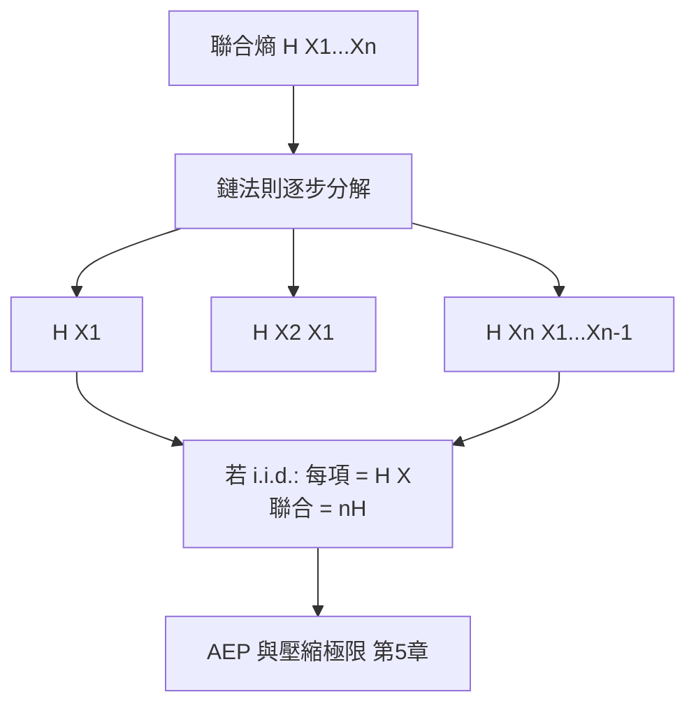

# 3.2 條件熵與鏈法則

## 導言：知道一點之後的不確定性

$H(X)$ 度量「對 $X$ 一無所知時的不確定性」。若我們先觀察到另一個變數 $Y$ （例如收到通道輸出、看到天氣、讀到上文），對 $X$ 的剩餘不確定性是多少？這就是**條件熵**：

$$
H(X \mid Y) = \sum_{y} p(y) \sum_{x} p(x \mid y) \log_2 \frac{1}{p(x \mid y)} = E\left[-\log_2 p(X \mid Y)\right]
$$

條件熵是資訊理論處理**雜訊**與**相依性**的鑰匙： $H(X \mid Y)$ 大，代表即使知道 $Y$ 仍不確定 $X$ （通道很糟、或兩者無關）； $H(X \mid Y) = 0$ 代表 $X$ 可由 $Y$ 完全確定（無雜訊通道、或 $Y$ 決定 $X$ ）。

## 定義與直觀

### 從條件自資訊出發

2.3 節定義條件自資訊 $I(x \mid y) = -\log_2 p(x \mid y)$ 。對 $(x, y)$ 取聯合期望即條件熵：

$$
H(X \mid Y) = E\left[I(X \mid Y)\right] = \sum_{x,y} p(x,y) \log_2 \frac{1}{p(x \mid y)}
$$

直觀：平均而言，聽到 $Y$ 之後， $X$ 還剩多少驚訝。

### 例題 1：完美通道

$Y = X$ （ $Y$ 完全複製 $X$ ）。對每個 $y$ ， $p(x \mid y) = 1$ 當 $x = y$ （否則 0），故每項 $-\log_2 1 = 0$ ：

$$
H(X \mid Y) = 0
$$

知道輸出後輸入完全確定——無雜訊的極限。

### 例題 2：無關變數

$X$ 與 $Y$ 獨立。 $p(x \mid y) = p(x)$ ，故

$$
H(X \mid Y) = \sum_y p(y) H(X) = H(X)
$$

知道一個無關的東西，不確定性不減分毫。

### 例題 3：BSC 通道

等可能輸入、錯誤率 $p$ 的 BSC。給定 $Y = y$ ，輸入 $X$ 的條件分佈是 $\{1-p, p\}$ ，故

$$
H(X \mid Y) = H_2(p)
$$

例： $p = 0.1$ ， $H(X \mid Y) = 0.469$ bits。輸入熵 $H(X) = 1$ bit，知道 $Y$ 後剩 0.469——**通道每個使用平均消除了 $1 - 0.469 = 0.531$ bits 的不確定性**，這個數正是通道容量（4.1 節）。

## 鏈法則：熵的微積分基本定理

### 二變數鏈法則

$$
H(X, Y) = H(Y) + H(X \mid Y) = H(X) + H(Y \mid X)
$$

證明： $p(x,y) = p(y) p(x \mid y)$ ，取 $-\log_2$ 加權求和：

$$
H(X,Y) = \sum_{x,y} p(x,y) \log_2 \frac{1}{p(y)} + \sum_{x,y} p(x,y) \log_2 \frac{1}{p(x \mid y)} = H(Y) + H(X \mid Y)
$$

### 多變數推廣

$$
H(X_1, X_2, \dots, X_n) = \sum_{i=1}^{n} H(X_i \mid X_1, \dots, X_{i-1})
$$

鏈法則對**任意相依結構**成立（不像獨立性要求），因此是所有熵計算與證明的萬用分解工具。

### 例題：鏈法則計算

信源 $p(x,y)$ ： $p(a,a) = 1/2$ 、 $p(a,b) = 1/4$ 、 $p(b,b) = 1/4$ 。

邊際： $p(x=a) = 3/4$ 、 $p(x=b) = 1/4$ ； $p(y=a) = 1/2$ 、 $p(y=b) = 1/2$ 。

- $H(Y) = 1$ bit（均勻）。
- 條件分佈 $p(x \mid y=a) = (1, 0)$ 、 $p(x \mid y=b) = (1/2, 1/2)$ 。
- $H(X \mid Y) = p(y=a) \cdot 0 + p(y=b) \cdot H_2(0.5) = \tfrac12 \cdot 1 = 0.5$ bits。
- 驗證： $H(X,Y) = H(Y) + H(X \mid Y) = 1 + 0.5 = 1.5$ bits。
- 直接算： $\tfrac12 \log_2 2 + \tfrac14 \log_2 4 + \tfrac14 \log_2 4 = 0.5 + 0.5 + 0.5 = 1.5$ 。✓

## 條件熵的不等式

### 不等式一：知道不會更糟

$$
H(X \mid Y) \le H(X)
$$

直觀「額外資訊不會增加不確定性」。證明由 3.3 節互資訊非負性 $I(X;Y) \ge 0$ 立即得到（因 $H(X) - H(X \mid Y) = I(X;Y)$ ）。**注意陷阱**：這個不等式是對**期望**成立的；對特定 $y$ ， $H(X \mid Y = y)$ 可以大於 $H(X)$ ！經典反例：

$P(X=0, Y=0) = 1/4$ 、 $P(X=1, Y=0) = 1/2$ 、 $P(X=1, Y=1) = 1/4$ 。則 $H(X) = H_2(3/4) \approx 0.811$ ，但 $H(X \mid Y = 0) = H_2(1/3) \approx 0.918 > 0.811$ 。特定觀察值可能「越聽越糊」，但平均上不會。

### 不等式二：條件條件熵不增（條件化遞減熵）

$$
H(X \mid Y, Z) \le H(X \mid Y)
$$

知道得越多，剩餘不確定性越少（平均意義）。由條件互資訊非負性可得。

### 不等式三：i.i.d. 鏈法則的退化

若 $X_1, \dots, X_n$ i.i.d.，每項條件熵等於 $H(X_i)$ ，鏈法則給

$$
H(X^n) = n H(X)
$$

聯合熵**線性**成長——這正是 AEP 中 $p(x^n) \approx 2^{-nH}$ 的來源（3.1 節），也是馬可夫信源熵率的定義入口（見下）。

## 熵率：序列信源的真實極限

對平穩隨機過程 $\{X_i\}$ （例如英文文本、馬可夫鏈），每符號熵隨位置變化，真正的極限是**熵率**：

$$
H(\mathcal{X}) = \lim_{n \to \infty} \frac{1}{n} H(X_1, \dots, X_n)
$$

平穩過程下此極限存在，且可證 $H(\mathcal{X}) = \lim_n H(X_n \mid X^{n-1})$ （條件熵的極限）。對一階馬可夫鏈：

$$
H(\mathcal{X}) = H(X_n \mid X_{n-1}) = \sum_{i,j} \pi_i T_{ij} \log_2 \frac{1}{T_{ij}}
$$

其中 $\pi$ 為平穩分佈、 $T$ 為轉移矩陣。

### 例題：英文的熵率

英文若為 i.i.d. 字母： $4.18$ bits。一階馬可夫（計入雙字母組）：約 $3.56$ 。Shannon 的猜字實驗： $1.3$ – $1.5$ bits。熵率隨上下文長度下降，反映語言的**長程統計相依**——這是 5.3 節上下文壓縮與現代語言模型的理論動機。

### 例題：馬可夫鏈熵率計算

兩態馬可夫鏈，轉移矩陣

$$
T = \begin{pmatrix} 0.8 & 0.2 \\ 0.4 & 0.6 \end{pmatrix}
$$

平穩分佈 $\pi$ 滿足 $\pi T = \pi$ ： $\pi = (2/3, 1/3)$ 。熵率：

$$
H(\mathcal{X}) = \tfrac23 H_2(0.2) + \tfrac13 H_2(0.4) \approx \tfrac23 (0.722) + \tfrac13 (0.971) \approx 0.805 \text{ bits/step}
$$

比無記憶同頻率信源 $H_2(2/3) \approx 0.918$ 小——**相依性攜帶可預測性，可預測性就是可壓縮性**。

## 歷史前因後果

### 誰提出條件熵

Shannon 1948 論文中已使用條件熵（稱 equivocation，「曖昧度」）分析雜訊通道：他定義 $H(x) - H_y(x)$ 為「接收後輸入的曖昧度」，正是今日的 $H(X \mid Y)$ 。鏈法則的系統陳述在 1950–60 年代由 Fano（MIT 講義，1961 出版《Transmission of Information》）、Gallager（1968）完成公理化。

### 解決了什麼問題

1. **雜訊的定量**： $H(X \mid Y)$ 把「雜訊造成多少損失」變成一個數，通道容量 $C = H(X) - H(X \mid Y) = I(X;Y)$ 隨之可定義（第 4 章）。
2. **相依信源的極限**：熵率使英文、語音等相依信源的壓縮極限可以陳述，導出 LZ 演算法的理論目標（5.3 節）。
3. **多信源問題**：Slepian–Wolf 定理（1973）用條件熵 $H(X \mid Y)$ 描述「 $Y$ 已在解碼端時 $X$ 的壓縮極限」，開啟分散式信源編碼（10.3 節）。

### 引發什麼新問題

1. 「條件化遞減熵」在量子資訊中**可以失敗**（條件化可增熵），催生量子資訊理論的新結構（10.3 節）。
2. 熵率的計算對高維相依過程困難，催生 Levitin–Varshamov 界、組合方法等。
3. 「平均 vs 逐點」的落差（特定 $y$ 時條件熵可增）引出資訊不等式的精細結構與資訊譜方法（10.3 節 Han 的理論）。

## 與其他領域的關聯

### 線性代數

馬可夫鏈的轉移矩陣是隨機矩陣，平穩分佈是其特徵值 1 的特徵向量；熵率是「隨機矩陣加權行熵」。Perron–Frobenius 定理保證平穩分佈存在且唯一（不可約時）——線性代數直接餵給資訊理論。

### 統計力學

條件熵對應熱力學的「給定巨觀約束下的剩餘微觀熵」； $H(X \mid Y) \le H(X)$ 的資訊版是「觀測不改變（平均）熵」，但在量子系統中測量本身會擾動系統——這正是量子資訊與經典資訊分道揚鑣之處。

### 機器學習

決策樹每次分裂以資訊增益（ $H(Y) - H(Y \mid X_{\text{split}})$ ）選特徵；序列模型的訓練目標是估計條件熵 $H(\text{下一字} \mid \text{上文})$ ；困惑度就是 $2^{H(X_n|X^{n-1})}$ 的實證估計。條件熵是「模型有多了解這個世界」的度量。

## 小結與思考題

條件熵 $H(X \mid Y)$ 量化「知道 $Y$ 後的剩餘不確定性」，鏈法則 $H(X,Y) = H(Y) + H(X \mid Y)$ 把聯合分解為序列的條件鏈，熵率把極限推廣到相依信源。下一節的互資訊 $I(X;Y) = H(X) - H(X \mid Y)$ 把「 $Y$ 消除了多少不確定性」變成中心量。

**思考題**

1. 用 2.3 節的骰子/奇偶例（ $X$ 骰子、 $Y$ 奇偶）計算 $H(X)$ 、 $H(X \mid Y)$ 、 $H(Y \mid X)$ ，並驗證鏈法則。（答案方向： $H(Y \mid X) = 0$ ， $H(X \mid Y) = H(X) - 1$ 。）
2. 證明 $H(Y \mid X) \le H(Y)$ ，並舉一個 $H(Y \mid X = x) > H(Y)$ 對某 $x$ 成立的例子。
3. 兩態馬可夫鏈 $T = \begin{pmatrix} 0.9 & 0.1 \\ 0.5 & 0.5 \end{pmatrix}$ ：求平穩分佈與熵率。
4. 為什麼 $H(X \mid Y) \le H(X)$ 平均成立、逐點未必？用「平均不會吃虧、個別可能吃虧」造一個生活類比。
5. 英文的熵率約 1.5 bits/字母而字母表有 27 個符號（ $\log_2 27 \approx 4.75$ ）。這 3.25 bits/字母的差距跑到哪裡去了？（提示：條件熵與上下文。）

下一節：互資訊與相對熵——資訊理論的兩把度量衡。

---

## 深入探討：鏈法則的應用、熵率的計算與馬可夫模型的深掘

### 一、鏈法則的「收支表」應用：一個五步計算示範

條件熵鏈法則最實用的形態是把它當作**聯合熵的逐段預算表**。例：英文文本的近似熵率計算。設已知（3.1 節表格）：

- $H(X_1) \approx 4.14$ （首字母，i.i.d. 頻率模型）。
- $H(X_2 | X_1) \approx 3.56$ （雙字母組統計）。
- $H(X_3 | X_1, X_2) \approx 3.30$ 。

則三字母聯合熵：

$$
H(X_1, X_2, X_3) = 4.14 + 3.56 + 3.30 = 11.0 \text{ bits}
$$

對 $n$ 長文本，若條件熵收斂到 $H(\mathcal{X}) \approx 1.5$ ，聯合熵為 $4.14 + 3.56 + (n-2) \times 1.5$ ——**首兩個符號的「開銷」攤薄後可忽略，長程極限由條件熵率決定**。這解釋了壓縮器（5.3 節）為何需要「暖機」階段：模型要先累積上下文，條件熵才降到極限。

### 二、熵率的三種等價表達與馬可夫鏈的完整計算

對平穩過程，熵率有三種寫法（皆可作定義）：

$$
H(\mathcal{X}) = \lim_{n\to\infty} \frac{1}{n} H(X^n) = \lim_{n\to\infty} H(X_n | X^{n-1}) = H(X_0 | X_{-1}, X_{-2}, \dots)
$$

**馬可夫鏈的完整計算流程**（以 3.2 節例題延伸）：

1. 求平穩分佈：解 $\pi T = \pi$ 、 $\sum \pi_i = 1$ （線性代數： $T$ 的特徵值 1 之左特徵向量）。
2. 熵率 $= \sum_i \pi_i \sum_j T_{ij} \log_2 \frac{1}{T_{ij}}$ ——**平穩分佈加權的行熵平均**。
3. 對稱二態鏈（ $T = \begin{pmatrix} 1-p & p \\ p & 1-p\end{pmatrix}$ ）： $\pi = (1/2, 1/2)$ ，熵率 $= H_2(p)$ 。**對稱鏈的熵率只依賴轉移機率**。

**例題**： $p = 0.1$ 的對稱二態鏈，熵率 $= H_2(0.1) = 0.469$ bits/step。比較同頻率的 i.i.d. 信源（邊際也是 1/2）熵率 1 bit——**相依性省了 53% 的位元**。把鏈變換成游程編碼的視角：狀態長游程（平均長度 $1/p = 10$ ），只需編「游程長度」分佈，而游程長度分佈是幾何分佈、熵約 0.469+1.44 bits……與直接馬可夫計算一致（讀者可驗證）。**游程編碼（傳真標準 G3/G4 的核心）就是二值馬可夫信源的工程化身**。

### 三、條件熵的進階不等式系統

除了 3.2 節的基本不等式，編碼理論常用的一組「熵微積分」：

| 不等式 | 陳述 | 用途 |
|---|---|---|
| 次模性 | 熵的集合函數次模性 | 網路編碼界（10.3） |
| Han 不等式 | $H(X^n)$ 的組合上界 | 多用戶界 |
| Mrs. Gerber | $H(X|Y) \ge H_2(H_2^{-1}(H(X)) * p)$ （BSC） | 遠程熵下界 |
| 遞減熵 | $H(X|Y,Z) \le H(X|Y)$ | 鏈法則方向 |

**Shannon 型不等式**（由非負互資訊導出者）在 1998 年被 Zhang–Yeung 打破：存在**非 Shannon 型**資訊不等式（四變數以上），證明資訊不等式的完備公理系統不存在——這是 3.3 節末預告的前沿，也是 10.3 節網路編碼容量域研究的日常工具。

### 四、條件熵與最小均方誤差（MMSE）的深層聯繫

對連續變數有一條深刻的恆等式（Guo–Shamai–Verdú 2005 的 I-MMSE）：

$$
\frac{d}{d\,\mathrm{snr}} I(X; \sqrt{\mathrm{snr}}\,X + Z) = \frac{1}{2} \mathrm{mmse}(\mathrm{snr})
$$

**互資訊對 SNR 的導數 = 最小均方誤差**。意義：

1. 估計理論（MMSE）與資訊理論（互資訊）被一條微分方程式縫合。
2. 4.2 節 AWGN 容量隨功率的增長速度，由「此 SNR 下的最佳估計誤差」決定——**通訊能力 = 估計能力**。
3. 這條恆等式是 2010 年代資訊理論最活躍的橋樑之一，連向單用戶/多用戶容量界與稀疏恢復理論。

### 五、熵率的經典反直覺例子

**例 1（負熵的視覺）**：對連續變數， $h(X|Y)$ 可為負（微分熵），但 $I(X;Y) = h(X) - h(X|Y) \ge 0$ 恆成立——兩個負數之差為正。初學者常在 4.2 節 AWGN 推導中被「負熵」絆倒，記住「**連續情況只有差有意義**」即可。

**例 2（知道越多極限熵越低）**： $H(X_n|X^{n-1})$ 對 $n$ 單調不增（平穩過程）。但**逐點**條件熵 $H(X_n|X^{n-1} = x^{n-1})$ 可以對特定 $x^{n-1}$ 上升（3.2 節的陷阱）——平均與逐點的差別再次出現。

**例 3（熵率與壓縮的實測對照）**：LZ77 實測英文文本約 2.2–2.6 bits/字母（5.3 節），高於人類估計的 1.5——LZ 收斂到熵率極慢（Ziv–Lempel 定理是極限陳述，有限文本差很遠）。這個「理論極限 vs 實際工具」的差距是壓縮工程存在的全部理由。

### 六、熵率與編碼器的介面：算術編碼如何「吃」條件熵

把 3.2 節的理論與 5.3 節的演算法對接（跨章預告）：

- 算術編碼的每步碼長增量 = $-\log_2 p(x_i | \text{上下文})$ ——**逐符號精確支付條件自資訊**。
- 上下文模型的品質決定它逼近哪個條件熵：1 階上下文逼近 $H(X_n|X_{n-1})$ ，無限階逼近熵率 $H(\mathcal{X})$ 。
- **編碼器的設計 = 選擇條件化結構**。語言模型壓縮器（10.3 節）用神經網路給條件機率，直接逼近人類級的 1.2 bits/字母。

這條「條件熵（理論）→ 條件機率模型（統計）→ 算術編碼（演算法）」的鏈，是資訊理論從定理到軟體的完整樣板，值得在學完第 5 章後回來重讀。

### 七、補充思考題

6. 三態馬可夫鏈轉移矩陣 $T = \begin{pmatrix} 0.5 & 0.5 & 0 \\ 0 & 0.5 & 0.5 \\ 0.5 & 0 & 0.5 \end{pmatrix}$ ：求平穩分佈與熵率。
7. 證明對稱二態鏈的熵率等於 $H_2(p)$ ，並解釋為何它等於「游程長度幾何分佈的熵加 $\log_2 e$ 項」。
8. 用 I-MMSE 恆等式論證：AWGN 通道在低 SNR 時容量近似線性於 SNR（提示： $\mathrm{mmse}(0) = \mathrm{Var}(X)$ ）。
9. 對 3.2 節的兩態鏈例：若把觀測延遲一個符號（計算雙側條件熵 $H(X_n | X_{n-2}, X_{n+1})$ ），熵會更低還是更高？這對雙向掃描壓縮器有何啟示？
