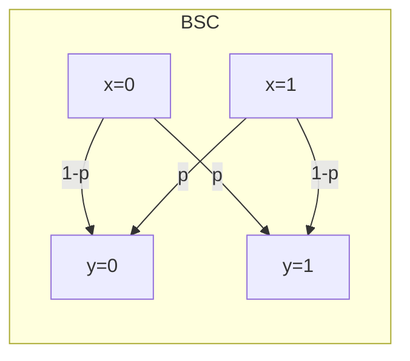

# 4.1 雜訊通道模型

## 導言：把雜訊寫成數學

真實世界沒有完美的通道：電線有電阻雜訊、無線電有衰落與干擾、光纖有放大器自發輻射、儲存媒體有位元翻轉。資訊理論的偉大之處在於：**不問雜訊的物理來源，只問它的統計行為**。一個通道由條件分佈 $p(y \mid x)$ 完整描述（2.3 節），而通道的一切能力由容量

$$
C = \max_{p(x)} I(X;Y)
$$

一個數字總結（1.3、3.3 節）。本節建立標準通道模型，計算幾個關鍵容量，為 4.2 的高斯通道鋪路。

## 標準離散通道模型

### 二元對稱通道（BSC）

最簡單也最重要的模型：輸入 $x \in \{0,1\}$，以機率 $p$ 翻轉：

$$
p(y \mid x) = \begin{cases} 1-p & y = x \\ p & y \ne x \end{cases}
$$

源自 Shannon 1948 的基本範例，適合描述：位元翻轉記憶體、淺衰落二元調變、密碼學攻擊模型。容量（3.3 節已推）：

$$
C_{\text{BSC}} = 1 - H_2(p)
$$

### 二元抹除通道（BEC）

輸入不是被翻轉而是被**抹除**（接收端知道它不知道）：

$$
p(y \mid x) = \begin{cases} 1-e & y = x \\ e & y = ? \end{cases}
$$

容量：

$$
C_{\text{BEC}} = 1 - e
$$

直觀：$e$ 比例的位元直接丟失，剩餘 $(1-e)$ 比例完美，故容量為 $1-e$。BEC 描述：封包網路（丟包）、擦除磁碟、以及**極化碼（Polar codes, 2008）的理論基礎**——Arikan 證明 BEC 可被「極化」為若干完美位元與若干全雜訊位元，容量漸近可達（10.3 節）。

### Z 通道（不對稱通道）

1 永遠正確、0 以機率 $q$ 變 1。容量無閉式解，但對輸入分佈 $p(x=1)$ 單調凹可數值解：

$$
C_Z = \log_2\!\left(1 + (1-q)\, q^{q/(1-q)}\right)
$$

Z 通道示範：**對稱假設不是普適的**，容量最大化需要最佳化輸入分佈。

### 例題：BSC 容量的計算

$p = 0.1$：

$$
C = 1 - H_2(0.1) = 1 - \left(-0.1\log_2 0.1 - 0.9\log_2 0.9\right) = 1 - (0.3322 + 0.1368) = 0.531 \text{ bits/use}
$$

意義：每兩次通道使用可零錯誤傳輸約 1.06 位元。若系統以 $R = 0.7$ bits/use 傳輸，$R > C$，**錯誤率必有一個正的下界**，任何聰明碼都救不了——Shannon 逆定理（4.3 節）。

## 雜訊的分類

| 類型 | 描述 | 模型 |
|---|---|---|
| 熱雜訊 | 導體中電子熱運動，功率 $kTB$ | 高斯白雜訊（AWGN，4.2） |
| 散粒雜訊 | 載子到達的隨機性（光電倍增管） | Poisson 通道 |
| 脈衝雜訊 | 稀疏但劇烈（閃電、開關） | 突發錯誤、Memory 通道 |
| 衰落 | 多路徑導致的時變增益 | 雙對數常數衰落通道 |
| 干擾 | 其他用戶的訊號 | 多用戶通道（10.3） |

**為什麼高斯是「最壞」的雜訊**：在給定雜訊方差的約束下，高斯分佈的熵最大（3.1 節最大熵原理），因此對訊息的破壞最強；若實際雜訊不是高斯，容量只會更高。這使 AWGN 成為保守的工程上界與標準基準。

## 通道容量的一般計算：Blahut–Arimoto 演算法

對一般離散通道，$C = \max_{p(x)} I(X;Y)$ 是凹規劃。Blahut（1972）與 Arimoto（1972）獨立提出迭代演算法：

1. 初始化輸入分佈 $p^{(0)}(x)$（通常均勻）。
2. 計算後驗：$q^{(t)}(x \mid y) = \dfrac{p^{(t)}(x) p(y \mid x)}{\sum_{x'} p^{(t)}(x') p(y \mid x')}$。
3. 更新輸入：$p^{(t+1)}(x) = \dfrac{p^{(t)}(x)\, \exp\!\left(\sum_y p(y \mid x) \log_2 \dfrac{p(y \mid x)}{\sum_{x'} p^{(t)}(x') p(y \mid x')}\right)}{\text{normalization}}$。
4. 重複直到收斂；收斂值即 $C$。

這是 EM 演算法在容量問題上的化身，證明每步 $I$ 單調不減、收斂到全域極大（凹性保證，3.1 節）。**互資訊的凹性不只證明存在，還直接給出演算法**。

### 例題：手算 BSC 的最佳輸入

BSC 對稱（$p(y|0)$ 是 $p(y|1)$ 的翻轉），由對稱性最佳輸入必為均勻。設 $p(x=0) = \alpha$：

$$
p(y=0) = \alpha(1-p) + (1-\alpha)p
$$

$$
I(X;Y) = H(Y) - H(Y \mid X) = H_2\!\left(\alpha(1-p) + (1-\alpha)p\right) - H_2(p)
$$

$H_2$ 在 0.5 處最大，故最佳 $\alpha = 0.5$，$C = 1 - H_2(p)$。✓（Z 通道無對稱性，故需數值最佳化——對照 3.1 節凹性的用途。）

## 通道的記憶與突發錯誤

BSC 假設每個位元獨立出錯，但真實通道（無線衰落、光碟刮痕）錯誤**成串**：一個位元錯，鄰近位元大概率也錯。模型化方式：

1. **Gilbert–Elliott 通道（1960）**：兩狀態馬可夫鏈，好狀態低錯誤率、壞狀態高錯誤率。由於記憶，容量高於把同樣平均錯誤率當 BSC 的值——**知道錯誤的時間相關性本身就是資訊**。
2. **交錯（interleaving）**：實務上不建模記憶，而是把位元打散，使突發錯誤在碼字內變成獨立錯誤（7.2 節 Reed–Solomon 的突發對策）。
3. **可反饋通道**：若接收端可回傳訊息（ARQ 自動重傳），容量改由「可反饋容量」描述；對離散無記憶通道反饋不增容量（Shannon, 1956），但對通道已知度、延遲與用戶通道有幫助（10.3 節）。

## 容量與速率：編碼定理的舞台

**編碼率** $R$：每個通道使用傳送的資訊位元數。定理的兩面（4.3 節證明）：

- **可達性**：$R < C \Rightarrow$ 存在碼使錯誤率 $\to 0$。
- **逆定理**：$R > C \Rightarrow$ 錯誤率有正下界。

| 通道 | 容量 | 備註 |
|---|---|---|
| BSC（$p=0.1$） | 0.531 | $C = 1-H_2(p)$ |
| BSC（$p=0.11$） | 0.4999 | 剛好約 1/2 |
| BEC（$e=0.3$） | 0.7 | $C = 1-e$ |
| AWGN（SNR 0dB, 1Hz） | 1 | $\frac12\log_2(1+1)$（4.2） |
| AWGN（SNR 20dB, 3kHz） | 19975 | $\approx 3000\log_2(101)$ |

### 例題：從容量到系統設計

無線鏈路 BSC 等效錯誤率 $p = 0.05$，需可靠傳 100 kbps 的資料。

- 容量 $C = 1 - H_2(0.05) = 1 - 0.2864 = 0.7136$ bits/use。
- 需要通道使用率 $\ge 100{,}000 / 0.7136 \approx 140{,}100$ use/s。
- 若調變每 use 傳 1 個原始位元，需 $140$ k symbols/s 以上的符號率（8.3 節調變）。
- 編碼率設計：可達率需 $< C$，例如取 $R = 0.6$（碼率 $0.6$），則符號率 $100{,}000/0.6 \approx 167$ kBaud。

## 歷史前因後果

### 誰、何時、為什麼

- **1948 Shannon**：提出離散通道模型與容量定義；BSC/BEC 作為核心範例。
- **1948 Wiener**：連續時間的濾波與預測觀點（與 Shannon 互補）。
- **1956 Shannon**：零錯誤容量與反饋容量。
- **1960 Elias**：BEC 的隨機編碼與刪除解碼分析。
- **1961 Fano**：Fano 不等式——逆定理的關鍵工具（4.3 節）。
- **1972 Blahut / Arimoto**：容量的可計算化。
- **2008 Arikan**：極化碼，第一個可證明在 BSC/BEC 上達香農極限的可實作碼（10.3 節）。

### 解決了什麼問題

把「這條線路最多能可靠傳多快」從經驗問題變成可計算的數。工程師從此有了設計標尺：碼的表現與 $C$ 的差距（Shannon gap）成為評價編碼方案的唯一標準。

### 引發什麼新問題

1. **可實作性**：Shannon 的存在性證明沒給碼，隨機編碼的解碼複雜度是指數級——五十年的編碼理論史就是「找可實作的好碼」（第 6、7、10 章）。
2. **多用戶**：兩個用戶共用通道，容量域是什麼？——網路資訊理論（10.3 節）。
3. **通道未知**：實際通道參數需估計，催生訓練序列、盲估計與通用編碼。
4. **有限碼長**：$C$ 是碼長無限的極限，實際碼長下的極限（normal approximation）仍是活躍研究（10.3 節）。

## 與其他領域的關聯

### 機率統計

通道是條件分佈 $p(y|x)$，容量是對其輸入分佈的最大互資訊；解碼是 MAP 估計（2.3 節貝葉斯）；錯誤指數是 Stein 引理的相對熵（3.3 節）。

### 凸優化

$\max_{p(x)} I$ 的目標函數凹、可行集是單純形，凸優化理論保證全域極大與 Blahut–Arimoto 的收斂。

### 線性代數

通道的轉移矩陣、馬可夫記憶通道的狀態空間、碼的奇偶檢驗矩陣（第 6 章）——線性代數是離散通道理論的骨架。

## 小結與思考題

通道模型 = 條件分佈 $p(y|x)$；通道能力 = 容量 $C = \max I(X;Y)$。BSC 的 $1 - H_2(p)$、BEC 的 $1 - e$、Z 通道的數值解，構成離散通道的教科書三部曲；高斯通道（4.2 節）將把劇情推向連續世界。

**思考題**

1. 計算 $p = 0.01$ 與 $p = 0.2$ 的 BSC 容量，體會 $C$ 隨 $p$ 的下降速度。
2. 證明 BEC 容量 $1 - e$：提示——被抹除的位元無論輸入何值輸出相同，互資訊只來自未抹除部分。
3. 為什麼高斯雜訊是「給定方差下最壞」？用最大熵原理论證。
4. 若 BSC 的 $p$ 可以由接收端測得（如衰落電平），這算不算「反饋」？對系統設計有何幫助？（提示：自適應調變。）
5. 用 Blahut–Arimoto 的思想手算 Z 通道（$q = 0.3$）的前兩次迭代。

下一節：連續世界的高斯通道——香農公式 $C = W \log_2(1 + P/N)$ 的誕生。

---

## 深入探討：通道模型的計算細節與容量計算技術

### 一、多種通道的容量計算演練

補齊 4.1 節的計算樣本，覆蓋各種典型通道：

**例 1（BSC 的對稱性論證補強）**：BSC 的轉移矩陣是**雙隨機**的（行和與列和皆 1）。可以證明：對雙隨機通道，均勻輸入即達容量。直觀：雙隨機性使輸出分佈在均勻輸入下也均勻，$H(Y) = \log 2$ 達極大，而 $H(Y|X)$ 與輸入分佈無關（$\sum_x p(x) H_2(p) = H_2(p)$）——$I$ 自動極大。

**例 2（BEC 的最佳輸入也是均勻）**：$p(y) = (1-e, e)$ 與輸入無關（每個輸入都有 $e$ 比例被抹除），$H(Y) = H_2(e)$ 固定，$H(Y|X) = e$（抹除時輸入完全未知），故 $I = (1-e)H(X) - e \cdot 0$ 型化簡後 $I = (1-e)H(X)$——**最大化 $H(X)$ 即均勻輸入**，$C = 1-e$。

**例 3（不對稱通道的數值解）**：Z 通道（$q = 0.3$）用 Blahut–Arimoto 的前兩輪：

- 初始 $p_0(1) = 0.5$。$p(y=1) = 0.5 \times 0.3 + 0.5 = 0.65$；$p(y=0) = 0.35$。
- $I = H(Y) - H(Y|X) = H_2(0.65) - [0.5 H_2(0.3) + 0.5 \times 0] = 0.934 - 0.442 = 0.492$。
- 更新 $p_1(1) = 0.5 e^{0.442/\ln 2 \text{ 項}} \approx 0.568$（由 Blahut 更新公式，機率向「帶來更多資訊的符號」傾斜，此處符號 1 的條件熵為零，最「有用」）。
- 繼續迭代收斂到 $p^*(1) \approx 0.55$，$C \approx 0.55$ bits（與 4.1 節公式 $ \log_2(1 + 0.7 \times 0.3^{0.3/0.7}) \approx 0.55$ 一致）。

### 二、通道模型的記憶性：Gilbert–Elliott 的完整分析

4.1 節提到突發錯誤，這裡做完整的二狀態馬可夫通道分析：

- 好狀態 G：錯誤率 $p_G = 0.01$；壞狀態 B：$p_B = 0.5$。
- 狀態轉移：$P(G \to B) = 0.05$、$P(B \to G) = 0.3$（壞狀態持續短、好狀態持續長——模擬衰落突發）。
- 平穩分佈：$\pi_B = \frac{0.05}{0.05 + 0.3} = 0.143$，$\pi_G = 0.857$。
- 平均錯誤率：$0.857 \times 0.01 + 0.143 \times 0.5 = 0.080$。

**若接收端知道狀態**（狀態資訊 CSI）：等效於兩條獨立通道的混合，容量

$$
C_{\text{CSI}} = \pi_G(1 - H_2(0.01)) + \pi_B(1 - H_2(0.5)) = 0.857 \times 0.919 + 0.143 \times 0 = 0.788
$$

**若不知道狀態**：容量低於此值（介於把 0.08 當 BSC 的 $1 - H_2(0.08) = 0.599$ 與 0.788 之間，具體值需數值方法）。**狀態資訊的價值 = 兩者的差，約 0.1–0.2 bits/use**——這就是 4G/5G 中「通道品質指示（CQI）回報」的資訊理論價值：上行的狀態回報本身花費資源，但換來的容量增益遠超其成本。

### 三、為什麼「高斯最壞」的完整論證

4.1 節宣稱高斯是給定方差下最壞的雜訊。完整論證：

1. 互資訊可寫為 $I(X;Y) = h(X + Z) - h(Z)$。
2. 給定雜訊方差 $N$，$h(Z) \le \frac12\log_2(2\pi e N)$（高斯最大，3.1 節）。
3. 對**固定的輸入分佈**，非高斯雜訊使 $h(Z)$ 變小、且 $h(X+Z)$ 的下降通常小於 $h(Z)$ 的下降（摺積向高斯靠近，中心極限定理效應）。
4. 淨效果：$I$ 通常更大——**非高斯雜訊的容量 $\ge$ 同方差高斯雜訊的容量**。

**例外與細節**：存在病態雜訊分佈（離散雜訊加極小振幅）可令 $I \to 0$（任意小方差也能毀掉高階調變）——所以正確的陳述是「**給定方差與可微密度約束下**，高斯最壞」。工程含義：數位系統害怕的不是雜訊的「大小」而是其「形狀」（突發、量化效應）——這再次連向 6.2 節突發錯誤與交錯。

### 四、容量的單調性與凸性：三條實用性質

| 性質 | 陳述 | 工程含義 |
|---|---|---|
| 對雜訊的單調 | 雜訊「更大」（統計意義）⇒ $C$ 更小 | 加任何干擾都吃容量 |
| 對功率的凹 | $C(P)$ 凹於 $P$ | 功率邊際效益遞減——低 SNR 加功率划算 |
| 對頻寬的線性極限 | 高 $W$ 時 $C \to \frac{P}{N_0}\log_2 e$ | 無限頻寬的容量極限有限（4.2 節 $-1.59$ dB 的另一讀法） |

第三條值得展開：$W \to \infty$、$P$ 固定時，$C = W\log_2(1 + \frac{P}{N_0 W}) \to \frac{P}{N_0}\log_2 e$。**無限頻寬的容量是有限數**——頻寬不能無限補償功率不足，這是深空通訊（功率極限區）的根本約束。

### 五、通道編碼定理的「誤差指數」預覽表

4.1 節的碼效能問題（Hamming 碼離極限多遠）可以用錯誤指數理論（4.3 節正式介紹）預答。BSC（$p = 0.1$）上的指數對照：

| 碼策略 | 指數 $E$（bits/位元） | 意義 |
|---|---|---|
| 隨機編碼下界（Shannon） | $\approx 0.04$（在 $R = 0.3$） | 可達指數的保證 |
| 球包裝上界 | $\approx 0.06$ | 不可能超過 |
| 重复碼 | $\approx 0.013$（$R \to 0$） | 差 3 倍且率趨零 |
| 良好現代碼（LDPC） | 接近下界 | 1996 後的達成 |

**讀法**：指數直接換算為「達到 $10^{-9}$ 錯誤率所需碼長」：$n \approx 9 / E$。隨機碼 $n \approx 225$、重複碼 $n \approx 690$ 且率極低——**差距是數量級的**。4.3 節將定義 $E(R)$ 函數並給出這些數字的來源。

### 六、通道容量計算的軟體實作提示

Blahut–Arimoto 是十行可寫完的演算法，讀者可用任何語言實作（本書不提供程式，但給出偽碼骨架與收斂判準）：

1. 初始化 $p(x)$ 均勻；$C_{\text{old}} = 0$。
2. 迴圈：算後驗 $q(x|y)$ → 更新 $p(x)$ → 算 $I^{(t)}$。
3. 收斂判準：$|I^{(t)} - C^{(t-1)}| < 10^{-6}$。
4. 驗證：對 BSC/BEC 對照解析解 $1 - H_2(p)$、$1 - e$；對 Z 通道對照公式。

**陷阱**：迭代中某些 $p(x) \to 0$ 的符號會永久歸零（若初始為零）——初始必須全正；數值下溢在 $\mathbb{F}_{256}$ 級通道中常見，需在 log 域計算。這個演算法是 3.3 節凹性的直接兌現，也是 8.2 節率失真 Blahut 演算法的孿生兄弟（同一框架、兩個應用）。

### 七、補充思考題

6. 對例 3 的 Z 通道，完成 Blahut–Arimoto 的第 3、4 輪迭代，驗證收斂到 $p^*(1) \approx 0.55$。
7. Gilbert–Elliott 例中，若接收端只知道「當前狀態的好壞機率」（軟 CSI），容量介於哪兩個數之間？
8. 證明：BEC 串接兩次（$e_1, e_2$）等效於單次 BEC（$e = e_1 + e_2 - e_1 e_2$），並驗證容量滿足 DPI。
9. 無限頻寬容量極限 $\frac{P}{N_0}\log_2 e$：深空鏈路 $P/N_0 = 100$ 時的極限容量是多少 bps？與實際航海家號的 160 bps 相比差在哪裡（天線增益、編碼損耗、路徑損耗）？
