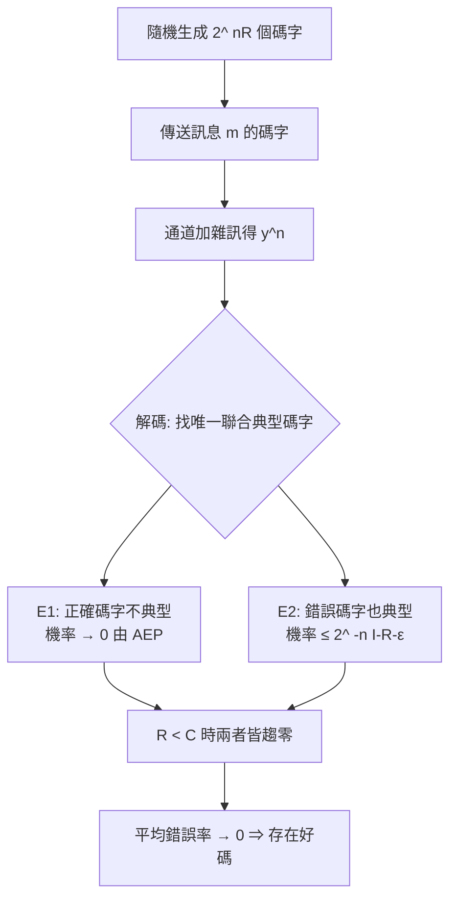

# 4.3 容量定理的證明思想

## 導言：存在性證明的藝術

第 4.1、4.2 節給了容量公式，但尚未證明：為什麼 $R < C$ 時**存在**零錯誤碼？為什麼 $R > C$ 時**任何**碼都失敗？Shannon 1948 的證明開創了兩項技術——**隨機編碼**與**典型序列**——它們至今仍是資訊理論的標準武器。本節以 BSC 為例，走一遍證明的思想全景；並介紹逆定理的核心工具 Fano 不等式。理解了本節，第 5、6、10 章的各種定理都將似曾相識。

## 證明一（可達性）：隨機編碼

### 策略：不找好碼，證明隨機碼平均就好

目標：$R < C$ 時，存在 $(n, 2^{nR})$ 碼使錯誤率趨近零。Shannon 的反直覺策略：

1. **隨機生成碼**：對每個訊息 $m \in \{1, \dots, 2^{nR}\}$，獨立均勻地隨機生成一個長度 $n$ 的碼字 $X^n(m)$。
2. **證明期望錯誤率小**：對所有隨機碼取平均，錯誤率 $\to 0$。
3. **存在性推論**：平均錯誤率小，則至少有一個碼的錯誤率不大於平均。

「平均好 ⇒ 至少一個好」這一步看似平凡，卻是整個資訊理論最深刻的存在性論證：它把「設計好碼」的搜尋問題，化為「證明隨機對象的統計性質」的機率問題。

### 解碼器：最近典型碼字

接收 $y^n$，在碼本中尋找與 $y^n$ **聯合典型**的碼字（3.1 節典型性）：

$$
\hat{m} = m \quad \text{若 } (x^n(m), y^n) \in A_\epsilon^{(n)}, \text{ 且唯一}
$$

### 錯誤事件分析

傳送 $m = 1$，定義兩種錯誤：

1. **$E_1$**：$(x^n(1), y^n)$ 不聯合典型。由 AEP（3.1 節），機率 $\to 0$。
2. **$E_2$**：某個錯誤碼字 $m' \ne 1$ 也與 $y^n$ 聯合典型。由通道模型，$x^n(m')$ 與 $y^n$ **獨立**，兩個獨立序列恰好聯合典型的機率約 $2^{-n(I(X;Y) - \epsilon)}$；共有 $2^{nR} - 1$ 個候選，聯集界：

$$
P(E_2) \le 2^{nR} \cdot 2^{-n(I(X;Y) - \epsilon)} = 2^{-n(I(X;Y) - R - \epsilon)}
$$

**若 $R < I(X;Y) - \epsilon$，錯誤率指數級衰減。** 最後對輸入分佈取最大：

$$
R < C = \max_{p(x)} I(X;Y) \Rightarrow \text{存在好碼}
$$

### 例題：數值體會指數衰減

BSC（$p = 0.1$，$C = 0.531$），取 $R = 0.4$，$\epsilon = 0.01$：

$$
P(E) \lesssim 2^{-n(0.531 - 0.4 - 0.01)} = 2^{-0.121 n}
$$

$n = 100$：$P \lesssim 2^{-12.1} \approx 2 \times 10^{-4}$；$n = 1000$：$2^{-121} \approx 4 \times 10^{-37}$。**碼長加長 10 倍，錯誤率下降約 30 個數量級**——這就是「夠長的碼 = 可靠通訊」的定量版本。實際錯誤指數 $E(R)$ 隨 $R$ 減小而增大，$R = C$ 處降為零（Shannon–Gallager–Berlekamp 界的經典圖形）。

## 證明二（逆定理）：Fano 不等式

### Fano 不等式

若 $\hat{X}$ 是由 $Y$ 對 $X$ 的估計，錯誤機率 $P_e = P(\hat{X} \ne X)$，則

$$
H(X \mid Y) \le H_2(P_e) + P_e \log_2(|\mathcal{X}| - 1)
$$

直觀：$H(X \mid Y)$（剩餘不確定性）中，一部分是「有沒有猜錯」的二元不確定（$H_2(P_e)$），一部分是猜錯時「錯在哪」的不確定（$\le \log_2(M-1)$）。

### 逆定理的證明骨架

碼長 $n$、$M = 2^{nR}$ 個訊息的碼，錯誤率 $P_e \to 0$，則：

$$
nR = H(M) = I(M; Y^n) + H(M \mid Y^n) \le I(M; Y^n) + n P_e' \text{ 項}
$$

逐步：

1. $H(M \mid Y^n) \le H_2(P_e) + P_e (nR) \to 0$（Fano）。
2. $I(M; Y^n) \le I(X^n; Y^n)$（資料處理不等式，3.3 節！$M \to X^n \to Y^n$）。
3. 無記憶通道的鏈法則 + 每步互資訊 $\le C$：$I(X^n; Y^n) \le nC$。

合併：$nR \le nC + o(n)$，即 $R \le C$。**若 $R > C$，Fano 給出 $P_e \ge 1 - \frac{C + 1/n}{R} \to 1 - C/R > 0$**——錯誤率不可能消失。

### 證明技術的精妙

逆定理的證明把三件武器串聯：Fano 不等式（統計學）、資料處理不等式（馬可夫鏈）、記憶性分解（鏈法則）。每一件都在本書前幾章出現過——資訊理論的證明是「積木組裝」，而非高深的新數學；難的是積木的選擇與順序。

## 強對偶與錯誤指數

- **強逆定理**：$R > C$ 時，錯誤率不僅不趨零，而是**趨近 1**（對碼率超過 $C$ 的程度依賴）。
- **錯誤指數**：$P_e \approx 2^{-nE(R)}$，$E(R)$ 是 $R$ 的凹函數，$E(R) = 0$ iff $R \ge C$。BSC 的球包裝（sphere packing）界給出 $E(R)$ 的上界，隨機編碼界給出下界，兩者在低率區夾逼（Gallager 1965 的 $E(R)$ 理論）。
- **球包裝的幾何**：AWGN 下碼字是 $n$ 維空間中的點，解碼是找最近的點；錯誤率由「Voronoi 域被雜訊球入侵」的機率決定——這是 6.2 節最小距離與錯誤更正的幾何預告。

## 有限碼長：極限之外

Shannon 極限是 $n \to \infty$ 的漸近結論。實際系統碼長有限（延遲約束），此時容量要修正（Yuri Polyanskiy, 2010）：

$$
C_n \approx C - \sqrt{\frac{V}{n}} \, Q^{-1}(\epsilon) + O\!\left(\frac{\log n}{n}\right)
$$

其中 $V$ 是**通道色散**（dispersion，互資訊的方差）。意義：想要錯誤率 $\epsilon$ 與有限碼長 $n$，可用速率比 $C$ 低一個 $\sqrt{1/n}$ 的量。IoT 短封包、URLLC（超可靠低延遲通訊）的 5G/6G 標準正在使用這套理論（10.3 節）。

### 例題：有限碼長的修正量

BSC（$p = 0.1$）：$C = 0.531$，$V \approx 0.142$。目標錯誤率 $\epsilon = 10^{-6}$，$Q^{-1}(\epsilon) \approx 4.75$。碼長 $n = 1000$：

$$
C_{1000} \approx 0.531 - \sqrt{\frac{0.142}{1000}} \times 4.75 \approx 0.531 - 0.0179 \approx 0.513 \text{ bits/use}
$$

僅損失約 3.4%——碼長 1000 已相當接近漸近極限；但 $n = 100$ 時損失達 12%，短封包場景不可忽略。

## 歷史前因後果

### 誰、何時、為什麼

- **1948 Shannon**：隨機編碼 + 典型序列證明可達性；用（粗糙版）Fano 式論證逆定理。
- **1952 Feinstein**：嚴格化可達性（Feinstein 引理，最大化典型解碼的機率）。
- **1952 Wolfowitz**：強逆定理的嚴格證明。
- **1966 Fano**《Transmission of Information》：Fano 不等式的系統化與教學化。
- **1965 Gallager**：錯誤指數 $E(R)$ 的完整理論。
- **2010 Polyanskiy–Poor–Verdú**：有限碼長理論（normal approximation）。

### 解決了什麼問題

1. **存在性**：好碼存在且「隨機挑一個就好」——為編碼理論設立了明確的獵物目標。
2. **不可能性**：$R > C$ 的絕對禁區使工程師不再浪費力氣設計超極限系統。
3. **性能預測**：錯誤指數讓碼長、錯誤率、碼率三角關係可計算。

### 引發什麼新問題

1. **建構性**：隨機碼的解碼是指數複雜度，找「有結構的好碼」成為五十年主線（第 6、7 章 → 第 10 章的 LDPC/Turbo 用隨機稀疏結構解決了它）。
2. **非漸近**：有限碼長理論仍在擴展（多用戶、衰落、安全）。
3. **資訊不等式系統**：Fano、DPI 之後，人們追問「什麼樣的資訊不等式存在」——Shannon 型不等式與非 Shannon 型不等式（Zhang–Yeung, 1998）的發現是 10.3 節的前沿。

## 與其他領域的關聯

### 大數法則與統計

典型序列方法是 LLN 的資訊版（3.1 節）；聯集界（union bound）是基礎機率技巧；Fano 不等式屬估計理論的下界家族（與 Le Cam、Cramér–Rao 並列）。

### 幾何

AWGN 的球包裝/球覆蓋圖像；碼的最小距離 $d$ 對應錯誤更正半徑 $\lfloor (d-1)/2 \rfloor$（6.2 節）；隨機高維幾何（concentration of measure）解釋為什麼隨機碼在高維意外地好。

### 計算複雜度

隨機編碼證明「存在」但解碼困難——這與複雜度理論的「隨機方法」（probabilistic method, Erdős）同源；LDPC 的成功顯示「隨機 + 稀疏結構」可以兼得存在性與可解碼性（10.2 節）。

### 密碼學

隨機編碼的對偶——隨機化加密——使密文統計上不可分辨；Shannon 完美保密的證明同樣用相對熵與隨機性論證（9.3 節）。

## 小結與思考題

可達性用「隨機碼 + 典型解碼 + 聯集界」證 $R < C$ 可達；逆定理用「Fano + DPI + 鏈法則」證 $R > C$ 不可能。兩者合起來就是編碼定理，也確立了資訊理論的證明範式。本書後續的每個「定理」都會用到這套積木。

**思考題**

1. 重做 4.3 例題：$R = 0.3$、$p = 0.1$、$\epsilon = 0.01$、$n = 500$，估計 $P(E)$ 上界。
2. 說明為什麼「平均錯誤率小 ⇒ 存在好碼」的論證對**最大錯誤率**（最壞訊息的錯誤率）不能直接使用？如何修補？（提示：把 2 個最壞訊息丟掉，碼率損失 $2/n \to 0$。）
3. Fano 不等式中若 $|\mathcal{X}| = 2$，化簡為何？（$H(X \mid Y) \le H_2(P_e)$，即二元問題的條件熵由錯誤率決定。）
4. 用 DPI 解釋：為什麼在接收端加「聰明的預處理」不能提高容量，但「聰明的調變（編碼前的映射）」可以？
5. 有限碼長修正 $-\sqrt{V/n}\,Q^{-1}(\epsilon)$ 隨 $n$ 減小的速度與 $C$ 的絕對值無關嗎？討論它對 5G 短封包設計的意義。

第 4 章完成。下一章：信源編碼——把「壓縮極限是熵」變成可執行的演算法。

---

## 深入探討：證明技術的完整演練與錯誤指數

### 一、隨機編碼證明的逐步算例（BEC 上的完整數值）

4.3 節以 BSC 概述了證明，這裡在 BEC（更易手算）上走完全程，讓讀者「用數字體驗定理」。

**設定**：BEC 擦除率 $e = 0.3$、$C = 0.7$。碼率 $R = 0.6$、碼長 $n = 100$、訊息數 $2^{60}$。

1. **碼本生成**：$2^{60}$ 個碼字，每個位元 i.i.d. 均勻。
2. **傳送**：$y^n$ 中 $100 e = 30$ 個位元被擦除（期望）。
3. **解碼事件 $E_1$**（正確碼字與 $y$ 不聯合典型）：BEC 的聯合典型檢驗 = 碼字在未擦位置與 $y$ 一致。正確碼字在 70 個未擦位元上與發送位元完全一致（它們就是同一個），故 $P(E_1) = 0$（BEC 的特權：無雜訊翻轉）。
4. **事件 $E_2$**（某錯誤碼字也一致）：隨機碼字在 70 個未擦位置全中的機率 $= 2^{-70}$。錯誤碼字數 $2^{60} - 1$，聯集界：

$$
P(E_2) \le (2^{60} - 1) 2^{-70} < 2^{-10} \approx 9.8 \times 10^{-4}
$$

**結論**：$R = 0.6 < C = 0.7$ 時，$P_e < 2^{-n(C - R)}$——**BEC 的隨機編碼指數恰為 $(C-R)\ln 2$**（可以嚴格證明）。平均錯誤率 $< 10^{-3}$，故存在至少一個碼達此性能。

**把 $R$ 推到極限**：$R = 0.69$、$n = 10^4$：$P_e \le 2^{-100} \approx 8 \times 10^{-31}$。**接近容量的碼需要碼長，而指數立即回報**——這就是「漸近」的具體含義。

### 二、Fano 不等式的完整證明

4.3 節使用了 Fano 不等式，證明本身是資訊論證明的教科書範例：

**設定**：估計量 $\hat X$ 由 $Y$ 產生，錯誤事件 $E = \{\hat X \ne X\}$，$P_e = P(E)$。

1. 鏈法則：$H(E, X \mid \hat X) = H(X \mid \hat X) + H(E \mid X, \hat X) = H(E \mid \hat X) + H(X \mid E, \hat X)$。
2. $H(E \mid \hat X) \le H(E) = H_2(P_e)$；$H(E \mid X, \hat X) = 0$（知道 $X$ 與 $\hat X$ 即知道錯與否）。
3. $H(X \mid E, \hat X)$：無錯時 $X = \hat X$ 貢獻 0；有錯時 $X$ 至多 $\log_2(|\mathcal{X}|-1)$ bits（排除 $\hat X$ 後剩 $M - 1$ 個可能）——故 $\le P_e \log_2(M-1)$。
4. 合併：$H(X \mid \hat X) \le H_2(P_e) + P_e \log_2(M-1)$。又 $\hat X$ 是 $Y$ 的函數 ⇒ $H(X \mid \hat X) \ge H(X \mid Y)$（條件化遞減）。∎

**逆定理應用**：碼的訊息 $M \in \{1, \dots, 2^{nR}\}$、$P_e \to 0$：

$$
nR - nC \le I(M; Y^n) - nC + H(M \mid Y^n) \le o(n)
$$

（用 $I(M;Y^n) \le nC$ 與 Fano 使 $H(M|Y^n) \le nR P_e + 1$。）整理得 $R \le C + P_e R + o(1)$，即 $P_e \ge 1 - C/R - o(1) > 0$ 當 $R > C$。**三件工具（鏈法則、DPI、Fano）的組裝完成**。

### 三、錯誤指數 $E(R)$ 的完整圖像

4.1 節末的表格需要正式定義支撐。**定義**：

$$
E(R) = \limsup_{n \to \infty} \left(-\frac{1}{n} \log_2 P_e^{(n)}(R)\right)
$$

**BSC 的已知結果**（Gallager 1965 理論）：

- **隨機編碼下界**：$E_r(R) = H_2(Q) - Q \log_2 2^{?}\dots$（閉式略），行為：$R = 0$ 時 $E = -\log_2(2\sqrt{p(1-p)})$，隨 $R$ 增大線性下降至 $R = C$ 處為 0。
- **球包裝上界**：$R < \frac12$ 時有臨界率 $R_{\text{crit}}$，之下上界與下界**重合**（$E(R)$ 精確已知）！
- **數值**（BSC $p = 0.1$、$C = 0.531$）：$E_r(0) = 0.522$、$E_r(0.2) \approx 0.12$、$E_r(0.4) \approx 0.03$。

**工程換算**：$P_e = 10^{-9}$ 在 $R = 0.2$ 需碼長 $n \approx 9 / 0.12 = 75$（理論下限）——實際好碼需 $10^3$ 級，差距來自有限碼長與非漸近效應（第四節）。

### 四、有限碼長理論的深入：色散的計算

4.3 節引入了 Polyanskiy–Poor–Verdú 的 normal approximation，這裡補齊 BSC 的色散公式與實例：

$$
V = p(1-p) \left(\log_2 \frac{1-p}{p}\right)^2
$$

**數值**（$p = 0.1$）：$V = 0.09 \times (3.17)^2 = 0.904$。$n = 128$、目標 $P_e = 10^{-4}$（$Q^{-1} = 3.72$）：

$$
C_n \approx 0.531 - \sqrt{0.904/128} \times 3.72 = 0.531 - 0.296 = 0.235
$$

**短碼的懲罰驚人**：128 位元的塊只能以 0.235 bits/use 傳，僅為漸近極限的 44%。這解釋了 5G URLLC（短封包）為何無法直接搬用長碼理論，催生：短碼設計（Polar 的 SCL 解碼，10.3 節）、列表解碼、以及「碼長–錯誤率–速率」三角的系統級取捨。

### 五、聯集界之外的精細工具：二項式與 Gallager 界

4.3 節主要用聯集界，實際分析常用更緊的工具：

1. **聯集界**：$P \le \sum P_i$——簡單但在高 SNR 精確、低 SNR 疏鬆。
2. **切爾諾夫捆綁（Chernoff bound）**：對碼字錯誤事件 $P_i \le \prod \min(P_{\text{pairwise}})$ 的改進——錯誤指數理論的基礎。
3. **Gallager 界**：對特定碼（已知重量分佈）的塊錯誤率上界，用重量分佈 $A_w$ 加權：

$$
P_B \le \sum_w A_w \, p^w (1-p)^{n-w}
$$

6.2 節的最小距離分析正是它的第一項。**重量分佈的形狀（不只是 $d_{\min}$）決定性能**——這個觀點在 10.1 節 Turbo 碼的「錯誤地板」分析中成為主角（低重量碼字的數量，multiplicity）。

### 六、隨機編碼的計算複雜度與「可解碼性鴻溝」

4.3 節證明存在好碼，但要指出理論與實作的鴻溝（它是第 6–10 章的驅動力）：

1. **碼本大小**：$2^{nR}$ 個碼字 × $n$ 位元 = 指數儲存。$n = 1000$、$R = 0.5$：$2^{500}$ 個碼字——**宇宙原子數都不夠**。
2. **解碼複雜度**：對每個接收字比對所有碼字 = $O(2^{nR} n)$。一般線性碼的 ML 解碼已證 NP-hard（6.2 節）。
3. **隨機方法的出路**：隨機**結構**碼（隨機稀疏圖，10.2 節）保留統計優良性，但解碼只需局部訊息傳遞——**隨機性的好處可以與計算可行性共存**，這是 1993–2001 年（Turbo→LDPC）解鎖的核心認識。

### 七、補充思考題

6. 對第一節的 BEC 例：$R = 0.65$、$n = 500$、$e = 0.3$，算 $P(E_2)$ 上界；$n = 5000$ 時呢？
7. 用第二節的步驟對「BSC、$p = 0.1$、$M = 2^{nR}$」寫出逆定理的完整代數（步驟 4 的不等式鏈）。
8. 對第四節：$n = 64$、$P_e = 10^{-6}$（$Q^{-1} \approx 4.75$）時 $C_{64}$ 為何？這對 5G 短控制訊息的設計意味著什麼？
9. Gallager 界（第五節 3）中，若碼的 $d_{\min} = 5$ 且 $A_5 = 4$，塊錯誤率的主導項是什麼？$p = 0.01$ 時約為何？（$4 \times 10^{-5} \times (0.99)^{n-5}$ 級。）
