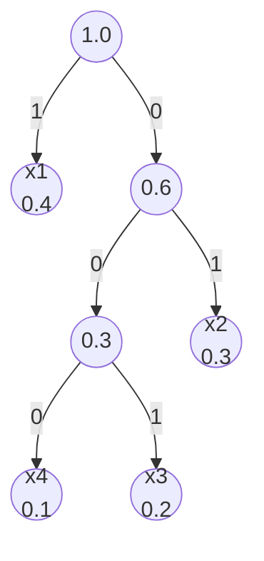

# 5.2 Huffman 編碼（1952）

## 導言：一次演算法面試造就的經典

1951 年，MIT 的 Robert Fano 給學生一個選擇：考試或找出「最佳二元碼」的證明。研究生 David A. Huffman 幾乎放棄（他後來自述已開始準備考試），卻在最後關頭想到一個反轉思路：**從碼樹的葉端往回建構**。1952 年論文《A Method for the Construction of Minimum-Redundancy Codes》發表後，Huffman 編碼成為教科書演算法、作業系統與通訊標準的常駐元件，至今七十餘年不衰。這個故事也提醒我們：突破常常來自換一個看問題的方向。

## 演算法

### 貪婪合併

輸入：符號機率 $\{p_1, \dots, p_M\}$。重複以下步驟直到剩一個節點：

1. 取出機率**最小**的兩個節點。
2. 合併為新節點，機率相加；兩子節點分別賦 0 與 1。
3. 把新節點放回佇列。

最後從根走到各葉，路徑上的 0/1 就是碼字。用**最小優先佇列**（heap）實作，總複雜度 $O(M \log M)$。

### 例題：完整演算

信源 $p = \{0.4, 0.3, 0.2, 0.1\}$（$x_1..x_4$）：

```
步驟0:  0.1(x4) 0.2(x3) 0.3(x2) 0.4(x1)
步驟1:  合併 0.1+0.2 = 0.3 (節點A)
        佇列: 0.3(A) 0.3(x2) 0.4(x1)
步驟2:  合併 0.3(A)+0.3(x2) = 0.6 (節點B)
        佇列: 0.4(x1) 0.6(B)
步驟3:  合併 0.4+0.6 = 1.0 (根)
```



碼表：

| 符號 | $p_i$ | 碼 | 碼長 | $p_i l_i$ |
|---|---|---|---|---|
| $x_1$ | 0.4 | `1` | 1 | 0.4 |
| $x_2$ | 0.3 | `01` | 2 | 0.6 |
| $x_3$ | 0.2 | `001` | 3 | 0.6 |
| $x_4$ | 0.1 | `000` | 3 | 0.3 |

$$
\bar{L} = 1.9 \text{ bits}, \qquad H = 1.846 \text{ bits}, \qquad \text{差距} = 0.054
$$

比 Shannon 碼（5.1 節的 2.4）好得多。驗證前綴性：`1`、`01`、`001`、`000` 互不為前綴。✓

## 最優性的證明思想

Huffman 編碼對給定機率分佈是**最佳前綴碼**（最小 $\bar L$）。證明由三個引理組成：

### 引理一：最優碼中，碼長與機率反序

$p_i > p_j \implies l_i \le l_j$。否則交換兩碼字，$\bar L$ 改變量 $(p_i - p_j)(l_j - l_i) > 0$ 減少——矛盾。

### 引理二：最優碼樹是滿樹（full tree）

若存在單子節點的內部節點，把子樹上提一層可減短碼長。

### 引理三：兩個最小機率符號可為兄弟

在最優樹中，最深層的兄弟對可換成最小的兩個符號而不增加 $\bar L$。

### 歸納證明

由引理三，最優樹中兩個最小符號是兄弟，深度相同。把兩者合併為一個「超符號」，機率 $p_{(M-1)} + p_{(M)}$，得到 $M-1$ 個符號的問題。由歸納假設，$M-1$ 問題的最優解由 Huffman（遞迴地）給出；展開超符號後 $\bar L$ 增加 $p_{(M-1)} + p_{(M)}$（兩葉各深一層）。因此 Huffman 的貪婪每步都最優——**歸納法 + 貪婪 = 動態規劃式最優性**。這個證明模式（交換論證 + 歸納）是演算法課的經典教材。

## Huffman 的極限：為什麼還需要算術編碼

Huffman 達到「整數碼長前綴碼」的最優，但**整數碼長本身是限制**。理論上最佳碼長是實數 $-\log_2 p_i$；整數化造成每個符號最多浪費 1 bit，最壞情況差距明顯：

### 例題：Huffman 的最壞情況

$M = 3$，$p = \{0.9, 0.05, 0.05\}$。$H \approx 0.569$ bits。

Huffman：`0`、`10`、`11`，$\bar L = 0.9(1) + 0.05(2) + 0.05(2) = 1.0$ bits。

$$
\text{差距} = 1.0 - 0.569 = 0.431 \text{ bits/符號（浪費 76\%）}
$$

**塊狀編碼**可攤薄浪費：一次編 $n$ 個符號，$\bar L_n / n \to H$（3.1 節 AEP），但 $M^n$ 大小碼表不可行。**算術編碼（5.3 節）用小數碼長直接逼近熵，無需擴大碼表**——這是它誕生的核心動機。

## 實務中的 Huffman

### 自適應 Huffman

信源統計未知或時變：FGK（Faller–Gallager–Knuth, 1985）演算法邊傳邊更新樹，單遍（one-pass）編碼，無需事先知道分佈——通用壓縮思想的過渡形態。

### 標準中的 Huffman

| 應用 | 用法 |
|---|---|
| JPEG | DCT 係數的熵編碼（靜態 Huffman 表） |
| MP3 | 位流細節編碼 |
| DEFLATE（ZIP/PNG） | LZ77 + 預定義/自訂 Huffman 表（5.3 節） |
| MP4/H.264 | CABAC 之前的 CAVLC |

工程上的考量：Huffman 碼表需傳給解碼端（帶寬開銷），碼長至少 1 bit（高機率符號無法短於 1 bit，極端分佈浪費大），位元對齊與緩衝管理——這些現實摩擦是更精巧編碼器（算術、ANS）興起的原因。

## 歷史前因後果

### 前因

- **1948 Shannon**：碼長定理（5.1 節），證明 $\bar L$ 可逼近 $H$。
- **1949 Shannon–Fano 編碼**：由上而下按機率切分——啟發式，**不是**最優（例：$p = \{0.35, 0.25, 0.2, 0.1, 0.1\}$ 時 Shannon–Fano 較差）。
- **1951 Fano 的題目**：直接催生 Huffman。

### 後果

- **演算法教材**：貪婪演算法最優性的經典案例（交換論證範本）。
- **壓縮產業**：PKZIP、JPEG、MP3 全部內建。
- **專利與自由**：Huffman 編碼本身無專利（與 LZW 不同，5.3 節），成為開放格式的標配。
- **理論延伸**：$D$ 元 Huffman、長度受限 Huffman（LHL, 1985–1991 包裝/合併演算法）、和 Huffman 與算術編碼的混合（範圍編碼）。

### 解決了什麼問題

給定機率分佈，**一次構造**（$O(M\log M)$）即達整數碼長前綴碼的最優——Shannon 的存在性證明（4.3 節隨機編碼思路）至此變成可執行程式。

### 引發什麼新問題

1. **統計未知**：實際壓縮前不知道 $p_i$——自適應與通用壓縮（5.3 節）。
2. **1 bit 的殘念**：極端分佈（如 $p = 0.99$）下 Huffman 效率暴跌——算術編碼的舞台。
3. **碼表傳輸成本**：塊狀與自適應的取捨。
4. **並行化**：Huffman 天生序列（合併依賴），現代硬體轉向 ANS（Asymmetric Numeral Systems, Jarosław Duda 2007–2014），兼具算術編碼的效率與 Huffman 的速度，已進入 Zstandard、LZ4 與視訊標準（10.3 節）。

## 與其他領域的關聯

### 演算法與最優化

貪婪最優性證明（交換論證 + 歸納）、優先佇列資料結構、$O(M \log M)$ 分析——Huffman 是演算法課的標準案例；它與最小生成樹（Kruskal）、最短路（Dijkstra）同屬「貪婪 + 優先佇列」家族。

### 樹與二叉樹理論

Huffman 樹是加權外部路徑長度最小的二叉樹；與最優二叉搜尋樹（Hu–Tucker、Knuth 的 $O(n^2)$ DP）形成對照：前者葉有序不重要、後者葉有序固定。

### 機率統計

自適應 Huffman 隱含地做「線上分佈估計」；與線上學習（experts 演算法）的 regret 分析相通——壓縮 = 預測 = 學習，這條等式是 5.3 節與現代語言模型的主軸。

### 機器學習

決策樹（如 C4.5）以資訊增益選分裂、以 Huffman 式方式長樹；語言模型的困惑度就是 $2^{H}$，模型訓練 = 逼近信源熵——Huffman 的精神在神經網路時代以「熵最小化」的形式延續。

## 小結與思考題

Huffman 用「由葉向根、每次合併最小兩個」的貪婪，達到整數碼長前綴碼的最優；它的最優是**受限最優**（整數碼長），殘餘差距由算術編碼補上。工程選型：分佈已知且溫和 → Huffman；分佈極端或未知 → 算術/ANS。

**思考題**

1. 對 $p = \{0.35, 0.25, 0.2, 0.1, 0.1\}$ 做 Huffman 演算，求 $\bar L$，並與 $H = 2.166$ 比較。
2. 證明 Huffman 樹中若 $p_i = p_j$（機率相等），不同合併順序可產生不同但同 $\bar L$ 的碼——最優碼不唯一。
3. 為什麼 $p = \{0.99, 0.01\}$ 的 Huffman 差距會接近 0.08 bits？改用「編 2 個符號一組」的 Huffman 會改善嗎？粗算 4 種組合的碼長。
4. Shannon–Fano 由上而下切分何時恰等於 Huffman？（當每次切分都沿 2 的負冪邊界時。）舉一個不等例子。
5. DEFLATE 為何選「LZ77 + Huffman」而非「Huffman + Huffman」？（提示：重複字串的統計結構與字典壓縮，5.3 節將詳述。）

下一節：算術編碼與通用壓縮——消滅最後的 1 bit 浪費，並在分佈未知時仍然逼近熵。
