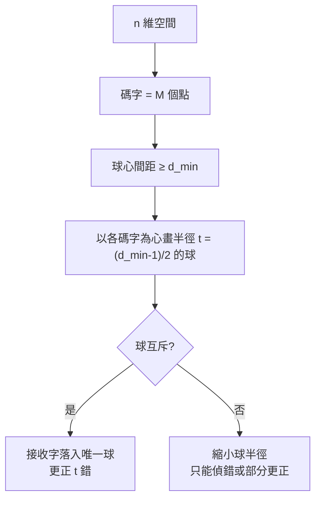

# 6.2 最小距離與錯誤更正能力

## 導言：碼的幾何學

6.1 節的 Hamming 碼能更正 1 個錯，但「能更正幾個錯」這件事的普適答案是什麼？答案是**最小距離** $d_{\min}$ ——碼字兩兩之間 Hamming 距離的最小值。它把編碼問題變成離散幾何：**在 $n$ 維超立方體上擺放 $M$ 個點，彼此盡量遠**。本節建立距離理論、四大界（Hamming、Singleton、Plotkin、Gilbert–Varshamov），並用線性碼的代數工具把「算距離」變成「找最小重量」。

## Hamming 距離與解碼半徑

### 定義

兩個長度 $n$ 向量 $u, v \in \mathbb{F}_q^n$ 的 **Hamming 距離**：

$$
d(u, v) = \left|\{i : u_i \ne v_i\}\right| = \text{重量}(u - v)
$$

它是 $\mathbb{F}_q^n$ 上的度量（正定、對稱、三角不等式成立——由分量逐一驗證）。

### 碼的最小距離與能力

碼 $\mathcal{C} \subseteq \mathbb{F}_q^n$ 的最小距離：

$$
d_{\min} = \min_{u \ne v \in \mathcal{C}} d(u, v)
$$

**核心定理**（最近鄰解碼 = 最大似然解碼，當 BSC 錯誤率 $< 1/2$ ）：

| 能力 | 條件 |
|---|---|
| 偵測 $t$ 個錯 | $d_{\min} \ge t + 1$ |
| 更正 $t$ 個錯 | $d_{\min} \ge 2t + 1$ |
| 同時偵 $e$ 偵、更正 $t$ 更 | $d_{\min} \ge t + e + 1$ |

**更正 $t$ 錯的幾何理由**：以每個碼字為球心、半徑 $t$ 的 Hamming 球互不相交 iff $2t < d_{\min}$ ；接收字落在某球內就歸該球心。半徑 $t$ 的球體積 $\sum_{i=0}^t \binom{n}{i}(q-1)^i$ 。

### 例題：距離與能力

- 奇偶檢驗碼（ $n$ 長，1 個同位）： $d_{\min} = 2$ → 偵 1 錯，**不能**更正（半徑 0）。
- $(7,4)$ Hamming： $d_{\min} = 3$ → 更正 $t = \lfloor (3-1)/2 \rfloor = 1$ 錯。✓（與 6.1 節症狀碼結果一致。）
- 假想 $d_{\min} = 5$ ：更正 2 錯（或偵 4 錯）。
- Golay $[23, 12, 7]$ ：更正 3 錯。

## 線性碼：距離 = 最小重量

線性碼 $\mathcal{C} = \{G^T u : u \in \mathbb{F}_2^k\}$ 是子空間。由線性性：

$$
d(u, v) = \text{重量}(u - v), \quad u - v \in \mathcal{C} \ (u \ne v)
$$

故

$$
d_{\min} = \min_{c \in \mathcal{C} \setminus \{0\}} \text{重量}(c)
$$

**線性碼的最小距離就是最小非零碼字重量**——距離計算從 $\binom{M}{2}$ 次比較化為一次線性代數問題。進一步： $d_{\min}$ 等於「 $H$ 中**線性相依**的最小列數」——奇偶檢驗矩陣的列相依結構直接決定距離：

- $H$ 的任兩列相異且非零 → 無重量 1、2 的碼字 → $d_{\min} \ge 3$ （Hamming 碼的構造原理）。
- $H$ 的任意 $2t$ 列皆線性獨立 → $d_{\min} \ge 2t + 1$ 。

### 例題：由 $H$ 讀出距離

$(7,4)$ 碼的 $H$ （6.1 節）三列互異非零。任兩列之和非零且不等於任一列（驗證： $H$ 的列集合在 XOR 下構成加法群 $\mathbb{F}_2^3 \setminus \{0\}$ ），故無重量 2 碼字， $d_{\min} = 3$ 。✓

## 碼的四大界：空間換能力的匯率

給定 $(n, M, d)$ ，三量互相制約。四條經典界：

### 1. Hamming 界（球包裝，1950）

更正 $t$ 錯的 $q$ 元碼：

$$
M \sum_{i=0}^{t} \binom{n}{i} (q-1)^i \le q^n
$$

碼球必須互斥地塞進整個空間。等號成立的碼稱**完美碼**（perfect code）：每個向量都恰屬一個球。已知二元完美碼：Hamming 碼、Golay $[23,12,7]$ 、重複碼 $n$ 奇（平凡）——Tietäväinen（1973）證明僅此而已。

### 2. Singleton 界（1964）

$$
M \le q^{n - d + 1}
$$

（刪掉碼字前 $d-1$ 個位置仍需可辨識所有訊息。）線性碼版： $k \le n - d + 1$ 。等號碼為 **MDS 碼**（最大距離可分）——Reed–Solomon 碼正是 MDS（7.2 節），這是 RS 在儲存與通訊中無可取代的原因。

### 3. Plotkin 界（1960）

$$
M \le \left\lfloor \frac{q d}{q d - (q-1) n} \right\rfloor \quad (\text{當 } d > \tfrac{q-1}{q} n)
$$

高距離時碼字數急遽受限。

### 4. Gilbert–Varshamov 界（1952 / 1957）

存在線性碼滿足

$$
\frac{k}{n} \ge 1 - H_2(d/n)
$$

（連續版本）。它是**存在性下界**（Shannon 隨機編碼精神的代數化身），保證好碼存在；長期不知道是否可達——1970 年代起的研究顯示 RS 等代數碼達不到，而隨機線性碼幾乎確實達到（Barg–Zémor 2002 等）。

### 例題：界之間的比較

$[7, 4, 3]$ Hamming 碼：

- Hamming 界： $16 \times (1 + 7) = 128 = 2^7$ ，**等號成立（完美碼！）**。
- Singleton： $16 \le 2^{7-3+1} = 2^5 = 32$ ，不緊。
- GV 界： $k/n \ge 1 - H_2(3/7) = 1 - 0.881 = 0.119$ ，即 $k \ge 0.83$ ——極寬鬆。

$[23, 12, 7]$ Golay 碼：Hamming 界 $4096 \times (1 + 23 + 253 + 1771) = 4096 \times 2048 = 2^{23}$ ，**又是完美碼**。

## 球包裝的視野：與 Shannon 定理的連接

4.3 節的 AWGN 幾何（碼字 = 高維點、解碼 = 最近點）與本節的 Hamming 球包裝是同一件事的兩種度量。共通的張力：

> **率 $R$ （碼字密度）** vs **距離/功率（抗雜訊半徑）**。

- 隨機碼的典型最小距離滿足 GV 界（甚至更好），且**隨機線性碼幾乎必然良好**。
- 但**隨機碼難解碼**（ML 解碼 NP-hard）。代數碼（RS/BCH）用結構換可解性，犧牲一點距離。
- 第 10 章的 LDPC/Turbo 用「隨機稀疏圖 + 迭代解碼」同時拿到兩者——這是 1993–1996 年的解鎖時刻。

## 突發錯誤與交錯

實際通道（衰落下行、光碟刮痕、快閃記憶體顆粒壞塊）錯誤**成串**。對付突發的兩招：

1. **交錯（interleaving）**：把 $m$ 個碼字的位元按列寫入、按行讀出，長度 $b$ 的突發在解交錯後變成 $m$ 個分離的單錯。CD 的 CIRC 編碼（Reed–Solomon × 2 + 交錯）可更正長達 4000 位元的刮痕。
2. **突發錯誤碼**：Fire 碼、Burton 碼等直接以「更正長度 $b$ 突發」為目標，用循環碼結構實現（7.1 節）。

### 例題：交錯的威力

用 $[15, 11, 3]$ Hamming 碼（更正 1 錯）+ 深度 10 的交錯：可承受**任一碼字內 1 錯**，經交錯後等於承受**總計 10 個錯，且這 10 錯可以是連續的**——突發長度 10 的能力由「交錯深度 × 單錯能力」達成，代價是 $10 \times 15 = 150$ 位元的延遲與緩衝。

## 歷史前因後果

### 誰、何時、為什麼

- **1950 Hamming**：距離、完美碼（Hamming 界）、 $[7,4]$ 碼。
- **1950 Golay**：兩個完美碼（1949 短文）。
- **1952 Gilbert**：GV 界（存在性）。
- **1955–1957 Varshamov**：線性碼版本的 GV 界。
- **1960 Plotkin**：Plotkin 界。
- **1964 Singleton**：Singleton 界。
- **1973 Tietäväinen**：完美碼分類完成。
- **1978 Berlekamp–McEliece–van Tilborg**：一般線性碼 ML 解碼 NP-hard——隨機碼「好而難」的複雜度確認。

### 解決了什麼問題

1. **能力量化**：「這碼能修幾個錯」= $d_{\min}$ ，一個數字說清楚。
2. **設計空間描繪**：四條界圍出 $(n, k, d)$ 的可能與不可能，工程師不再盲搜。
3. **完美碼的封頂**：證明 Hamming/Golay 之外再無完美二元碼，終結一場追尋。

### 引發什麼新問題

1. **GV 界是否可達**（碼的漸近問題）：1980 年代 Tsfasman–Vlăduţ–Zink 用代數幾何曲線構造的碼超越 GV 界（ $q \ge 49$ ），代數幾何碼成為一大分支（10.3 節）。
2. **軟解碼**：距離是硬解碼（Hamming 距離）的量；軟資訊（通道的機率輸出）可超越硬解碼性能——迭代解碼（10.1、10.2 節）的核心。
3. **列表解碼**：更正超過 $\lfloor(d-1)/2\rfloor$ 的錯，允許輸出候選清單（Sudan 1997 的 RS 列表解碼，7.3 節）。

## 與其他領域的關聯

### 線性代數

距離 = 奇偶檢驗矩陣列相依度；對偶碼的重量分佈由 MacWilliams 恆等式（1963）聯繫——線性代數與組合的深層橋樑。

### 組合數學與幾何

球包裝 = 離散幾何的 Hamming 空間版；與歐氏空間球包裝（Kepler 猜想）、編碼理論的 Lee 度量版本互相啟發；MDS 碼與有限幾何、正交陣列、實驗設計同構。

### 統計學

最近鄰解碼 = 最大似然估計（BSC 下）；最小距離決定的錯誤率用聯集界 $\le \sum \binom{n}{i} p^i$ 分析——統計決策論的語言（2.3 節貝葉斯、3.3 節錯誤指數）。

### 密碼學

「一般線性碼解碼 NP-hard」是 McEliece 公鑰系統（1978，比 RSA 更早提出）的安全基礎（9.3 節）；最小距離也是碼上密碼學與秘密共享的核心參數。

## 小結與思考題

$d_{\min}$ 決定偵錯/更正能力： $2t + 1 \le d_{\min}$ 更正 $t$ 錯；線性碼的 $d_{\min}$ = 最小重量 = $H$ 列相依度；四大界（Hamming、Singleton、Plotkin、GV）圍出設計空間；交錯對付突發。距離理論是「幾何化的編碼」，而它是通往代數碼（第 7 章）與現代迭代碼（第 10 章）的門廳。

**思考題**

1. 求重複碼 $\{000, 111\}$ 的 $d_{\min}$ 與更正能力；它滿足 Hamming 界的等號嗎？（ $d = 3$ ，更正 1 錯； $M(1 + n) = 2 \times 4 = 8 = 2^3$ ，是 $n=3$ 的完美碼。）
2. 碼長 $n = 10$ 、要求更正 2 錯，Hamming 界允許的最大碼字數為何？（ $2^{10}/(1 + 10 + 45) = 1024/56 \approx 18.3$ ，故 $M \le 18$ 。）
3. 證明 Singleton 界的線性碼版本 $k \le n - d + 1$ ，並說明為什麼 $[7, 4, 3]$ 不達等號。
4. 交錯深度越大越好嗎？列出兩個代價。
5. 為什麼 MDS 碼在「刪除（erasure）」問題上特別有用？（提示：Singleton 界等號 + 刪除比錯誤容易處理，7.2 節 RAID 應用。）

下一節：重複碼為何失敗、編碼增益的真相——以及為什麼 Shannon 極限需要完全不同的碼。
