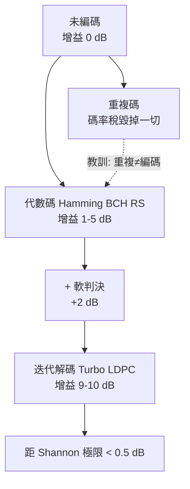

# 6.3 重複碼為何失敗與編碼增益

## 導言：最直覺的除錯方法，為什麼不行

面對雜訊，最樸素的對策是**重複**：每個位元連發三次，接收端多數決（majority vote）。 $000 \to 00000$ ？不，重複碼 $R_3$ ： $0 \to 000$ 、 $1 \to 111$ 。 $d_{\min} = 3$ ，可更正 1 錯。這真的有效嗎？——單看錯誤率，有效；但**效率上，它是一場災難**。本節解剖重複碼，理解「為什麼重複行不通」，從而真正理解 Shannon 定理的革命性：可靠通訊**不需要**犧牲速率，只需要聰明的碼。

## 重複碼的解剖

### 錯誤率確實下降

重複 $n$ 次（ $n$ 奇）、多數決解碼，BSC 錯誤率 $p$ 下：

$$
P_e^{(n)} = P\left(\text{錯誤數} > \frac{n}{2}\right) = \sum_{i=(n+1)/2}^{n} \binom{n}{i} p^i (1-p)^{n-i}
$$

### 例題：計算幾個重複度

| 重複度 $n$ | 碼率 $R$ | $p = 0.1$ 時 $P_e$ |
|---|---|---|
| 1（不編碼） | 1 | 0.1 |
| 3 | 1/3 | $\binom31 p^2(1-p) + p^3 = 0.028$ |
| 5 | 1/5 | $\binom52 p^5(1-p)^3+\binom53 p^3(1-p)^2+p^5 \approx 0.00856$ |
| 11 | 1/11 | $\approx 0.00094$ |
| 101 | 1/101 | $\approx 3 \times 10^{-18}$ |

錯誤率指數級下降！但看碼率：**為了 $10^{-18}$ 的錯誤率，付出 101 倍的頻寬**。等效資訊速率只剩原本的 1/101。

### 失敗的定量刻劃

重複碼的率 $R = 1/n \to 0$ 。Shannon 逆定理（4.3 節）說 $R > C$ 必錯，但沒說 $R < C$ 必可——重複碼的問題是：**它以「壓低碼率」換取可靠度，最終率趨於零**，遠低於 $C$ 。任何「重複」式策略都如此：可靠度上升的同時，率被壓死。

**更根本的失敗**：重複碼無法同時逼近「低錯誤率 + 高碼率」。而 Shannon 定理說存在碼可以。**這個「可以」的證明（4.3 節隨機編碼）本質上依賴：好的碼不是重複資訊，而是把資訊「打散」到整個碼字中**——每個碼字位元都攜帶所有訊息位元的混合資訊，雜訊打壞一部分位元，其餘位元仍能整體辨識訊息。這種「資訊的廣播式分散」是編碼理論的靈魂，Hamming 碼已具雛形，Turbo/LDPC 達成。

## 編碼增益：工程師的計分板

**編碼增益（coding gain）**定義：在相同錯誤率下，編碼系統相對未編碼系統所需的 SNR 節省（dB）：

$$
G = \left(\frac{E_b/N_0}{E_b/N_0}\right)_{\text{uncoded}} - \left(\frac{E_b/N_0}{E_b/N_0}\right)_{\text{coded}} \text{（dB）}
$$

注意編碼要付出功率代價：碼率 $R_c = k/n$ 意味著同樣資訊率下，**每資訊位元的能量**被分攤到 $n$ 個傳輸位元，若總功率不變， $E_b$ 下降 $R_c$ 倍——編碼增益必須先償還這個「碼率稅」。

### 例題：編碼增益計算

BSC 等效系統（硬判決），目標 $P_e = 10^{-5}$ 。

**未編碼**：需要 $p = 10^{-5}$ 。對 QPSK 相干解調 $p \approx Q(\sqrt{2 E_b/N_0})$ ，得 $E_b/N_0 \approx 9.6$ dB。

**Hamming $[7,4]$ （硬判決）**：塊錯誤率 $P_B = \sum_{i=2}^{7}\binom7i p^i (1-p)^{7-i} \approx 21 p^2$ （ $p$ 小時）。要求 $P_B/4$ 級的位元錯誤率 $10^{-5}$ → $P_B \approx 4 \times 10^{-5}$ → $p \approx \sqrt{4\times10^{-5}/21} \approx 1.38 \times 10^{-3}$ 。對應 $E_b/N_0 \approx Q^{-1}(1.38\times 10^{-3})/\sqrt{2} \cdot \frac{1}{R_c}$ 修正碼率稅 $10\log_{10}(4/7) = -2.43$ dB …淨增益約 **0.9–1.5 dB**（隨假設細節不同）。

**結論**：Hamming 碼增益約 1 dB 量級；重複碼 $n=5$ 在 $10^{-5}$ 下增益為負（碼率稅吃掉一切）。**現代碼（Turbo/LDPC）在 $10^{-5}$ 下增益 8–10 dB**——這 9 dB 的差距就是 1993 年之前的五十年代編碼史。

| 碼 | 碼率 | 典型增益（ $10^{-5}$ ） | 年代 |
|---|---|---|---|
| 重複碼 $n=5$ | 0.2 | ≈ 0 或負 | 遠古 |
| Hamming $[7,4]$ | 0.571 | ≈ 1 dB | 1950 |
| BCH $[127, 64]$ | 0.504 | ≈ 3 dB | 1960 |
| Reed–Solomon + 摻積（CD） | 約 0.5 | ≈ 4–5 dB | 1979 |
| 摻積碼（軟判決 Viterbi） | 0.5 | ≈ 5 dB | 1967/1974 |
| Turbo 碼 | 0.5 | ≈ 9.5 dB | 1993 |
| LDPC（近香農） | 0.5 | ≈ 9.7 dB | 1996（1962 想法復活） |

## 為什麼 Hamming/BCH 撞牆：距離與率的取捨

BSC 上塊碼錯誤率的聯集界：

$$
P_B \le \sum_{i=d_{\min}}^{n} A_i \, p^i (1-p)^{n-i} \approx A_{d_{\min}} p^{d_{\min}}
$$

$A_i$ 是重量 $i$ 的碼字數（**重量分佈**）。要低錯誤率，需要大 $d_{\min}$ **且小 $A_{d_{\min}}$ **。問題：

1. 固定率下，代數構造的 $d_{\min}$ 增長慢（BCH 界給 $d \ge 2t+1$ ，但率隨 $t$ 下降）。
2. 碼長增大時， $A_{d_{\min}}$ 往往指數增長（重量分佈集中在 $n/2$ 附近），抵消 $p^{d}$ 的好處。
3. 硬判決丟失軟資訊：通道輸出的「信心程度」被量化成 0/1，等效損失約 2 dB（3 bit 量化可回收大部分）。

Shannon 的隨機碼有最好的重量分佈（隨機集中性），但解碼指數複雜。**編碼理論五十年 = 在「好分佈（隨機）」與「可解碼（結構）」之間找橋**——LDPC 的稀疏隨機圖最終證明兩者可兼得。

## 軟判決與迭代解碼的預告

硬判決： $y \in \{0, 1\}$ 。軟判決： $y \in \mathbb{R}$ （或量化），攜帶 **LLR**（log-likelihood ratio，對數似然比）：

$$
\Lambda(y) = \log \frac{P(x = 0 \mid y)}{P(x = 1 \mid y)}
$$

LLR 的加法規則使解碼器可「累積證據」：兩個獨立觀測的 LLR 相加。迭代解碼（10.1、10.2 節）就是在圖上傳遞 LLR，讓每個位元從多方證據匯聚信念。軟判決 + 迭代 = 現代編碼接近香農極限的兩根支柱；Hamming 時代只有硬判決 + 代數。

## 歷史前因後果

### 誰、何時、為什麼

- **1948 Shannon**：逆定理宣告「重複不是解」；隨機編碼證明存在遠比重複聰明的碼。
- **1950–1960 Hamming、Golay、BCH、RS**：代數碼黃金期（增益 1–5 dB）。
- **1967 Viterbi**：摻積碼的 ML 解碼演算法（動態規劃），1974 年軟判決版本帶來 5 dB。
- **1962 Gallager**：LDPC 博士論文——因當時算力不足被遺忘 34 年。
- **1993 Berrou、Glavieux、Thitimajshima**：Turbo 碼，增益跳躍至近香農極限（當年評審一度懷疑計算錯誤）。
- **1996 MacKay–Neal**：復活 LDPC，同樣逼近極限。

### 解決了什麼問題

1. **破除「重複迷信」**：Shannon 定理證明可靠與高速不衝突；重複碼的失敗反襯出「資訊分散」設計的必要性。
2. **增益的定量**：編碼增益成為系統設計的核心 KPI，直接換算為功率、覆蓋、電池壽命與頻譜效率。
3. **路線圖**：重複 → 代數 → 軟判決 → 迭代，增益的階梯指明了通往香農極限的路。

### 引發什麼新問題

1. **延遲**：逼近極限需要長碼（ $n = 10^3$ – $10^4$ ），短封包應用受限（4.3 節有限碼長理論回應）。
2. **解碼能耗**：迭代解碼計算量大，行動裝置的功耗預算成為新戰場（ANS 與輕量極化碼的機會）。
3. **非 AWGN 通道**：衰落、干擾、多用戶下「接近極限」需要自適應碼率與混合 ARQ（10.3 節）。
4. **安全**：接近極限的碼與物理層安全（wiretap 通道，Wyner 1975）結合（9.3、10.3 節）。

## 與其他領域的關聯

### 統計物理

LDPC 的迭代解碼等價於自旋玻璃模型的信念傳播；碼的「錯誤地板（error floor）」對應相變；碼集合的率–失真行為由統計力學方法分析（Mézard–Montanari《Information, Physics, and Computation》2009）。

### 機器學習

迭代解碼是機率圖模型上的信念傳播（9.2 節）；Turbo 碼的兩個軟解碼器互餵 = 融合（ensembling）；現代「學習的解碼器」（neural decoder）直接用梯度下降學解碼策略（10.3 節）。

### 幾何

重複碼 = 一維空間中僅兩點、靠間距抗雜訊；Shannon 式碼 = 高維空間中的密集點集，靠**維度詛咒的相反面（維度祝福）**：高維中隨機點幾乎正交，碼字可同時多且距離遠。這個幾何直覺也解釋 MIMO 與擴頻（8.3 節）。

### 經濟學

每 1 dB 編碼增益在行動網路中換算為基站數、頻譜租金與終端電池成本——資訊理論的數字直接寫進營運預算。

## 小結與思考題

重複碼證明了「可靠度可換」，但以碼率崩塌為代價——它失敗在**把資訊冗餘做在局部**，而非 Shannon 式的**全域分散**。編碼增益的歷史（0 → 1 → 5 → 9.7 dB）是理解現代通訊性能的座標軸；軟判決與迭代解碼是最後兩級階梯。

**思考題**

1. 對 $p = 0.1$ 的 BSC，計算重複度 3、7 的 $P_e$ 與碼率；在 $P_e = 10^{-3}$ 目標下，哪個更「浪費」？
2. 解釋碼率稅：碼率 $R_c$ 的碼在固定總功率下， $E_b/N_0$ 與未編碼相比變化多少 dB？
3. 為什麼軟判決比硬判決好約 2 dB？用 LLR 的資訊量觀點論證。
4. 重複碼的重量分佈只有兩個碼字（重量 0 與 $n$ ）， $A_{d_{\min}} = 1$ ——按 6.3 的聯集界分析，它的 $P_B$ 應該極好，為什麼實際仍失敗？（提示：碼率。）
5. 查資料：5G NR 的控制通道用 Polar 碼、資料通道用 LDPC。為什麼兩種場景選不同碼？（提示：碼長、碼率範圍、解碼延遲。）

第 6 章完成。下一章：代數碼——用多項式與有限體把碼的構造與解碼推向工程極限。
