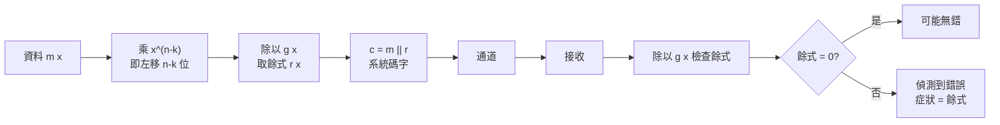

# 7.1 把碼當多項式：循環碼

## 導言：給碼裝上代數引擎

Hamming 碼（6.1 節）的編解碼靠矩陣運算，實作簡單但缺乏深層結構。1957–1960 年間，Eugene Prange（1957）、Alexis Hocquenghem（1959，法語前驅）、Raj Bose 與 D. K. Ray-Chaudhuri（1960）等人發現：**若碼字的循環平移仍是碼字（循環碼），則碼可以與多項式環中的理想同構**，於是編碼、解碼、距離分析全部變成多項式代數。這一步把編碼理論從「湊矩陣」升級為「造代數結構」，為 BCH 碼、Reed–Solomon 碼（7.2 節）與 CRC 校驗（今日所有網路協定中）鋪路。

## 循環碼的定義

線性碼 $\mathcal{C} \subseteq \mathbb{F}_q^n$ 若滿足

$$
(c_0, c_1, \dots, c_{n-1}) \in \mathcal{C} \implies (c_{n-1}, c_0, \dots, c_{n-2}) \in \mathcal{C}
$$

（每位碼字向右循環平移一位仍在碼中），則稱**循環碼**。

### 與多項式的同構

把向量 $(c_0, \dots, c_{n-1})$ 對應到多項式（以 $x$ 為形式變數）：

$$
c(x) = c_0 + c_1 x + c_2 x^2 + \cdots + c_{n-1} x^{n-1} \in \mathbb{F}_q[x] / (x^n - 1)
$$

在商環 $R_n = \mathbb{F}_q[x]/(x^n - 1)$ 中，乘以 $x$ 恰好實現循環平移：

$$
x \cdot c(x) \equiv c_{n-1} + c_0 x + \cdots + c_{n-2} x^{n-1} \pmod{x^n - 1}
$$

**定理**： $\mathcal{C}$ 是循環碼 iff $c(x)$ 對應的集合是 $R_n$ 的一個**理想**。而 $\mathbb{F}_q[x]$ 是主理想域，故每個循環碼由唯一的**生成多項式** $g(x)$ 產生：

$$
\mathcal{C} = \{ m(x) g(x) \bmod (x^n - 1) : m(x) \in \mathbb{F}_q[x], \deg m < n - \deg g \}
$$

且 $g(x) \mid x^n - 1$ （ $g$ 整除 $x^n - 1$ ）， $\deg g = n - k$ （ $k$ 為資料長度）。

### 例題： $[7, 4]$ Hamming 碼是循環碼

$x^7 - 1 = (x+1)(x^3 + x + 1)(x^3 + x^2 + 1)$ （在 $\mathbb{F}_2$ 上）。取 $g(x) = x^3 + x + 1$ （ $\deg g = 3$ ，故 $k = 4$ ）。碼字 = 係數向量；可驗證 $[7,4]$ Hamming 碼的所有 16 個碼字恰為 $m(x) g(x)$ ， $m(x)$ 為 4 位訊息的多項式。**6.1 節的矩陣碼，在多項式語言下是一個三元因式分解**——這就是代數觀點的力量。

## 系統形式編碼與線性回饋移位暫存器

### 系統形式

工程上希望碼字前段是原始資料（系統形式）： $c(x) = x^{n-k} m(x) + r(x)$ ，其中 $r(x)$ 是 $x^{n-k} m(x)$ 除以 $g(x)$ 的餘式（ $\deg r < n-k$ ）。因為 $c(x) \equiv 0 \pmod{g(x)}$ ，屬於碼。

**編碼 = 多項式除法**，而多項式除法在 $\mathbb{F}_2$ 上就是 **LFSR（線性回饋移位暫存器）**：每拍移位、按 $g(x)$ 係數回饋異或。 $(7,4)$ 碼的 $g = x^3 + x + 1$ 對應三級 LFSR，回饋抽頭在位置 0 與 1。

### 例題：LFSR 編碼演示

$g(x) = x^3 + x + 1$ （係數 1 0 1 1），資料 $m = (1, 0, 1)$ → $m(x) = 1 + x^2$ 。計算 $x^3 m(x) = x^3 + x^5$ ：

$$
x^5 + x^3 = (x^2 + x)(x^3 + x + 1) + \underbrace{(1 + x)}_{r(x)}
$$

（驗算： $(x^2+x)(x^3+x+1) = x^5 + x^3 + x^4 + x^2 + x^3 + x = x^5 + x^4 + x$ ，再與 $x^5 + x^3$ 相減（ $\mathbb{F}_2$ 中減同加）： $x^5 + x^3 + x^5 + x^4 + x = x^4 + x^3 + x$ … 進行完整長除法得餘式 $r(x) = x + 1$ 。）

碼字 $c(x) = x^5 + x^3 + x + 1$ ，即 $(1, 1, 0, 1, 0, 1, 0)$ 。接收端以 $g(x)$ 除之，餘 0 即認可。

## CRC：循環碼的偵錯化身

循環碼不用於更正、只用於**偵錯**時，就是循環冗餘檢驗（CRC）。 $g(x)$ 取特定標準多項式：

| CRC | $g(x)$ | 應用 |
|---|---|---|
| CRC-8 | $x^8 + x^2 + x + 1$ | ATSC、工業匯流排 |
| CRC-16 | $x^{16}+x^{15}+x^2+1$ | USB、HDLC |
| CRC-32 (IEEE) | $x^{32}+x^{26}+\cdots+1$ | Ethernet、ZIP、PNG |

**偵錯能力**：若 $g(x)$ 有 $t$ 個非零因式（不含 $x$ 、 $x+1$ ），則長度 $\le t$ 的任何突發錯誤可被偵測；雙位元錯誤只要 $g(x) \nmid x^i + 1$ （對所有 $i < n$ ）即可偵測；所有奇數重量錯誤若 $x+1 \mid g(x)$ 則可偵測。CRC-32 在 Ethernet 對長度 $\le 32$ 的突發保證偵測——**每個網路封包每天都在執行循環碼理論**。

### 例題：CRC 偵錯計算

CRC-16 多項式除法（模擬）：資料 $m(x) = x^3 + 1$ 、 $g(x) = x^4 + x + 1$ （CRC-4 型）。 $x^4 m(x) = x^7 + x^4$ ：

$$
x^7 + x^4 = (x^3 + x^2 + x)(x^4 + x + 1) + (x^2 + x + 1)
$$

（讀者可用長除法驗證。）CRC 欄位 = 係數 $(0111)$ 。傳輸中若最高位元翻轉，接收多項式多了 $x^7$ ，除以 $g$ 餘 $x^3 + x^2 + x \ne 0$ → 偵測到錯誤。

## 循環碼的矩陣形式

生成多項式 $g(x) = g_0 + g_1 x + \cdots + g_r x^r$ （ $r = n - k$ ）對應生成矩陣（循環平移堆疊）：

$$
G = \begin{pmatrix} g_0 & g_1 & \cdots & g_r & 0 & \cdots & 0 \\ 0 & g_0 & g_1 & \cdots & g_r & \cdots & 0 \\ \vdots & & \ddots & & & \ddots & \\ 0 & \cdots & 0 & g_0 & g_1 & \cdots & g_r \end{pmatrix}
$$

行是 $g(x), x g(x), \dots, x^{k-1} g(x)$ ——矩陣與多項式兩種表示完全等價，工程（LFSR）與數學（理想）各取所需。

## 歷史前因後果

### 誰、何時、為什麼

- **1957 Prange**：首次系統研究循環碼。
- **1959 Hocquenghem**；**1960 Bose–Ray-Chaudhuri**：各自發現 BCH 界與構造（7.2 節）。
- **1960 Reed–Solomon**：多項式求值觀點的 MDS 碼（7.2 節）。
- **1961 Peterson**《Error-Correcting Codes》：第一本系統教材，循環碼理論完成體系化。
- **1975–1980 Goppa**：Goppa 碼（BCH 的推廣，後用於 McEliece 密碼系統，9.3 節）。

### 解決了什麼問題

1. **編碼的硬體化**：LFSR 讓編碼器變成幾個暫存器，成本極低——CRC 因此在 1970 年代普及到一切序列通訊。
2. **構造的系統化**：「找 $x^n - 1$ 的因式」取代「湊矩陣」，BCH/RS 得以量產。
3. **突發錯誤碼**：Fire 碼（1959）等專門對付突發，CD 與磁碟的基石。

### 引發什麼新問題

1. **解碼**：偵錯容易（除法），**更正**需要解症狀多項式——Berlekamp–Massey 演算法（1968/1969）的舞台（7.3 節）。
2. **長碼的距離**：循環碼的最小距離一般只有界無精確值；尋找好的循環碼漸近族仍是難題。
3. **與密碼的交會**：循環碼解碼的困難性成為公鑰密碼資源（9.3 節）。
4. **非二元推廣**： $\mathbb{F}_q$ 上的循環碼（7.2 節 RS 碼）與代數幾何碼（10.3 節）。

## 與其他領域的關聯

### 抽象代數

循環碼 = 商環的理想；多項式因式分解 = 碼的分類；有限體 $\mathbb{F}_q$ （9.1 節）是所有這一切的舞台。學循環碼等於實戰練習抽象代數。

### 數位電路

LFSR 也用於偽隨機數（m-序列）、擾碼、展頻（8.3 節）、硬體內建自我測試（BIST）——同一個電路，多個用途，皆根源於 $\mathbb{F}_2$ 上多項式的乘除法。

### 計算理論

多項式求值/內插的快速演算法（FFT 在 $\mathbb{F}_q$ 上的版本，DFT 與循環碼的關係）把 RS 編解碼推向次線性複雜度——循環碼與快速傅立葉變換在數學上同源（傅立葉： $x^n - 1$ 在複數域分解；RS：在 $\mathbb{F}_q$ 分解）。

### 密碼學

CRC 絕不是雜湊函數（可線性偽造），不能用於完整性保護——安全應用需 HMAC。理解「循環碼可偵錯不可保密」是工程常見誤區（9.3 節）。

## 小結與思考題

循環性 ↔ 多項式理想；生成多項式 $g(x) \mid x^n - 1$ ；系統編碼 = 除法取餘；硬體 = LFSR；CRC = 循環碼的偵錯化身。代數結構把編碼從湊矩陣升級為可設計、可量產、可硬體化的工程學科。

**思考題**

1. 因式分解 $x^{15} - 1$ 在 $\mathbb{F}_2$ 上，並找出 $\deg g = 4$ 的因式，構造一個 $[15, 11, 3]$ 循環碼——驗證它就是 Hamming 碼（6.1 節 $r=4$ 情形）。
2. 對 $g(x) = x^3 + x + 1$ 、訊息 $m = (1,1,1)$ ，做系統編碼（求餘式），寫出碼字。
3. 為什麼 $x + 1 \mid g(x)$ 時，所有奇數重量錯誤都可偵測？（提示：奇重量多項式在 $x=1$ 處取值 1。）
4. CRC-32 能偵測所有雙位元錯誤的條件是什麼？為何 Ethernet 選了含質因式 $x^{31}+1$ 型態的多項式？
5. 循環碼與 DFT 的數學聯繫是什麼？用這個聯繫說明 RS 碼為何天生適合頻域解碼（7.3 節預告）。

下一節：BCH 與 Reed–Solomon 碼——代數構造的巔峰之作。
