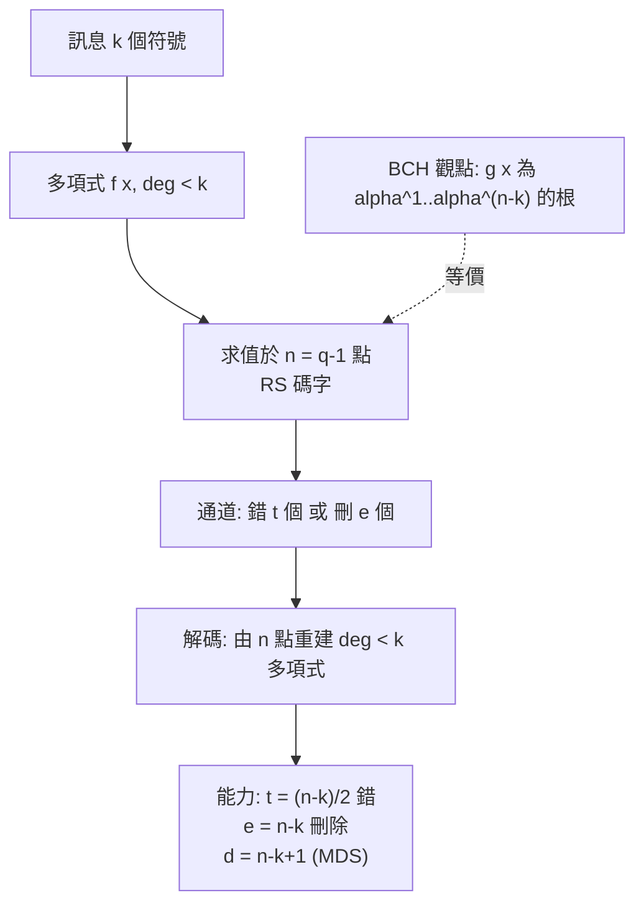

# 7.2 BCH 與 Reed–Solomon 碼（1960）

## 導言：代數構造的黃金年代

1960 年是編碼理論的豐收年：一月，Bose 與 Ray-Chaudhuri 發表 BCH 界；Hocquenghem 1959 年已有等價結果；同年六月，Irving Reed 與 Gustave Solomon 發表《Polynomial Codes over Certain Finite Fields》。兩者都以有限體上的多項式根為骨架：

- **BCH 碼**：設計多重根的循環碼，精確控制更正能力 $t$ 。
- **Reed–Solomon（RS）碼**：以「多項式求值」定義的 MDS 碼，達 Singleton 界等號（6.2 節），在刪除與突發錯誤場景無可替代。

從 CD 唱片、QR 碼、Deep Space 網路到 RAID 6 與 5G 的 NR 碼塊，RS/BCH 是迄今部署最廣的碼家族。

## 有限體與 BCH 碼的構造

（有限體 $\mathbb{F}_q$ 的完整理論見 9.1 節；此處取用其基本事實： $\mathbb{F}_q^*$ 是 $q-1$ 階循環群，存在本原元 $\alpha$ 。）

### 定義（狹義 BCH 碼）

固定長度 $n = q^m - 1$ （對 $\mathbb{F}_q$ ），設計距離 $\delta$ 。取 $\alpha \in \mathbb{F}_{q^m}$ 為本原元，定義生成多項式 $g(x)$ 為使 $\alpha^1, \alpha^2, \dots, \alpha^{\delta - 1}$ 皆為根的最小次多項式：

$$
g(x) = \mathrm{lcm}\left(m_1(x), m_2(x), \dots, m_{\delta-1}(x)\right)
$$

其中 $m_i(x)$ 是 $\alpha^i$ 的最小多項式。碼

$$
\mathcal{C}_{\text{BCH}} = \{ c(x) \in \mathbb{F}_q[x]/(x^n-1) : g(x) \mid c(x) \}
$$

**BCH 界**： $d_{\min} \ge \delta$ 。（證明骨架： $\alpha^1, \dots, \alpha^{\delta-1}$ 為根 ⇒ 重量 $< \delta$ 的多項式不能有這些根，由 Vandermonde 矩陣的滿秩性推出。）碼的維度 $k \ge n - m(\delta - 1)$ （因每個最小多項式次數 $\le m$ ）。

### 例題：二元 $[15, 7, 5]$ BCH 碼

$\mathbb{F}_{16}$ 中 $\alpha$ 滿足 $\alpha^4 = \alpha + 1$ 。 $\alpha^3$ 的最小多項式為 $x^4 + x^3 + x^2 + x + 1$ （3 階分圓陪集 $\{3, 6, 12, 9\}$ ）。取 $\delta = 5$ ：需 $\alpha^1..\alpha^4$ 為根。 $\alpha^1$ 與 $\alpha^2$ 、 $\alpha^4$ 同陪集（ $m_1 = x^4+x+1$ ）， $\alpha^3$ 自成陪集。故

$$
g(x) = (x^4+x+1)(x^4+x^3+x^2+x+1) = x^8 + x^7 + x^6 + x^4 + 1
$$

$\deg g = 8$ ， $n = 15$ ， $k = 7$ ， $d_{\min} \ge 5$ （實際恰為 5），更正 $t = 2$ 位元錯。**從「要修兩個錯」的規格出發，直接寫下 $g(x)$ **——這就是 BCH 構造的工程威力。

## Reed–Solomon 碼：求值觀點

### 定義

RS 碼定義在 $\mathbb{F}_q$ **上**（ $n = q - 1$ ，取 $n = q-1$ 的本原情形）。訊息是 $k$ 個係數 $m_0, \dots, m_{k-1}$ ，對應多項式

$$
f(x) = m_0 + m_1 x + \cdots + m_{k-1} x^{k-1}, \qquad \deg f < k
$$

碼字為其在 $n = q - 1$ 個非零元素上的求值向量：

$$
c = \big(f(1), f(\alpha), f(\alpha^2), \dots, f(\alpha^{n-1})\big), \qquad n = q-1
$$

### MDS 性質與能力

兩個不同的 $k-1$ 次多項式至多在 $k-1$ 個點上相等，故任兩碼字至少在 $n - (k-1)$ 個位置相異：

$$
d_{\min} = n - k + 1
$$

**恰好達到 Singleton 界等號**（6.2 節）——RS 是 MDS 碼。能力：

- 更正錯誤： $t = \lfloor (n-k)/2 \rfloor$ 。
- **更正刪除（erasure）**： $e = n - k$ 個（位置已知），**雙倍效率**。

### 例題：RS(10, 6) 完整演算（小體示範）

取 $\mathbb{F}_{11}$ （ $q = 11$ ， $n = 10$ ， $\alpha = 2$ 是本原元： $2^1..2^{10}$ 模 11 遍歷 $2,4,8,5,10,9,7,3,6,1$ ）。碼參數 $(n, k) = (10, 6)$ ， $d_{\min} = 5$ ， $t = 2$ 。

訊息 $m = (3, 1, 0, 0, 2, 1)$ ，多項式：

$$
f(x) = 3 + x + 2x^4 + x^5
$$

求值 $f(\alpha^j) = f(2^j)$ ， $j = 0..9$ ：

| $x$ | 1 | 2 | 4 | 8 | 5 | 10 | 9 | 7 | 3 | 6 |
|---|---|---|---|---|---|---|---|---|---|---|
| $f(x) \bmod 11$ | 7 | 3 | 9 | 0 | 7 | 3 | 10 | 6 | 8 | 4 |

（例如 $f(2) = 3 + 2 + 2\cdot16 + 32 = 3+2+32+32 = 69 \equiv 3 \pmod{11}$ 。）

碼字 $c = (7, 3, 9, 0, 7, 3, 10, 6, 8, 4)$ 。若接收時位置 3（值 0）與位置 9（值 4）各錯一個值——**兩個錯誤恰為 $t = 2$ **，解碼器（7.3 節 Berlekamp–Massey）可完全還原 $f$ ；若只是刪除（知道位置但不知原值），最多可容忍 $n - k = 4$ 個刪除。

**RAID 6 的直覺**：資料 + 兩個同位條 = RS(若干, k) 的實例；任何兩顆磁碟壞掉（刪除）皆可重建——正是 $e = n-k$ 刪除能力的應用。

## 兩種觀點的等價

RS 碼同時是：

1. **求值碼**（上）：多項式 → 求值向量（Reed–Solomon 原始觀點）。
2. **循環碼**：以 $g(x) = \prod_{j=1}^{n-k}(x - \alpha^j)$ 為生成多項式的循環碼（BCH 觀點， $\delta = n-k+1$ ）。

兩者由「多項式求值向量的循環平移 = 乘 $x$ = 係數的線性組合」聯繫，且**生成多項式的根恰為傅立葉變換的零頻段**：RS 碼 = 頻域中連續 $n-k$ 個零的頻譜——這是頻域解碼（7.3 節）的數學基礎，也是循環碼與 DFT 同源的直接證據（7.1 節思考題 5 的答案）。

## 突發錯誤之王

RS 碼的符號是 $\mathbb{F}_q$ 元素（ $m$ 位元一個符號）。**一個符號錯誤 = 最多 $m$ 個連續位元錯誤**。RS( $n$ , $k$ ) 在 $m$ 位元/符號下可更正長達 $t \cdot m$ 位元的突發。例： $\mathbb{F}_{256}$ （ $m = 8$ ）、 $t = 16$ → 可更正 128 個連續位元錯誤。這解釋了為什麼：

- **CD（1982）**：CIRC = 交錯的兩層 RS(32, 28) 與 RS(28, 24)， $\mathbb{F}_{256}$ 。可更正約 4000 位元刮痕；不可更正時靠內插隱藏。
- **QR 碼**：RS 區塊（ $\mathbb{F}_{256}$ ），L/M/Q/H 四個錯誤更正等級（最多約 30% 修復）。
- **DVB、DSL、儲存**：RS 長碼 + 縮短/打洞變體。
- **RAID 6、糾刪碼儲存**（HDFS、S3）：刪除模式 RS。

## RS 碼與刪除碼的現代生命

**分散式儲存**（2020 年代雲端）： $k$ 個資料塊 + $r$ 個同位塊（RS），任意 $r$ 塊丟失可重建，儲存成本 $(1 + r/k)$ 倍，比 3 副本省 $40\%+$ 。修復單塊時傳統 RS 需下載 $k$ 塊（regenerating codes 研究降低修復頻寬，10.3 節）。RS 碼從 1960 的深空應用，到 2026 年支撐整個雲端儲存的冗餘層——一條數學公式活了六十年。

## 歷史前因後果

### 誰、何時、為什麼

- **1959 Hocquenghem**、**1960 Bose–Ray-Chaudhuri**：BCH 構造與界（獨立於 1940 年代的 Prange 工作）。
- **1960 Reed–Solomon**：原始論文用 $\mathbb{F}_q$ 上的廣義（非本原）形式；後經 Berlekamp–Welch、Massey（1969）證明與 BCH/循環碼等價。
- **1968 Berlekamp**《Algebraic Coding Theory》：BM 演算法，使 RS/BCH 解碼可行（7.3 節）。
- **1977 Voyagers**：RS + 摻積串接碼上太空，至今仍從星際邊緣回傳資料。
- **1982 CD**：CIRC 把 RS 帶入消費電子。
- **1985–1995 RAID、儲存業**：刪除碼工業化。
- **1997 Sudan**：RS 列表解碼，突破 $\lfloor(d-1)/2\rfloor$ 極限（7.3 節）。

### 解決了什麼問題

1. **可規格化的碼**：要更正 $t$ 錯 → BCH 直接給 $g(x)$ ；要 $d = n-k+1$ → RS 給 MDS。
2. **突發錯誤**：符號級設計天然抗突發。
3. **刪除與冗餘**：RS 的雙倍刪除能力使儲存冗餘達最優（Singleton 等號）。

### 引發什麼新問題

1. **解碼計算**： $O(n^2)$ 的 Berlekamp–Massey 在長碼上吃緊——FFT 型 RS 解碼（Justesen 等）與列表解碼複雜度。
2. **率–距離漸近**：RS 碼長受限 $n \le q - 1$ ；要長碼需大體（計算昂貴）或代數幾何碼（TSVZ 1982 超越 GV 界）。
3. **軟解碼**：RS 原生硬判決；與軟迭代解碼結合（如 RS-LDPC 串接）是現代設計。
4. **修復頻寬**：分散式儲存的單塊修復成本（regenerating、locally repairable codes，10.3 節）。

## 與其他領域的關聯

### 線性代數

RS 解碼 = 解 Vandermonde 系統； $n$ 點決定 $k$ 次多項式 = 線性方程組的解的唯一性；MDS = 生成矩陣任意 $k$ 列滿秩。

### 有限體與代數

$\mathbb{F}_q^*$ 的循環性、本原元、最小多項式、分圓陪集——9.1 節將系統補足；RS 碼是抽象代數最成功的工程應用之一。

### 傅立葉分析

循環碼 ↔ 離散傅立葉（有限體上的 DFT）；RS = 頻譜連續零；編解碼可全頻域進行（Rader、Bluestein 型演算法在 $\mathbb{F}_q$ 的實現）。

### 計算機科學

多項式求值碼是**密碼學與複雜度理論**的基礎原語：Reed–Solomon 碼用於 PCP 定理、互動式證明、FRI/STARK 零知識證明（2020s 區塊鏈）——一個 1960 年的通訊碼成為可驗證計算的基石（9.3、10.3 節）。

## 小結與思考題

BCH 以「設計根」控制距離，RS 以「多項式求值」達 MDS；兩者是同一枚代數硬幣的兩面。從 CD 到 QR 到 RAID 到零知識證明，RS 碼證明：好的數學結構可以服役遠超其設計者的想像。

**思考題**

1. 求二元 BCH $[31, 21, 5]$ （ $t = 2$ ）的生成多項式需要知道哪些分圓陪集？
2. 對 RS(10, 6)（ $\mathbb{F}_{11}$ ）與訊息 $m = (1, 0, 0, 0, 0, 0)$ （ $f(x) = 1$ ），寫出碼字；若接收時位置 5 的值錯了，解碼器如何知道是「值錯」而非「多項式不同」？
3. RS(255, 239)（ $\mathbb{F}_{256}$ ）： $t$ 為何？可更正多長的位元突發？碼率多少？
4. 為什麼刪除的容忍上限（ $n-k$ ）是錯誤的兩倍？從「位置資訊」的角度論證。
5. 用 Singleton 界論證：任何 $(n, k, n-k+1)$ 距離的碼，其刪除能力 $n - k$ 已是最優。

下一節：解碼演算法——Berlekamp–Massey、Euclid 與 Sudan，把代數碼的理論潛力兌現為執行速度。
