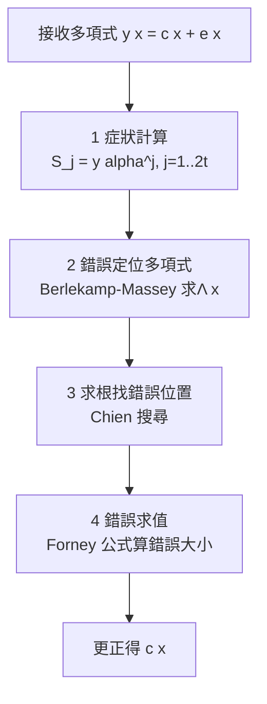

# 7.3 解碼演算法與應用

## 導言：理論潛力的兌現

第 7.2 節的 BCH/RS 碼有漂亮的構造，但「能更正 $t$ 錯」只是數學承諾；**解碼演算法**才是工程兌現。1960 年代的三項突破——Peterson–Gorenstein–Zierler（1960）、Berlekamp（1968）的迭代演算法、Massey（1969）的 LFSR 理論解讀——把 RS 解碼降到 $O(t^2)$；1986 年 Welch–Berlekamp、1997 年 Sudan 的列表解碼再推進。本節走完「症狀 → 錯誤定位 → 求值 → 更正」的全流程，並檢視 RS/BCH 在各領域的部署。

## 解碼的整體流程

RS/BCH 解碼分四步（$t$ 錯、$n$ 碼長、$\mathbb{F}_q$ 符號）：

### 第 1 步：症狀計算

接收 $y(x) = c(x) + e(x)$（$e$ 為錯誤多項式，重量 $\le t$）。對 $j = 1, \dots, 2t$ 求值：

$$
S_j = y(\alpha^j) = c(\alpha^j) + e(\alpha^j) = e(\alpha^j)
$$

（碼字在 $\alpha^1..\alpha^{n-k}$ 為零，故症狀只反映錯誤。）若錯誤在位置 $i_{\ell}$（即 $\alpha^{i_\ell}$）、大小 $Y_\ell$：

$$
S_j = \sum_{\ell=1}^{t} Y_\ell \, \alpha^{j i_\ell}, \qquad j = 1, \dots, 2t
$$

**2t 個方程、2t 個未知數（$t$ 個位置、$t$ 個大小）**——解碼就是解這個非線性系統。直接解是 Peterson 演算法（$O(t^3)$）；Berlekamp–Massey 演算法以 $O(t^2)$ 遞迴解出。

### 第 2 步：錯誤定位多項式（Berlekamp–Massey）

定義**錯誤定位多項式**（error locator polynomial）：

$$
\Lambda(x) = \prod_{\ell=1}^{t}(1 - X_\ell x), \qquad X_\ell = \alpha^{i_\ell}
$$

其根為 $X_\ell^{-1}$。症狀序列 $\{S_j\}$ 恰好是 $\Lambda$ 對應線性回饋移位暫存器（LFSR）的輸出序列——**Massey（1969）的洞察：求 $\Lambda$ = 找能生成症狀序列的最短 LFSR**。BM 演算法迭代更新 $(\Lambda, B, L)$，每步由下一個症狀校正，$2t$ 步後收斂。若 $\deg \Lambda > t$ 或根不在 $\mathbb{F}_q$ → 超過 $t$ 個錯，宣告解碼失敗（可靠地拒絕）。

### 第 3 步：Chien 搜尋

對每個候選位置 $\alpha^{-i}$（$i = 0, \dots, n-1$）檢驗 $\Lambda(\alpha^{-i}) = 0$：成立則位置 $i$ 有錯。總成本 $O(n t)$。硬體上以並行乘法器流水線化。

### 第 4 步：Forney 公式

錯誤大小由**錯誤求值多項式** $\Omega(x) = S(x)\Lambda(x) \bmod x^{2t+1}$（$S(x) = S_1 + S_2 x + \cdots$）得到：

$$
Y_\ell = \frac{-\Omega(X_\ell^{-1})}{X_\ell^{-1} \Lambda'(X_\ell^{-1})}
$$

（Forney 1965；$\Lambda'$ 為形式導數。）減去 $Y_\ell$ 即完成更正。

### 例題：完整解碼一個 RS(10, 6)（$\mathbb{F}_{11}$）

延續 7.2 節例題：$f(x) = 3 + x + 2x^4 + x^5$，碼字 $c = (7,3,9,0,7,3,10,6,8,4)$（位置 0–9，對應 $x = 2^j$）。假設位置 5 由 3 錯成 6（$Y = 3$），單錯 $t' = 1$。

**症狀**（$\alpha = 2$，$S_j = e(\alpha^j) = Y \cdot (\alpha^j)^5$）：

- $S_1 = 3 \cdot 2^5 = 3 \cdot 32 = 96 \equiv 8 \pmod{11}$
- $S_2 = 3 \cdot 2^{10} = 3 \cdot 1 = 3$（$2^{10} \equiv 1$）
- $S_3 = 3 \cdot 2^{15} = 3 \cdot 2^5 \equiv 8$，$S_4 = 3$，循環。

**BM 求定位**：單錯時 $\Lambda(x) = 1 - X_1 x$，$X_1 = \alpha^5 = 2^5 = 32 \equiv 10$。即 $\Lambda(x) = 1 - 10x = 1 + x \pmod{11}$。

**Chien 搜尋**：$\Lambda(\alpha^{-i}) = 0 \iff \alpha^{-i} = -1 \iff \alpha^{-i} = 10 = \alpha^5 \iff i = 5$。✓ 位置 5。

**Forney 求值**：$Y_1 = \frac{S_1}{X_1} = \frac{8}{10} = 8 \cdot 10^{-1}$。$10^{-1} \bmod 11 = 10$（$10 \times 10 = 100 \equiv 1$）。$Y_1 = 8 \times 10 = 80 \equiv 3$。✓ 錯誤大小 3。

**更正**：$y_5 = 6 - 3 = 3$。還原 $c$，由任意 6 個位置解多項式還原訊息。全程 $O(t^2 + nt)$，$t = 1$ 時僅數十次 $\mathbb{F}_{11}$ 運算。

## 列表解碼：突破 $\lfloor(d-1)/2\rfloor$

**Sudan（1997）與 Guruswami–Sudan（1998）**：放棄唯一解，輸出與接收字距離 $\le \tau$ 的**所有**碼字清單。多項式內插 + 因式分解的兩段式：

1. 內插：找二元多項式 $Q(x, y)$ 使 $Q(\alpha_i, y_i) = 0$ 對所有接收點。
2. 因式分解：取 $Q$ 中形如 $y - f(x)$ 的因式，$f$ 即候選碼。

理論容量：在率 $R < 1 - \sqrt{1 - d/n}$ 時列表解碼可更正**超過** $d/2$ 的錯誤。應用：對抗高雜訊、以及密碼學中 RS 碼的「軟」處理（身份基礎加密 SBKD 等）。複雜度 $O(n^2)$ 級，長碼上仍重，但理論意義重大：**它證明 $\lfloor(d-1)/2\rfloor$ 不是資訊的極限，只是唯一解碼的極限**。

## 軟資訊與串接系統

RS/BCH 用硬判決，單獨使用時距香農極限遠。實務用**串接**（Forney, 1966）：

$$
\text{資料} \to \underbrace{\text{RS（外碼）}}_{\text{符號級、抗突發}} \to \underbrace{\text{交錯}} \to \underbrace{\text{摻積/LDPC（內碼）}}_{\text{位元級、軟判決}} \to \text{通道}
$$

- 內碼以軟判決消化通道雜訊（增益 5–9 dB）。
- 殘餘錯誤在外碼眼中是**符號級突發**，交錯打散後 RS 收尾。
- **Voyager（1977–）**：RS(255, 223) + 摻積碼（$K=7$），$P_e \approx 10^{-6}$ 下距香農極限約 2.5 dB——1990 年代深空標準。
- **CD 的 CIRC**：兩層 RS + 交錯，刮痕容忍 + 隱藏內插。
- **QR 碼**：RS 區塊 + 遮罩；錯誤更正等級 L(7%)/M(15%)/Q(25%)/H(30%)。

## 應用地圖（2020s）

| 領域 | 碼 | 為何選它 |
|---|---|---|
| QR 碼 | RS（$\mathbb{F}_{256}$） | 突發容忍（污損）、任意形狀分塊 |
| RAID 6 / 雲端儲存 | RS 糾刪碼 | 刪除能力 $n-k$，MDS 最優 |
| DVB-S2 | BCH + LDPC 串接 | BCH 清地板、LDPC 追極限 |
| 5G NR 控制通道 | Polar（BCH 外碼） | 短碼、CRC 輔助 |
| 以太網路 CRC-32 | 循環碼（偵錯） | 硬體極簡、突發偵測 |
| 區塊鏈糾刪碼 | RS（KZG 承諾預告） | 資料可用性取樣（DAS） |
| DNA 儲存 | RS + 編輯距離碼 | 替換+刪除混合錯誤 |

## 歷史前因後果

### 誰、何時、為什麼

- **1960 Peterson**：第一個系統解碼法（$O(t^3)$ 矩陣求逆）。
- **1965 Forney**：Forney 公式 + 串接碼理論。
- **1968 Berlekamp**：迭代演算法 $O(t^2)$。
- **1969 Massey**：以 LFSR 重述 BM，教科書形式定型。
- **1970 Chien 搜尋普及**（Chien 1964 原創）。
- **1986 Welch–Berlekamp**：直接由「多項式擬合」解碼，避免症狀域。
- **1997–1998 Sudan、Guruswami–Sudan**：列表解碼，率–錯誤折衷上移。
- **2000–2020 神經解碼**：以 NN 輔助解碼（預告 10.3）。

### 解決了什麼問題

1. **可行性**：BM 演算法把 RS 解碼做成每秒數 GB 的矽晶（DVB、網卡）。
2. **魯棒性**：解碼失敗可偵測（$\deg \Lambda > t$ 或根出體）——誤更正率極低，是儲存系統安全的前提。
3. **極限上移**：列表解碼證明更高錯誤容忍在原則上可行。

### 引發什麼新問題

1. **列表大小與率**：Guruswami–Rudra（2006）證明 $\Omega(\epsilon)$ 級錯誤下高率碼列表解碼的極限，開啟碼的列表可解性研究。
2. **軟/列表混合**：硬解碼快、軟解碼準，如何取捨？——現代接收器多層混合。
3. **編輯距離錯誤**：DNA 儲存有刪除/插入（非替換），RS 不直接適用——刪除碼（Brakensiek–Guruswami 等）是新前沿（10.3 節）。

## 與其他領域的關聯

### 線性代數與多項式代數

症狀系統 = 非線性方程組的「線性化」（定位多項式）；Vandermonde 結構；BM = 線性遞迴的最短化（與 Hankel 矩陣、Padé 逼近等價——BM 即 Padé 逼近的快速版）。

### 演算法

BM $O(t^2)$ 是經典的「動態規劃/貪婪迭代」；Chien 搜尋的並行化是硬體設計案例；內插+分解是「代數計算幾何」的入門（Roth–Ruckenstein 演算法等）。

### 密碼學與複雜度

- **解碼的難**：一般碼 ML 解碼 NP-hard（6.2 節）→ McEliece 密碼（9.3 節）。
- **解碼的易（結構碼）**：RS 列表解碼成為 SBKD、Goppa 碼攻擊、與 PCP 的工具——同一數學物件的難易切換是密碼學的核心手法。
- **零知識證明**：RS 多項式承諾（KZG 需橢圓曲線、FRI 用 RS 本身）。

### 統計學

最近鄰解碼 = MLE（2.3 節）；解碼失敗/誤更正的機率分析用大偏差與相對熵（3.3 節）；列表解碼對應統計的「多重假設」與 Lasso 的稀疏恢復——低雜訊下的稀疏訊號重建與 RS 列表解碼在數學上同構。

## 小結與思考題

RS/BCH 解碼四步曲（症狀 → BM 定位 → Chien 搜尋 → Forney 求值）把 $t$ 錯更正做到 $O(t^2 + nt)$；列表解碼把能力的理論上限再推一層；串接使代數碼在軟解碼時代繼續服役。從 QR 碼到 RAID 到零知識證明，這些 1960 年的演算法仍在 2026 年的核心基礎設施中運轉。

**思考題**

1. 對 7.3 例題改設「位置 5 錯、大小 5」，重算症狀與 Forney 值，驗證解碼。
2. 為什麼症狀只需 $2t$ 個（而非 $n$ 個）？由未知數個數論證。
3. BM 演算法失敗（$\deg \Lambda > t$）時，接收字與碼的距離必超過 $t$ 嗎？還是可能解碼到錯誤碼字？（討論誤更正機率。）
4. 用 Singleton 界論證列表解碼在 $\tau > (d-1)/2$ 時可能有多個解——舉 RS(10, 6) 的具體構造（兩個多項式在 6+2 個點上重合的例子）。
5. DNA 儲存中「刪除」錯誤為何不能用 RS？刪除與抹除（erasure）的差別是什麼？

第 7 章完成。下一章：回到連續世界——取樣、量化與調變，把位元放回波形。
