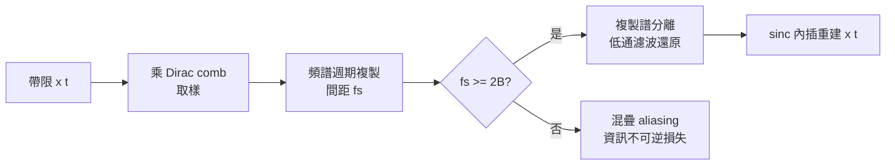

# 8.1 取樣定理

## 導言：離散化世界的許可證

1.2 節已預告：Nyquist（1928）與 Shannon（1948/1949）確立了取樣定理。它是**整個數位革命的法律基礎**：只要訊號帶限，以足夠快的速率取樣，就能用有限數字完全記錄一個連續訊號——不多一點、不少一點。沒有它，就沒有 CD、數位相機、手機、MRI、網路電話。本節完整陳述定理、證明其頻域本質、討論實務陷阱（混疊、保護帶、非理想濾波），並介紹現代推廣（非均勻取樣、壓縮感知預告）。

## 定理與證明

### 定理（Whittaker–Shannon–Kotel'nikov）

設 $x(t)$ 帶限於 $[-B, B]$ （ $X(f) = 0$ 對 $|f| > B$ ）。若取樣週期 $T \le \frac{1}{2B}$ ，則

$$
x(t) = \sum_{n=-\infty}^{\infty} x(nT)\, \mathrm{sinc}\!\left(\frac{t - nT}{T}\right), \qquad \mathrm{sinc}(u) = \frac{\sin \pi u}{\pi u}
$$

**重建是無限精確的**：有限樣本，無限函數——資訊論「有限自由度」思想的第一次大勝利。

### 證明（頻域摺積）

**步驟 1**：取樣 = 乘 Dirac comb。 $x_s(t) = x(t) \sum_n \delta(t - nT)$ 。

**步驟 2**：頻域。Dirac comb 的傅立葉轉換仍是 comb（間距 $1/T$ ），摺積定理給

$$
X_s(f) = \frac{1}{T} \sum_{k} X\!\left(f - \frac{k}{T}\right)
$$

**步驟 3**：重疊判斷。複製譜中心相距 $1/T$ 。若 $1/T \ge 2B$ ，無重疊；理想低通濾波器 $H(f) = T \cdot \mathbf{1}_{|f| \le 1/(2T)}$ 取出 $k=0$ 項還原 $X$ 。

**步驟 4**：回時域。理想低通脈衝響應是 $\mathrm{sinc}$ ，濾波即與 $\mathrm{sinc}$ 摺積，展開即得內插公式。∎

** $f_s < 2B$ 會怎樣**：複製譜重疊（aliasing），高低頻互相冒充，**不可逆**。 $f_s = 2B$ 稱 Nyquist 率； $B$ 稱 Nyquist 頻率（ $f_s/2$ ）。

### 例題 1：混疊頻率的計算

以 $f_s = 8000$ Hz 取樣訊號，包含成分 $9.5$ kHz。混疊後的視在頻率：

$$
f_{\text{alias}} = 9500 - 8000 = 1500 \text{ Hz}
$$

（因 $9.5$ kHz 的複製譜在 $9500 - 8000 = 1500$ 處落入基帶。）實例：老電影片（24 fps 取樣）中車輪看似倒轉——輻條的空間頻率超過取樣率的假象，正是混疊。

### 例題 2：系統參數設計

語音 $B = 4$ kHz：

- 取樣率 $f_s = 8$ kHz（Nyquist 恰好）；實務 8 kHz 標準（DS0）。
- 抗混疊濾波器截止 $4$ kHz、阻帶自 $8 - 4 = 4$ kHz 起——**無過渡帶**！理想磚牆濾波器不存在，故實際系統取 $f_s > 2B$ 。電話系統帶限到 $3.4$ kHz、取樣 $8$ kHz，過渡帶 $4.6$ kHz，8 階類比濾波器可達成。**保護帶 = 給非理想濾波器的餘地**。

## 實務的三大陷阱

### 陷阱一：帶限假設

真實訊號從不完美帶限（熱雜訊白、脈衝有寬頻）。**先濾波、後取樣**是不變的次序；跳過抗混疊濾波器是初學者（與某些產品）的經典錯誤。

### 陷阱二：sinc 的無限長

理想重建需 $\mathrm{sinc}$ 無限內插（每個樣本影響所有時間）。實際用有限長內插：線性、三次樣條、或升餘弦（raised cosine）成形（8.3 節）。品質代價以停帶衰減與紋波量化。

### 陷阱三：抖動與量化

取樣瞬間的時鐘抖動 $\Delta t$ 造成雜訊 $x'(t)\Delta t$ ；對 $B$ 頻寬訊號，等效 SNR 限制 $\approx 20\log_{10}\left(\frac{1}{2\pi B \Delta t}\right)$ 。取樣定理是「精確取樣時刻」下的陳述，時鐘品質是系統設計的真實約束。

## 2B 自由度的深層意義

每秒 $2B$ 個實數樣本 = 訊號空間的自由度。但**自由度 ≠ 資訊**：樣本是連續實數，似乎每個含無限位元；要變成可傳輸的位元，必須**量化**（8.2 節），量化引入失真；失真與率的取捨由率失真理論給出。全鏈條：

$$
\text{連續信源} \xrightarrow{\text{取樣}} 2W \text{ 樣本/s} \xrightarrow{\text{量化}} R \text{ bits/s} \xrightarrow{\text{通道}} C \text{ bits/s}
$$

**可行性條件**： $R \le C = W \log_2(1 + \text{SNR})$ 。數位通訊系統的全部參數（頻寬、取樣率、量化位元數、碼率）都在這條鏈上互相牽制。

### 例題：鏈條平衡

語音（ $W = 4$ kHz）、通道 SNR 20 dB（ $P/N = 100$ ）：

- 通道容量 $C = 4000 \log_2(101) \approx 26.6$ kbps。
- PCM 每樣本 $8$ bits、 $8$ kHz 取樣 → $64$ kbps > $C$ ，**傳不動**！
- 解法：ADPCM 壓到 32 kbps、或 LPC 聲碼器壓到 4.8 kbps（現代語音編碼 AMR 低至 4.75 kbps）——**信源編碼（第 5 章）的必要性由此可見**。

## 現代推廣

### 非均勻與帶通取樣

帶通信號（ $f \in [f_L, f_H]$ ，頻寬 $W = f_H - f_L \ll f_H$ ）可用遠低於 $2f_H$ 的取樣率：**帶通取樣定理** $f_s \ge 2W$ （需特定區間以避開複製譜重疊）。軟體無線電以此直接取樣高頻訊號。

### 壓縮感知（Compressed Sensing, 2004–2006）

Candès–Romberg–Tao 與 Donoho：若訊號在某基底**稀疏**（ $k$ 個非零/小係數），可用 $m \gtrsim k \log(N/k)$ 個隨機線性測量（而非 $N$ 個均勻樣本）以凸優化重建。取樣定理的「頻寬決定樣本數」被「稀疏度決定測量數」取代——MRI 加速（4–10 倍）、雷達、影像是直接受益者。**資訊量（稀疏度）而非頻寬決定取樣需求**——Shannon 自由度思想的現代化。

### 有限率創新（FRI）訊號

脈衝串（雷达回波、神經放電）只有有限參數（位置與幅度），可用**低於 Nyquist** 的取樣率以譜估計重建（Vetterli 2002）。與壓縮感知同屬「超越 Nyquist」家族。

## 歷史前因後果

### 誰、何時、為什麼

- **1915 Whittaker**（E. T.）：內插級數的數學前身（whittaker–shannon 內插）。
- **1928 Nyquist**：電報傳輸理論中的帶限與符號率（工程動機：電報多工）。
- **1933 Kotelnikov**（蘇聯）：獨立完整陳述（戰後才為西方所知）。
- **1949 Shannon**：在通信數學理論書中正式化，故稱 WSK 或 Shannon 取樣定理。
- **1949 Gabor**：資訊的「自由度」觀念。
- **2004–2006 Donoho、Candès 等**：壓縮感知。

### 解決了什麼問題

1. **連續與離散的鴻溝**：證明帶限訊號 = 有限樣本列，數位化從此合法。
2. **系統設計參數化**：取樣率、頻寬、濾波器規格有了理論依據（CD 44.1 kHz、電話 8 kHz、視訊 30/60 fps 的由來）。
3. **多工**：複製譜結構支撐 FDM/TDM（8.3 節）。

### 引發什麼新問題

1. **樣本是實數**：量化與率失真（8.2 節）。
2. **帶限要求與時域集中衝突**（不確定性原理）：實際訊號不可能同時時限與帶限——視窗化的洩漏問題。
3. **非平穩訊號**：短時傅立葉、小波——多解析度取樣（10.3 節 JPEG2000）。
4. **稀疏革命**：壓縮感知把「取樣什麼」從頻寬問題變成稀疏性問題。

## 與其他領域的關聯

### 傅立葉分析

本節的證明就是傅立葉分析：Dirac comb 的自對偶性（Poisson 求和公式）、摺積定理、 $\mathrm{sinc}$ 是矩形脈衝的傅立葉對。取樣定理是傅立葉分析的「殺手級應用」。

### 線性代數與希爾伯特空間

$\{\mathrm{sinc}((t-nT)/T)\}$ 是帶限空間的正交基底（2.2 節提過）；取樣值 = 座標；帶限空間的再生核（RKHS）理論是其嚴格版。

### 機率論

雜訊的取樣：白雜訊（功率譜常數）取樣後是 i.i.d. 高斯序列——AWGN 離散模型（4.2 節）的合法性來源。混疊把帶外雜訊摺入帶內，量化雜訊假設（8.2 節）同理。

### 神經科學

視網膜的取樣（感光細胞密度、眼動微掃描對抗混疊）、聽覺耳蝸的頻率–位置映射（近似非均勻取樣），都是自然界的取樣系統設計。

## 小結與思考題

取樣定理證明：帶限 ⇒ 每秒 $2B$ 個樣本即可完美重建。實務三陷阱（混疊、sinc 無限長、抖動）各有對策；「帶限 → 樣本 → 位元 → 容量」的鏈條連接了本章與第 4、5 章。超越 Nyquist 的現代發展（帶通、壓縮感知、FRI）把自由度概念推向稀疏時代。

**思考題**

1. $f_s = 44100$ Hz 下， $20$ kHz 成分的混疊頻率為何？CD 為何選 $44.1$ kHz（提示：視訊錄影帶的三二線 ×60/1.001 的歷史巧合）？
2. 帶通信號 $f \in [70, 74]$ MHz（ $W = 4$ MHz）：求可行的最低取樣率（帶通取樣）。
3. 抗混疊濾波器為什麼必須在取樣**前**？若事後數位濾波能否補救？（不能——為什麼？）
4. 時鐘抖動 $\Delta t = 1$ ns、 $B = 1$ MHz：估計 SNR 極限（dB）。
5. 壓縮感知中「稀疏度 $k$ 、測量 $m \sim k \log(N/k)$ 」與取樣定理「帶寬 $B$ 、樣本 $2B$ 」各把什麼當作資訊量？舉一個訊號，兩者的結論差異巨大。

下一節：量化與率失真——把實數樣本壓成有限位元的科學。
