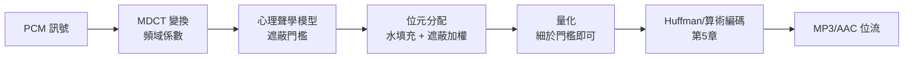

# 8.2 量化與率失真理論

## 導言：實數不可能完美，失真必須被管理

取樣後的樣本是實數；要把每個樣本寫成有限位元，必須**量化**——從無限可能的實數中選有限個代表值。量化必然引入誤差（失真）。**率失真理論（rate–distortion theory）**（Shannon 1948 提出、1959 論文系統化）回答根本問題：

> 允許失真 $\le D$ 時，描述訊號每秒最少需要多少位元？

答案是率失真函數 $R(D)$——有失真壓縮的極限，正如熵 $H$ 是無失真壓縮的極限（第 5 章）。JPEG、MP3、視訊編碼、語音編碼的全部理論基礎在此。

## 量化的基礎

### 均勻量化器

把實軸分成 $L$ 個等寬區間（步長 $\Delta$），每區間以中心點代表。樣本 $x$ 映到

$$
Q(x) = \Delta \left\lfloor \frac{x}{\Delta} \right\rfloor + \frac{\Delta}{2}, \qquad \text{位元率} = \log_2 L \text{ bits/樣本}
$$

### 量化雜訊模型

若步長夠小、訊號活動充分，量化誤差 $e = Q(x) - x$ 近似 $[-\Delta/2, \Delta/2]$ 均勻分佈：

$$
E[e^2] = \frac{\Delta^2}{12}
$$

**6 dB 法則**：$b$ 位元均勻量化（滿幅對稱）的訊號對量化雜訊比

$$
\mathrm{SQNR} \approx 6.02\, b + 1.76 \text{ dB}
$$

每加一位元，品質 +6 dB。

### 例題：CD 與電話的量化品質

- **CD**：16 位元 PCM、正弦滿幅：$\mathrm{SQNR} \approx 6.02 \times 16 + 1.76 \approx 98$ dB。位元率 $44100 \times 16 \times 2 = 1411$ kbps（立體聲）。
- **電話 PCM**：8 位元（但用 A 律/μ 律**非均勻**量化：小訊號細步長、大訊號粗步長，模擬對數壓縮），64 kbps。
- **MP3**：目標透明品質約 128–192 kbps——比 PCM 省 10 倍，靠率失真理論 + 感知加權。

## 率失真函數

### 定義

信源 $X$（或過程 $\{X_t\}$）、失真測度 $d(x, \hat{x})$。**率失真函數**：

$$
R(D) = \min_{p(\hat{x} \mid x):\; E[d(X, \hat{X})] \le D} I(X; \hat{X})
$$

**意義**：尋找條件分佈（隨機映射/測試通道）使平均失真 $\le D$ 且 $X$ 與重建 $\hat X$ 的互資訊最小。$R(D)$ 是「失真 $D$ 允許下，描述 $X$ 所需的最小互資訊率」。Shannon 1959 的反定理：任何率 $< R(D)$ 的編碼器，失真必 $> D$（對應無失真版的逆定理，4.3 節）。

### 高斯信源的經典結果

平方誤差失真下，方差 $\sigma^2$ 的高斯信源：

$$
R(D) = \max\left\{0,\; \frac{1}{2} \log_2 \frac{\sigma^2}{D}\right\} \text{ bits/樣本},
\qquad
D(R) = \sigma^2 \, 2^{-2R}
$$

**2R 法則**：每加 1 bit，失真降 4 倍（6 dB）——與 6 dB 法則一致，但 $D(R)$ 是**極限**，均勻量化器差約 4.35 dB（熵碼化的高分辨近似可縮小）。

**水填充（water-filling）推廣**：對譜功率 $S(f)$ 的平穩高斯源，最佳分配是「填水」：

$$
D(f) = \min\{\theta, S(f)\}, \qquad R = \int \max\left\{0, \log_2 \frac{S(f)}{\theta}\right\} df
$$

頻譜平的頻段多花位元、接近零的頻段不花——**感知編碼（MP3 為什麼丟掉人耳聽不到的頻段）的數學化身**。

### 例題：高斯 R(D) 計算

語音波形近似 $\sigma^2 = 1$ 的高斯。目標失真 $D = 0.01$（即 SNR 20 dB）：

$$
R = \frac12 \log_2 \frac{1}{0.01} = \frac12 \times 6.644 = 3.32 \text{ bits/樣本}
$$

$8$ kHz 取樣 → 理論極限 $26.6$ kbps。對照：PCM 64 kbps（8 bits）超額 2.4 倍；AMR-WB 12.65 kbps 低於理論值——因為語音**不是**高斯（有更強的結構，LPC 模型利用之），實際可壓得更好。**率失真下界對更複雜的信源模型只會更低**。

## 向量量化與信息論極限的接近

純量量化每樣本獨立，效率有恆定損失。**向量量化（VQ）**一次編 $k$ 維向量，用碼本（$L$ 個代表向量）+ 最近鄰：

- 高解析極限：VQ 對純量量化的增益趨近 $1.5 \pi e \approx 12.8$（約 11 dB 的理論上限，Zador 1963/Gish–Pierce 1968），實際 $k$ 維時 $1.5\pi e^{1 - 4\pi k/(3k)}$ 型曲線，$k=4$ 已達約 5 dB。
- 現代編解碼器的實踐：變換（DCT/MDCT）去相關 → 係數當近高斯 → 標量量化 + 熵碼化，等效於部分 VQ 收益；神經編解碼器（10.3 節）直接學 VQ 碼本（VQ-VAE）。

## 感知失真：量化「聽起來」的誤差

平方誤差不是人耳/眼的失真。感知編碼用**遮蔽（masking）**：強音遮蔽鄰近頻段的弱音，使量化雜訊「藏」在遮蔽曲線下。

MP3/AAC 的核心就是：率失真的水填充位元分配 + 遮蔽曲線當「失真加權」+ 熵編碼。**率失真理論提供框架，心理聲學提供失真測度**——兩者結合把 1411 kbps 的 PCM 壓到 128 kbps 仍「透明」。

## 量化的工程細節

| 議題 | 對策 |
|---|---|
| 空閒雜訊（小訊號下顆粒感） | 非均勻量化（μ 律）、抖動（dither）加白雜訊攤平誤差 |
| 過載（超出滿幅） | 限幅 + 過載失真管理；預測式編碼降方差 |
| 色彩帶（correlated error） | 抖動、雜訊塑形（noise shaping，ΣΔ 調變器把量化雜訊推到帶外） |
| 相位/時間失真 | 預測編碼（DPCM）、自適應差分（ADPCM） |

**ΣΔ（sigma-delta）過取樣轉換器**：以極高取樣率 + 1 位元量化 + 雜訊塑形，用取樣率換位元數——取樣定理（8.1）與率失真的聯手工程化，今日音訊 DAC 的主流。

## 歷史前因後果

### 誰、何時、為什麼

- **1948 Shannon**：提出 R(D) 概念（論文第 23 節預告）。
- **1959 Shannon**《Coding Theorems for a Discrete Source with a Fidelity Criterion》：率失真定理完整化。
- **1948 PCM 專利**（Reeves 1938 原始、戰後商業化）：量化工程先行於理論。
- **1960s 高分辨理論**：Zador、Gish–Pierce 的量化增益。
- **1970s–80s 感知壓縮**：心理聲學（Zwicker 遮蔽曲線）+ 變換編碼。
- **1988–1995 標準化**：JPEG（1992）、MP3（1993 定案，1998 播放器普及）、MPEG-2。

### 解決了什麼問題

1. **位元率的科學**：任何有失真編碼器的位元率有一個不可低於的 $R(D)$；工程師第一次能說「這個編解碼器離極限多遠」。
2. **位元分配**：水填充給出跨頻段/跨係數的最優分配原則，成為所有變換編碼器的演算法骨架。
3. **感知壓縮**：把失真測度換成感知加權，壓縮率跳升一個數量級。

### 引發什麼新問題

1. **失真測度的魔咒**：低失真 ≠ 好品質（PSNR 的失效催生 SSIM、VMAF）；感知模型的永續工程。
2. **視訊**：時間維 + 空間維 + 運動補償，率失真優化（RDO）是編碼器決策核心（H.264/265/AV1）。
3. **分佈式**：Slepian–Wolf（1973）與 Wyner–Ziv（1976）理論告訴我們「邊資訊」可省率——分散式視訊編碼實踐緩慢（10.3 節）。
4. **神經編解碼**：2020s 以 VQ-VAE、隱碼學習直接端到端學率失真折衷（10.3 節）。

## 與其他領域的關聯

### 傅立葉分析

水填充在頻域進行；變換編碼的能量集中（DCT 的 Karhunen–Loève 逼近）；遮蔽曲線是頻域概念。

### 統計力學

R(D) 的計算與配分函數、自由能同構（Blahut 演算法的每步是 Boltzmann 分佈更新）；$\theta$ 即「溫度」參數——統計力學方法在率失真中的精確重現。

### 機器學習

向量量化 = 碼本學習 = k-means 的量化觀點；變分自編碼器（VAE）的目標函數「重構誤差 + KL 正則」正是率失真的神經版；語言模型的量化（8 bit/4 bit 推理）是率失真的實務應用（10.3 節）。

### 經濟學

位元是稀缺資源，位元分配 = 預算分配；行動網路的自適應位率（ABR）串流是以「率失真 + 通道容量（4.2）」聯合優化的即時控制問題。

## 小結與思考題

量化把實數變位元；率失真函數 $R(D)$ 是有失真壓縮的絕對極限；高斯源的 $\frac12\log(\sigma^2/D)$ 與水填充是理論核心；感知失真與變換編碼是把理論兌現為 MP3/AAC/JPEG 的工程三件套。**壓縮的完整圖像 = 取樣（8.1）→ 變換去相關 → 量化（本節）→ 熵編碼（第 5 章）**。

**思考題**

1. 計算 12 位元均勻量化的 SQNR；若訊號只用滿幅的 1/4，實際 SQNR 損失幾 dB？
2. 高斯信源 $\sigma^2 = 4$：要 $D = 0.25$，$R(D)$ 為何？若改用 4 bits 均勻量化，實際失真約多少？
3. 為什麼 MP3 把 1411 kbps 壓到 128 kbps 還能「聽不出來」？用水填充 + 遮蔽解釋。
4. 證明高斯 R(D) 的下界：由 $I(X;\hat X) \ge \frac12 \log \frac{\sigma^2}{D}$（高斯最大熵 + MMSE 的關係 $h(X|\hat X) \le h(Z), \sigma^2_{X|\hat X}$ 型論證）。
5. ΣΔ 轉換器用「過取樣 + 1 bit」達到高品質——它如何用 8.1 的取樣率換 8.2 的位元數？估算 $64\times$ 過取樣 + 雜訊塑形等效的位元數增益。

下一節：調變——把位元放上載波，讓數位訊號真正出發。
