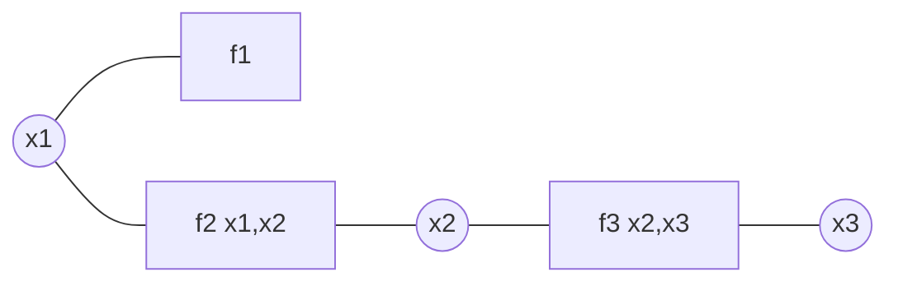

# 9.2 圖論觀點：因子圖

## 導言：把高維機率拆成圖

現代解碼（Turbo、LDPC）面對的問題是：在巨大的聯合機率分佈 $p(x_1, \dots, x_n \mid y_1, \dots, y_n)$ 上做邊際化與最大化，直接計算是指數複雜度。**因子圖**（factor graph）——Pearl（1986）、Frey、Kschischang–Loeliger–Forney（2001）系統化——把分佈的**分解結構**畫成二分圖，並在圖上做**訊息傳遞（message passing）**，若圖是樹則**精確**、若含環則**近似但實用上極準**。本節建立因子圖與信念傳播（belief propagation, BP），它們是第 10 章 Turbo/LDPC 解碼器的數學骨架，也是機器學習圖模型的通用語言。

## 因子圖的定義

### 分解與圖

聯合分佈若可寫成局部函數的乘積：

$$
p(x_1, \dots, x_n) = \frac{1}{Z} \prod_{a \in F} f_a\big(x_{N(a)}\big)
$$

（ $F$ 為因子集合， $N(a)$ 是因子 $a$ 連接的變數子集， $Z$ 為正規化常數。）**因子圖**是二分圖：變數節點 $\circ$ 與因子節點 $\square$ ，因子 $a$ 與變數 $i$ 之間有邊 iff $i \in N(a)$ 。

### 例題 1：鏈（馬可夫鏈）

$p(x_1, x_2, x_3) = f_1(x_1) f_2(x_1, x_2) f_3(x_2, x_3)$ ：

### 例題 2：奇偶檢驗因子

約束 $x_1 \oplus x_2 \oplus x_3 = 0$ 的指示函數是一個因子（3 條邊）。**LDPC 碼 = 一堆奇偶檢驗因子 + 通道似然因子**（10.2 節）。

## 信念傳播：樹上的精確邊際化

### 兩種訊息

- 變數 → 因子： $\mu_{x \to f}(x)$ （變數目前對自身值的信念）。
- 因子 → 變數： $\mu_{f \to x}(x) = \sum_{\sim x} f(\cdots) \prod \mu_{x' \to f}(x')$ （因子的局部證據整合）。

更新規則（和積演算法 sum-product）：

$$
\mu_{f \to x}(x) = \sum_{\{x'\} \setminus x} f_a(\cdots) \prod_{x' \in N(f) \setminus x} \mu_{x' \to f}(x')
$$

### 樹定理（Pearl, 1986）

**若因子圖是樹（無環），兩輪訊息傳遞後，每個變數節點的信念 = 精確後驗邊際** $p(x_i \mid \text{全部證據})$ 。複雜度：每條邊傳遞的訊息是 $O(|\text{值域}|)$ 的向量，總成本對節點數線性——**圖的稀疏性直接兌換成計算可行性**。

### 例題：三變數鏈的傳遞

$p = f_1(x_1) f_2(x_1,x_2) f_3(x_2,x_3)$ ，求 $p(x_2 \mid \cdot)$ ：

1. $f_1 \to x_1$ ： $\mu = f_1$ 。
2. $x_1 \to f_2$ ： $\mu = f_1(x_1)$ 。
3. $f_2 \to x_2$ ： $\sum_{x_1} f_2(x_1, x_2) f_1(x_1)$ （先驗與轉移的摺積）。
4. 對稱地 $f_3 \to x_2$ ： $\sum_{x_3} f_3(x_2, x_3)$ 。
5. $x_2$ 的信念 $\propto$ 兩訊息之積——**精確後驗**。兩輪（葉到根再回）完成。

## LLR 域的訊息傳遞（解碼實務）

二元變數時，訊息可用**對數似然比（LLR）**表示： $\lambda = \log \frac{p(x=0)}{p(x=1)}$ 。和積在 LLR 域變成：

- 變數節點更新：**LLR 相加**（獨立證據合併，6.3 節）。
- 檢驗節點更新（奇偶檢驗 $x_1 \oplus \cdots \oplus x_d = 0$ ）：

$$
\tanh\!\left(\frac{\lambda_{\text{out}}}{2}\right) = \prod_{j=1}^{d} \tanh\!\left(\frac{\lambda_j}{2}\right)
$$

（tanh 規則；工程近似 $\lambda_{\text{out}} \approx 2 \tanh^{-1}\!\prod \tanh(\lambda_j/2)$ 的 min-sum 變體只取最小值，硬體友好、損失約 0.5 dB。）

**整個現代解碼 = LLR 進來、tanh 規則在圖上迭代、LLR 出去**——機率論的貝葉斯更新被幾何化成圖上的向量流動。

## 環的出現：近似與密度進化

### 有環圖的兩難

樹圖可解但碼性能差（樹碼的率–距離折衷有限）；**好碼需要環**（否則碼長受限），但環使 BP 不再精確。Shannon 理論與可解性在此碰撞——解法：

1. **隨機稀疏圖 + 大 $n$ **：局部樹狀（周長大），BP 近似良好。
2. **密度進化（density evolution, Richardson–Urbanke 2001）**：追蹤訊息分佈隨迭代次數的演化，證明隨機 LDPC 在 BP 下錯誤率指數衰減，**閾值現象**（通道品質好於某值時 BP 收斂）可精確計算——統計物理的方法論（自由能、相變）進入編碼理論。
3. **外資訊轉移圖（EXIT chart, ten Brink 1999）**：追蹤互資訊在解碼器間的迭代放大——Turbo 碼設計的可視化工具（10.1 節）。

### 例題：密度進化的直觀

BEC（ $e$ 抹除）上的 BP 有解析解：變數節點傳遞「擦除機率」 $q$ ，更新 $q_{\text{new}} = e \cdot (\text{檢驗節點匯集})$ 。度分佈 $(\lambda, \rho)$ 下固定點方程的解存在與否決定 BP 是否收斂——擦除機率 $e$ 低於**閾值** $e^*$ 時 $q \to 0$ 。Arikan 的極化碼（10.3 節）可視為 BEC 上 BP 極限行為的極致工程化。

## 因子圖的通用性

| 領域 | 模型 | 與 BP 的關係 |
|---|---|---|
| 編碼 | LDPC/Turbo 圖 | 迭代解碼 = BP |
| 機器學習 | 貝氏網路、馬可夫隨機場 | 精確（樹）/ 近似（環）推斷 |
| 電腦視覺 | 立體匹配、分割（MRF） | 圖割 / BP |
| 語音 | HMM 前向-後向演算法 | 樹上的 BP 特例（1967 Baum） |
| Kalman 濾波 | 線性高斯圖模型 | 樹上 BP 的連續版 |
| SLAM | 位姿圖 | 因子圖優化（GTSAM） |
| 統計物理 | 自旋玻璃、Ising 模型 | BP = Bethe 自由能的駐點（Yedidia–Freeman–Weiss 2000） |

**Kalman 濾波與 HMM 都是樹上 BP 的特例**——訊息傳遞是「狀態估計」的統一語言；Viterbi 演算法（摻積碼解碼，10.1 節前身）是 max-product 版（求最大機率路徑而非邊際）。

## 歷史前因後果

### 誰、何時、為什麼

- **1962 Gallager**：LDPC 博士論文首次用迭代解碼（當時稱「低密度」奇偶檢驗碼），但理論工具（密度進化）尚未成熟，被擱置。
- **1967 Viterbi**：樹狀圖上的 max-product（格狀圖）。
- **1986 Pearl**：信念傳播的因果網路框架（AI 動機）。
- **1993 Berrou et al.**：Turbo 碼（軟輸入軟輸出迭代）——當時作者**不知道**自己在做 BP！
- **1996 MacKay–Neal**：復活 LDPC，指出 Turbo/LDPC 同為訊息傳遞。
- **2001 Kschischang–Frey–Loeliger**《Factor Graphs and the Sum-Product Algorithm》：統一語言定稿。
- **2001 Richardson–Urbanke**：密度進化證明 LDPC 極限（10.2 節）。
- **2000 Yedidia–Freeman–Weiss**：BP ↔ Bethe 自由能（統計物理橋接）。

### 解決了什麼問題

1. **高維推斷的複雜度**：樹上線性時間精確推斷。
2. **編碼的解鎖**：Turbo/LDPC 的性能突然逼近香農極限——圖方法把 4.3 節「存在性」兌現為「可解碼」。
3. **跨領域統一**：濾波、語音、視覺、編碼共用一個演算法框架。

### 引發什麼新問題

1. **環的理論**：BP 在環圖上的精確性條件、計算偏差（Bethe 近似誤差）、以及收斂性保證（圖的展開、阻尼、譜半徑條件）。
2. **錯誤地板**：LDPC 在低錯誤率區的性能由小捕獲集（trapping set）主導——圖的組合結構成為設計瓶頸。
3. **學習 vs 推斷**：現代「神經 BP」（10.3 節）把訊息更新函數換成可學習網路。

## 與其他領域的關聯

### 圖論

二分圖、周長（girth，影響 BP 收斂）、覆蓋（covering graph 分析環效應）、Tanner 圖（1981，碼的圖表示命名者）。

### 統計物理

BP = Bethe 近似下的零溫/有限溫消息傳遞；碼的閾值 = 相變點；「condensation/細胞複雜度」解釋錯誤地板——Mézard–Montanari 的教材把兩個領域徹底打通。

### 機器學習

圖模型推斷（變分、BP）、GNN（圖神經網路可視為可學習的訊息傳遞）、期望傳播（EP）——BP 的後代遍佈現代 ML。

### 線性代數與矩陣譜理論

訊息傳遞的收斂性由圖的譜（鄰接矩陣特徵值）控制；EXIT chart 的收斂判據是互資訊軌跡的不動點分析——譜理論提供工具。

## 小結與思考題

因子圖把分佈的分解結構幾何化；樹上 BP 精確、線性時間；LLR 域的 tanh 規則是解碼的計算核心；環導致近似，但「隨機稀疏 + 大碼長 + 密度進化」把它馴服成逼近香農極限的引擎。第 10 章的 Turbo 與 LDPC 將直接以本節的圖與訊息為主角。

**思考題**

1. 畫出 $(7,4)$ Hamming 碼（6.1 節 $H$ 矩陣）的 Tanner 圖；它有環嗎？最小環長度（周長）為何？
2. 證明：鏈狀 HMM 的前向演算法 = 樹上 BP 的變數→因子訊息。
3. 用 tanh 規則計算：三條入邊 LLR $= 4, 2, 1$ ，檢驗節點輸出 LLR 為何？（先算 $\tanh(2)\tanh(1)\tanh(0.5)$ 。）
4. 為什麼「好碼需要環」？從碼長–周長關係（Moore 界：周長 $g$ 的二分圖至少 $n \sim (d_v-1)^{g/2}$ 節點）論證。
5. Bethe 自由能觀點下，BP 的收斂點是什麼量的駐點？這對「BP 何時可信」有何啟示？

下一節：密碼學的一瞥——資訊理論與計算安全的分野與交匯。
