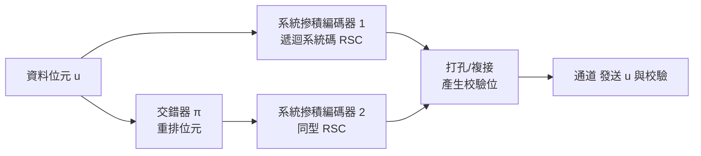

# 10.1 Turbo 碼（1993）

## 導言：一次震驚世界的模擬

1993 年，ICCP（日內瓦）國際會議上，法國 ENST Bretagne 的 Claude Berrou、Alain Glavieux 與 Punya Thitimajshima 報告了 Turbo 碼：在 BSC/AWGN 通道上、碼率 1/2、 $P_e = 10^{-5}$ 下距香農極限**僅 0.5 dB**。當時最佳系統（摻積碼 + Viterbi）距極限約 3–4 dB——與會者普遍懷疑他們算錯了。幾個月後世界各地重現結果：**這是真的**。五十年的編碼理論，在一天之內被推到極限門口。Turbo 碼隨即進入 3G（WCDMA/CDMA2000）、Deep Space 2（火星探測器）、DVB-RCS 等系統。

## 結構：兩個碼，交錯，互回饋

### 並行串接摻積碼（PCCC）

- **遞迴系統摻積碼（RSC）**：反饋移位暫存器產生的摻積碼（系統位元 = 原資料，校驗位由遞迴狀態產生）。遞迴性使低重量輸入不產生低重量輸出（隨機碼式重量分佈）。
- **交錯器**：把資料重排後餵給第二個編碼器——**兩個碼看到同一訊息的不同排列**，低重量錯誤事件在兩碼中幾乎不會同時發生。
- **整體**：碼率 $R = 1/3$ （可打孔到 1/2），碼長 = 交錯器長度（ $10^3$ – $10^5$ ）。

## 迭代解碼：SISO 的舞蹈

### 軟輸入軟輸出（SISO）解碼器

每個成分解碼器輸出**後驗 LLR**：

$$
L(u) = \log \frac{P(u = 0 \mid \text{全部證據})}{P(u = 1 \mid \text{全部證據})} = \underbrace{L_{\text{ch}}(u)}_{\text{通道}} + \underbrace{L_a(u)}_{\text{先驗（來自另一解碼器）}} + \underbrace{L_e(u)}_{\text{外部資訊}}
$$

**外部資訊（extrinsic information） $L_e$ ** 是解碼器的淨貢獻——只用了校驗位，不含已知的輸入。迭代中， $L_e$ 經**解交錯/交錯**傳給另一個解碼器當先驗。這正是 9.2 節因子圖 BP 的精神：**在含環的圖上，兩個（幾乎樹狀的）子圖之間交換信念**。

演算法選擇：BCJR（Bahl–Cocke–Jelinek–Raviv, 1974，前向-後向 = 樹上 BP，9.2 節）或 SOVA（軟輸出 Viterbi）。BCJR 精確（每個成分碼是格狀圖/樹），故 Turbo 迭代 = 「兩個精確 BP 子圖之間的貝葉斯握手」。

### 例題：外部資訊的直觀

收到系統位元 LLR $L_{\text{ch}} = +1$ （微弱支持 0）。第一個解碼器整合校驗位後給出 $L_e = +3$ （強支持 0）。第二個解碼器（看交錯後的另一組校驗）得先驗 $L_a = +3$ ，結合自己的通道與校驗給出 $L_e' = +5$ 。回傳後第一個解碼器的後驗變成 $+1 + 5 + L_e = \dots$ ——**信念像滾雪球**，數次迭代後 LLR 增幅達數十，錯誤率雪崩式下降（turbo 之名由此：如渦輪增壓回收廢氣能量）。

## 為什麼這麼好：兩大理論工具

### 1. 重量分佈（距離視角）

Turbo 碼的有效自由距離不高，但**低重量碼字的數量（multiplicity）極小**：交錯器使低重量輸入序列產生的兩個低重量校驗「撞在一起」的機率極低。錯誤率曲線分兩段：

- **瀑布區（waterfall）**： $P_e$ 隨 SNR 陡降——由交錯器驅動的迭代收斂主導。
- **錯誤地板（error floor）**：由極少數低重量碼字主導——設計交錯器（S-random 等）壓制。

### 2. EXIT 圖（互資訊視角）

ten Brink（1999）：追蹤每個 SISO 的「輸入互資訊 $I_a$ → 輸出互資訊 $I_e$ 」曲線 $T(I_a)$ 。迭代的軌跡在 $(I_a, I_e)$ 平面上於兩條曲線之間樓梯式攀升；**兩曲線若不相交（有一個「開口」），迭代收斂到 $(1,1)$ **——開口寬度對應距香農極限的距離。EXIT 圖把「為什麼好」變成可視幾何，也是交錯器與成分碼的設計工具（9.2 節密度進化的 Turbo 版）。

### 例題：EXIT 開口計算

AWGN、 $E_b/N_0 = 0.8$ dB 時兩條曲線幾乎相切（閾值）；提高 0.1 dB 開口出現，迭代數十次收斂。閾值 SNR 與香農極限（ $R=1/2$ 、 $10^{-5}$ 下約 0.2–0.3 dB）之差 = **Shannon gap ≈ 0.5 dB**。

## 歷史前因後果

### 誰、何時、為什麼

- **1966 Forney**：串接碼理論（Turbo 的結構前身）。
- **1974 BCJR**：前向-後向 SISO 演算法（早就存在，等一個用武之地）。
- **1982 Hagenauer**：軟輸出 Viterbi（SOVA）與迭代思想。
- **1993 Berrou–Glavieux–Thitimajshima**：Turbo 碼問世（作者自述靈感部分來自類比電路的反饋直覺，而非資訊理論教材——工程直覺再次搶在理論前面）。
- **1996 MacKay**：指出 Turbo = 迭代 BP（9.2 節的統一）。
- **1999–2003 EXIT 圖、密度進化**：理論跟上，解釋閾值與設計規則。
- **2000s 標準化**：3GPP WCDMA（ $K=4$ RSC，8 狀態）、CCSDS 深空、DVB-RCS、LTE（Turbo 1/3 為資料通道之選，5G 改用 LDPC/Polar，10.2 節）。

### 解決了什麼問題

1. **Shannon gap 的坍縮**：3–4 dB → 0.5 dB；等效為行動系統省功率/增覆蓋/提容量數倍。
2. **長碼的實用解碼**：交錯長碼 + 兩個短狀態機 = 低複雜度近似 ML。
3. **軟迭代範式**：SISO 模組化介面成為現代接收器的設計語言。

### 引發什麼新問題

1. **迭代延遲**：數十次迭代 × 長交錯 = 毫秒級延遲，URLLC 場景受限（4.3 節有限碼長理論提供短碼指引）。
2. **錯誤地板**：交錯器設計與 trapping set 分析（LDPC 的對應問題）。
3. **理論收編**：1990s 的奇蹟在 2000s 被密度進化/EXIT 完全解釋——「理論落後工程一拍再追上」的經典案例，也預告了 10.2 節 LDPC 的歸來。

## 與其他領域的關聯

### 因子圖與 BP（9.2 節）

Turbo = 含環二分圖上兩棵「超樹」之間的訊息交換；BCJR = 樹上精確 BP；EXIT = 訊息分佈的互資訊摘要。

### 機器學習

迭代解碼 ≈ 變分推斷的座標上升；EXIT 的不動點分析 ≈ 深度網路訓練的訊號傳播理論；「學習的解碼器」（neural BP、neural Turbo）直接把 SISO 換成梯度下降學出的小網路（10.3 節）。

### 統計物理

瀑布–地板分界 = 一階相變；交錯器的隨機性 = 自旋玻璃的樣本依賴；密度進化 = 重整化群式平均場——統計物理提供了 Turbo 時代的理論顯微鏡。

### 演算法

BCJR 的前向-後向 = 動態規劃；打孔與複接 = 碼率調整的工程彈性；並行與流水線化 = 現代 SoC 中解碼器佔矽面積的重要部分（5G 終端的功耗大戶之一）。

## 小結與思考題

Turbo 碼以「RSC + 交錯 + SISO 迭代」三件套，把 1993 年的系統推到距香農極限 0.5 dB；EXIT 圖與密度進化事後把奇蹟還原為可計算的幾何。它證明：**迭代 + 軟資訊 + 隨機交錯**是逼近極限的通用配方——下一節的 LDPC 用另一種（更古老、更根本的）方式重演同一配方。

**思考題**

1. 畫出碼率 1/3 Turbo 碼（兩個 $1/(1, 7/5)$ RSC）的因子圖；標出環的位置。
2. 為什麼 RSC（遞迴）比非遞迴摻積碼更適合當 Turbo 成分？（提示：低重量輸入的輸出重量；交錯器的作用。）
3. 用 EXIT 語言解釋：為什麼迭代多次後增益遞減（LLR 不會無限增長）？
4. 錯誤地板的成因與對策各是什麼？對 URLLC 為何特別致命？
5. LTE 用 Turbo、5G 改用 LDPC——從碼長彈性、並行度、迭代延遲三方面比較兩者的工程理由。

下一節：LDPC——1962 年被遺忘的碼，1996 年復活後統治 5G。
