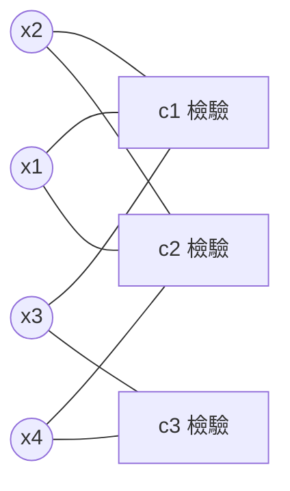

# 10.2 LDPC 碼

## 導言：被遺忘三十四年的寶藏

1962 年，MIT 博士生 Robert Gallager 在論文《Low-Density Parity-Check Codes》中提出：用**稀疏**奇偶檢驗矩陣定義碼，並以迭代訊息傳遞解碼。他證明了這類碼在迭代解碼下可以逼近香農極限——但 1960 年代的算力無法實作，論文被塵封。1993 年 Turbo 碼的衝擊下，David MacKay 與 Radford Neal（1996）重新發現 Gallager 碼並證明同樣逼近極限；1999–2001 年 Richardson、Urbanke 與 Shokrollahi 等以密度進化完成理論，隨機 LDPC 碼在 AWGN 上達到**距極限 0.0045 dB**（2001 年的最佳紀錄）。今日：5G NR 資料通道、Wi-Fi 6/7、DVB-S2/X、10GBase-T 以太網、Flash SSD、衛星與深空——**LDPC 是當代最廣泛部署的信道碼**。

## 定義與 Tanner 圖

### 稀疏奇偶檢驗矩陣

LDPC 碼由 $(n, k)$ 與奇偶檢驗矩陣 $H$（$m = n - k$ 列）定義，要求 $H$ **稀疏**：每列（檢驗）含 $d_c$ 個 1、每行（變數）含 $d_v$ 個 1，$d_v, d_c \ll n$。碼 $\mathcal{C} = \{x \in \mathbb{F}_2^n : H x^T = 0\}$。

**規則碼**（Gallager 原始）：$(d_v, d_c)$ 固定，如 $(3, 6)$；率 $R = 1 - d_v/d_c = 1/2$。

**非規則碼**（1990s Luby–Mitzenmacher–Shokrollahi–Spielman–Stemann）：度分佈 $(\lambda, \rho)$ 多項式描述，性能更優——5G 與 DVB-S2 皆為非規則碼。

### Tanner 圖（1981）

二分圖：$n$ 個變數節點 $\circ$ ↔ $m$ 個檢驗節點 $\square$，邊 = $H$ 的 1。

（小例：$(n, m) = (4, 3)$，$H = \begin{pmatrix} 1&1&1&0\\1&1&0&1\\0&1&1&1\end{pmatrix}$ 型。實際碼 $n \sim 10^3$–$10^5$、每節點度 3–30。）**圖的性質（周長、度分佈）決定碼的性能**——編碼理論的設計對象從矩陣轉為圖（9.2 節）。

## 迭代解碼：LLR 圖上的訊息傳遞

9.2 節的 BP 在此完全落地。每輪迭代：

1. **變數節點**：匯集通道 LLR 與所有相連檢驗的訊息，LLR 相加後廣播。
2. **檢驗節點**：tanh 規則合併入邊訊息後廣播。
3. 判決：$L_{\text{total}}(x_i) > 0 \Rightarrow 0$，否則 1；檢驗 $Hx^T = 0$ 滿足則停。

### 例題：一次迭代的數值

某變數 $x_2$（度 3）：通道 LLR $+2$，來自檢驗 $c_1$ 的訊息 $+1$、來自 $c_2$ 的訊息 $-0.5$。更新：

$$
L(x_2) = 2 + 1 - 0.5 = +2.5 \quad (\text{判 0，信心增強})
$$

同時 $x_2$ 傳給 $c_3$ 的訊息（不含 $c_3$ 自己的回音，**外部資訊原則**）：$2 + 1 - 0.5 = 2.5$ 減去 $c_3$ 路徑……正確寫法：傳給 $c_3$ 的訊息 = 通道 + 其他入邊 = $2 + 1 = 3$（**排除** $c_2$ 來的那條？不——排除的是接收目標 $c_3$ 自身，即 $2 + 1 + (-0.5) = 2.5$ 中減去 $c_3$ 未參與，故傳出 $= 2 + 1 - 0.5$ 對 $c_1$、$2 + (-0.5)$ 對 $c_2$……初學者務必記住：**傳給某檢驗的訊息不含該檢驗自己的貢獻**，否則信念自我強化發散）。

min-sum 變體（硬體主流）：檢驗輸出 $\approx \pm\min_j |\lambda_j|$（取絕對值最小者、符號為其餘符號之積），查表補償約損 0.3–0.5 dB，但可完全流水線化。

## 密度進化：理論的凱旋

**Richardson–Urbanke–Shokrollahi（2001）**：追蹤訊息 LLR 分佈 $f_t$ 隨迭代 $t$ 的演化（對隨機圖取期望）。通道好於某**閾值**時，$f_t$ 的質量指數移向 $+\infty$（錯誤率 $\to 0$）；差則停滯。

- **解析成果**：BEC 上密度進化有閉式遞迴（9.2 節）；AWGN 上需數值積分，但精度極高。
- **最優設計**：以密度進化為約束優化度分佈（線性規劃式搜尋）→ 非規則碼閾值達 $0.0045$ dB（碼長 $10^7$）。
- **意義**：4.3 節 Shannon 的「存在性」在 2001 年變成「構造 + 可解碼 + 可證明」的完備閉環——**資訊理論史上第一次，好碼的構造與解碼同時被理論收編**。

### 例題：BEC 密度進化一輪

$(3, 6)$ 規則碼、擦除率 $e$。變數節點輸出擦除機率 $x$，檢驗節點回傳 $1 - (1 - x)^5$（六條入邊除自身外五條全非擦除才可恢復）。遞迴：

$$
x_{t+1} = e \left[1 - (1 - x_t)^5\right]^2
$$

（變數側兩條檢驗邊除自身後各需非擦除。）取 $e = 0.4$：迭代 $x: 0.4 \to 0.307 \to 0.221 \to 0.148 \to 0.089 \to 0.049 \to \dots \to 0$——收斂！取 $e = 0.5$：$x \to 0.499\ldots$（停滯）——閾值約 $e^* \approx 0.4294$（$(3,6)$ 碼的精確值）。**擦除率 42.9% 以內可解，超過不行**——密度進化給出可計算的邊界。

## LDPC 的工程版圖

| 標準/系統 | 碼 | 特點 |
|---|---|---|
| 5G NR（資料通道） | 基圖 1（$R \ge 1/3$）與基圖 2（$R \le 1/3$），QC-LDPC，提升度支援任意碼長/率 | 並行解碼友好 |
| Wi-Fi 6/7（802.11ax/be） | 4 種碼長 × 4 碼率的 QC-LDPC | 高譜效率 MCS |
| DVB-S2/S2X | IRA 型非規則碼，$R = 1/4$–$9/10$ | 距極限 0.7–1 dB |
| 10GBASE-T 以太網 | $[2048, 1723]$ | 布線上 10 Gbps |
| Flash/SSD 控制器 | 短 LDPC + 軟資訊 | 取代 BCH（7.2 節），壽命提升數倍 |
| 深空/近地 | CCSDS AR4JA | 碼長至 16384 |

**QC-LDPC（準循環）**：$H$ 由小循環方塊拼成——硬體佈線規整、編碼可用循環移位暫存器（7.1 節循環碼硬體的直系後代）。**編碼問題**：稀疏 $H$ 不直接給生成矩陣；Richardson–Urbanke 的有效編碼演算法（近似下三角結構）解決了 $O(n^2)$ 瓶頸。

## 歷史前因後果

### 誰、何時、為什麼

- **1962 Gallager**：LDPC + 迭代解碼 + 早期分析（連界、改進界）。
- **1981 Tanner**：圖表示與局部約束理論（Tanner 圖）。
- **1993 Berrou**：Turbo 衝擊（間接復活 LDPC）。
- **1996 MacKay–Neal**：重發現與模擬驗證；同年 Sipser–Spielman 的展開碼（expander codes）提供組合證明路線。
- **1999 Luby et al.**：非規則碼與 BEC 最優度分佈。
- **2001 Richardson–Urbanke**：密度進化 + 高斯近似 + 有效編碼；Shokrollahi 等：0.0045 dB 碼。
- **2003–2011**：DVB-S2、802.11n、WiMAX、CCSDS 標準化；**2016–2018**：5G NR 採用。

### 解決了什麼問題

1. **構造與解碼的雙贏**：隨機稀疏圖既有隨機碼的重量分佈（4.3 節），又可 BP 解碼（9.2 節）——五十年矛盾在此終結。
2. **可並行硬體**：局部訊息傳遞天然並行，多 Gbps 吞吐的解碼器可行。
3. **理論閉環**：密度進化把閾值變成可計算數，設計從盲搜變為優化。

### 引發什麼新問題

1. **錯誤地板**：小捕獲集（trapping set）、小環（短周長）在 $P_e < 10^{-7}$ 區主導——組合圖論的設計難題。
2. **有限碼長**：密度進化是 $n \to \infty$ 理論；5G 短碼塊（數十位元）的性能由 scaling law（4.3 節）修正。
3. **極化碼的競爭**：短碼、低複雜度場景 Polar 碼（2008）勝出，5G 控制通道採用（10.3 節）——LDPC 與 Polar 的分治是當代標準化的大設計。
4. **學習化**：神經 BP、可學習度分佈（10.3 節）。

## 與其他領域的關聯

### 圖論與組合

周長與性能（Moore 界限制碼長）、展開圖（expander，Sipser–Spielman 線性時間解碼）、捕獲集與地板——LDPC 是應用圖論的最大單一引擎之一。

### 統計物理

密度進化 = 平均場；閾值 = 相變；錯誤地板 = 玻璃態亞穩態；code ensembles 的 free energy 分析（9.2 節 Bethe 橋接的工程兌現）。

### 機器學習

BP = 圖模型推斷；EXIT/密度進化 = 訊號傳播理論（深網訓練的 mean-field）；「用 GNN 學解碼器」是 2020s 活躍方向（10.3 節）。

### 資訊理論其他分支

LDPC 也用於：信源編碼（Slepian–Wolf 的實際碼）、率失真、秘密共享與 wiretap（9.3 節物理層安全的實用碼）、以及**查表式編碼極限**（列表解碼的隨機碼變體）——LDPC 已成資訊理論的通用基礎設施。

## 小結與思考題

LDPC 以「稀疏圖 + 訊息傳遞 + 密度進化」三位一體，從 1962 的遺珠成為 2026 年的統治者；它與 Turbo 共用迭代範式，以圖的稀疏性換來並行與極限性能。資訊理論的四大支柱（熵、容量、編碼、解碼）至此全部閉環。

**思考題**

1. 對 $(3, 6)$ 規則 LDPC：率為何？驗證 Tanner 圖的邊數從兩側計數相等（$3n = 6m$）。
2. 用 BEC 遞迴式計算 $(3, 6)$ 碼在 $e = 0.45$ 時的前 5 次迭代；收斂嗎？
3. 為什麼 min-sum 損失約 0.5 dB？從 tanh 規則的近似（$\tanh x \approx \pm 1$ 對大 |x|）論證其偏差方向。
4. 周長小（有 4-環）的 Tanner 圖為何傷害 BP？（提示：訊息沿環立即回饋自我強化。）
5. 5G 為何資料用 LDPC、控制用 Polar？以碼長、碼率範圍、解碼延遲、並行度列表比較。

下一節：資訊理論的擴張——網路、量子、生物與 AI 時代的邊界。
