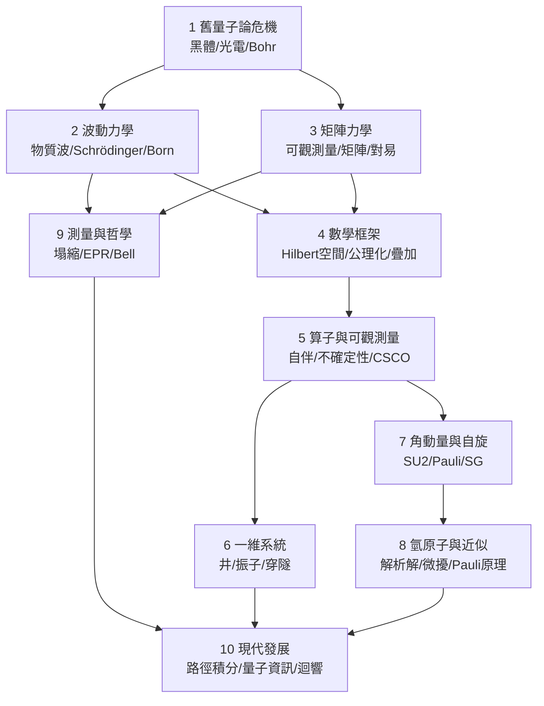

# 10.3 迴顧數學與物理的相互塑造

## 本章導言

本書走完了 1900–2025 的全程：Planck 的絕望之舉到量子處理器的糾錯盈虧平衡。最後一節不講新內容，而做一件事：**把二十五節的歷史重新閱讀為一部「數學與物理互相塑造」的雙向史**——實驗危機如何逼出數學結構，數學結構又如何預言與反哺物理。這個視角不只是編史學的趣味，它教導我們如何閱讀任何理論：先找「被迫登場」的異物（3.1 節），再問「結構說了什麼」（5.1 節）。

### 第一條主線：實驗危機逼出數學

量子力學的每個數學結構都有明確的「出生證明」——一個古典物理無法容納的實驗現象：

| 實驗危機 | 被逼出的數學 | 節次 |
|----------|--------------|------|
| 紫外災難（黑體高頻發散） | 離散求和取代連續積分；離散譜 | 1.1 |
| 光電效應（閾值頻率） | 光的能量—動量量子（ $E = h\nu$ ， $p = h/\lambda$ ） | 1.2 |
| 氫光譜的整數平方差 | 駐波條件；本徵值問題 | 1.3 → 2.2 |
| 譜線只見頻率強度 | 雙指標躍遷振幅 → 矩陣乘法 | 3.1 |
| 振子的能量守恆 | 對易關係 $[\hat x,\hat p] = i\hbar$ | 3.2 |
| 兩套力學同預言 | 希爾伯特空間與表示論 | 3.3 → 4.1–4.2 |
| $\gamma$ 顯微鏡與電子定位 | Fourier 寬度不等式 → 不確定性原理 | 5.2 |
| 反常 Zeeman 效應 | su(2) 表示論；自旋 | 7.1–7.2 |
| 週期表與氣體比熱 | 對稱化公理、FD/BE 統計 | 8.3 |
| EPR 關聯 | Bell 不等式；凸幾何 | 9.2–9.3 |

模式驚人地一致：**異物（不對易性、半整數、糾纏）先以「計算麻煩」或「無主數據」出現，被結構化後成為原理**。Heisenberg 的乘法麻煩 → 對易關係；STERN-GERLACH 的兩斑 → 自旋；Einstein 的「鬼魅作用」→ 糾纏資源。**識別異物、給它數學形式、接受它改寫原理**——這是理論演化的三步舞。

### 第二條主線：數學結構反哺物理

數學一旦到位，就開始**超越**催生它的問題：

- **譜定理**（5.1、4.2 節）：為了理解測量而發展，最終把「量子化」定義為譜性質——能階、角動量、自旋、場的模式，全是一個定理的應用。
- **表示論**（7.1 節）：為了自旋而必要，最後成為粒子物理的分類系統（SU(3)、標準模型規範群）。
- **階梯算子**（6.2 節）：為了解振子，成為場論與可積系統的通用語言。
- **路徑積分**（10.1 節）：為了量子電動力學，反哺紐結不變量、指標定理、重整化群——數學物理的活躍前線。
- **張量積與糾纏幾何**（4.3 節）：為了多體系統，成為量子資訊、張量網路、以及「為什麼世界是量子的」重構計畫的基石。

**數學的「超前供應」**：泛函分析（Hilbert 1904–13）在量子力學到來前已備好倉庫；分布理論（Schwartz 1945）事後為 Dirac 的 $\delta$ 補上身分；C^*-代數（Gelfand–Naimark 1943）為代數量子力學鋪路。而物理的「異常需求」反過來加速數學：無界算子譜論、von Neumann 代數、量子機率、張量範疇——**二十世紀數學的幾大分支都有量子力學的胎記**。

### 第三條主線：詮釋的未完成

數學封閉（公理 4.2 節自洽、預言精確到 $10^{-12}$ ），詮釋開放（9.1 節測量問題百年未決）。這個不對稱是量子力學最深的教訓：

> **理論的操作內容可以完全確定，而其本體論負載持續討論**——Einstein 的不滿（9.2 節）沒有輸給數據，它輸給了 Bell 不等式的**組合**（9.3 節），但詮釋的空間仍在。

2020 年代的實驗（宏觀疊加、塌縮模型限縮、複數結構的必要性證明）正在把詮釋問題的一部分移入實驗室。**量子力學是「實驗上完成、概念上開放」的理論**——這個狀態本身就是重要的哲學事實：它顯示科學的完成度是分層的。

### 例題

**例題 10.3.1**：追蹤一個量—— $h$ 的身分變遷史。

**解**： $h$ 在本書的旅程是全書主題的縮影：

1. **1900（1.1 節）**：內插常數——Planck 的黑體公式需要它，物理身分不明（「絕望之舉」）。
2. **1905（1.2 節）**：光的量子—— $E = h\nu$ ，普適性由光電與 Compton 交叉確認。
3. **1913（1.3 節）**：軌道量子化—— $L = n\hbar$ ，原子世界的度量衡。
4. **1925（3.1–3.2 節）**：對易子—— $[\hat x, \hat p] = i\hbar$ ，從常數升格為**代數結構**（非對易性的量）。
5. **1927（5.2 節）**：不確定性—— $\Delta x\Delta p \ge \hbar/2$ ，因果結構的邊界。
6. **1948（10.1 節）**：相位尺度——路徑積分 $e^{iS/\hbar}$ ，古典極限的干涉參數。
7. **2025（10.2 節）**：工程參數——相干時間、量子位元的閘精度都以 $\hbar$ 定標。

**一個數字的七種身分**：從內插常數到代數結構到工程參數—— $h$ 的身分史就是量子力學的結構史。任何理論的核心常數（ $c$ 、 $G$ 、 $k_B$ ）都可以做同樣的追蹤，而 $h$ 的案例最富戲劇性：它從「待解釋的數值」變成「定義結構的算子」。

**例題 10.3.2**：繪製本書的結構地圖（mermaid），檢驗敘事的完整性。

結構檢驗：三條支線（波動 2、矩陣 3、抽象 4）在測量問題（9）與現代發展（10）匯流；實驗（1、7.3、9.3）與數學（4、5）交替推進。**教材的結構本身就是「相互塑造」論題的圖示**。

### 歷史啟示

- **沒有單向的箭頭**：不是「實驗 → 理論 → 數學」也不是「數學 → 物理」——是螺旋：實驗異常（1.1）逼出數學（3.2），數學預言新現象（7.1 半整數自旋），現象再逼出新數學（9.3 凸幾何）。**領域的邊界是循環對流的**。
- **異物的命運**：不對易性、半整數表示、糾纏、虛數相位——每個都從「不可理解」走過「形式化」抵達「不可或缺」。**評價一個新理論時，請先問：它的異物是什麼、它給了異物什麼形式**。
- **開放理論的活力**：測量問題未解、真空能矛盾（6.2 節）、重構計畫未竟——量子力學不是「完成的教科書」，而是**仍在成長的雙向工程**。本書的結尾是讀者研究的中點。

## 與其他章節及領域的關聯

- **全部二十五節**：本節是它們的鏡像閱讀。
- **複變函數（同系列教材）**：虛數的幽靈（該書 1.1 節）與量子力學的複振幅（2.2 節）是「異物平反史」的雙聯畫——Cardano 的 $\sqrt{-15}$ 與 Heisenberg 的不交換乘法是同一劇本的兩幕。
- **線性代數、泛函分析、群論**：量子力學是它們最大的應用場與最快的催化劑。
- **機率統計**：Born 規則、量子機率論、Bell 幾何——機率論的非交換擴張由物理直接催生。
- **哲學**：實在論、因果性、觀察者——量子力學把形而上學變成了部分可實驗的學科。

## 練習

1. 從本書選三個「異物」，各寫 200 字的「異物檔案」：出現的實驗、被結構化的過程、今日地位。
2. 對照 $h$ 與 $c$ （光速）的身分變遷史，比較「常數的結構化」在相對論與量子力學中的異同。
3. 畫出「數學 ↔ 物理」雙向箭頭圖：標出至少五個數學→物理與五個物理→數學的具體傳輸事件（附年份）。
4. 思考題：若 2050 年的實驗發現宏觀疊加的 GRW 式偏差（9.1 節），本書的哪些章節需要重寫、哪些只需加註？用這個思想實驗檢驗「理論的分層完成度」。

## 進階研讀

**未完成的問題清單**（留給讀者的研究議程）：

1. **測量問題的實驗化**（9.1 節）：塌縮模型的參數空間能否被完全排除？
2. **量子重構**（4.2、10.2 節）：從操作公理推出 Hilbert 空間的計畫能否覆蓋場論？
3. **真空能**（6.2 節）： $10^{120}$ 的矛盾——理論錯、觀測錯，還是重力對量子能的響應未知？
4. **量子–重力**：路徑積分（10.1 節）與糾纏幾何（10.2 節）能否長成量子重力？AdS/CFT 與「時空 = 糾纏」的猜想（Van Raamsdonk 2010）是當代最大賭注。
5. **數學的下一站**：量子資訊的反哺（10.2 節）會催生什麼新數學？張量範疇、量子拓撲、高階範疇論都在候選名單上。

### 名詞速查表（全書總索引）

- **量子假設**： $E = h\nu$ ；能量、動量、角動量的離散交換。
- **對易關係**： $[\hat x,\hat p] = i\hbar$ ；量子性的代數標記。
- **希爾伯特空間**：態的居所；內積幾何承載機率。
- **譜定理**：測量、演化、量子化的統一數學。
- **糾纏**：不可分離的複合態；從悖論到資源。
- **Bell 不等式**：局域實在論的定量判決。
- **路徑積分**：全路徑求和；古典的干涉極限。
- **量子資訊**：疊加、糾纏、干涉的工程化。

### 年表速查（全書精選）

- 1900：Planck 量子化。
- 1905：Einstein 光子。
- 1913：Bohr 原子。
- 1924：de Broglie 物質波；Bose–Einstein 統計。
- 1925–26：矩陣力學、波動力學、Born 詮釋。
- 1927：不確定性、互補原理。
- 1932：von Neumann 公理化。
- 1935：EPR、糾纏、薛定諤貓。
- 1948：Feynman 路徑積分。
- 1964：Bell 不等式。
- 1982：Aspect 實驗。
- 1994–96：Shor、Grover、糾錯。
- 2015：無漏洞 Bell 實驗。
- 2022：糾纏諾獎。
- 2024–25：糾錯盈虧平衡，工程時代開啟。

### 深化問答三則

**問：學完本書，讀者應該帶走什麼？**
答：三層。**技能層**：Dirac 符號、本徵值問題、微擾與變分的計算能力（3–8 章）。**結構層**：看見「異物 → 形式 → 原理」的演化模式，能閱讀任何理論的出生證明。**批判層**：知道理論的完成度是分層的——預言、公理、詮釋各有不同的成熟時鐘。技能過時最快，批判視野最持久。

**問：本書的敘事有沒有盲點？**
答：有，誠實列出。一、場論被壓縮為 6.2 與 10.1 的瞥視——它值得獨立一冊。二、數學家的角色（Hilbert、von Neumann、Weyl）與物理學家的敘事密度不均。三、非西方傳統（日本學派的湯川、朝永的重整化，蘇聯學派的 Landau、Bogoliubov）著墨不足。四、「相互塑造」的主題可能誇大了平滑性——實際的理論競爭（Bohr–Einstein、Schrödinger–Heisenberg）遠比教科書敘事殘酷。**任何綜合都是取捨，讀者應當質疑取捨**。

**問：下一個「量子級」的相互塑造會發生在哪裡？**
答：最強的候選是**量子–重力–資訊的三角**。線索：時空度規可能從糾纏譜湧現（10.2 節）、黑洞資訊悖論以糾錯碼語言重述（2020s 的 Hayden–Preskill、島嶼公式）、路徑積分在 AdS/CFT 中承載全息原理。若 2030–50 年代出現可檢驗的量子重力理論，它的數學（範疇論、非交換幾何、高階結構）與物理（糾纏、路徑積分、退相干）的相互塑造，將是本書敘事的直接續集。**歷史沒有終點，只有下一章**。

（全書完）
