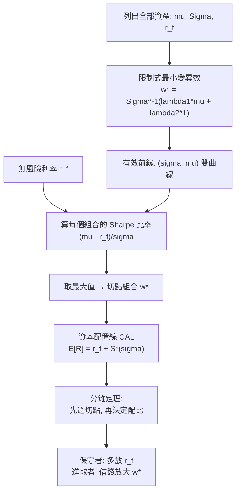

# 3.2 有效前緣與分離定理

## 本章導言

3.1 節把每個投資組合壓縮成平面上的一個點 $(\sigma_p, \mu_p)$ ，並證明所有可能點組成一個凸集。下一個問題自然是：**投資人應該在凸集的哪裡？** Markowitz 1959 年的專著給出了幾何答案：對每一個「想要的報酬」，挑變異數最小的組合，這些點連起來就是**有效前緣**（efficient frontier）——可行集合的左上邊界。此後的推論更驚人：若存在一個可自由借貸的無風險利率，那麼**所有投資人的最優選擇都會落在同一條直線上**，差別只在於「無風險資產」與「同一個風險組合」的配比。這就是 **James Tobin（托賓）1958 年**提出的分離定理（separation theorem），它把「資產配置」與「選股」兩個問題徹底分開，也是指數基金、基金評級與資產管理產業的理論根柢。本節先重建前緣的代數與幾何，再引入無風險利率與切點組合。

### 有效前緣：把凸集的邊界找出來

問題是給定期望報酬 $m$ ，求最小變異數：

$$
\min_w\ \tfrac{1}{2} w^\top \Sigma w
\quad \text{s.t.} \quad w^\top \mu = m,\quad \mathbf{1}^\top w = 1.
$$

以 Lagrange 乘子 $\lambda_1, \lambda_2$ 求解，一階條件給出：

$$
w^* = \Sigma^{-1}\big(\lambda_1 \mu + \lambda_2 \mathbf{1}\big),
$$

代入兩個限制式解出 $\lambda$ 。讓 $m$ 掃過所有可行值， $w^*$ 的軌跡就是有效前緣；在 $(\sigma^2, \mu)$ 平面上它是一條**雙曲線**（在 $(\sigma, \mu)$ 平面上是它的右支）。三件性質值得記住：

1. **前緣上不存在「同報酬而風險更低」的點**——這是「有效」的定義；
2. 全球最小變異數組合（global minimum variance）位於 $\Sigma^{-1}\mathbf{1}/(\mathbf{1}^\top\Sigma^{-1}\mathbf{1})$ ；
3. **兩檔有效組合的任何混合仍落在前緣上**（雙曲線對這一點是封閉的），這就是**兩基金分離**：整條前緣只需兩個基金即可複製。

### 加入無風險利率：切點組合與資本配置線

設無風險利率為 $r_f$ ，允許以 $r_f$ 自由借貸。此時可行集合從「凸集」擴大為「**以 $r_f$ 為頂點、與前緣相切的錐形**」。最優風險組合 $w^*$ 是使**Sharpe 比率**（超額報酬／波動度）最大的那一個：

$$
\max_w \frac{w^\top \mu - r_f\,\mathbf{1}^\top w}{\sqrt{w^\top \Sigma w}}
\quad \Longleftrightarrow \quad
w^* \propto \Sigma^{-1}(\mu - r_f \mathbf{1}).
$$

這條直線稱**資本配置線**（capital allocation line, CAL）：

$$
\mathbb{E}[R_p] = r_f + \frac{\mu_{w^*} - r_f}{\sigma_{w^*}} \, \sigma_p,
$$

其斜率就是最大的 Sharpe 比率。**整個投資問題從此只剩下一個決策**：把多少資金放在 $w^*$ 、多少放在無風險資產——這就是 Tobin 的**分離定理**（1958）：「持有什麼樣的風險組合」人人相同（同質預期下即市場組合），「承擔多少風險」因人而異。

**例題 3.2.1**：兩檔風險資產：資產 1（ $\mu_1 = 10\%$ 、 $\sigma_1 = 20\%$ ）、資產 2（ $\mu_2 = 6\%$ 、 $\sigma_2 = 10\%$ ）， $\rho_{12} = 0.2$ ，無風險利率 $r_f = 3\%$ 。(1) 求切點組合的權重；(2) 計算其期望報酬、標準差與 Sharpe 比率；(3) 驗證它是所有權重中 Sharpe 比率最高者。

**解**：(1) 超額報酬向量 $\mu - r_f\mathbf{1} = (0.07,\ 0.03)^\top$ ，共變異數矩陣

$$
\Sigma = \begin{pmatrix} 0.04 & 0.006 \\ 0.006 & 0.01 \end{pmatrix}, \qquad
\det\Sigma = 0.0004 - 0.000036 = 0.000364,
$$

$$
\Sigma^{-1} = \frac{1}{0.000364}\begin{pmatrix} 0.01 & -0.006 \\ -0.006 & 0.04 \end{pmatrix}
= \begin{pmatrix} 27.47 & -16.48 \\ -16.48 & 109.89 \end{pmatrix}.
$$

$$
\Sigma^{-1}(\mu - r_f\mathbf{1}) =
\begin{pmatrix} 27.47(0.07) - 16.48(0.03) \\ -16.48(0.07) + 109.89(0.03) \end{pmatrix}
= \begin{pmatrix} 1.4286 \\ 2.1429 \end{pmatrix},
$$

正規化（總和 3.5715）得

$$
w_1^* = 0.40, \qquad w_2^* = 0.60.
$$

(2) 組合統計量：

$$
\mathbb{E}[R_p] = 0.4(10\%) + 0.6(6\%) = 7.6\%,
$$

$$
\sigma_p^2 = 0.16(0.04) + 0.36(0.01) + 2(0.4)(0.6)(0.006) = 0.0064 + 0.0036 + 0.00288 = 0.01288,
$$

$$
\sigma_p = \sqrt{0.01288} = 11.35\%, \qquad
S^* = \frac{7.6\% - 3\%}{11.35\%} = 0.405.
$$

(3) 檢驗等權組合（ $w = 0.5, 0.5$ ）： $\mathbb{E} = 8\%$ 、 $\sigma = \sqrt{0.0155} = 12.45\%$ （3.1 節已算），Sharpe $= 5\%/12.45\% = 0.402 < 0.405$ 。再檢驗全押資產 1：Sharpe $= 7\%/20\% = 0.35$ ，全押資產 2： $3\%/10\% = 0.30$ 。**切點組合 0.405 確為最大值**——雖然它的期望報酬（7.6%）低於等權組合（8%），但每單位風險拿到的補償更多。

(3) 的啟示：分離定理說，任何投資人若想要更高報酬，**不該換股票，而該提高 $w^*$ 的配比（或借貸槓桿）**——風險與報酬沿著 CAL 一起放大，Sharpe 比率不變。

### 歷史啟示

- **幾何化讓政策變成策略**：前緣把「分散化」畫成一條看得見的邊界，退休金董事會第一次能用圖形討論資產配置。
- **分離定理是「專業分工」的數學形式**：選股（找切點）與風險預算（決定配比）分開，基金評級得以只比較「每單位風險的超額報酬」。
- **同質預期假設是全章的軟肋**：一旦投資人對 $\mu$ 看法不同，切點就不同（3.3 節放寬為市場均衡；6.3 節的 HJM 框架用「遠期利率無偏」取代這項假設）。

## 前因後果與驅動關係

**什麼問題逼出了這套技術？** 其一是**資產管理的工業化**：當基金規模擴大到無法逐一選股，經理人需要一個「先決定配置、再挑選工具」的兩步流程，兩基金分離正提供了這個流程的證明。其二是**保險與退休金的政策性配置**：這些機構要向監管與受託人說明「為何持有這組資產」，前緣與 CAL 提供了可稽核的語言。其三是**借貸不對稱的現實**：Tobin 1958 年論文的原始問題正是「投資人同時面臨不同的借貸利率與風險態度」，放寬假設後才得到完整分離結果。

**理論成熟後如何回頭改變實務？** 分離定理直接導向**市場組合與被動投資**：若人人都應持有同一個風險組合，那麼基金的正當角色就是追蹤它——1970 年代後指數化投資快速成長（3.3 節）。它也帶來**基金績效評比的標準化**：Sharpe 比率、信息比率皆源於「超額報酬 ÷ 波動度」的這條直線。在風險管理側，CAL 讓「風險預算」成為可分割的商品：先算切點，再按客戶的風險承受度決定配比，這是 7.1 節 VaR 在組合層級的前置步驟；退休金則以資產配置決定存續期間缺口（2.3 節）。理論的邊界也被推進：當存在多個無風險或類無風險資產（國債、現金、通膨連動債），分離定理推廣為**多基金分離**；當報酬不服從常態、含有選擇權（第 4 章），前緣的形狀會被扭曲，此時需要以模擬或整數規劃重算。

## 練習

1. 承例題 3.2.1，若兩資產相關係數提高到 0.9，切點組合的 Sharpe 比率會上升或下降？請用 $\Sigma^{-1}$ 的變化定性說明，並解釋「相關性升高使分散化價值下降」。
2. 某投資人的 CAL 斜率為 0.35，無風險利率 2.5%。若他希望組合標準差不超過 8%，其期望報酬上限為多少？其中投在風險組合的比例是多少？
3. 設 $\mu = (0.12,\ 0.06)^\top$ 、 $\Sigma = \begin{pmatrix} 0.09 & 0.01 \\ 0.01 & 0.04 \end{pmatrix}$ 、 $r_f = 0.04$ ，求切點組合權重（先算 $\Sigma^{-1}$ 再正規化）。
4. 證明「兩基金分離」：設 $w^A$ 、 $w^B$ 都是有效前緣上的點，證明它們的凸組合 $\alpha w^A + (1-\alpha)w^B$ 仍給出前緣上的點（在 $(\sigma^2, \mu)$ 平面上為何仍落在雙曲線上？）。
5. 思考題：分離定理要求「所有人對 $\mu, \Sigma$ 有相同看法」。若投資人甲認為 A 股報酬高、乙認為 B 股報酬高，市場還會存在單一切點組合嗎？這會如何影響 3.3 節「市場組合」的存在性，以及 10.1 節對期限結構的無套利處理？

### 名詞速查表

- **有效前緣**：可行集合的左上邊界，同報酬下風險最小的組合軌跡（雙曲線）。
- **全球最小變異數組合**：前緣最左端的點， $\Sigma^{-1}\mathbf{1}$ 正規化的結果。
- **Sharpe 比率**： $(\mu_p - r_f)/\sigma_p$ ，每單位風險的超額報酬。
- **資本配置線（CAL）**：由 $r_f$ 出發通過切點組合的直線，最優風險－報酬配比的所有可能。
- **分離定理（Tobin, 1958）**：風險組合選擇與風險程度決定可以分開進行。
- **兩基金分離**：整條有效前緣可由兩個有效組合的混合生成。
- **切點組合**：使 Sharpe 比率極大的風險組合，權重 $\propto \Sigma^{-1}(\mu - r_f\mathbf{1})$ 。

### 年表速查

- 1952：Markowitz 建立均值－變異數與有效組合概念（3.1 節）。
- 1958：Tobin〈作為行為面對風險的流動性偏好〉提出分離定理。
- 1959：Markowitz 專著出版，有效前緣的幾何被完整表述。
- 1964：Sharpe 在分離定理之上導出 CAPM（3.3 節）。
- 1966：Treynor 提出以超額報酬除以風險的績效指標。
- 1970 年代：以 CAL 為基礎的基金評級與指數化投資興起。

（本節完）
