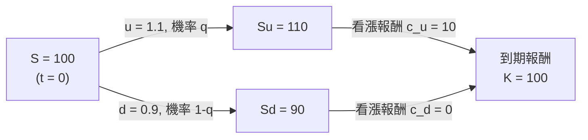

# 4.2 Black–Scholes 公式（1973）

## 本章導言

1960 年代末，場外選擇權市場已經長大，卻沒有一個被普遍接受的價格公式。當時的計算方式多是「標的股票過去的價格波動度」或發明者各自發明的貼現公式：**A. James Boness**（1964）用股票的期望報酬貼現報酬，**Paul Samuelson（薩謬森，1915–2009）** 與其學生 **Myron Scholes** 等人（1960 年代中期）指出：正確的貼現率不是股票的期望報酬，因為報酬已被對沖，只剩無風險利率。MIT 的 **Fischer Black（布萊克，1938–1995）** 與 Scholes（1941–）在 1969–1972 年間反覆推導（Black 當時在 Shearson Hayden Stone 從事認股權證研究），與同在 MIT 的 **Robert C. Merton（默頓，1944–）** 交流後，1973 年 Black 與 Scholes 的〈企業負債與選擇權的定價〉發表於《政治經濟學期刊》（Journal of Political Economy），Merton 的〈理性選擇權定價理論〉同年發表於 Bell Journal。兩人因此與 Markowitz 分享 1997 年諾貝爾經濟學獎（Black 於 1995 年病逝，未及領獎）。本節重建公式、它背後的複製論證，以及它與 5 節隨機過程的關係。

### 模型假設與二項樹的直覺

Black–Scholes 的四個核心假設：(1) 股價服從**幾何布朗運動**（5.2 節）： $dS = \mu S\,dt + \sigma S\,dW$ ；(2) 無風險利率 $r$ 恆定且可按此借貸；(3) 無股利、無交易成本、可連續交易；(4) 無套利。

連續模型的論證不易一眼看穿，**二項樹**（Cox–Ross–Rubinstein，1979 年發表，但結構更早被用來說明）先把直覺講清楚。設一期之內股價只會漲到 $Su$ 或跌到 $Sd$ ：

關鍵想法是**動態複製**：買 $\Delta$ 股、借 $B$ 元，使它在兩個到期狀態的價值都等於選擇權報酬：

$$
\Delta (Su) - B(1+r) = c_u, \qquad
\Delta (Sd) - B(1+r) = c_d.
$$

相減解出避險比率（就是 4.3 節的 delta）：

$$
\Delta = \frac{c_u - c_d}{Su - Sd} = \frac{10 - 0}{110 - 90} = 0.5,
\qquad
B(1+r) = 0.5 \times 90 - 0 = 45.
$$

複製組合的成本為 $\Delta S - B = 0.5 \times 100 - 45/1.05 = 50 - 42.857 = 7.143$ 元。由無套利，**選擇權價格必等於複製成本**：

$$
c = \frac{q\, c_u + (1-q)\, c_d}{1+r}, \qquad
q = \frac{(1+r) - d}{u - d} = \frac{1.05 - 0.9}{0.2} = 0.75,
\qquad c = \frac{0.75 \times 10}{1.05} = 7.143.
$$

注意 $q$ 的妙處：它只由 $u, d, r$ 決定，**與股價真實的漲跌機率完全無關**——這就是 5.3 節要說的**風險中立機率**。二項樹把「連續時間」切得更細，取極限即得到 Black–Scholes。

### Black–Scholes 公式

把上述複製論證連續化（delta 需連續調整，詳見 4.3 節），可得無套利偏微分方程：

$$
\frac{\partial C}{\partial t} + \frac{1}{2}\sigma^2 S^2\frac{\partial^2 C}{\partial S^2} + rS\frac{\partial C}{\partial S} - rC = 0,
$$

其歐式看漲的解為：

$$
\boxed{\ C = S\,N(d_1) - K e^{-rT} N(d_2)\ }
$$

$$
d_1 = \frac{\ln(S/K) + \left(r + \tfrac{1}{2}\sigma^2\right)T}{\sigma\sqrt{T}},
\qquad
d_2 = d_1 - \sigma\sqrt{T},
$$

$N(\cdot)$ 為標準常態累積分布函數（《機率統計》1.2 節）。看跌由 Put–Call 平價（4.1 節）直接得到：

$$
p = C - S + Ke^{-rT} = K e^{-rT} N(-d_2) - S N(-d_1).
$$

公式的三個特性一目了然：**沒有 $\mu$ **（股價的期望報酬完全不出現在定價中——這是「無套利」最驚人的結論）；** $N(d_1), N(d_2)$ 是機率**（ $N(d_2)$ 是風險中立下選擇權被履約的機率， $N(d_1)$ 是避險比率）；** $\sigma$ 與 $T$ 以 $\sigma\sqrt{T}$ 組合出現**（波動度是「每平方根時間」的量，與 7.1 節 VaR 同一量綱）。

**例題 4.2.1**： $S = K = 100$ 元、 $r = 5\%$ （連續）、 $\sigma = 30\%$ 、 $T = 1$ 年。用 $N(0.3167) = 0.6243$ 、 $N(0.0167) = 0.5067$ 計算看漲價格，再用平價求看跌，並驗證兩者一致。

**解**：

$$
d_1 = \frac{\ln(100/100) + (0.05 + 0.045)(1)}{0.30} = \frac{0.095}{0.30} = 0.3167,
\qquad d_2 = 0.3167 - 0.30 = 0.0167.
$$

$$
C = 100 \times 0.6243 - 100 \times e^{-0.05} \times 0.5067
  = 62.43 - 95.1229 \times 0.5067 = 62.43 - 48.19 = 14.24 \text{ 元}.
$$

平價求看跌：

$$
p = C - S + Ke^{-rT} = 14.24 - 100 + 95.12 = 9.36 \text{ 元}.
$$

直接代入看跌公式驗證： $p = 95.1229 \times N(-0.0167) - 100 \times N(-0.3167) = 95.1229 \times 0.4933 - 100 \times 0.3757 = 46.92 - 37.57 = 9.35$ 元，與平價結果在四捨五入範圍內一致。**兩個獨立方法給出同一答案**，這本身就是公式自洽的檢驗。

再看一個對照：若把 $\sigma$ 提高到 40%， $d_1 = (0 + (0.05+0.08))/0.40 = 0.325$ 、 $d_2 = -0.075$ ， $N(d_1) = 0.6274$ 、 $N(d_2) = 0.4701$ ， $C = 62.74 - 95.12 \times 0.4701 = 62.74 - 44.72 = 18.02$ 元。**波動度上升 10 個百分點，選擇權漲價約 27%**——波動度是選擇權價格的主導變數，這為 4.3 節的 vega 與「隱含波動度」實務埋下伏筆。

### 歷史啟示

- **公式賣掉了人們真正想要的東西**：選擇權買方要的是「下行保護、上行參與」，公式讓這種非對稱性第一次有了可比較的價格標籤。
- **定價與對沖是一體兩面**：公式的正確性來自「可以複製」，而複製需要 4.3 節的動態對沖——**沒有交易實務，就沒有公式**。
- **場內化與普及**：CBOE 於 1973 年 4 月開業，同年公式發表；期貨式與二項樹模型（Cox–Ross–Rubinstein, 1979）使計算可以在小型計算機上完成，選擇權從「議價契約」變成「每日報價的商品」。

## 前因後果與驅動關係

**什麼問題逼出了這套技術？** 其一是**選擇權場外市場的定價混亂**：買賣雙方各憑不同貼現率喊價，急需一個共同語言。其二是**公司認股權證與補償制度**：企業發行的認股權證、員工選擇權需要列入財報，會計準則要求估值方法（《會計的數學》第 10 章現代會計的估計與揭露）。其三是**對沖的經濟必要性**：選擇權造市商、可轉債承銷商與避險基金需要知道「該持有多少股票來抵銷選擇權部位」，這直接逼出 delta 與動態對沖。

**理論成熟後如何回頭改變實務？** Black–Scholes 的影響遠超出選擇權：它確立了**「無套利＋複製」作為整個衍生品產業的定價哲學**，利率衍生品、信用衍生品（7.3 節）、保險精算（第 8 章）逐一改用這套語言；它讓**隱含波動度**成為市場最即時的恐慌指標（由 $C$ 反解 $\sigma$ ，與 2.2 節由價格反解殖利率同型），波動度曲面成為報價的第二維度。它也帶來教訓：1987 年股災後，人們發現報酬分佈具有厚尾與不對稱，公式中的常態假設系統性低估深度價外選擇權的價格，波動度微笑遂成為常態（第 9 章）；2008 年後，交易對手風險、流動性與借貸成本差異使平價與公式都要修正。理論上，公式沒有 $\mu$ 的特性把金融學分成兩半——**定價問題與報酬預測問題從此分家**，這條分界線正是 5.3 節馬丁格爾測度的主題，也是《經濟的數學》第 9 章「不確定性與資訊」所討論的「價格資訊含量」的數學基礎。

## 練習

1. 用例題 4.2.1 的參數（ $S=K=100$ 、 $r=5\%$ 、 $T=1$ ）改以 $\sigma = 20\%$ 計算看漲價格（ $d_1 = 0.25$ 、 $d_2 = -0.05$ ， $N(0.25)=0.5987$ 、 $N(-0.05)=0.4801$ ），並與 $\sigma = 30\%$ 的 14.24 元比較。
2. 承上，把履約價改為 110 元（其餘不變， $d_1 = -0.3167$ 、 $d_2 = -0.6167$ ， $N(-0.3167)=0.3757$ 、 $N(-0.6167)=0.2687$ ），計算深度價外看漲的價格，並解釋為何它仍然不等於零。
3. 在二項樹例題中（ $S=100$ 、 $u=1.1$ 、 $d=0.9$ 、 $r=5\%$ 、 $K=100$ ），請驗證以 $\Delta=0.5$ 、借 42.857 元的組合在兩個到期狀態的價值分別為 10 與 0。
4. 證明：當 $\sigma \to 0$ （無波動），看漲價格趨近於 $\max(S - Ke^{-rT}, 0)$ ，與 4.1 節的平價下界一致。
5. 思考題：公式裡沒有股票的期望報酬 $\mu$ 。請用「投資人可以同時持有股票並對沖選擇權」的語言解釋為什麼 $\mu$ 會消失；再說明：既然定價與 $\mu$ 無關，經濟學家為何仍花大量精力預測報酬（連結 3.3 節 CAPM 與《經濟的數學》第 9 章不確定性與資訊）。

### 名詞速查表

- **Black–Scholes 公式**： $C = SN(d_1) - Ke^{-rT}N(d_2)$ ，1973 年發表的歐式選擇權定價式。
- **無套利偏微分方程**： $\partial_t C + \tfrac12\sigma^2S^2\partial_{SS}C + rS\partial_SC - rC = 0$ 。
- **風險中立機率 $q$ **：二項樹中只依 $u, d, r$ 決定的計算機率。
- **動態複製**：以 $\Delta$ 股股票加借貸逐時調整以複製選擇權報酬。
- **隱含波動度**：由市場價格反解出的 $\sigma$ ，選擇權市場的第二報價維度。
- **二項樹（CRR）**：離散時間的定價模型，取極限收斂到 Black–Scholes。
- **平價公式求看跌**： $p = C - S + Ke^{-rT}$ ，免去第二次計算。

### 年表速查

- 1900：Bachelier 以布朗運動描述價格，先驅工作被埋沒（5.1 節）。
- 1964：Boness 提出以股票期望報酬貼現的選擇權定價（未普遍接受）。
- 1960 年代中：Samuelson 等人指出貼現率應為無風險利率，並保證股價為正。
- 1969–1972：Black 與 Scholes 在 Shearson 與 MIT 之間反覆推導。
- 1973：CBOE 於芝加哥開業，選擇權交易標準化。
- 1973：Black–Scholes 論文與 Merton 的理性選擇權定價論文相繼發表。
- 1977：Merton 提出選擇權與公司負債的結構關係（連結 7.3 節）。
- 1979：Cox–Ross–Rubinstein 二項樹模型發表。
- 1997：Scholes 與 Merton 獲諾貝爾經濟學獎。

（本節完）
