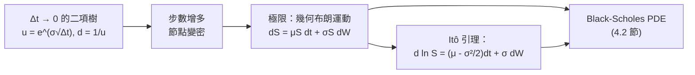

# 5.2 幾何布朗運動與 Itô 引理

## 本章導言

Bachelier 的算術布朗運動（5.1 節）有一個致命缺陷：常態增量允許價格變成負數，而股東的損失以投資額為上限，股價不可能低於零。1965 年，**Paul Samuelson** 在〈合理投機價格的證明〉中提出修正：**不讓價格本身、而讓報酬率服從隨機漫步**——即股價的**對數**是布朗運動。這就是**幾何布朗運動**（Geometric Brownian Motion, GBM），它在 1973 年成為 Black–Scholes 公式的模型假設（4.2 節），至今仍是教科書與實務的預設語言。而要對這個模型做微積分，需要一套全新的法則——**Itô 引理**。本節建立 GBM 與 Itô 微積分的基本操作，並以 mermaid 圖對照離散二項樹與連續路徑兩種表述。

### 從算術到幾何：一步觀念修正

GBM 的隨機微分方程是

$$
\mathrm{d}S_t = \mu S_t\,\mathrm{d}t + \sigma S_t\,\mathrm{d}W_t,
$$

其顯式解（可由 Itô 引理直接驗證，見下）為

$$
S_t = S_0 \exp\!\left( \left(\mu - \tfrac{\sigma^2}{2}\right) t + \sigma W_t \right).
$$

三個立即可見的優點：

1. **恆為正**：指數函數保證 $S_t > 0$ ，符合股東責任有限的制度現實。
2. **報酬率加總**：對數報酬 $\ln S_t - \ln S_0 = (\mu - \tfrac{\sigma^2}{2})t + \sigma W_t$ 服從常態隨機漫步，不同期間的（簡單）報酬近似獨立加總，符合經驗。
3. **尺度不變**：波動項 $\sigma S_t \mathrm{d}W_t$ 與價位成正比——股價 100 元時一天波 2 元、股價 200 元時一天波 4 元，這正是百分比波動的直覺。

但代價隨之而來： $\ln S_t$ 常態、 $S_t$ 就是**對數常態**，其期望值與眾數分離：

$$
\mathbb{E}[S_t] = S_0 e^{\mu t}, \qquad
\text{中位數（眾數附近）} = S_0 e^{(\mu - \sigma^2/2)t}.
$$

期望值比中位數高出因子 $e^{\sigma^2 t/2}$ ——**波動率越高，期望與「典型結果」的落差越大**。初學者最容易犯的錯，就是拿 $e^{\mu t}$ 當「預期價格」的直覺；它其實是被右偏尾部拉高的平均，而多數路徑落在更低的典型值附近。這個偏態正是 7.2 節尾部風險的模型根源。

### Itô 引理：隨機世界的鏈鎖法則

對函數 $f(t, x)$ ，若 $X_t$ 服從 $\mathrm{d}X_t = a\,\mathrm{d}t + b\,\mathrm{d}W_t$ ，則

$$
\mathrm{d}f = \left( \frac{\partial f}{\partial t} + a\,\frac{\partial f}{\partial x} + \tfrac{1}{2} b^2 \frac{\partial^2 f}{\partial x^2} \right) \mathrm{d}t
+ b\,\frac{\partial f}{\partial x}\,\mathrm{d}W_t.
$$

與普通鏈鎖法則唯一的差別是多了**二階項 $\tfrac{1}{2}b^2 f_{xx}$ **。原因在 5.1 節的二次變差： $(\mathrm{d}W_t)^2 = \mathrm{d}t$ 不是零，泰勒展開的二階項倖存。乘法規則口訣：

$$
(\mathrm{d}t)^2 = 0, \qquad \mathrm{d}t\,\mathrm{d}W_t = 0, \qquad (\mathrm{d}W_t)^2 = \mathrm{d}t.
$$

**用 GBM 驗證顯式解**：取 $f(t,x) = \ln x$ ， $a = \mu x$ 、 $b = \sigma x$ ，則 $f_x = 1/x$ 、 $f_{xx} = -1/x^2$ 、 $f_t = 0$ ，故

$$
\mathrm{d}(\ln S_t) = \left( \mu - \tfrac{\sigma^2}{2} \right)\mathrm{d}t + \sigma\,\mathrm{d}W_t,
$$

積分即得前述顯式解。注意 $\ln S_t$ 的漂移是 $\mu - \sigma^2/2$ 而非 $\mu$ ——**那個 $-\sigma^2/2$ 正是 Itô 修正項**：波動率會「吃掉」部分期望對數報酬，這是 GBM 模型下一切長期報酬計算的關鍵細節。

### 離散與連續：二項樹如何逼近 GBM

Cox–Ross–Rubinstein（1979）的二項樹（4.1、5.3 節使用）是 GBM 的離散近似：每步取 $u = e^{\sigma\sqrt{\Delta t}}$ 、 $d = 1/u$ ，路徑在 $\Delta t \to 0$ 時逐點收斂到 GBM：

這張圖總結了本書前後章的匯流：離散樹（可手算、可程式化）與連續模型（有封閉解、有微積分工具）是同一個數學對象的兩種表述，衍生品定價因此在理論與計算兩端都可行。

### 例題 5.2.1

**例題 5.2.1**：股價 $S_0 = 100$ 元，年化期望報酬 $\mu = 8\%$ 、波動率 $\sigma = 20\%$ 。求一年後：(1) 期望股價；(2) 中位數股價；(3) 股價高於期初（ $S_1 > 100$ ）的機率。

**解**：

(1) $\mathbb{E}[S_1] = 100\, e^{0.08} \approx 108.33$ 元。

(2) 中位數 $= 100\, e^{0.08 - 0.02} = 100\, e^{0.06} \approx 106.18$ 元。期望值高出約 2 元，全因右偏尾部。

(3) $S_1 > 100 \iff \ln(S_1/100) > 0$ ，而 $\ln(S_1/100) \sim N(0.06,\, 0.04)$ ，標準化：

$$
P(S_1 > 100) = N\!\left(\frac{0.06}{0.2}\right) = N(0.3) \approx 0.618.
$$

注意：雖然期望報酬是正的 8%，賺錢的機率也只有約 62%——期望值的正面由少數大幅上漲的路徑貢獻。若把 $\sigma$ 提高到 40%，機率降為 $N(0.06/0.4) = N(0.15) \approx 0.559$ ：**波動越大，正期望下賺錢的機率反而越低**，這是對數常態模型給風險教育最直白的一課。

### Itô 引理的第二個用場：推出 Black–Scholes 偏微分方程

設衍生品價格 $V = f(t, S)$ ，以 Itô 引理展開：

$$
\mathrm{d}V = \left( f_t + \mu S f_S + \tfrac{1}{2}\sigma^2 S^2 f_{SS} \right)\mathrm{d}t + \sigma S f_S\,\mathrm{d}W_t.
$$

構造「買入 1 單位衍生品、賣空 $f_S$ 股標的」的對沖組合（4.3 節 Delta 對沖），隨機項抵消，餘下確定的 $\mathrm{d}t$ 項；由無套利，其收益必為無風險利率，整理即得

$$
\tfrac{1}{2}\sigma^2 S^2 f_{SS} + rS f_S - rf + f_t = 0.
$$

這正是 4.2 節的 Black–Scholes 方程。Itô 引理因此不是炫技，而是把「對沖 $\to$ 消隨機項 $\to$ 無套利」這條論證線寫成微積分的工具；5.3 節將以馬丁格爾測度給出它的另一條、更一般的證明路線。

## 前因後果與驅動關係

**驅動**：股價不可為負的制度事實（有限責任）逼出「報酬而非價格服從隨機漫步」的修正；Samuelson 1965 年的模型與 Itô（1942–1951）建立的隨機微積分在 1970 年代匯合，使 Black、Scholes、Merton 得以寫下封閉解。經驗動機則來自對股價資料的長期觀察：價格分布右偏、尾部厚重，對數常態比常態貼近現實。

**回饋**：GBM＋Itô 框架成熟後，(1) 衍生品定價有了可擴充的母版——把 $\sigma$ 換成隨機過程即得隨機波動率模型、把利率換成隨機過程即得第 6 章期限結構模型；(2) 實務上，隱含波動率微笑（波動率隨履約價變化）顯示 GBM 常數 $\sigma$ 的不足，推動了 Heston 等模型（第 10 章）；(3) 風險管理中，對數常態尾部的理論與 7.2 節極端值理論的實證互相校正。Itô 引理本身已成為量化分析師的讀寫能力：任何「對隨機價格的非線性部位」（選擇權、可轉債、結構型商品）都靠它估風險。

**跨書連結**：對數常態分布是《機率統計》中「常態的變換」一章的直接應用，期望值與中位數的分離是期望值概念的深化（cf.《機率統計》第 1 章 Pascal–Fermat 的公平價格）；報酬率的加總結構與《經濟的數學》第 9 章不確定性下的跨期決策相接；對沖組合的會計恆等式可對照《會計的數學》第 1 章複式簿記的「每筆交易兩面平衡」思想。

## 練習

1. 以 Itô 引理求 $f(S) = S^2$ 在 GBM 下的隨機微分，並證明 $\mathbb{E}[S_t^2] = S_0^2 e^{(2\mu + \sigma^2)t}$ 。
2. 承例題 5.2.1，求兩年後 $\mathbb{E}[S_2]$ 、中位數 $S_2$ 與 $P(S_2 > 100)$ ，並比較與一年的結果，說明「期望值按 $e^{\mu t}$ 成長、中位數按 $e^{(\mu-\sigma^2/2)t}$ 成長」的分歧如何隨時間擴大。
3. 某股票年波動率 30%、漂移 $\mu = 0$ 。求十年後「股價低於期初一半」的機率。（提示： $\ln(0.5) \approx -0.693$ ，標準化後查常態表。）
4. 用 Itô 引理推導：在風險中性測度下（漂移換為 $r$ ，5.3 節），GBM 的期望價格 $\mathbb{E}^{Q}[S_T] = S_0 e^{rT}$ ，並解釋這與「期望報酬等於無風險利率」的關係。
5. 思考題：GBM 隱含「不同時間的報酬獨立同分布、波動率常數」。實務上波动率會集群（大波動跟著大波動）。請討論：在 Itô 框架內如何修正模型（讓 $\sigma$ 隨狀態變化），以及此修正會讓 Black–Scholes 封閉解失效到什麼程度。

### 名詞速查表（本節出現的核心術語）

- **幾何布朗運動（GBM）**： $\mathrm{d}S = \mu S\,\mathrm{d}t + \sigma S\,\mathrm{d}W$ ，價格恆正、對數常態。
- **Itô 引理**：隨機鏈鎖法則，比普通微積分多出 $\tfrac{1}{2}b^2 f_{xx}$ 項。
- **Itô 修正項／乘法規則**： $(\mathrm{d}W)^2 = \mathrm{d}t$ 造成 $\ln S$ 漂移為 $\mu - \sigma^2/2$ 。
- **對數常態分布**：對數服從常態的分布，右偏、尾部厚重。
- **二項樹極限**：CRR 樹在步長趨零時收斂到 GBM。
- **二次變差**：路徑的二階變量，是 Itô 微積分與普通微積分的分水嶺。

（本節完）
