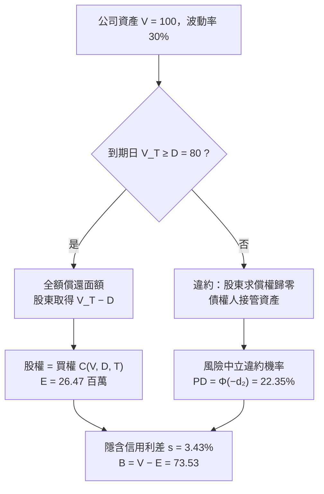

# 7.3 Merton結構化信用模型1974

## 本章導言

在 1974 年之前，「企業違約」沒有理論，只有慣例。放款者依賴擔保品、契約限制、法律程序與授信人員的判讀，債券的信用利差被當成無法定價的「額外補償」；學術上連「違約機率應該如何由市場價格反推」都沒有共識。1974 年，Robert C. Merton 在《Journal of Finance》發表〈On the Pricing of Corporate Debt: The Risk Structure of Interest Rates〉，把公司資產視為一項標的，把「有限責任」這條法律條文轉譯成數學：**股東對公司的求償權，等於以公司資產為標的、履約價格為債務面額的買權**。債務違約從此變成一個可以算出機率與利差的分佈問題。這是 4.2 節 Black–Scholes 公式誕生一年後最漂亮的延伸，也是第 7 章從「統計風險」走向「結構化信用風險」的轉折點。

### 模型設定：一家公司、一筆債、一個到期日

設公司資產總值 $V_t$ 服從幾何布朗運動（5.2 節），發行面額 $D$ 、到期日 $T$ 的零息債。到期時的清償規則：

- 若 $V_T \ge D$ ：公司全額償還，股東取得剩餘 $V_T-D$ ；
- 若 $V_T < D$ ：公司違約，債權人接管資產，股東因**有限責任**只損失投資，得 0。

於是股權價值 $E$ 正是以 $V$ 為標的、履約價 $D$ 、剩餘期間 $T$ 的**買權**：

$$
E=V\Phi(d_1)-De^{-rT}\Phi(d_2),\qquad
d_1=\frac{\ln(V/D)+(r+\tfrac12\sigma^2)T}{\sigma\sqrt{T}},\quad d_2=d_1-\sigma\sqrt{T}.
$$

而**風險中立違約機率**就是 $d_2$ 的左尾：

$$
PD=\Pr^{\mathbb{Q}}(V_T<D)=\Phi(-d_2),
$$

$d_2$ 在信用分析上稱為**距離違約**（distance to default）的標準差倍數。整條推理完全不需歷史違約統計——**市場對股票的報價，本身就是對信用風險的報價**。

### 從違約機率到信用利差

債券價值可用買賣權平價（4.1 節）反推：債 = 無風險債 − 賣權，故

$$
B=De^{-rT}-\underbrace{\left[De^{-rT}\Phi(-d_2)-V\Phi(-d_1)\right]}_{\text{賣權}}=V-E.
$$

給定 $B$ ，就能定義使 $De^{-sT}=B$ 的隱含**信用利差** $s$ 。違約機率、距離違約、利差三者由同一組 $(V,\sigma,D,T)$ 同時決定，這是結構化模型最強的性質：**一致地看股票與債券**。

### 例題 7.3.1

**例題 7.3.1**：某公司資產 $V=100$ 百萬元、資產波動率 $\sigma=30\%$ 、一年內到期的面額 $D=80$ 百萬元、無風險利率 $r=5\%$ 、 $T=1$ 年。求（i） $d_1,d_2$ ；（ii）股權價值 $E$ ；（iii）風險中立違約機率；（iv）債券價值與隱含信用利差。

**解**：（i）

$$
d_1=\frac{\ln(100/80)+(0.05+0.045)\times1}{0.30}=\frac{0.22314+0.095}{0.30}=1.0605,\qquad d_2=1.0605-0.30=0.7605.
$$

（ii）查常態表 $\Phi(1.0605)=0.85551$ 、 $\Phi(0.7605)=0.77646$ ：

$$
E=100\times0.85551-80\times e^{-0.05}\times0.77646=85.551-76.098\times0.77646=85.551-59.084=26.47\text{ 百萬元}.
$$

（iii） $PD=\Phi(-d_2)=1-0.77646=0.2235$ ，即 **22.35%**。注意此值是風險中立機率，通常高於真實物理世界的一年違約頻率——這是 5.3 節測度變換在信用問題上的直接後果。

（iv）債券價值 $B=V-E=100-26.47=73.53$ 百萬元。隱含利差：

$$
s=\frac{1}{T}\ln\frac{D}{B}-r=\ln\frac{80}{73.53}-0.05=0.08429-0.05=3.43\%.
$$

即市場會對此債要求約 **343 個基點**的信用利差；同一時間無風險債的現值為 $80e^{-0.05}=76.10$ 百萬元，兩者相差 2.57 百萬元正是賣權（違約保險）的價格。

### 由股價隱含違約的機制

### 模型的邊界：為什麼後來的人要修正它

Merton 模型的假設過強，最遲到 1990 年代已眾所皆知。**其一**，違約只可能發生在到期日——這使短期債的利差被嚴重低估，與市場「三個月期公司債也有可觀利差」的事實不符，即所謂**信用利差之謎**。**其二**，資產價值無法直接觀察， $V$ 與 $\sigma$ 必須由股價反推，對非上市公司不可用。**其三**，它假設違約是「資產不足」的經濟結果，忽略契約、法律程序與流動性——Black–Cox（1976）引入**首次通過模型**允許債權人提早強制破產，Leland（1994）把違約時點內生化。**其四**，對於不具資產的實體（主權、銀行的交易帳簿），結構化思路無用，於是 Jarrow–Turnbull（1995）、Duffie–Singleton（1999）發展出直接指定違約強度的**簡約式模型**，而 9.3 節的相關違約問題則另走 copula 路線。

## 前因後果與驅動關係

**實務如何逼出數學**：1970 年代美國公司債市場擴張、第三世界債務風暴（1982 年起）使違約風險成為日常，而 1973 年 Black–Scholes 已把「有條件的求償權」定價；兩者結合只差「有限責任＝買權」這一步。Merton 的貢獻不在計算技巧，而在**把法律條文（limited liability）翻成 payoff 圖**，這與 4.1 節用 Put–Call 平價把契約寫成代數式是同一種方法論。

**理論成熟後如何改變市場**：1990 年代 KMV 公司（創辦人包含 6.2 節的 Vasicek）把「距離違約」產品化，使股票市場每天自動生產信用訊號；巴塞爾 II 的內部評等法（IRB）以 PD、LGD、EAD 三參數計算資本，其 PD 估計的主流技術正是結構化模型的距離違約思路。反面教材同樣重要：1998 年長期資本管理公司（LTCM）的爆發證明「模型給出的低違約機率」在體制轉換時會同時失真——Merton 與 Scholes 本人都在 LTCM 任職，此事件把模型風險寫進了監管。

- **4.1 節、4.2 節**：買賣權平價與 Black–Scholes 公式是本節的直接工具。
- **5.2 節、5.3 節**：幾何布朗運動、Itô 引理與風險中立測度解釋為何 PD 是 $\Phi(-d_2)$ 。
- **7.1 節、7.2 節**：違約機率是分位數概念的機構版；違約損失分布的厚尾問題仍需 EVT。
- **9.3 節**：單名違約模型的下一步是「多名相關違約」，即 Li（2000）的 Gaussian copula。
- **《會計的數學》第 3 章、第 8 章**：資產負債表方程式 $A=L+E$ 正是 $V=E+B$ 的會計表述；比率分析中的負債比、利息保障倍數，是 $V/D$ 與 $d_2$ 的原始版本。
- **《經濟的數學》第 9 章**：違約機率是「資訊不對稱下的信號」，與貸款市場的逆選擇問題同源。

### 名詞速查表

- **結構化模型**：把公司資產當標的、違約視為資產不足面額的信用模型。
- **有限責任＝買權**：股東求償權 $\max(V_T-D,0)$ 與買權 payoff 完全相同。
- **距離違約（DD）**： $d_2$ ，資產價值距離違約門檻的標準差倍數。
- **風險中立違約機率**： $\Phi(-d_2)$ ，在計價測度下計算、用於定價的機率。
- **隱含信用利差**：由債券價格反推的 $s$ ，滿足 $De^{-sT}=B$ 。
- **首次通過模型**：允許資產在到期前觸及門檻即違約（Black–Cox, 1976）。
- **簡約式模型**：直接指定違約強度而不追蹤資產的另一條路線。

### 年表速查

- 1968：Altman 以判別分析提出 Z 分數，信用分析仍屬計量打分。
- 1970：Merton 完成理性選擇權定價的博士論文（哈佛）。
- 1973：Black–Scholes 選擇權公式發表。
- 1974：Merton 結構化信用模型發表於《Journal of Finance》。
- 1976：Black–Cox 首次通過模型，引入契約與提早違約。
- 1982：拉丁美洲債務危機，主權與銀行信用風險浮上檯面。
- 1994：Leland 內生違約模型；KMV 的距離違約產品在市場普及。
- 1995：Jarrow–Turnbull 簡約式（強度）模型。
- 1998：LTCM 崩盤，結構化模型的相關性與流動性假設受質疑。
- 2004：巴塞爾 II 內部評等法上路，PD／LGD／EAD 成為資本語言。

## 練習

1. 承例題 7.3.1，若資產波動率降為 20%，重算 $d_1,d_2$ 與違約機率，說明「波動上升反而使違約機率上升、股權價值上升」的股東冒險動機。
2. 設 $V=100$ 、 $D=95$ 、 $r=3\%$ 、 $\sigma=25\%$ 、 $T=1$ ，計算距離違約 $d_2$ 與 $\Phi(-d_2)$ ，並求債券價值與利差。
3. 承上題，若把 $D$ 提高到 100（面額等於資產），用買賣權平價說明此時股權價值小於 $V$ ，並解釋差額等於賣權（違約保險）價格。
4. 某公司股價顯示 $d_2=3.0$ ，求其一年風險中立違約機率；再問 $d_2$ 要小到多少，違約機率才會超過 10%（查 $\Phi(-1.28)=0.10$ ）。
5. 思考題：Merton 模型說「違約只能在到期日發生」，但實務上三個月期公司債也有明顯利差。請提出兩種修正方向（提示：觀察 7.3 節的修正清單與 4 章的選擇權觀點），並討論哪一種會讓模型更容易產生厚尾損失（連結 7.2 節）。

（本節完）
