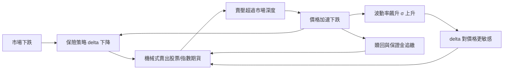

# 9.2 1987 股災與風險值的順反饋

## 本章導言

1987 年 10 月 19 日（黑色星期一），道瓊工業指數單日下跌 22.6%，創下美國股市史上最大單日跌幅；香港、雪梨、倫敦與東京接連崩跌，全球市值蒸發約一兆美元以上。詭異的是：**沒有可辨認的壞消息**。當週僅有眾議院稅法案的小幅利空與貿易赤字數據，規模遠不足以解釋跌幅。事後的 Brady 委員會報告（1988）指出真兇不在新聞裡，而在交易機制裡：當時大量機構採用**投資組合保險**（portfolio insurance，Leland–O'Brien–Rubinstein 於 1981 年前後商品化），它在市場下跌時**機械式賣出股票**——賣壓使價格再跌，價格再跌觸發更多機械賣出。一條原本用來**消除**風險的數學，在特定市場結構下變成**製造**風險的正回饋迴路。這次災難的另一個遺產同樣深刻：JP Morgan 的執行長 Dennis Weatherstone 要求每個下午 4:15 收到一頁「明日若有壞日子，銀行可能損失多少」的報告，這個內部需求在 1994 年演化為公開的 RiskMetrics 技術文件——**風險值（VaR）**自此成為全球風險管理的標準語言（7.1 節）。本節用一個股災的核心數學——delta 避險的順反饋——把兩件事接起來。

### 投資組合保險的數學：合成賣權

投資組合保險的目標是「合成一個賣權」：組合價值不低於某個地板價，代價是放棄地板之上的部分漲幅。做法是把資金在股票與現金間動態切換，持有的股票比例等於合成買權的 delta（本書 4.3 節）：

$$
\text{持股金額} = S \cdot \frac{\partial C}{\partial S}, \qquad \text{現金} = \text{組合總值} - S \cdot \Delta_C.
$$

Black–Scholes 理論保證：只要連續調整，這個策略完美複製保險——**在市場流動性充足時**。問題藏在 $\Delta$ 對價格的敏感度裡：delta 隨價格下跌而下降，於是「市場跌 → 機構必須賣股」。

**例題 9.2.1**：某機構對 1 億美元的投資組合執行投資組合保險，目標為履約價 90（以指數計，現價 100）。參數：波動率 $\sigma = 0.2$ 、剩餘期限 $T = 0.25$ 年、無風險利率 $r = 5\%$ （股息忽略）。計算指數在 100 與 85 時應持有的股票比例，以及指數從 100 跌到 85 時機構必須賣出的金額。

**解**：合成買權 delta 為 $N(d_1)$ ， $d_1 = \dfrac{\ln(S/90) + (r + \sigma^2/2)T}{\sigma\sqrt{T}} = \dfrac{\ln(S/90) + 0.0175}{0.1}$ 。

- $S = 100$ ： $d_1 = (0.10536 + 0.0175)/0.1 = 1.229$ ， $N(1.229) \approx 0.890$ 。持倉：股票 89.0%、現金 11.0%。
- $S = 85$ ： $d_1 = (-0.05716 + 0.0175)/0.1 = -0.397$ ， $N(-0.397) \approx 0.346$ 。持倉：股票 34.6%、現金 65.4%。

指數下跌 15% 時，機構必須把持股從 89% 砍到 34.6%——**賣出約組合的一半**。再以現金流量估計順反饋的規模：若市場上有 $V$ 億美元採用此策略，且策略賣出額與指數跌幅近似線性，斜率約為「每跌 1% 賣出約 $3.6\% \times V$ 」（由 $(0.890-0.346)/15 \approx 0.036$ ），則單日下跌 $d$ % 觸發的機械賣壓為 $0.036\, d\, V$ 億美元。1987 年 10 月，採用投資組合保險的資產估計達 600 至 900 億美元：指數每跌 1%，僅此類策略就釋出 20–30 億美元的賣單——而當日紐約證交所總成交額不過 210 億美元。**賣壓相對於市場深度不再是小量**，Black–Scholes 的連續避險假設（價格連續、交易不影響價格）整個失效。

### 順反饋迴路

圖中三條迴路同時收緊：**delta 迴路**（主迴路）、**波動率迴路**（下跌使 $\sigma$ 上升， $|d\Delta/dS|$ 變大，避險更急）、**流動性迴路**（贖回與保證金強迫非保險參與者也賣出）。數學上，若市場中保險策略占比為 $\kappa$ ，價格動態近似變成

$$
\frac{dS}{dt} \approx -\lambda\, \kappa \cdot 0.036\, V \cdot \frac{d\ln S}{dt}\big/ \text{深度}，
$$

當 $\lambda\kappa \times 0.036\,V$ 逼近市場深度時，系統的有效回饋增益超過 1，價格進入**發散區**——這正是 10 月 19 日下午發生的事：尾盤期貨對現貨大幅折價、兩市場的套利機制因成交延遲而斷裂，指數崩跌 22.6%。

### 風險值：災後的科學化回應

Brady 報告的處方之一是要求更透明的風險度量。JP Morgan 的 4:15 報告把「明天最壞情況」量化為單一數字：持有期 1 天、信賴水準 95% 的風險值

$$
\text{VaR}_{95} = z_{0.95}\, \sigma \sqrt{1}\, V = 1.645\, \sigma V,
$$

RiskMetrics（1994）將其標準化，並用指數加權移動平均 $\sigma_t^2 = (1-\lambda)\sum \lambda^k r_{t-k}^2$ （ $\lambda = 0.94$ ）捕捉「波動率會聚集」的事實。但 VaR 度量的是**正常日子**的風險（7.1、7.2 節）：1987 年 10 月 19 日的損失是 22 個標準差事件——在常態假設下的 VaR 世界裡，宇宙年齡內都不該發生一次。股災因此教會風險管理兩件事：**順反饋使分布變厚尾**（必須用極端值理論補 VaR 的洞），以及**風險度量本身會改變行為、進而改變分布**——這是市場設計者（10.2 節）後來必須面對的反身性。

## 前因後果與驅動關係

**驅動力**：1970–80 年代退休基金與企業年金規模膨脹，機構亟需「保證最低報酬」的工具；Black–Scholes（4.2 節）讓「合成保險」看起來唾手可得。理論的兩個隱含假設——價格連續、交易不影響價格——在 1987 年被自己的成功打爆：**當策略大到成為市場本身，它的假設就不再成立**。這是本書反覆出現的主題（9.3 節的 copula 亦然）的第一次大型展演。

**理論成熟後的反向改變**：股災直接催生了三項制度。其一，**熔斷機制**（circuit breaker，1988 年起）：在價格發散區強制暫停交易，切斷順反饋迴路；其二，**VaR 體系**：4:15 報告 → RiskMetrics（1994）→ 巴塞爾銀行監理委員會 1996 年市場風險修正案允許銀行以內部 VaR 模型計提資本，風險值成為法定語言；其三，**投資組合保險的轉型**：業界改以場內賣權（真正的保險，由賣方吸收風險）取代動態複製。與本書其他章節：VaR 的常態假設與 7.2 節極端值理論的厚尾修正、6.2 節隨機利率模型中「參數本身隨機」的思想一脈相承；熔斷機制與 10.2 節市場設計（拍賣、交易規則）同屬「規則設計改變均衡」；順反饋的數學結構與 9.1 節龐氏遞推共享「增益超過閾值即發散」的動力系統本質。與兄弟書：《管理的數學》第 4 章排隊論解釋了為何「賣單湧入超過處理深度」會使成交延遲爆炸，切斷套利機制；《會計的數學》第 10 章的衍生性商品會計處理了避險策略的損益即時認列問題；《經濟的數學》第 9 章的資訊與預期理論，說明為何「大家都知道別人會機械式賣出」本身就是新的下跌理由。

## 練習

1. 用例題參數，計算指數分別在 95、90、85 時的持股比例，畫出「持倉–價格」曲線，並說明為何該曲線在接近履約價時最陡（提示： $d_1 \approx 0$ 附近 delta 對 $S$ 的敏感度 $\Gamma$ 最大，參考 4.3 節）。
2. 設市場深度為單日 150 億美元，保險策略規模 800 億美元。用例題斜率 3.6% 估計：指數跌 5% 觸發的機械賣壓占深度的比例；再問占比超過 30% 時指數需跌多少。
3. 某組合價值 5 億元，日報酬標準差 1.8%。用 RiskMetrics 常態假設計算 95% 與 99% 的一天 VaR。若該日實際損失 11%，這在 VaR 語言中是幾個標準差的事件？說明為何巴塞爾監理要求銀行同時回溯測試（backtesting）與壓力測試。
4. 用 EWMA（ $\lambda = 0.94$ ）：昨日 $\sigma_t = 1\%$ ，今日實現報酬為 $-6\%$ 。求明日波動率預估 $\sigma_{t+1}$ ，並解釋：為何 1987 年 10 月 20 日，所有 VaR 系統同時「失明」？（提示：波動率一夜之間翻倍，以歷史資料校準的 $\sigma$ 來不及更新。）
5. 思考題：熔斷機制暫停交易時，想賣的人賣不掉——這減少了順反饋，卻把風險推遲到重開盤之後。請從「反饋增益」與「時間聚集」兩個角度論證：熔斷是消除風險，還是重排風險？與 9.3 節危機後的監管改革有何相似之處？

### 名詞速查表

- **投資組合保險**：以動態持股比例合成賣權的策略；1987 年股災的順反饋來源。
- **順反饋（正回饋）**：下跌觸發賣出、賣出加劇下跌的迴路；增益超過市場深度時價格發散。
- **熔斷機制**：價格劇變時暫停交易的市場設計，1988 年起實施。
- **VaR**：給定信賴水準與持有期下，損失分布的分位數；4:15 報告的制度化產物。
- **EWMA**： $\sigma_t^2 = (1-\lambda)\sum\lambda^k r_{t-k}^2$ ，RiskMetrics 的波動率估計， $\lambda = 0.94$ 。
- **熔斷與深度**：成交延遲使套利失效，是順反饋的放大器。

### 年表速查

- 1976：Leland 提出以動態避險合成賣權的構想；1981 年 LOR 公司商品化投資組合保險。
- 1980 年代中：美國機構採用投資組合保險的資產規模達 600–900 億美元。
- 1987/10/14–16：市場已連續大跌（週三至週五），保險策略進入高賣出區。
- 1987/10/19：黑色星期一，道瓊指數單日 −22.6%，全球連鎖崩跌；期貨現貨基差撕裂。
- 1988/1：Brady 委員會報告指出投資組合保險與市場機制的順反饋作用。
- 1988：紐約證交所引入熔斷機制。
- 1994：JP Morgan 公開 RiskMetrics 技術文件，VaR 成為行業標準。
- 1996：巴塞爾委員會市場風險修正案允許以內部 VaR 模型計提資本。

## 進階研讀：順反饋數學的三個深化場景

**場景一：Gamma——為什麼崩塌總在尾盤加速**。4.3 節的希臘字母在此有動力學的含義：持股比例 $N(d_1)$ 對價格的斜率就是 $S \cdot \Gamma$ 。以例題參數計算： $S = 95$ 時 $\Gamma$ 約為 $0.066$ （每股、每 1 元價格變動），意味著指數跌 5 元、持股比例要砍約 30%——避險需求不是線性的，**在履約價附近呈尖峰**。1987 年 10 月 19 日道瓊一開盤即跌破多數保險策略的保護線， $\Gamma$ 尖峰整日橫在市場面前；下午流動性枯竭後，每 1% 的下跌對應的機械賣壓非線性放大。順反饋增益隨狀態變數移動，正是「平時無事、危時失控」的數學原因。

**場景二：VaR 的時間加總陷阱**。VaR 有平方根時間法則： $h$ 天的 VaR $= \sqrt{h} \times$ 一天 VaR，依賴獨立同分布。但 1987 年的教訓是損失**自相關**（跌 → 更跌）：序列相關使 $\sqrt{h}$ 法則低估長期風險。RiskMetrics 用 EWMA 的 $\lambda = 0.94$ 吸收波動聚集（條件異方差），卻無法吸收條件**均值**的動量；這是 7.1 節三種 VaR 估計法之間真正的分工線——歷史模擬保留分布形狀、蒙地卡羅可以塞入自相關結構、解析法最快但假設最脆。

**場景三：熔斷的拍賣視角**。熔斷暫停交易後重開盤，採「集合競價」：所有委單集中、以單一價格出清——正是 10.2 節拍賣理論中的統一價格密封拍賣。設計者的算盤：連續交易在順反饋下變成「搶先賣」的競速，集合競價把競速改為**同時報價、集中出清**，切斷時間維度上的順反饋。2010 年 5 月 6 日閃崩（道瓊五分鐘內跌近千點後反彈）後，美國把個股熔斷與「漲跌停帶」升級，本質仍是同一招：在增益過大的頻段強制改變交易協議。

### 深化問答三則

**問：投資組合保險是「錯」的數學嗎？**
答：數學沒有錯——Black–Scholes 的動態複製在其假設內嚴格成立。錯的是**假設的規模依賴**：複製要求「交易不影響價格」，這對單一機構成立、對數百億美元的同質策略不成立。這是本書反覆出現的主題（9.3 節 copula、10.3 節共識機制）：**工具的正確性不以使用人數為轉移，市場的可用性卻以使用人數為轉移**。理論與市場的介面本身是設計變數。

**問：為什麼 1987 年之後再沒有同規模的單日崩盤？**
答：制度改變了迴路增益。熔斷切斷時間競速；投資組合保險轉為場內賣權（避險需求由選擇權賣方以資本吸收，而非轉嫁給市場深度）；做市商義務與監控升級提高了深度。但注意：增益沒有消失，只是移位——2010 年閃崩顯示高頻演算法與流動性抽單構成新的順反饋形態。**順反饋不會被消滅，只會換載體**，這是風險管理必須持續存在的理由。

**問：EWMA 的 $\lambda = 0.94$ 從哪裡來？**
答：RiskMetrics 以最小化預測誤差對日資料經驗選定，且刻意選「好看的半衰期」—— $0.94^n = 0.5$ 解出 $n \approx 10.8$ 天，即昨日資訊的權重約每 11 天減半。這個選擇沒有深層理論，卻成為全球標準：模型參數的影響力，往往與其嚴謹度無關，而與**發布時機與工具包的完整度**有關——1994 年 RiskMetrics 附贈了資料集與程式碼，使採用成本趨近於零。與 10.1 節的校準文化合觀：金融數學的傳播史，一半是公式史，一半是工具包史。

（本節完）
