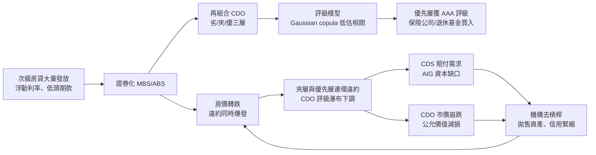

# 9.3 2008 次貸危機與 Gaussian Copula

## 本章導言

2008 年 9 月 15 日，雷曼兄弟破產，成為美國史上最大破產案；同週，保險巨頭 AIG 被政府接管，美林被併購。危機的火種是次級房貸，但把火種放大成全球金融海嘯的，是一組金融工程工具：**擔保債務憑證（CDO）**把數千筆房貸的違約風險切成優先、夾層與劣後層級出售；**信用違約交換（CDS）**為這些層級提供保險；而把數百個違約事件「黏」在一起定價的黏著劑，是 David X. Li 於 2000 年發表的**高斯 copula** 單因子模型——華爾街用一個參數「相關性」概括了數千筆貸款之間的所有相依結構。2009 年《Wired》雜誌的標題稱它為「殺死華爾街的公式」。本節把公式本身講清楚：它**做了什麼**、哪一步是近似、近似在哪裡失效，以及失效之後為何沒有人能夠全身而退——包括那些看起來與房貸毫無關聯的機構。

### Copula：把邊際黏成聯合的函數

設兩個資產的違約時間 $T_1, T_2$ 各有自己的累積分布 $F_1, F_2$ （邊際），市場需要的是**聯合**分布——特別是「兩者都早死」的機率，因為 CDO 的損失取決於**同時**違約的數量。Sklar 定理（1959）說：存在函數 $C$ 使

$$
P(T_1 \le t_1, T_2 \le t_2) = C\big(F_1(t_1), F_2(t_2)\big),
$$

$C$ 稱為 copula。Li（2000）借用壽險精算（8.1 節）的想法，選了最簡單的一種——**高斯 copula**：

$$
C(u, v) = \Phi_\rho\big(\Phi^{-1}(u),\, \Phi^{-1}(v)\big),
$$

其中 $\Phi$ 是標準常態分布、 $\Phi_\rho$ 是相關係數 $\rho$ 的二元常態。直觀：把兩個違約時間各自「常態化」，再假設常態化後的世界線性相關。Li 並給出條件生存的關鍵式：給定市場共同因子 $Z$ ，公司 $i$ 的條件違約時間為

$$
S(T_i \mid Z) = \Phi\!\left( \frac{\Phi^{-1}(F_i(T_i)) - \sqrt{\rho}\, Z}{\sqrt{1-\rho}} \right),
$$

它正是 7.3 節 Merton 模型「資產值跌破門檻即違約」的機率翻版——**模型本身就是 Merton 的一因子版本**，這是它能瞬間普及的原因：所有信用模型使用者的肌肉記憶都適用。

### 一個參數如何替數千筆貸款定價

交易員的作法：市場上可觀測的是 CDS 價差（邊際違約機率）與**分層價差**（tranche spread）；從後者反解出一個 $\rho$ （稱為**基差相關** base correlation），再用它推其他沒有市場報價的層級。整座 CDO 市場的定價，壓縮成一條「相關性微笑」。問題在於：**真實的違約相依不是常態**。房價是共同因子，房價下跌時所有地區的違約**同時**暴增——這是尾部極端的相依（tail dependence），而高斯 copula 恰好**沒有尾部相依**：在常態世界裡，「多筆同時違約」的極端事件的機率隨違約數增加呈指數衰減。用下面的例題看這個差別有多大。

**例題 9.3.1**：兩筆一年期貸款，各自違約機率均為 $p = 5\%$ （即 $F(t_1) = F(t_2) = 0.05$ ）。取 $\rho = 0.3$ 的高斯 copula，計算兩筆同時違約的機率；與獨立（ $\rho = 0$ ）及完全相依（ $\rho = 1$ ）比較。

**解**： $\Phi^{-1}(0.05) = -1.6449$ 。高斯 copula 下

$$
P(\text{同時違約}) = \Phi_\rho(-1.6449,\ -1.6449).
$$

用條件分解 $\int_{-\infty}^{-1.6449} \varphi(x)\, \Phi\!\left(\dfrac{-1.6449 - 0.3x}{\sqrt{0.91}}\right) dx$ 數值積分（ $\sqrt{0.91} = 0.9539$ ）：在 $x = -2.5, -2, -1.5$ 等點被積函數分別約為 $0.00305,\ 0.00738,\ 0.01363$ ，梯形法合計

$$
\Phi_{0.3}(-1.645,\,-1.645) \approx 0.0111.
$$

三個世界的比較：

| 相關結構 | 同時違約機率 | 倍數（對獨立） |
|---------|------------|--------------|
| 獨立 $\rho = 0$ | $0.05^2 = 0.0025$ | 1× |
| 高斯 copula $\rho = 0.3$ | $\approx 0.0111$ | 4.4× |
| 完全相依 $\rho = 1$ | $0.05$ | 20× |

**關鍵訊息**：單筆邊際違約率 5% 完全相同，聯合行為卻差 20 倍。AAA 評級的 CDO 優先層，賣的是「獨立世界」的尾部保護；當真實世界滑向完全相依（房價全國性下跌），優先層的損失機率不是變差一點，而是從「不可能」跳到「正在發生」。

### 危機鏈條

兩條正回饋在圖中閉合：**房價–違約迴路**（違約 → 法拍 → 房價更跌），與**去槓桿迴路**（減損 → 增資或縮表 → 拋售 → 價格更跌）。與 9.2 節股災相比，結構相同但時間尺度是「季」而非「分鐘」——順反饋不一定快，只要增益夠大。

### 會計與資本：失效如何被放大

模型的錯誤之所以致命，靠的是三層制度放大器。**一、資本規則**：AAA 層的風險權重極低，銀行與保險公司幾乎不必為它計提資本——模型輸出直接變成槓桿許可。**二、公允價值會計**：CDO 沒有活躍市場，估值依賴模型與同業報價（mark-to-model）；違約相關一旦真實化，同一批資產的「公允價值」連續瀑布下調，資本與損益同步蒸發（見《會計的數學》第 10 章）；**三、影子銀行**：SIV 與回購融資依賴短期資金，抵押品價值下跌觸發保證金追繳，把流動性風險接回償付能力。AIG 的倫敦子公司賣出數千億美元的 CDO 層級 CDS 保護，未提足額準備——保險數學（8.2 篂準備金遞推）的每一條原則都被繞過。

## 前因後果與驅動關係

**驅動力**：CDO 市場需要為「數百個違約事件的相依」定價，但全聯合分布無法從市場觀測——**降維是需求，不是懶惰**。Li 模型以「一個參數 + 與既有 Merton 框架相容」滿足了需求，於是被採用到超出其假設的範圍。理論（Sklar 定理本身）沒有錯，錯的是把「哪一種 copula」的選擇從統計問題降格為交易慣例。

**理論成熟後的反向改變**：危機後信用風險建模朝三個方向修正。其一，**承認模型不確定性**：巴塞爾 2.5／3 號協議要求信用與市場風險之外加計壓力測試資本；監管者從「信賴單一模型」轉向「對模型群做穩健性檢查」。其二，**copula 技術升級**：t-copula、動態 copula 與直接對共同因子（房價）建模的結構法，允許尾部相依；基差相關微笑成為研究對象而非報價工具。其三，**證券化萎縮與責任重整**：評級機構改變 CDO 評級方法並面臨訴訟，風險自留（skin in the game）條款要求發起人保留部分風險。與本書其他章節：copula 是 3.1 節相關矩陣思想在信用領域的延伸；其失效與 7.2 節極端值理論的教訓相同——**相依結構在尾部會改變**，用中段資料校準的參數在尾部不可信；9.1 節的資產端檢驗在此對應「評級是否描述了真實資產」；危機中的會計問題直接連到《會計的數學》第 10 章；《經濟的數學》第 9 章的資訊不對稱與《管理的數學》第 8 章決策分析，則提供了「在模型失效前，機構本可持有何種安全邊際」的分析框架。

## 練習

1. 用例題的方法，計算 $p = 5\%$ 、 $\rho = 0.6$ 時的高斯 copula 同時違約機率（ $\sqrt{1-0.36} = 0.8$ ，被積函數在 $x = -2.5, -2, -1.5$ 附近變化劇烈，請加密格點），並與 $\rho = 0.3$ 的結果比較其「跳升」程度。
2. 某夾層 CDO 層級在「共同因子 $Z$ 低於門檻」時開始虧損。以例題的條件生存式說明：為何當 $\rho$ 從 0.3 上調到 0.6，優先層的違約機率上升遠快於劣後層？（提示：劣後層早已承擔首批損失。）
3. 兩筆貸款邊際違約機率各 5%。用 t-copula（自由度 3）與高斯 copula（同 $\rho = 0.3$ ）的定性差異說明：為何 t-copula 給出的同時違約機率更高？這對 AAA 層定價的影響方向為何？
4. 某保險公司賣出名目 500 億美元的 CDO 優先層 CDS 保護，模型估計年虧損機率 0.1%、虧損期望為零。用 8.3 節 Lundberg 思想說明：若真實相關性使違約機率上升 20 倍，該公司需要多少資本才不至於破產？為何危機前 AIG 未計提？
5. 思考題：Li 模型被廣泛歸咎為危機元兇，但 Sklar 定理與 copula 數學本身是嚴謹的。請論證：真正的失敗點是 (a) 高斯族的選擇、(b) 用單一 $\rho$ 概括全部相依、(c) 將模型輸出直接接上資本規則，還是 (d) 使用者對模型假設的無知？這四者中哪些是「數學問題」，哪些是「制度問題」？

### 名詞速查表

- **Copula**：把各變數的邊際分布黏成聯合分布的函數（Sklar 定理，1959）。
- **高斯 copula**：以相關係數 $\rho$ 的二元常態構造的 copula；無尾部相依。
- **單因子模型**： $X_i = \sqrt{\rho} Z + \sqrt{1-\rho}\, \varepsilon_i$ ；Li（2000）與 Merton（1974）的共同骨架。
- **基差相關微笑**：由 CDO 分層市場價格反解出的隱含相關性隨層級而異的現象。
- **CDO / CDS**：把信用風險分層出售的憑證 / 為信用事件提供賠付的交換合約。
- **風險自留**：危機後要求證券化發起人保留部分風險的監管條款。

### 年表速查

- 1959：Sklar 定理確立 copula 的數學地位。
- 1974：Merton 結構化信用模型（7.3 節），單因子結構的源頭。
- 1987：David X. Li 生於中國；後於加拿大取得精算與統計訓練。
- 1990 年代：J.P. Morgan CreditMetrics（1997）以相關矩陣建模信用組合。
- 2000：Li 發表高斯 copula 單因子違約時間模型，迅速成為 CDO 定價標準。
- 2003–2006：CDO 發行量爆發式成長；基差相關微笑出現；合成 CDO 規模遠超實際房貸。
- 2007：房價轉跌，BBB 級房貸層違約率超過模型假設數倍；6 月 Bear Stearns 兩檔次貸基金倒閉；評級瀑布下調開始。
- 2008/3：Bear Stearns 賤售予 JPMorgan；9/7 AIG 被政府接管（注資 850 億美元起）；9/15 雷曼破產、美林售予美國銀行。
- 2009：學界與業界系統性轉向 t-copula、動態相關與結構化模型；監管要求壓力測試與風險自留。

（本節完）
