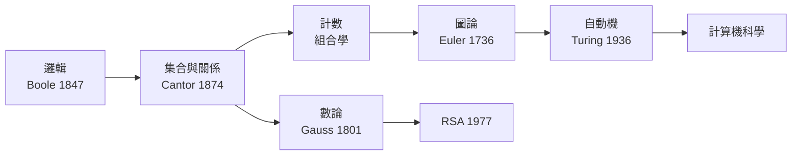

# 前言

## 0.1 從連續到離散的世界觀

微積分處理「連續流動」的世界，但電腦的世界是「一格一格」的：位元、整數、節點、狀態。離散數學正是這個有限／可數世界的數學。二十世紀下半葉，隨著電腦的誕生，原本被視為「數學邊角料」的組合學、圖論、數論、數理邏輯，一躍成為科技文明的地基。

## 0.2 離散數學與電腦科學的互動史

這門學科與電腦的關係是**雙向驅動**：

* **數學 → 電腦**：Boole 代數成為邏輯閘；圖論成為網路與資料結構；數論成為 RSA；自動機成為編譯器與 regex 引擎。
* **電腦 → 數學**：計算需求反過來催生新數學——演算法複雜度理論、計算幾何、密碼學協定，都是「為了讓機器能算」而生的學問。

本書各章都會標明這條因果鏈：一個問題（七橋、漢諾塔、金鑰交換）如何逼出一個數學結構（圖、遞迴、模運算），再如何變成今天的技術（網路分析、動態規劃、HTTPS）。

## 0.3 閱讀地圖

| 篇 | 主題 | 核心工具 | 對應的資訊技術 |
|---|---|---|---|
| 一 | 邏輯與集合 | 真值表、量詞、基數 | 資料庫查詢、型別系統 |
| 二 | 計數與遞迴 | 排列組合、生成函數 | 演算法分析、動態規劃 |
| 三 | 圖論 | Euler/Hamilton、樹、著色 | 網路、地圖、社群分析 |
| 四 | 數論、代數與自動機 | 同餘、群、有限狀態機 | 密碼學、編譯器、regex |

**建議路線**：

* **資訊系學生**：按順序，第一篇的證明訓練是全書地基。
* **重實作**：每一節都附 Python 範例，可邊讀邊跑；附錄 C 集中速查。
* **重理論**：注意每章證明所用的模式（歸納、反證、對角線、雙射），附錄 B 有總整理。

閱讀時請時時自問三個問題：**這個概念在解決什麼問題？它的反例長什麼樣？它驅動了後面的哪個技術？**——這正是離散數學最迷人的地方：它是一門「問題驅動、結構回答」的學問。
