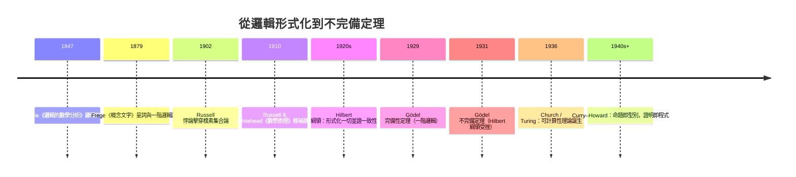
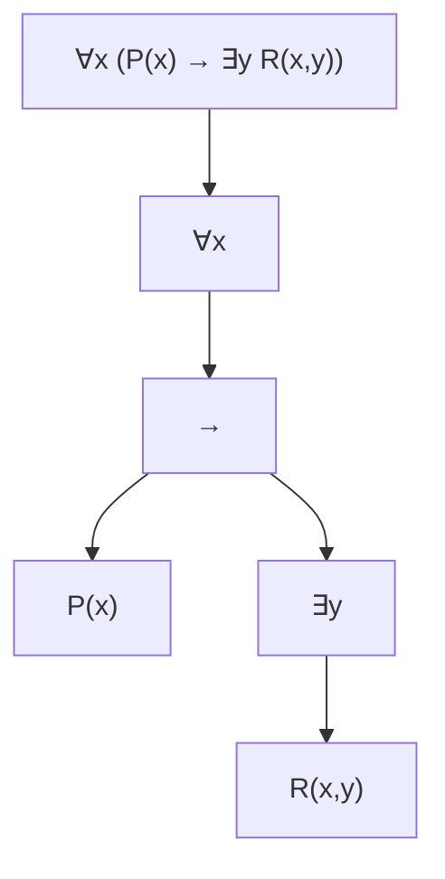

# 01.2 謂詞邏輯與量詞：數學敘述的精確語法

## 1. 命題邏輯的極限

命題邏輯把「蘇格拉底會死」當成一個原子 $p$，於是經典論證

> 所有人都會死；蘇格拉底是人；所以蘇格拉底會死。

只能寫成 $p \land q \to p$——根本不是恆真式！問題在於「所有人都會死」**不是原子**：它內含「所有」這個量詞，把個體（人）與性質（會死）連結起來。命題邏輯看不見這個結構，因此無法表達幾乎所有數學定理。

**Frege（1879）《概念文字》**首次引進量詞與關係符號，建立了足以承載全部數學證明的語法。Frege 的目標是宏大的：證明算術純粹是邏輯的延伸（邏輯主義）。這條路線經 Peano 公理化、Russell 與 Whitehead《數學原理》（1910–1913）發展，最後在羅素悖論（02.1 節）與 Hilbert 綱領、Gödel 不完備定理（本節第 6 節）的歷史脈絡中重塑了整個數學基礎。本節先學好這套語法本身——**它也是所有證明（01.3 節）的文法**。

## 2. 謂詞、論域與變數

**定義 2.1（論域）**：論域（universe/domain）$D$ 是變數所能取值的全體對象集合。

**定義 2.2（謂詞）**：謂詞 $P(x_1, \dots, x_n)$ 是一個從 $D^n$ 映到真值的敘述模板。代入具體對象後成為命題。

**範例 2.3**：設 $D = \mathbb{N}$。
- $P(x)$：「$x$ 是質數」。$P(7) = T$，$P(8) = F$。
- $L(x,y)$：「$x < y$」。$L(3,5) = T$，$L(5,5) = F$。

**關鍵觀察**：謂詞 $P(x)$ 類似程式中的函數回傳 `bool`。事實上這正是 **Curry–Howard 對應**的預告：命題與型別同構，$P(x)$ 就像「型別為 $P$ 的證明需要一個 $x$ 參數」——下一章我們會反覆看到「邏輯構造 = 資料構造」。

**範例 2.4（Python 對照）**：

```python
def is_prime(x: int) -> bool:
    if x < 2: return False
    return all(x % k for k in range(2, int(x**0.5) + 1))

# 謂詞 = 回傳 bool 的函數
print(is_prime(7))   # True  <-> P(7)
print(is_prime(8))   # False <-> P(8)

# "存在小於100的最大質數" 可由窮舉驗證一階命題
largest = max(p for p in range(100) if is_prime(p))
print(largest)       # 97
```

## 3. 量詞：$\forall$ 與 $\exists$

**定義 3.1**：給定論域 $D$ 與謂詞 $P(x)$：

- **全稱量詞** $\forall x\, P(x)$：對 $D$ 中**所有** $x$，$P(x)$ 為真。Python 對應 `all(P(x) for x in D)`。
- **存在量詞** $\exists x\, P(x)$：$D$ 中**存在**某個 $x$ 使 $P(x)$ 為真。Python 對應 `any(P(x) for x in D)`。

**定理 3.2（量詞否定，De Morgan 律的推廣）**：

$$\neg \forall x\, P(x) \equiv \exists x\, \neg P(x), \qquad \neg \exists x\, P(x) \equiv \forall x\, \neg P(x)$$

**證明**：$\forall x P(x)$ 為假，若且唯若存在某 $x_0$ 使 $P(x_0)$ 為假，即 $\exists x\, \neg P(x)$ 為真。第二式由第一式與雙重否定得：$\neg\exists x P(x) \equiv \neg \neg \forall x \neg P(x) \equiv \forall x \neg P(x)$。$\blacksquare$

這條定理極為實用：**否定一個命題，就是把量詞反轉後否定內部**。例：「所有學生都及格」的否定是「存在一個學生不及格」——不是「所有學生都不及格」。

**多重量詞**：順序決定意義。
- $\forall x \exists y\, (y > x)$：真（任何數都有更大的數）。
- $\exists y \forall x\, (y > x)$：假（不存在大於所有數的 $y$）。

口訣：**$\forall\exists$ 是「對每個，有個（可能不同）的」；$\exists\forall$ 是「有一個通吃全部的」**。分析學的極限定義（$\forall \varepsilon\, \exists \delta$）與其否定（$\exists \varepsilon\, \forall \delta$）正是此處的經典戰場。

## 4. 數學敘述的形式化

**範例 4.1**：把下列敘述寫成謂詞邏輯（論域 $\mathbb{R}$）：

| 敘述 | 形式化 |
|------|--------|
| 每個實數都有相反數 | $\forall x \exists y\, (x + y = 0)$ |
| 存在乘法單位元素 | $\exists e \,\forall x\, (x \cdot e = x)$ |
| 極限的 $\varepsilon$-$\delta$ 定義 | $\forall \varepsilon{>}0\, \exists \delta{>}0\, \forall x\, (|x-a|<\delta \to |f(x)-L|<\varepsilon)$ |
| 「$f$ 在 $a$ 不連續」 | $\exists \varepsilon{>}0\, \forall \delta{>}0\, \exists x\, (|x-a|<\delta \land |f(x)-f(a)|\ge \varepsilon)$ |

**範例 4.2（否定實戰：Goldbach 猜想）**：

$$\text{G} \equiv \forall n\, \big(n \text{ 為偶數且 } n > 2 \to \exists p \exists q\, (p, q \text{ 質} \land p + q = n)\big)$$

其否定為：

$$\neg \text{G} \equiv \exists n\, \big(n \text{ 偶} \land n>2 \land \forall p \forall q\, (\neg(p \text{ 質} \land q \text{ 質}) \lor p+q \ne n)\big)$$

即「存在一個大於 2 的偶數，不能寫成兩質數之和」。Goldbach 猜想至今未被證明或否證——謂詞邏輯讓我們能**精確說出**這個未解之謎在問什麼。

**範例 4.3（Python 驗證量詞否定）**：

```python
D = range(1, 21)

# 敘述：「所有元素都大於 5」
stmt = all(x > 5 for x in D)          # False
# 否定等價於「存在元素 <= 5」
neg1 = not stmt
neg2 = any(x <= 5 for x in D)
assert neg1 == neg2                   # 定理 3.2 的程式驗證

# 驗證 ∀∃ ≠ ∃∀
forall_exists = all(any(y > x for y in D) for x in D)     # True
exists_forall = any(all(y > x for x in D) for y in D)     # False
```

## 5. 一階邏輯的語法與語意

**定義 5.1（一階語法的生成規則）**：由項（變數、常數、函數套用）與原子公式（$R(t_1,\dots,t_n)$）出發，用 $\neg, \land, \lor, \to$ 與量詞 $\forall x, \exists x$ 遞迴構造公式。變數 $x$ 在 $\forall x\, \varphi$ 中受**約束**；不在任何量詞管轄內者為**自由**變數。

- $\forall x\, (x>0)$：$x$ 受約束，是閉公式（語句），有固定真值。
- $x > 0 \to y > 0$：$x, y$ 自由，真值依賴指派。

**束縛與代換**：$\forall x\, P(x,y)$ 中 $y$ 自由；若對 $y$ 代入 $3$，得 $\forall x\, P(x,3)$。**必須避免變數捕捉**：對 $\forall y\, P(x,y)$ 的自由 $x$ 代入 $y$ 是非法的（會改變約束關係）。這個技術細節在 $\lambda$ 演算與函數式程式設計（影子變數、$\alpha$-等價）中完全重現。

**定理 5.2（完備性，Gödel 1929 博士論文）**：一階邏輯中，凡語意上有效（所有模型皆真）的公式，皆可由公理系統形式地證明。這條「語意 = 語法」定理是形式化證明（01.3 節）合法性的基石。

**但完備性 ≠ 完備性！** 注意 1931 年 Gödel 的**不完備定理**說的是另一回事：在足夠強的理論（如 Peano 算術）內，存在**真但不可證**的算術語句。1929 年的完備性定理說「一階邏輯本身夠強」；1931 年的定理說「任何含算術的公理系統不夠強」。兩者並不矛盾——完備性是對**邏輯演繹系統**而言，不完備性是對**數學理論**（含自然數的公理）而言。這組對比是理解 Hilbert 綱領命運的鑰匙。

## 6. 歷史動線：Frege → Russell → Hilbert → Gödel



Frege 想用邏輯推出算術；Russell 發現悖論顯示樸素的「性質集合」觀念會自毀；Hilbert 退一步主張「用有限、機械的證明證明數學自身一致」；Gödel 用「語句編碼自身」（對角線構造，見 01.3 節與 Cantor 對角線法的血緣）證明這個夢想注定部分失敗——但證明過程中的編碼技術，直接導致了 Turing 機器與可計算性理論。**一門「失敗」的研究，孕育了電腦科學。**

**範例 5.3（語法樹與程式解析器）**：一階公式的結構是**遞迴生成**的，因此可畫成語法樹——這正是編譯器解析程式的原理：



變數 $x$ 的兩次出現都被 $\forall x$ 約束；$y$ 被 $\exists y$ 約束。語法樹的每個節點是邏輯連接詞或量詞，葉子是原子公式——**公式的意義由樹自底向上遞迴計算**，與 01.1 節的真值表求值、未來章節的表達式樹完全一致。

## 7. 習題

1. 論域 $\mathbb{Z}$，令 $E(x)$ 表「$x$ 為偶」。形式化「兩偶數之和為偶數」與「不是所有奇數都是質數」。
2. 寫出 $\forall x \exists y\, (x + y = 1)$ 在論域 $\mathbb{R}$ 與 $\mathbb{N}$ 下的真值，並說明**論域選擇改變命題真值**。
3. 否定：「對每個 $\varepsilon > 0$，存在 $\delta > 0$ 使所有 $x > \delta$ 皆有 $f(x) > 0$」，並用 Python 窮舉一個離散例子驗證否定正確。
4. 判斷自由變數：$\big(\forall x\, P(x) \to Q(x)\big) \lor R(x)$。
5. 證明：$\exists x \forall y\, (x + y = y)$ 在 $\mathbb{R}$ 為真，且這樣的 $x$ 唯一（用 01.3 節的唯一存在寫法 $\exists x (P(x) \land \forall y(P(y) \to y = x))$）。

## 8. 小結與下一步

- 命題邏輯看不見句子內部結構；謂詞邏輯以**論域、謂詞、量詞**達到表達所有數學敘述的能力。
- 量詞否定律是轉換命題的核心工具；$\forall\exists$ 與 $\exists\forall$ 的順序差異是極限、連續等概念的成敗關鍵。
- Frege 1879 的語法 → Russell 悖論 → Hilbert 綱領 → Gödel 1929/1931，是現代邏輯的主幹劇情。
- Gödel 完備性（1929）與不完備（1931）談的是不同對象：前者是演繹系統，後者是含算術的理論。

**下一步**：有了精確語法，接下來要問：**什麼樣的論證是證明？** 01.3 節系統介紹直接證明、反證法、數學歸納法、窮舉與唯一存在，並以 Cantor 對角線法與 Gödel 自指構造展示「證明技術本身如何驅動數學史」。
