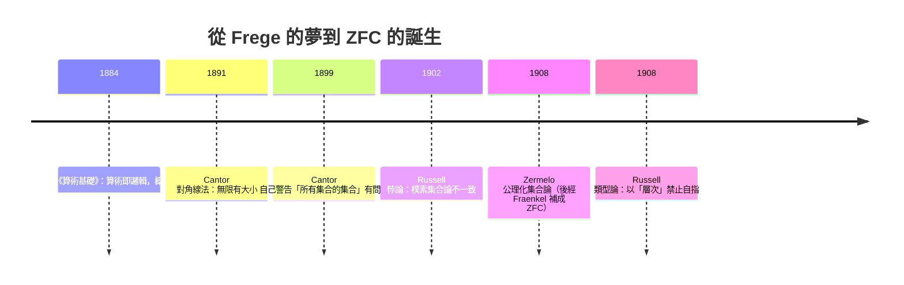

# 02.1 集合運算與羅素悖論：樸素集合論的危機

## 1. 集合：Frege 夢想的基礎

集合（set）是數學最基本的名詞：由確定對象彙集而成的整體。Cantor（1874–1884）建立集合論時的雄心，是把它變成**全部數學的地基**：自然數可由集合定義（von Neumann 序數 $0 = \varnothing$ ， $1 = \{\varnothing\}$ ， $2 = \{\varnothing, \{\varnothing\}\}$ ，…），實數可由自然數的子集構造，分析學的一切都可還原。Frege 在《算術基礎》（1884）中走的正是這條路：**每個性質 $\varphi(x)$ 決定一個集合 $\{x : \varphi(x)\}$ **（概括公理，Comprehension Axiom）。

這條公理聽起來無害且強大得驚人——任何可敘述的性質都能造集合。1901–1902 年，Russell 卻發現它自毀了。

## 2. 基本運算：與 01.1 節的同構

**定義 2.1**：設 $A, B$ 為宇集 $U$ 的子集。

| 運算 | 定義 | 邏輯對應 |
|------|------|----------|
| 聯集 | $A \cup B = \{x : x \in A \lor x \in B\}$ | $\lor$ |
| 交集 | $A \cap B = \{x : x \in A \land x \in B\}$ | $\land$ |
| 補集 | $\bar{A} = \{x : x \notin A\}$ | $\neg$ |
| 差集 | $A - B = \{x : x \in A \land x \notin B\}$ | $\land \neg$ |
| 對稱差 | $A \triangle B = (A - B) \cup (B - A)$ | $\oplus$ |
| 冪集 | $\mathcal{P}(A) = \{S : S \subseteq A\}$ | — |

**定理 2.2（De Morgan 律的集合版）**： $\overline{A \cup B} = \bar{A} \cap \bar{B}$ 。

**證明**（兩路包含法，集合恆等式的標準技術）：
- （ $\subseteq$ ）設 $x \in \overline{A \cup B}$ ，即 $x \notin A \cup B$ ，即 $\neg(x \in A \lor x \in B)$ 。由 01.1 節 De Morgan 律得 $x \notin A \land x \notin B$ ，故 $x \in \bar A \cap \bar B$ 。
- （ $\supseteq$ ）反向逐步倒推即可（每步皆為雙向等價）。 $\blacksquare$

**範例 2.3（Python 集合即 Boole 代數）**：

```python
U = {1, 2, 3, 4, 5, 6, 7, 8}
A = {1, 2, 3, 4}
B = {3, 4, 5, 6}

assert (A | B) and True            # 聯集 A ∪ B
assert A & B == {3, 4}             # 交集
assert U - A == {5, 6, 7, 8}       # 補集
assert A ^ B == {1, 2, 5, 6}       # 對稱差

# 驗證 De Morgan 律（集合版）
assert U - (A | B) == (U - A) & (U - B)

# 冪集
from itertools import chain, combinations
def powerset(s):
    return list(chain.from_iterable(combinations(s, r) for r in range(len(s)+1)))
print(len(powerset({1, 2, 3})))    # 8 = 2^3，定理見 02.3 節
```

這裡的深刻訊息：**Python 的集合運算子 `| & ~` 就是 Boole 代數**。01.1 節的「邏輯等價律」與本節的「集合恆等式」是同一組公理的兩個模型——數學的抽象結構觀由此可見。

## 3. 羅素悖論：概括公理的崩潰

**羅素悖論（Russell, 1902 年給 Frege 的信）**：考慮性質「 $x$ 不屬於自己」，依概括公理造集合

$$R = \{x : x \notin x\}$$

問： $R \in R$ ？

- 若 $R \in R$ ：依 $R$ 的定義， $R \notin R$ 。矛盾。
- 若 $R \notin R$ ：則 $R$ 滿足入會條件，故 $R \in R$ 。矛盾。

兩種情況皆矛盾。**這不是謬誤，而是形式系統內的真矛盾**——Frege 的體系蘊含 $R \in R \leftrightarrow R \notin R$ ，因此不一致。

**Frege 的反應**是誠實而悲壯的：他在《算術基本法則》第二卷（1903）的附記中承認「算術的基石動搖了」。這封信的衝擊不亞於一次數學地震：



**日常比喻**：「村裡唯一的理髮師只替不自己刮鬍的人刮鬍」——他該不該替自己刮？這個理髮師悖論是羅素悖論的通俗版，但它有出路（那個理髮師不存在）；羅素悖論的殺傷力在於**概括公理證明那個集合「存在」**，無法輕易否認。

**與 Gödel 的深層連結**：羅素悖論與 Gödel 不完備定理、Cantor 對角線法、Turing 停機問題共用同一個結構——**自我指涉**。用命題邏輯表達對角線化的共同核心：

$$\varphi(x) \ \leadsto\ \varphi(\ulcorner \varphi \urcorner)$$

Cantor：對角翻轉集合的成員關係；Russell：「屬於自己」這個謂詞套用於自身；Gödel：「不可證」這個謂詞套用於自己的編碼；Turing：程式讀入自己並行為相反。**凡有足夠表達力的系統，自指都是陷阱或動力**。

## 4. ZFC：公理化後的集合論

Zermelo（1908）的藥方：**限制造集的權力**。不再允許「任意性質造集合」，只允許「從既有集合中依性質**分離**出子集」（分離公理）。經 Fraenkel 補充，現代標準是 ZFC：

1. **外延公理**：兩集合相等當且唯若元素相同。
2. **分離公理**：對集合 $A$ 與性質 $\varphi$ ， $\{x \in A : \varphi(x)\}$ 是集合。*羅素集合 $R$ 造不出來了：它需要全域的 $x$ ，而現在 $x$ 必須先屬於某個既有集合。*
3. **配對、聯集、冪集公理**：基本構造的合法性。
4. **無限公理**：存在無限集合。
5. **正則公理（基礎公理）**：沒有集合屬於自身——直接禁止 $R \in R$ 這種回路。
6. **選擇公理（AC）**：從一族非空集合中可各選一元。爭議最大，其地位與後果見 02.3 節。

**定理 4.1（ZFC 下無羅素悖論）**：ZFC 中不存在滿足 $\forall x (x \in A \leftrightarrow x \notin x)$ 的集合 $A$ 。

**證明**：若存在，如第 3 節推出 $A \in A \leftrightarrow A \notin A$ ，矛盾。 $\blacksquare$

這個「定理」看似平凡，卻是 1902 年後數學家最渴望聽到的話：**矛盾被隔離了，而不是被修辭掩蓋**。代價是數學基礎從「顯而易見」變成「公理選擇」——這正是 Hilbert 綱領想進一步解決的問題：能否**證明** ZFC 一致？Gödel 1931 的回答（在含算術的系統內不可能）再次改寫了劇本。

## 5. 分割與分離的計算實踐

**範例 5.1（分離公理的程式版）**：

```python
# ZFC 分離公理：從既有集合中依性質取子集
A = list(range(-10, 11))
evens = [x for x in A if x % 2 == 0]      # {x ∈ A : x 為偶}

# 「全域概括」在程式中同樣危險：
# 試圖定義 R = {x : x ∉ x} 對一般對象無意義——
# 不是所有對象都有「屬於」關係，正如 ZFC 禁止自由造集

# 正則公理的體現：資料結構不允許自包含
class Node:
    def __init__(self, v):
        self.v = v
        self.next = None
n = Node(1)
# n.next = n  # 自指鏈表會造成無窮迴圈，如同 x ∈ x 的集合被正則公理排除
```

**範例 5.2（容斥原理——集合運算的計數應用）**：

$$|A \cup B \cup C| = |A| + |B| + |C| - |A \cap B| - |A \cap C| - |B \cap C| + |A \cap B \cap C|$$

```python
students = {"數學", "物理", "化學", "數學物理", "生化", "資工", "數化"}
M = {s for s in students if "數" in s}
P = {s for s in students if "物" in s}
C = {s for s in students if "化" in s}
assert len(M | P | C) == (len(M) + len(P) + len(C)
                          - len(M & P) - len(M & C) - len(P & C)
                          + len(M & P & C))
```

容斥原理是組合計數的主力工具，其一般形式將在第 03 章（組合數學）的鴿籠與計數中反覆出現。

## 6. 習題

1. 用兩路包含法證明 $A \triangle A = \varnothing$ 與 $A \triangle \varnothing = A$ （對稱差是「模 2 加法」，這觀察通往第 04 章的 $\mathbb{Z}_2$ ）。
2. 用 01.1 節的真值表程式，驗證 $(A - B) \cup (B - A) = (A \cup B) - (A \cap B)$ 對 $A, B \subseteq \{1,2,3\}$ 的所有組合成立。
3. 解釋：為什麼在 ZFC 中可以安全地談論 $\{x \in \mathbb{N} : x \notin x\}$ ？（提示：對 $x \in \mathbb{N}$ 而言 $x \notin x$ 恆真，此集合其實就是 $\mathbb{N}$ 。）
4. 羅素悖論與「理髮師悖論」有何本質差別？（答案線索：理髮師故事的結局是「無此人」；Frege 的系統卻由公理**保證**羅素集合存在。）
5. 證明容斥原理的兩集合版本： $|A \cup B| = |A| + |B| - |A \cap B|$ （把 $A \cup B$ 拆成三個互斥區域）。
6. 正則公理禁止 $x \in x$ 。討論：這是「證明」了自指集合不存在，還是「假設」了它不存在？這種公理選擇的自由，與 01.3 節反證法對排中律的依賴有何呼應？

## 7. 小結與下一步

- 集合運算與命題邏輯同構：兩個模型、一組公理，抽象結構思想成形。
- Frege 的概括公理 + Russell 1902 悖論 = 樸素集合論的崩潰；分離公理與正則公理將矛盾隔離。
- 自指結構貫穿 Cantor、Russell、Gödel、Turing——形式化越強，自指越鋒利。
- ZFC 是「災後重建」的標準答案，但其一致性本身無法在內部證明（Gödel II）。

**下一步**：集合有了安全的公理基礎，接著要研究集合之間的**結構性連結**。02.2 節引進關係（二元關係、等價關係、偏序），並回答一個關鍵問題：**等價類如何把一個集合「壓縮」成商集合**——這是定義 $\mathbb{Z}_n$ 、有理數、乃至一切數學對象的通用手法。
