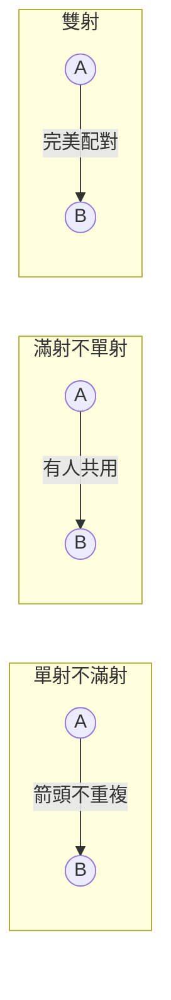

# 02.3 函數與基數：可數與不可數無限的分界

## 1. 函數：數學的「箭頭」

等價類（02.2）把對象合併成新的宇宙；**函數**則是宇宙之間的箭頭。從 Dirichlet（1837）以「任意對應規則」取代 Euler 時代的解析式定義起，函數成為現代數學的通用語言——從集合到集合的對應，不再需要公式。這個抽象化不是無聊的形式主義：正是它允許我們**把「兩集合一樣大」定義成「存在兩集合間的雙射」**，從而為無限集合稱重——Cantor 1874–1895 年的革命。

## 2. 函數的基本定義與分類

**定義 2.1（函數）**：函數 $f : A \to B$ 是 $A \times B$ 的子集，滿足：每個 $a \in A$ 恰有一個 $b \in B$ 使 $(a, b) \in f$（**良定義 + 全域定義**）。$A$ 為定義域，$B$ 為對應域，$f(A)$ 為值域。

與 02.2 節呼應：02.2 的「良定義」問題正是函數定義的第一半——**代表元不同時輸出必須相同**。

**定義 2.2（三種箭頭）**：

- **單射**（injective）：$a \ne a' \Rightarrow f(a) \ne f(a')$。等價：$f(a) = f(a') \Rightarrow a = a'$。不撞車。
- **滿射**（surjective）：$f(A) = B$。都打到。
- **雙射**（bijective）：兩者兼具。一一對應。



**定理 2.3（計數定理）**：對有限集，$|A| = |B|$ 若且唯若存在雙射 $A \to B$；存在單射 $A \to B$ 則 $|A| \le |B|$；存在滿射 $A \to B$ 則 $|A| \ge |B|$（$B \ne \varnothing$）。

這條定理在有限世界是常識，但 Cantor 的天才在於**把它原封不動搬到無限世界當定義**：

**定義 2.4（基數比較）**：$|A| \le |B|$ 若存在單射 $A \to B$；$|A| = |B|$ 若存在雙射；$|A| < |B|$ 若前者成立而後者不成立。

**範例 2.5（無限的第一次驚嚇：Hilbert 旅館）**：$\mathbb{N} \to \mathbb{N} \setminus \{0\}$，$n \mapsto n+1$ 是雙射。**無限集合可以與自己的真子集等基數**——這正是 Dedekind 對「無限」的定義。Galileo 在 1638 年就為「平方數不比自然數多也不少」感到不安；Cantor 的回答是：不安的來源是把有限直覺強加於無限。

```python
# Hilbert 旅館：滿房仍可再收一位客人
def move_guests():
    # 原客人 n → 房號 n+1，房 1 空出給新客
    return {n: n + 1 for n in range(1, 11)}
print(move_guests())   # {1: 2, 2: 3, ..., 10: 11}

# 雙射驗證的小工具
def is_bijection(f, A, B):
    vals = [f(a) for a in A]
    return len(vals) == len(set(vals)) and set(vals) == set(B)
print(is_bijection(lambda n: n + 1, range(10), range(1, 11)))  # True
```

## 3. 可數與不可數

**定義 3.1**：集合 $A$ **可數**（countable）若 $|A| \le |\mathbb{N}|$（可列成有限或無窮序列）；**可數無限**若與 $\mathbb{N}$ 雙射；否則**不可數**。

**定理 3.2**：$\mathbb{Z}$ 可數無限；$\mathbb{N} \times \mathbb{N}$ 可數無限；$\mathbb{Q}$ 可數無限。

**證明（$\mathbb{Q}$，Cantor 1874 的梳狀枚舉）**：把既約分數 $\frac{p}{q}$（$q > 0$）按 $|p| + q$ 的「對角高度」分層列出，層內任意排序。每個高度只有有限多個分數，故每個分數終將獲得編號——這構造出滿射 $\mathbb{N} \to \mathbb{Q}$，再抽出雙射（可數集合的子集仍可數）。$\blacksquare$

**幾何圖像（蛇形對角掃描）**：

```
(0,0) (0,1) (0,2) ...
(1,0) (1,1) (1,2) ...
(2,0) (2,1) (2,2) ...
沿反對角線蛇行：(0,0), (1,0), (0,1), (0,2), (1,1), (2,0), ...
```

「可數個可數集合的聯集仍可數」——對角掃描是證明此點的標準技術。

**定理 3.3（Cantor，1874/1891）：$\mathbb{R}$ 不可數。**

**證明**：即 01.3 節定理 6.1 的對角線法：任何 $\mathbb{N} \to (0,1)$ 的列表都漏掉一個對角構造的實數。故不存在 $\mathbb{N}$ 與 $\mathbb{R}$ 的雙射。$\blacksquare$

**注意對角線法的「非對角」前置版本**：Cantor 1874 的原始證明用的是區間套（完備性），對角線法是 1891 年的精煉——**方法本身也在進化**，且 1891 版更容易推廣到任意集合（見定理 3.5）。

**定理 3.4（$\mathbb{R} \approx \mathcal{P}(\mathbb{N})$）**：$|\mathbb{R}| = 2^{\aleph_0}$。

**證明（構造雙射的核心步驟）**：$(0,1)$ 的實數可用二進位展開對應 $\{0,1\}^{\mathbb{N}}$（全體 $0/1$ 數列）中的數列（除去雙展開的歧義，$0.0111\cdots = 0.1000\cdots$，可用標準化處理）。而 $\{0,1\}^{\mathbb{N}}$ 顯然雙射於 $\mathcal{P}(\mathbb{N})$（數列 $\leftrightarrow$ 子集：位置 $i$ 為 $1 \leftrightarrow i$ 在子集中）。$\blacksquare$

**定理 3.5（Cantor 定理，1891）**：對**任何**集合 $A$，$|A| < |\mathcal{P}(A)|$。

**證明**：
- 單射：$a \mapsto \{a\}$ 是 $A \to \mathcal{P}(A)$ 的單射，故 $|A| \le |\mathcal{P}(A)|$。
- 無雙射：設 $f : A \to \mathcal{P}(A)$ 任給。造對角集合 $D = \{x \in A : x \notin f(x)\}$。若 $D = f(d)$ 對某 $d$，則 $d \in D \iff d \notin f(d) = D$——矛盾。（**這正是羅素悖論的集合論原型**：$\neg(d \in f(d) \leftrightarrow d \in D)$ 的結構與 02.1 節 $R \in R \leftrightarrow R \notin R$ 完全一致，只是用在「證明不存在」而非「引發爆炸」。）$\blacksquare$

**推論**：$|\mathbb{N}| < |\mathbb{R}| < |\mathcal{P}(\mathbb{R})| < \cdots$。**無限不是一個，而是一座無窮的塔**。

```python
# Cantor 定理的有限模擬：D = {x : x ∉ f(x)} 必不在 f 的值域中
def diagonal_D(A, f):
    return {x for x in A if x not in f(x)}

A = {1, 2, 3}
f = {1: {1, 2}, 2: {2, 3}, 3: set()}     # 任何 f : A -> P(A)
D = diagonal_D(A, f)
print(D)                                  # {2, 3}
assert D not in f.values()                # D 永遠漏網 —— Cantor 定理

# 2^n 個子集：有限版冪集大小
print(len({frozenset(s) for s in
           [{1},{2},{3},{1,2},{1,3},{2,3},{1,2,3},set()]}))  # 8
```

## 4. 連續統假設與選擇公理：地基的邊界

既然 $\aleph_0 = |\mathbb{N}| < 2^{\aleph_0} = |\mathbb{R}|$，自然要問：**中間還有基數嗎？**

**連續統假設（CH）**：不存在基數 $\kappa$ 使 $\aleph_0 < \kappa < 2^{\aleph_0}$。

答案震驚了所有人：
- **Gödel（1940）**：ZFC $\nvdash \neg$CH（構造可構造宇宙 $L$，CH 在其中成立）。
- **Cohen（1963，Fields 獎）**：ZFC $\nvdash$ CH（力迫法 forcing）。

**CH 在 ZFC 中獨立**——它是無法從現行公理判定真偽的問題。這正是 Gödel 1931 不完備定理的宏觀版本：**公理化不是終點，有些問題註定懸而未決**。Hilbert 1900 年提出的 23 個問題中，第一個就是 CH，百年後答案是「兩邊都證不出」。

**選擇公理（AC）**同樣戲劇化：Zermelo 1904 用它證明良序原理，遭 Borel、Lebesgue 猛烈反對；Gödel 證明 ZFC $\nvdash \neg$AC，Cohen 證明 ZFC $\nvdash$ AC——AC 也獨立。Banach–Tarski 悖論（球可分解重組成兩顆同大球）是 AC 的駭人後果，但 Lebesgue 測度的良好理論又需要它。**數學家最終選擇 ZFC 作為標準框架，是一種工程折衷，而非真理裁定。**

## 5. 不可數的工程意義

不可數不只是抽象玄談，它劃定了計算的邊界：

- 全體程式是可數的（有限字元串的序列），全體實函數不可數。**因此存在不可計算的函數**——這就是 Turing 1936 停機問題不可判定的計數版論證（鴿籠原理的無限版！）：可計算函數 $\subsetneq$ 全部函數。
- 密碼學中「真隨機實數」（如 Chaitin 的 $\Omega$）不可計算，正因其定義依賴不可數域上的對象。

```python
# 計數論證的模擬：可數個程式 vs 不可數個函數
# 每個 Python 程式是有限字串 -> 程式集合可數
def program_strings(max_len):
    alphabet = "01()x:+<>= \n"
    for L in range(1, max_len + 1):
        # 有限字母表上的有限長度字串：可數多
        yield from ("".join(p) for p in
                    __import__("itertools").product(alphabet, repeat=L))

# 全體 {0,1} 數列（即 P(N)）不可數 —— 01.3 習題 5 的對角線
# 結論：必然存在不可計算的 {0,1} 數列（如 Chaitin Ω）
print("程式：可數；數列：不可數；故有不可計算的數列。")
```

## 6. 習題

1. 證明 $f : \mathbb{Z} \to \mathbb{Z}$，$f(n) = 2n$ 是單射但非滿射；構造 $\mathbb{Z} \to \mathbb{Z}$ 的滿射非單射函數。
2. 用蛇形對角掃描寫出 $\mathbb{N} \times \mathbb{N} \to \mathbb{N}$ 的明確公式（Cantor 配對函數），並用 Python 驗證它是雙射（至少到 $10 \times 10$）。
3. 證明：全體代數數（整係數多項式的實根）可數。推論：超越數存在（Cantor 1874 的原始副產品！）——這是「不可數性證明存在性」的典範。
4. 證明 $\mathcal{P}(\mathbb{N})$ 中「幾乎皆為 0 的數列」全體是可數的；而全體數列不可數。兩者的差別說明了什麼？
5. 寫 Python 程式：對 $A = \{1,\dots,5\}$ 的**所有**函數 $f : A \to \mathcal{P}(A)$（共 $2^{25}$ 個太多，改抽樣）計算 $D = \{x : x \notin f(x)\}$，驗證 $D$ 恆不在 $f$ 的值域。
6. 討論：Hilbert 旅館可收無限新客（每位舊客搬到自己編號兩倍的房間）。若來了**可數無限多團**新客呢？寫出房間重配方案（提示：$\mathbb{N} \times \mathbb{N}$ 可數）。

## 7. 小結與下一步

- 函數 = 特殊的關係；單射/滿射/雙射是「大小比較」的語言。
- Cantor 把有限計數定理提升為無限定義，誕生基數理論。
- 對角掃描證 $\mathbb{Q}$ 可數；對角線法證 $\mathbb{R}$、$\mathcal{P}(\mathbb{N})$ 不可數；Cantor 定理 $|A| < |\mathcal{P}(A)|$ 築起無限之塔。
- CH 與 AC 在 ZFC 中獨立：公理系統有其極限（Gödel 不完備的巨觀餘響）。
- 程式可數、函數不可數 ⇒ 不可計算性存在：基數理論直接預告可計算性理論。

**下一步**：無限的「大小」已經分層；接著看**可計算的「難度」如何分層**。下一章從計數與組合（鴿籠、容斥、生成函數）開始，逐步走向圖論（Cayley 1857 化學樹）、演算法複雜性，最終抵達 P vs NP——一個由對角線法與歸約驅動的當代懸案。
