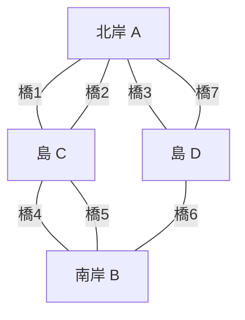
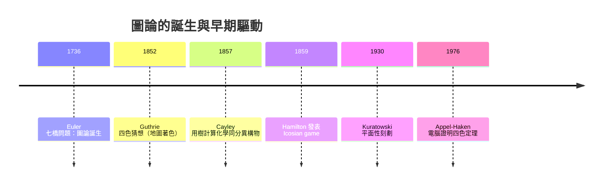

# 05.1 圖論的誕生：Euler 1736 七橋問題與圖的定義

## 1. 歷史前因：為什麼 1736 年的 Königsberg 改變了數學？

18 世紀的 Königsberg（今俄羅斯 Kaliningrad）是普魯士的貿易重鎮，Pregel
河將城市切成四塊陸地：兩岸（A、B）與兩座河中島（C、D）。七座橋將這四塊
陸地連接起來。市民閒暇時流行一個問題：

> 能否從任一地出發，**恰好走過每座橋一次**，然後回到起點？

這個問題在當時被視為「幾何」問題，但它與長度、角度無關——這正是它革命
性的地方。1736 年，Euler 在聖彼得堡科學院發表 *Solutio problematis ad
geometriam situs pertinentis*（關於位置幾何問題的解），明確指出：

> 「此問題與距離無關，只與**相對位置（geometry of position）**有關。」

Euler 的洞見是：**把每塊陸地縮成一個點，把每座橋畫成一條線**，問題瞬間
變成純粹的「連接結構」問題。這就是史上第一張「圖」，圖論由此誕生。



## 2. 圖的正式定義

**定義 2.1（圖）**：一個圖是二元組 $G = (V, E)$ ，其中
- $V$ 是頂點（vertex）的有限集合；
- $E \subseteq \{\{u,v\} : u, v \in V,\ u \neq v\}$ 是邊（edge）的集合。

若 $\{u,v\} \in E$ ，稱 $u$ 與 $v$ **相鄰（adjacent）**，記作 $u \sim v$ 。

**定義 2.2（度數）**：頂點 $v$ 的度數 $d(v)$ 是與 $v$ 相接的邊數。
七橋問題對應的度數為：

| 陸地 | 度數 |
|:---:|:---:|
| A（北岸） | 3 |
| B（南岸） | 3 |
| C（島） | 5 |
| D（島） | 3 |

## 3. 定理與證明：Euler 路徑判準

**定理 3.1（Euler, 1736）**：連通圖 $G$ 存在走過每條邊恰好一次的封閉
路徑（**Euler 迴路**），若且唯若每個頂點的度數皆為偶數。

**證明**：
（ $\Rightarrow$ ）設 Euler 迴路存在。每次迴路「進入」某頂點時也必「離開」
它，故對每個頂點，進入次數等於離開次數，每個進出使用一條相異邊，因此
度數為進出次數之和，是偶數。

（ $\Leftarrow$ ）對邊數歸納。設所有度數皆偶。從任一頂點出發，沿未走的邊
隨意前進；因每次進入一個度數為偶數的頂點時，已用掉奇數條邊，必還有邊
可離開，故行進只能停回起點，形成一個迴路 $C$ 。刪除 $C$ 的邊後，各頂點
度數仍為偶數（減去 $C$ 中使用的偶數條），由歸納假設各剩餘連通分量皆有
Euler 迴路，可於 $C$ 經過它們的頂點處逐一插入。所有分量合併即得 $G$
的 Euler 迴路。 $\blacksquare$

**推論 3.2**：連通圖有開放 Euler 路徑（起點終點不同）若且唯若恰有兩個
奇度數頂點；此兩點即為起點與終點。

Königsberg 圖有 4 個奇度數頂點（3、3、5、3），故**無解**。圖論的第一個
定理，就否定了一個流行百年的都市傳說。

## 4. 前因後果：從一筆畫到整個學科

Euler 1736 的成果沉寂了近一個世紀，驅動圖論再次發展的是**科學應用的
壓力**：



- **1857 年 Cayley** 為計數 $\mathrm{C}_n\mathrm{H}_{2n+2}$ 烷類的同分
  異構物，發展了**樹（tree）**的計數理論——化學問題驅動了圖論分支。
- **1852 年 Guthrie** 觀察到地圖四色足夠，引出四色定理，最終（1976）
  迫使數學界接受「電腦輔助證明」。
- 這些發展共享 Euler 留下的核心思想：**抽象化連接結構，忽略幾何細節**。

## 5. 範例與程式驗證

**例 5.1**：判斷一張圖是否有 Euler 路徑，只需檢查度數。

```python
from collections import defaultdict

def has_euler_path(graph):
    """graph: dict, 頂點 -> 相鄰頂點清單"""
    odd = [v for v, ns in graph.items() if len(ns) % 2 == 1]
    return len(odd) in (0, 2)

def euler_path(graph):
    """Hierholzer 演算法（1873），定理 3.1 的建設性版本"""
    odd = [v for v, ns in graph.items() if len(ns) % 2 == 1]
    start = odd[0] if odd else next(iter(graph))
    adj = defaultdict(list)
    for u, ns in graph.items():
        for v in ns:
            adj[u].append(v)
    stack, path = [start], []
    while stack:
        if adj[stack[-1]]:
            stack.append(adj[stack[-1]].pop())
        else:
            path.append(stack.pop())
    return path[::-1]

# Königsberg：A,B,D 度數 3，C 度數 5 -> 四奇點，無解
k = {"A": ["C","C","D"], "B": ["C","C","D"],
     "C": ["A","A","B","B","D"], "D": ["A","B","B"]}
print(has_euler_path(k))          # False
print(has_euler_path({"x":["y"], "y":["x","z"], "z":["y"]}))  # True
```

執行結果：七橋圖回傳 `False`，與 Euler 的結論一致；去掉一座橋後剩兩個
奇點，即可一筆畫。這示範了圖論方法的威力：**把「能否走完」化約成「數
奇點」**，從巡邏路線、清掃街道到 DNA 定序（Eulerian superstring）都是
這個定理的後代。

## 6. 延伸：圖的分類詞彙

- **有向圖**：邊有方向，七橋的「單行道版」；對應網頁連結、物流單行道。
- **多重圖**：允許平行邊——七橋問題其實是多重圖（A-C 間有兩座橋）。
- **加權圖**：邊帶權重，是最短路徑與最小生成樹（第 06 章）的舞台。
- **簡單圖**：無自環、無平行邊，是本書多數定理的預設對象。

一個實用的心智模型：

$$\text{實際系統} \xrightarrow{\text{抽象化}} \text{圖 } G=(V,E)
\xrightarrow{\text{演算法}} \text{結構性答案}$$

## 7. 章末小結

1. Euler 1736 將「走橋」抽象為 $G=(V,E)$ ，開創圖論；判準是**度數的
   奇偶性**，與幾何長度無關。
2. Euler 迴路存在 $\iff$ 連通且所有頂點偶度數；Euler 路徑 $\iff$ 恰兩
   個奇點。Hierholzer 演算法給出建設性構造。
3. 圖論之後的每次躍進（Cayley 的樹、四色問題、Hamilton 迴路）都來自
   其他學科或娛樂問題的「外部驅動」，這是本書反覆出現的模式。

**下一步**：抽象的圖要進電腦，必須先變成**數字**——鄰接矩陣與
Laplacian 矩陣（05.2）不僅是儲存結構，更是把連通性、譜理論帶進圖論
的橋樑。
