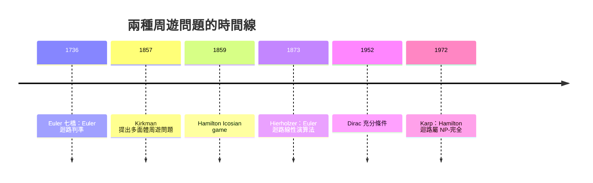

# 05.3 尤拉與漢米頓迴路：兩種周遊問題的命運分岔

## 1. 引言：一對孿生問題的不同際遇

Euler 迴路（1736）與 Hamilton 迴路（1859）表面上是一對鏡像問題：

| | Euler 迴路 | Hamilton 迴路 |
|:---|:---|:---|
| 要求 | 每條**邊**恰一次 | 每個**頂點**恰一次 |
| 誕生 | Euler 1736 七橋 | Hamilton 1859 Icosian game |
| 判準 | 完整刻劃（奇偶性） | 無簡潔判準 |
| 複雜度 | $O(|E|)$ | 判定問題為 **NP-完全** |

一個誕生即被完全解決，另一個拖到 20 世紀後半才被證明「本質上難」。
這條命運分岔線，正是計算複雜性理論的史前史。

## 2. Hamilton 的 Icosian Game（1859）

1857 年，愛爾蘭數學家 Hamilton 在研究**正十二面體**時發明了名為
*Icosian Game* 的玩具：十二面體的 20 個頂點各標一座城市，玩家要沿稜
線造訪每城恰好一次後回到起點。1859 年他將版權以 25 鎊賣給倫敦遊戲商
——商業上慘敗，數學上卻名留青史。

「Hamiltonian cycle（漢米頓迴路）」一詞由 Sir William Rowan Hamilton
命名（與他發明四元數、哈密頓力學同名），意即：

**定義 2.1**：圖 $G$ 中的 Hamilton 迴路是經過每個頂點恰好一次的封閉
路徑；對應的開放版本稱 Hamilton 路徑。

**注意**：與 Euler 情形不同，漢米頓迴路的存在性**沒有**「度數奇偶
性」那類簡潔的充要條件——只有一堆充分條件與必要條件。

## 3. 定理與證明：幾個經典刻劃的碎片

**定理 3.1（必要條件）**： $G$ 有 Hamilton 迴路 $\Rightarrow$ 刪去任意
頂點集 $S$ 後，連通分量數 $c(G - S) \le |S|$ 。

**證明**：Hamilton 迴路刪去 $S$ 的 $|S|$ 個頂點後，剩餘部分至多裂成
$|S|$ 段路徑，每段至少是一個連通分量；而 $G-S$ 的每個分量在迴路上都
占至少一段，故 $c(G-S) \le |S|$ 。 $\blacksquare$

此必要條件立刻排除經典反例：Petersen 圖（1930 年代廣泛出現於各領域，
後來以 Julius Petersen 1898 年命名）刪去 3 個特定頂點可裂成 4 個分量，
故無 Hamilton 迴路。

**定理 3.2（充分條件，Dirac 1952）**： $n \ge 3$ 且每個頂點度數
$\ge n/2$ ，則 $G$ 有 Hamilton 迴路。

**證明**：取 $G$ 中最長的路徑 $P = v_1, \dots, v_m$ 。若 $m < n$ ，路徑
外的頂點與 $v_1$ （或 $v_m$ ）相鄰才能延長，矛盾，故 $m = n$ 。設
$S = \{i : v_1 \sim v_{i+1}\}$ 、 $T = \{i : v_i \sim v_n\}$ 。因
$d(v_1), d(v_n) \ge n/2$ ，有 $|S| + |T| \ge n$ ，但 $S, T \subseteq
\{1,\dots,n-1\} $，故存在公共元素$ i^*$。於是

$$v_1, v_2, \dots, v_{i^*}, v_n, v_{n-1}, \dots, v_{i^*+1}, v_1$$

構成 Hamilton 迴路。 $\blacksquare$

## 4. 命運分岔：Euler 易、Hamilton 難的深層原因

為什麼「數奇點」就能解 Euler，Hamilton 卻懸置百年？

- **Euler 迴路是局部條件的堆疊**：只需逐點檢查度數奇偶性，各頂點
  互相獨立，故有 $O(|E|)$ 演算法（Hierholzer 1873）。
- **Hamilton 迴路是全域條件**：一個選擇會牽動所有後續選擇，本質是
  「在指數多的排列中搜尋」。1970 年代 Karp 的 21 個 NP-完全問題
  （1972）把 Hamiltonian cycle 判定正式列入；旅行推銷員問題（TSP）
  是它的加權版。



## 5. 範例與 Python：回溯搜尋 Hamilton 迴路

```python
def hamilton_cycle(graph, start=None):
    """回溯法：n 很小時可行，指數時間的必然宿命"""
    n = len(graph)
    start = start if start is not None else 0
    path = [start]
    used = {start}

    def backtrack(v):
        if len(path) == n:
            return start in graph[v]          # 尾接回首，成迴路
        for u in graph[v]:
            if u not in used:
                used.add(u); path.append(u)
                if backtrack(u):
                    return True
                path.pop(); used.discard(u)   # 回溯：撤銷選擇
        return False

    return path + [start] if backtrack(start) else None

# Icosian game 的圖：正十二面體的 20 頂點（簡化示意：取其平面嵌入）
icosian = {
    0:[1,4,5], 1:[0,2,7], 2:[1,3,9], 3:[2,4,11], 4:[0,3,13],
    5:[0,6,14], 6:[5,7,16], 7:[1,6,8], 8:[7,9,17], 9:[2,8,10],
    10:[9,11,18], 11:[3,10,12], 12:[11,13,19], 13:[4,12,14],
    14:[5,13,15], 15:[14,16,19], 16:[6,15,17], 17:[8,16,18],
    18:[10,17,19], 19:[12,15,18],
}
print(hamilton_cycle(icosian))
# 找到一條 20 頂點的迴路；把任一頂點的鄰居清單刪一個，可能就找不到了

# 對照：Euler 是多容易——直接 Hierholzer 線性時間
```

回溯法最壞 $O(n!)$ ——這不是實作不夠聰明，而是問題的內在困難（除非
$P = NP$ ）。實務上 TSP 用動態規劃（Held–Karp，1962， $O(n^2 2^n)$ ）、
分支限界或近似演算法。

## 6. 前因後果：這條分岔線通向哪裡？

1. **往計算複雜性**：Euler/Hamilton 的難易對比，成為教科書解釋
   $P$ vs $NP$ 的標準例子——「局部可驗、全域難解」。
2. **往組合優化**：TSP 是運籌學的聖杯；Concorde 求解器（2006）已解
   到 85,900 城市。
3. **往 DNA 定序**：1990 年代 Idury–Waterman 把序列重組從 Hamilton
   框架（NP-難）轉為 Euler 框架（多項式），是演算法觀點轉換的典範。
4. **往設計**：Hamilton 迴路對應印刷電路板鑽孔路徑、倉揀貨路徑的
   最優巡訪。

## 7. 章末小結

1. Euler 迴路要求每條邊一次，有奇偶判準與線性演算法；Hamilton 迴路
   要求每頂點一次，只有 Dirac 類充分條件與必要條件的碎片，判定是
   NP-完全（Karp 1972）。
2. 兩問題都是 19 世紀「遊戲與日常」孕育出來的：七橋是市民談資，
   Icosian 是販售的玩具——娛樂數學是圖論的溫床。
3. 難易分岔的根源在**局部 vs 全域**：這條直覺日後被形式化為
   $P$ vs $NP$ 。

**下一步**：從「周遊圖」轉向「壓縮圖」。當 Cayley 為了數烷類異構物
而研究樹，生成樹成為連通圖的骨架；Kruskal 1956 年為網路佈線給出
貪婪演算法——這是 06.1 的主題。
