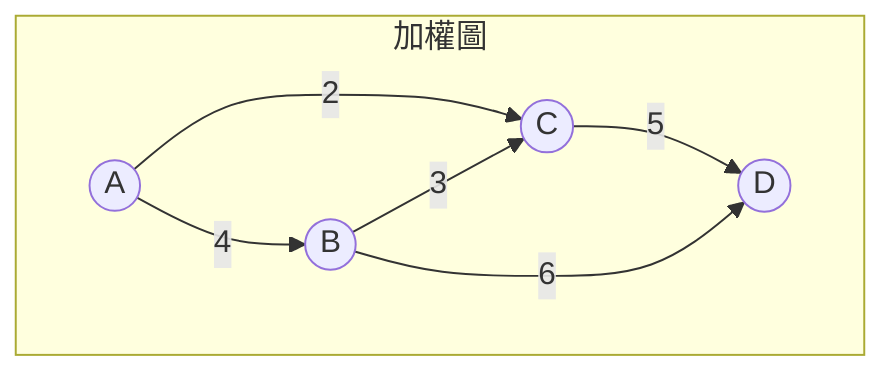

# 06.1 樹與生成樹：Cayley 化學樹與 Kruskal 最小生成樹演算法

## 1. 前因：化學如何把「樹」塞進數學

1850 年代，有機化學正陷入一場謎團：乙醇與二甲醚的化學式都是
$\mathrm{C_2H_6O}$ ，性質卻完全不同。Couper 與 Kekulé 提出原子以「鍵」
連接成**結構**的觀念後，問題變成：

> 化學式 $\mathrm{C_nH_{2n+2}}$ 的烷類，可能有多少種連接結構？

1857 年，Arthur Cayley 把這個化學問題翻譯成圖論：碳原子四價、氫一價，
烷類的碳骨架是一棵**樹**——連通且無迴路的圖。他隨後發展了樹的計數
理論。二甲醚與乙醇的差別，就是「氧插在骨架哪裡」：樹不是一個，是好
幾個。**化學驅動了樹論的誕生**，正如七橋問題驅動了圖論的誕生。

**定義 1.1（樹）**：連通且無迴路的（簡單）圖。樹的邊稱為枝。
**定義 1.2（森林）**：無迴路的圖（未必連通），即樹的不相交聯集。

## 2. 基本性質：樹的等價刻劃

**定理 2.1**： $n$ 個頂點的圖 $G$ 滿足以下任一，即為樹；且任兩條
等價：

1. $G$ 連通且無迴路；
2. $G$ 連通且恰有 $n-1$ 條邊；
3. $G$ 無迴路且恰有 $n-1$ 條邊;
4. $G$ 中任意兩頂點間恰有一條路徑。

**證明（要點）**：先證「連通 + 無迴路 $\Rightarrow$ 恰 $n-1$ 邊」：對
$n$ 歸納， $n=1$ 顯然；一般連通圖必有度數 $1$ 的頂點（沿任意路徑走到
不能再走即得葉），刪葉歸納，每次恰刪一點一邊。
反之，「連通 + $n-1$ 邊 $\Rightarrow$ 無迴路」：若含迴路，刪迴路上一
邊仍連通，反覆得連通且無迴路的 $n$ 頂點子圖有 $\le n-1$ 邊，由前段
知恰 $n-1$ 邊時原圖不能多出任何一邊。第 4 條由「無迴路 $\Rightarrow$
路徑唯一（兩條不同路徑可拼出迴路）」得到。 $\blacksquare$

**推論 2.2**：任何 $n$ 頂點連通圖至少含一棵生成樹；生成樹即「保留
連通、拿掉多餘邊」的極小連通子圖，恰有 $n-1$ 條邊。

## 3. Cayley 計數與矩陣樹定理的匯流

**定理 3.1（Cayley 1889）**： $K_n$ 的生成樹數目為 $n^{n-2}$ 。

**證明（矩陣樹定理路線）**：由 Kirchhoff 矩陣樹定理（05.2 定理 4.1），
$\tau(K_n) = \dfrac{\lambda_2 \cdots \lambda_n}{n}$ 。 $K_n$ 的 Laplacian
特徵值為 $0$ 與 $n$ （ $n-1$ 重），故

$$\tau(K_n) = \frac{n^{\,n-1}}{n} = n^{n-2}. \qquad \blacksquare$$

Cayley 原始證明用的是 Prüfer 編碼（Prüfer 1918 年給出的更簡潔版本）：
$n$ 頂點樹 $\leftrightarrow$ 長度 $n-2$ 的序列，逐一刪最小標號的葉並
記錄其鄰居；反向重建。雙射立即給出計數，且讓「固定度數的樹有幾棵」
這類化學問題變得可解。

回到化學： $n$ 個碳的骨架樹（度數 $\le 4$ ）數量決定烷類異構物數目；
$\mathrm{C_7H_{16}}$ 的庚烷恰好 $9$ 種——1900 年代化學家的異構物表
就是這樣被圖論清點出來的。

## 4. 最小生成樹：從理論到電網佈線

1956 年，貝爾實驗室的 Joseph Kruskal 在研究電網、管線的**最低成本
連通**問題時提出貪婪演算法。背景是 1920 年代 Borůvka（1926）為捷克
Moravia 的農村電氣化所做的先驅工作——同樣的數學需求在兩個國家、
兩個時代被各自發明。

**定義 4.1（最小生成樹 MST）**：加權連通圖 $G=(V,E,w)$ 的生成樹中
權重總和最小者。

**演算法 4.2（Kruskal 1956）**：

1. 將所有邊按權重遞增排序；
2. 依序掃描，若該邊兩端點不在同一連通塊（不形成迴路）則採用；
3. 採滿 $n-1$ 條邊即得 MST。

**定理 4.3（正確性）**：Kruskal 演算法輸出 MST。

**證明（交換論證）**：設 Kruskal 選出的邊集為 $K$ ，某 MST 為 $T$ ，
取兩者第一個不同的採用時刻， $e = \{u,v\} \in K \setminus T$ 。 $T + e$
含迴路，迴路上必有一邊 $f$ 連接 $K$ 當下已連的 $u$ 側與 $v$ 側之外
……由演算法順序知 $w(e) \le w(f)$ （否則 $f$ 會更早被掃到且不會形成
迴路而被採用）。 $T' = T - f + e$ 也是生成樹且權重不增，交換後新樹
與 $K$ 的一致前綴更長；重複歸納，最終 $K$ 本身是 MST。 $\blacksquare$

**演算法 4.4（Prim 1930/1957）**：從任一頂點出發，反覆加入「跨出
現有樹的最便宜邊」。與 Kruskal（全域排序）相比，Prim（局部擴張）
適合稠密圖，可用堆疊實作至 $O(|E| \log |V|)$ 。



以 Python 驗證 Kruskal（併查集判迴路）：

```python
class DSU:
    def __init__(self, n):
        self.p = list(range(n))
    def find(self, x):
        while self.p[x] != x:
            self.p[x] = self.p[self.p[x]]   # 路徑壓縮
            x = self.p[x]
        return x
    def union(self, a, b):
        ra, rb = self.find(a), self.find(b)
        if ra == rb: return False
        self.p[rb] = ra
        return True

def kruskal(n, edges):
    """edges: (w, u, v)，頂點 0..n-1"""
    total = 0
    mst = []
    dsu = DSU(n)
    for w, u, v in sorted(edges):
        if dsu.union(u, v):
            total += w
            mst.append((u, v, w))
    return total, mst

# 上圖：A=0 B=1 C=2 D=3
print(kruskal(4, [(4,0,1),(2,0,2),(3,1,2),(5,2,3),(6,1,3)]))
# (10, [(2,0,2), (3,1,2), (5,2,3)])  總權 10
```

## 5. 前因後果：生成樹為何無所不在

- **網路設計**：電信骨幹、輸油管、水電管線——「用最少材料保持全連
  通」就是 MST；Kruskal 原始動機正是 AT&T 的長途電路成本。
- **近似演算法**：TSP 的 $2$ -近似（MST 遍歷 + 捷徑）以 MST 為骨架。
- **叢集分析**：刪去 MST 中最長的 $k-1$ 條邊，即得 $k$ 個叢集。
- **驗證連通**：圖連通 $\iff$ 存在生成樹；MST 甚至給出瓶頸最小的
  連通方式（最大瓶頸邊最小化）。
- **隨機化**：隨機生成樹、矩陣樹定理（05.2）的計數結果在此化為
  機率分布。

## 6. 章末小結

1. 樹 = 連通無迴路 = 恰 $n-1$ 邊的連通圖 = 路徑唯一，四種刻劃等價。
2. Cayley 1857 年為化學異構物計數而創樹論；Cayley 公式 $n^{n-2}$
   可由矩陣樹定理或 Prüfer 編碼證得——化學、代數、組合在此匯流。
3. Kruskal 1956（承 Borůvka 1926）以貪婪 + 交換論證解決 MST，正確
   性的關鍵是「安全邊交換」；Prim 提供稠密圖的替代路線。

**下一步**：生成樹回答「怎樣連通最便宜」，但許多問題問的是「兩點之
間怎麼走最快」——Dijkstra 1959 的單源最短路徑與 Bellman-Ford 的動態
規劃視角，見 06.2。
