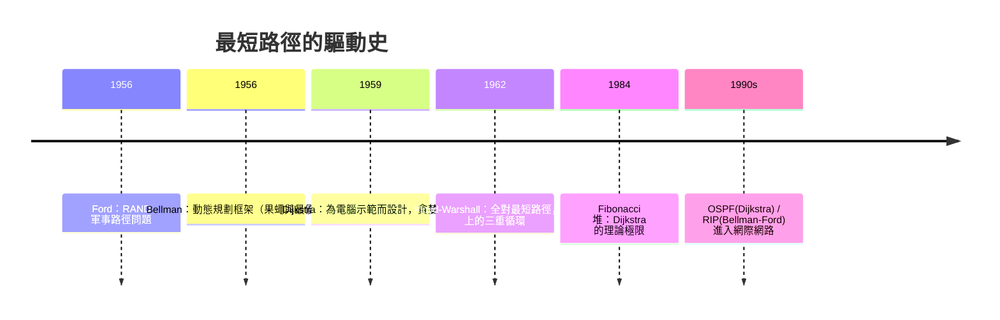

# 06.2 最短路徑：Dijkstra 1959 與 Bellman-Ford 的動態規劃視角

## 1. 前因：兩條問題來源，兩套解法哲學

最短路徑問題有兩個幾乎同時、卻哲學迥異的源頭：

- **1956–1959 年，Edsger Dijkstra**：荷蘭，在阿姆斯特丹為設計
  **電腦**（ARMAC）示範程式而想出這個演算法——他後來自述是在咖啡店
  等未婚妻的二十分鐘裡想出來的。目標是「找出 Rotterdam 與 Groningen
  間最短路線」，非負邊權的單源最短路徑（SSSP）。論文 1959 年發表於
  *Numerische Mathematik*，僅三頁。
- **1955–1958 年，Richard Bellman**：美國 RAND 公司，為美國空軍研究
  **飛彈射程與路徑優化**，發展**動態規劃（DP）**框架；Bellman-Ford
  演算法（與 Lester Ford Jr. 的 1956 年工作合稱）能處理**負邊權**。

一個是「貪婪擴張」，一個是「逐輪鬆弛」——差異根源在於能否容忍負權。

**定義 1.1**：加權圖 $G=(V,E,w)$，$w: E \to \mathbb{R}$。路徑 $P$ 的
長度為 $\sum_{e \in P} w(e)$。單源最短路徑問題：給定源點 $s$，求
$s$ 到每點的最短距離 $\delta(v)$。

**假設 1.2**：若含負權，則須無負迴路，否則 $\delta$ 無定義（繞圈
一次比一次便宜）。

## 2. 共同引擎：鬆弛（relaxation）

兩個演算法的原子操作相同：

**鬆弛邊 $(u,v)$**：若 $\mathrm{dist}[u] + w(u,v) < \mathrm{dist}[v]$，
則更新 $\mathrm{dist}[v] \leftarrow \mathrm{dist}[u] + w(u,v)$ 並記錄
前驅 $\mathrm{prev}[v] \leftarrow u$。

**性質 2.1（最優子結構）**：$s \to v$ 的最短路徑，其任何前段也是
端點間的最短路徑。證明：否則把前段換成更短的，與整體最短矛盾。

**性質 2.2（三角不等式）**：$\delta(v) \le \delta(u) + w(u,v)$ 對所有
邊 $(u,v)$ 成立——由定義直接可得；演算法終止的判準正是所有邊都
「已鬆弛」（不再觸發更新）。

## 3. Dijkstra：貪婪 + 非負權的正確性

**演算法 3.1（Dijkstra 1959）**：維護已定案集合 $S$。反覆：取不在
$S$ 中 $\mathrm{dist}$ 最小的頂點 $u$，加入 $S$，鬆弛其所有出邊。

**定理 3.2**：若所有 $w(e) \ge 0$，演算法結束時
$\mathrm{dist}[v] = \delta(v)$ 對所有 $v$ 成立。

**證明**：歸納證明「$u$ 被選入 $S$ 時 $\mathrm{dist}[u] = \delta(u)$」。
反設第一次失敗於選中 $u$：存在真最短路徑 $s \leadsto x \to y \leadsto u$，
其中 $x \in S$、$y \notin S$（$s \in S$ 故這樣的 $y$ 存在）。$x$ 被選
入 $S$ 時已鬆弛 $(x,y)$，故

$$\mathrm{dist}[y] \le \delta(x) + w(x,y) \le \delta(u).$$

但 $\delta(y) \le \delta(u)$（$u$ 是路徑後段，非負權保證前段不比全程
長），而演算法選了 $u$ 而非 $y$，故 $\mathrm{dist}[u] \le \mathrm{dist}[y]
\le \delta(u)$；又 $\mathrm{dist}[u] \ge \delta(u)$ 恆真，得
$\mathrm{dist}[u] = \delta(u)$，矛盾。$\blacksquare$

注意證明用到非負權兩次（前段不比全程長）。**若允許負權，Dijkstra
可能早熟地把尚未最優的頂點定案**——這正是 Bellman-Ford 存在的理由。

複雜度：二分堆實作 $O((|V|+|E|)\log |V|)$；Fibonacci 堆（1984）達
$O(|E| + |V| \log |V|)$。

## 4. Bellman-Ford：動態規劃視角

**定義 4.1（逐段最優）**：令 $\delta_k(v) = $ 最多用 $k$ 條邊的
$s \to v$ 最短距離。

**遞迴（Bellman 方程）**：

$$\delta_k(v) = \min\{\,\delta_{k-1}(v),\ \min_{(u,v)\in E}\ \delta_{k-1}(u) + w(u,v)\,\},
\qquad \delta_0(s) = 0,\ \delta_0(v \ne s) = \infty.$$

**演算法 4.2（Bellman-Ford）**：對 $k = 1, \dots, n-1$，掃描全部邊做
鬆弛；再做第 $n$ 輪，若仍有邊可鬆弛，則存在負迴路。

**定理 4.3**：$n$ 個頂點的圖中，最短路徑至多含 $n-1$ 條邊（路徑不重
訪頂點）；故 $n-1$ 輪後 $\mathrm{dist}[v] = \delta(v)$（在無負迴路時）。
第 $n$ 輪仍可鬆弛 $\iff$ 負迴路存在。

**證明**：任何最短路徑若重訪某頂點，刪去中間的迴路不會變長（迴路權
非負；負迴路已排除），故可取簡單路徑，至多 $n-1$ 條邊。第 $k$ 輪後
$\mathrm{dist}[v] \le \delta_k(v)$（歸納），且每輪至少把一條真最短路
徑的邊「接對」，$n-1$ 輪涵蓋所有情形。多出的第 $n$ 輪若仍能改進，
改進量來自一個可無限降權的圈，即負迴路。$\blacksquare$

複雜度 $O(|V| \cdot |E|)$——比 Dijkstra 慢，但能偵測負迴路，且在
**分布式系統**中自然實作（距離向量路由 RIP 協定即其化身；Dijkstra
則化身為 OSPF）。

## 5. 範例與 Python 實作

```python
import heapq

def dijkstra(n, adj, s):
    """adj: 頂點 -> [(鄰點, 權重)]，權 >= 0"""
    INF = float('inf')
    dist = [INF] * n
    dist[s] = 0
    pq = [(0, s)]
    while pq:
        d, u = heapq.heappop(pq)
        if d > dist[u]:
            continue                      # 過期項，跳過
        for v, w in adj[u]:
            if dist[u] + w < dist[v]:     # 鬆弛
                dist[v] = dist[u] + w
                heapq.heappush(pq, (dist[v], v))
    return dist

def bellman_ford(n, edges, s):
    """edges: (u, v, w)，可含負權；回傳 (dist, has_neg_cycle)"""
    INF = float('inf')
    dist = [INF] * n
    dist[s] = 0
    for _ in range(n - 1):                # 定理 4.3：n-1 輪
        for u, v, w in edges:
            if dist[u] + w < dist[v]:
                dist[v] = dist[u] + w
    for u, v, w in edges:                 # 第 n 輪偵測負迴路
        if dist[u] + w < dist[v]:
            return dist, True
    return dist, False

adj = {0: [(1,4),(2,2)], 1: [(2,3),(3,6)], 2: [(3,5)], 3: []}
print(dijkstra(4, adj, 0))        # [0, 4, 2, 7]

# 負權測試：0->1 (-2), 1->2 (1), 0->2 (0)
e = [(0,1,-2), (1,2,1), (0,2,0)]
print(bellman_ford(3, e, 0))      # ([0, -2, -1], False)  負權下 0->2 路徑更便宜
# 加上 2->0 (-1) 形成負迴路 (0,1,2,0) 總權 -2：
e2 = e + [(2,0,-1)]
print(bellman_ford(3, e2, 0)[1])  # True
```

第一個例子顯示 Dijkstra 正確繞過直達邊（$0\to2\to3$ 的 $7$ 勝過
$0\to1\to3$ 的 $10$）；負權例子顯示「直達不一定最短」，這也是
Dijkstra 失效的場景。

## 6. 前因後果：軍事、電腦與網際網路的合流



1. **動態規劃的一般化**：Bellman 的「最優原理」——最優路徑的子路徑
   亦最優（性質 2.1）——不止解最短路，還催生了背包問題、序列對齊
   （生物資訊的 Needleman-Wunsch 1970）。
2. **網路協定**：今天每一次上網，路由器都在跑這兩個演算法的直系
   後代；理論與基礎設施在此直接接軌。
3. **A\* 搜尋**：Dijkstra 加上啟發式估計（1968, Hart-Nilsson-Raphael），
   成為機器人導航與遊戲尋路的標準。

## 7. 章末小結

1. 鬆弛是共同引擎；最優子結構與三角不等式是正確性的兩根支柱。
2. Dijkstra：貪婪 + 非負權，$O((|V|+|E|)\log|V|)$；負權會讓「早熟
   定案」出錯。
3. Bellman-Ford：逐段 DP，$O(|V||E|)$，容忍負權並偵測負迴路，是
   分布式路由的原型。
4. 兩者的分工映射出 1950 年代兩種問題來源——計算機示範 vs 軍事
   優化——如何導出不同演算法哲學。

**下一步**：以上問題都把圖畫在紙上就好。但若圖必須「畫在平面上且
邊不相交」呢？Kuratowski 1930 年的刻劃與四色定理 1852–1976 的百年
長跑，見 06.3。
