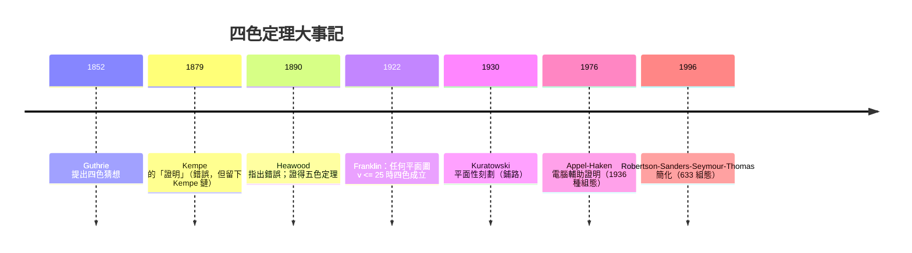

# 06.3 平面圖與著色：從四色定理 1852 到 Kuratowski 1930

## 1. 前因：一張英國地圖引出的百年懸案

1852 年 10 月，南非出生的學生 Francis Guthrie 在為英國郡地圖上色時
注意到：**四種顏色永遠夠用**。他把問題交給弟弟 Frederick，後者轉問
老師 De Morgan——四色猜想就此進入數學史。與七橋問題（1736）一樣，
它來自日常經驗；不同的是，它花了 **124 年**才被解決，而且解法迫使
數學界重新思考「什麼是證明」。

在 1852 年，「圖」甚至還不是標準概念。四色問題能被嚴格陳述，依賴
兩個先行概念：

- **平面嵌入**：把圖畫在平面上使邊只在端點相交（不交叉）；
- **著色**：給頂點（或面）上色，相鄰者異色。

Guthrie 觀察的是**地圖的面著色**；對偶化後等價於平面圖的**頂點
著色**——「圖」這個中介物，把地圖學問題變成組合學問題。

## 2. 平面圖的基本理論

**定義 2.1（平面圖 planar graph）**：可畫在平面上、邊互不交叉的圖。
一個已畫好的畫法稱為平面嵌入。

**定理 2.2（Euler 公式, 1758）**：連通平面圖的嵌入若有 $v$ 個頂點、
$e$ 條邊、$f$ 個面（含無界面），則

$$v - e + f = 2.$$

**證明**：對 $e$ 歸納。$e=1$（單邊樹的 $v=2,f=1$）成立。若嵌入是樹，
$f=1$ 且 $e = v-1$，成立；若含迴路，刪去迴路上任一邊，$e$ 減 $1$ 且
恰有一對面合而為一，$f$ 減 $1$，$v-e+f$ 不變，歸納完成。$\blacksquare$

**推論 2.3（邊數上界）**：$v \ge 3$ 的簡單平面圖有 $e \le 3v - 6$；
若無三角形則 $e \le 2v - 4$。

**證明**：每面至少 $3$ 條邊，且每條邊至多屬於兩面，故 $2e \ge 3f$，
代入 Euler 公式得 $e \le 3v-6$；無三角形時 $2e \ge 4f$ 給出第二式。
$\blacksquare$

此推論的著名應用：$K_5$ 有 $e = 10 > 3\cdot5-6 = 9$，故 $K_5$ 非平
面；$K_{3,3}$（三人宿舍接三項設施，$v=e=6$）無三角形，$6 > 2\cdot6-4
= 8$ 不成立——即 $6 \le 8$，上界失效，需另一證法（見下節 Kuratowski）。

## 3. 定理與證明：Kuratowski 1930 的刻劃

**定義 3.1（細分 subdivision）**：把邊換成內部不相交的路徑（插入
度數 $2$ 的頂點）。

**定理 3.2（Kuratowski, 1930）**：圖 $G$ 是平面圖 $\iff$ $G$ 不含
$K_5$ 或 $K_{3,3}$ 的細分為子圖。

換言之，**非平面性的全部障礙只有兩種**：五頂點全連通，或三對三
二部全連通。這是「有限障礙定理（finite obstruction set）」的第一個
偉大範例，直接啟發了 Robertson–Seymour 的圖子式定理（1983–2004,
Graph Minors 系列，20 篇論文）。

**證明綱要**：
（$\Leftarrow$）$K_5$、$K_{3,3}$ 非平面（前者由推論 2.3；後者：在
$K_{3,3}$ 的任何迴路嵌入中，第三對頂點各需穿越迴路內外兩次，必然
交叉——此即「六人聚會、三三角糾纏」的 Jordan 曲線論證）。細分不影
響平面性，故含其細分者非平面。
（$\Rightarrow$）取極小非平面圖（各真子圖皆平面），證其最小度數
$\ge 3$、無割點、且必含一條「扭結邊」，刪之再嵌入後，由 Jordan
曲線性質把端點分屬內外，可插入該邊的唯一方式製造出 $K_5$ 或
$K_{3,3}$ 細分。完整證明數頁，核心思想是**極小反例 + Jordan 曲線
內外二分**。$\blacksquare$

1937 年 Wagner 給出等價的「子式」版本（$K_5$/$K_{3,3}$ 為子式），
那正是圖子式定理的雛形。

## 4. 四色定理：1852–1976 的長跑



**定義 4.1（$k$-著色）**：函數 $c: V \to \{1,\dots,k\}$ 使相鄰頂點
異色；**色數** $\chi(G)$ 是最小可用的 $k$。

**定理 4.2（五色定理，Heawood 1890）**：任何平面圖 $\chi \le 5$。

**證明**：平面圖有度數 $\le 5$ 的頂點（由 $e \le 3v-6$，平均度
$< 6$）。對 $v$ 歸納，刪一個 $\deg \le 5$ 的頂點 $v$，五著色其餘。
若 $v$ 有 $\le 4$ 個鄰居或鄰居未用滿五色，直接補色。否則 $v$ 恰有
五個鄰居、依次著色 $1\text{–}5$。考慮 Kempe 鏈：在 $2\text{–}4$ 色
子圖中從 $v_2$ 出發走鏈，若走不到 $v_4$，交換該連通塊的 $2 \leftrightarrow 4$
即騰出顏色給 $v$；若走得到，則該鏈與 Jordan 曲線把 $v_3$ 與 $v_5$
隔在異側，$3\text{–}5$ 鏈走不到，交換那側即可。$\blacksquare$

Kempe 1879 年的錯誤證明正是栽在最後這步——他假設兩條 Kempe 鏈
交換互不干擾，1890 年 Heawood 找到反例。但錯誤證明留下的 **Kempe
鏈技術**，成為 Appel–Haken 1976 年電腦證明的核心工具：把「任意平
面圖」約化為 1936 種**不可約組態**，逐一用電腦驗證可四著色。這是
史上第一個重要的電腦輔助數學證明，至今仍無能被人類徒手覆核。

## 5. 範例與 Python

```python
def is_planar_bound(v, e):
    """推論 2.3 的快速排除：超過上界必非平面"""
    if v >= 3:
        if e > 3 * v - 6: return False
        # 無三角形（二部圖）可用 2v-4 再驗
    return True   # 未超界只代表「未被排除」

def welch_powell_coloring(graph):
    """Welsh-Powell 貪婪著色：按度數遞減上色（上界演算法）"""
    order = sorted(graph, key=lambda v: -len(graph[v]))
    color = {}
    for v in order:
        used = {color[u] for u in graph[v] if u in color}
        c = 0
        while c in used: c += 1
        color[v] = c
    return color, max(color.values()) + 1

# K3,3：非平面的另一種看到法
k33 = {u: [f"b{i}" for i in range(3)] for u in ["a1","a2","a3"]}
for i in range(3):
    k33[f"b{i}"] = ["a1","a2","a3"]

color, k = welch_powell_coloring(k33)
print(k)  # 2 —— K3,3 是二部圖，色數 2；但非平面（Kuratowski）
# 教訓：色數小 ≠ 平面；兩個概念各自獨立
```

注意範例的最後一行：$K_{3,3}$ 只要 $2$ 色卻畫不平——**平面性與
著色性是兩個正交的結構性質**，它們在四色定理中才交會（平面 $\Rightarrow$
$\chi \le 4$）。

## 6. 前因後果：這兩支脈絡通向哪裡

- **往拓撲圖論**：Euler 公式 $v-e+f=2$ 是 Euler 特徵數的特例，推廣
  到環面（$\chi = 0$，環面地圖七色定理，Heawood 1890）。
- **往圖子式理論**：Kuratowski 的「有限障礙」思想在 Robertson–
  Seymour 定理中達到頂點——任何子式封閉的圖類都只有有限個障礙。
- **往計算複雜性**：一般圖的 $k$-著色判定在 $k \ge 3$ 時是 NP-完全
  （Karp 1972 名單成員），但平面圖恆可 $4$ 著色且 $3$-著色仍
  NP-完全——「結構保證」與「計算難度」的微妙互動。
- **往電腦證明哲學**：Appel–Haken 之後，四色定理於 2005 年被
  Gonthier 以 Coq 交互定理證明器形式化，回應了對可信度的質疑。

## 7. 章末小結

1. 平面性由 Euler 公式 $v-e+f=2$ 支配，邊數上界 $3v-6$ 立即排除
   $K_5$；$K_{3,3}$ 需 Jordan 曲線論證——兩者正是 Kuratowski 1930
   年刻劃的全部障礙。
2. 四色定理自 1852 年 Guthrie 的地圖觀察出發，經 Kempe 1879 的
   錯誤證明（留下 Kempe 鏈）、Heawood 1890 五色定理，到 Appel–
   Haken 1976 電腦證明——124 年，跨越人證與機證的界線。
3. 平面性與著色性正交互補；有限障礙的思想延伸為圖子式定理，是
   20 世紀圖論最大的理論工程。

**下一步（本書路線）**：圖論諸章到此完成「誕生（05.1）— 代數化
（05.2）— 周遊（05.3）— 樹與優化（06.1, 06.2）— 拓撲與著色（06.3）」
的弧線。下一章將轉入計數與代數結構：鴿籠原理、排容原理與群論——
當年驅動圖論的那些「遊戲問題」，同樣是組合學的起點。
