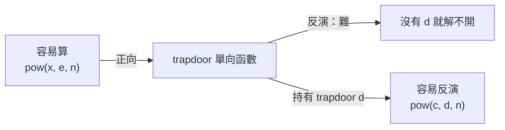
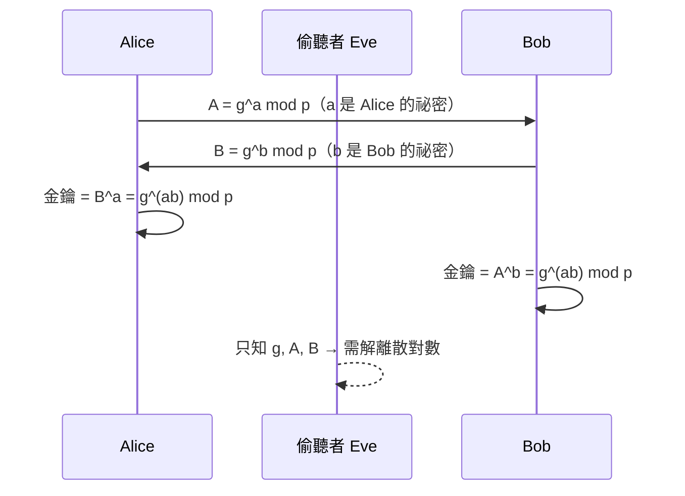
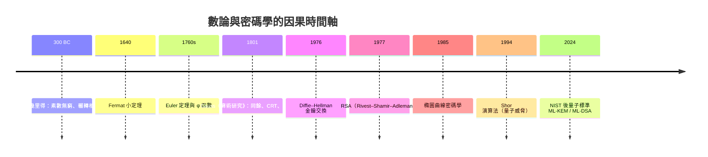

# 07.3 RSA 與 Diffie–Hellman：數論如何成為密碼學基石

## 0. 導言：兩千年密碼學的典範轉移

在 1976 年之前，所有密碼系統——從凱薩密碼、Enigma 到 DES——都是**對稱式**的：加密與解密用同一把鑰匙。這帶來一個致命的雞生蛋問題（*key distribution problem*）：通訊雙方必須先有共享祕密，但建立祕密又需要安全通道。

1976 年，Stanford 的 Whitfield Diffie 與 Martin Hellman 發表〈*New Directions in Cryptography*〉，提出**公開金鑰密碼學**的革命性想法；1977 年，MIT 的 Ron Rivest、Adi Shamir、Leonard Adleman 提出 RSA，實現了這個想法。諷刺的是，英國 GCHQ 的 Ellis、Cocks、Williamson 早在 1969–1974 年就祕密做出同樣結果，但因機密而無法發表。

> **驅動關係**：電腦網路興起（前因）→ 金鑰分配成為瓶頸 → 數論從「純粹數學的女王」變成基礎設施（後果）→ 大量計算資源投入 → 反過來推動素數測試、分解演算法、橢圓曲線的研究。**理論與應用互相驅動**的最佳範例。

本章前因：07.1 的 Bézout 與中國剩餘定理、07.2 的 Euler 定理與模指數。後果：TLS/HTTPS、區塊鏈、電子簽章，以及第 10 章的計算複雜度理論（P vs NP 與單向函數）。

## 1. 單向函數：公開金鑰的哲學基礎

### 定義 1.1（單向函數，直觀版）

函數 $f$ 是**單向的**，若正向計算容易（多項式時間），而反演困難（已知無多項式時間演算法）。



密碼學需要的其實是**陷門單向函數**（trapdoor one-way function）：反演很難，**除非**知道某個祕密（陷門）。

| 函數 | 正向 | 反向（困難問題） | 陷門 |
|---|---|---|---|
| 模指數 $m^e \bmod n$ | 平方-乘法，$O(\log e)$ | 求第 $e$ 次根 | $d = e^{-1} \bmod \varphi(n)$ |
| 模冪 $g^a \bmod p$ | 平方-乘法 | 離散對數 | （無已知陷門 → 只能做金鑰交換） |
| 乘法 $p \cdot q$ | 一秒 | 大數分解 | $p, q$ |

**注意**：單向函數的存在性等價於 $P \neq NP$ 的某種形式，至今未證明。密碼學建立在「我們非常努力找過，但沒找到快演算法」的經驗事實上。

## 2. Diffie–Hellman 金鑰交換（1976）

### 協定描述

公開參數：大素數 $p$ 與 $\mathbb{Z}_p^*$ 的生成元 $g$（階為 $p-1$ 的元素）。



**正確性**：$B^a = (g^b)^a = g^{ab} = (g^a)^b = A^b \pmod p$。

**安全性**：Eve 要算 $g^{ab}$。已知攻擊路線是先求 $a = \log_g A$（離散對數問題，DLP），或直接解 Diffie–Hellman 問題（DHP）。目前最強的古典演算法（數域篩法變體）是次指數時間 $L_p[1/3]$，對 2048 位元的 $p$ 仍不可行。

```python
import random

def is_prime(n, k=20):
    """Miller-Rabin（見 07.1）"""
    if n < 2: return False
    for p in (2,3,5,7,11,13,17,19,23,29,31,37):
        if n % p == 0: return n == p
    d, r = n - 1, 0
    while d % 2 == 0: d, r = d // 2, r + 1
    for _ in range(k):
        a = random.randrange(2, n - 1)
        x = pow(a, d, n)
        if x in (1, n - 1): continue
        for _ in range(r - 1):
            x = pow(x, 2, n)
            if x == n - 1: break
        else: return False
    return True

def diffie_hellman_demo(p, g):
    a = random.randrange(2, p - 1)   # Alice 祕密
    b = random.randrange(2, p - 1)   # Bob 祕密
    A, B = pow(g, a, p), pow(g, b, p)
    kA, kB = pow(B, a, p), pow(A, b, p)
    assert kA == kB                  # Euler 定理保證的正確性
    return A, B, kA

p = next((q for q in range(2**20 + 1, 2**21, 2) if is_prime(q)), None)
g = 2
A, B, key = diffie_hellman_demo(p, g)
print(f"p={p}, 公開值 A={A}, B={B}, 共享金鑰={key}")
```

### 中間人攻擊：DH 的阿基里斯腱

DH 只證明「兩方之間」可建立祕密，但**不驗證對方身分**。Eve 可以同時與 Alice、Bob 各做一次 DH，居中轉發並解密。解法：需要**簽章**或憑證——而這正是 RSA（可簽章）勝出成為 TLS 主力的原因之一。前因（DH 無認證）→ 後果（憑證 authorities、PKI 的誕生）。

## 3. RSA 密碼系統（Rivest–Shamir–Adleman, 1977）

### 3.1 金鑰生成

1. 選兩個大素數 $p \neq q$（各 1024 位元以上），令 $n = pq$。
2. 計算 $\varphi(n) = (p-1)(q-1)$（只有知道 $p, q$ 的人算得快，見 07.2 定理 1.3）。
3. 選 $e$ 使 $\gcd(e, \varphi(n)) = 1$（常用 $e = 65537 = 2^{16}+1$，二進位只有兩個 1，加密快）。
4. 求 $d = e^{-1} \pmod{\varphi(n)}$（擴展歐幾里得/Bézout）。

**公開金鑰** $(n, e)$；**私鑰** $d$（搭配 $p, q$ 或 $\varphi(n)$）。

### 3.2 加密與解密

對訊息 $m \in \mathbb{Z}_n$：

$$c = m^e \bmod n, \qquad m = c^d \bmod n.$$

### 定理 3.3（RSA 正確性）

對所有 $m \in \mathbb{Z}_n$（即使 $\gcd(m, n) \neq 1$），$m^{ed} \equiv m \pmod n$。

**證明**：由 $ed \equiv 1 \pmod{\varphi(n)}$，寫 $ed = 1 + t\varphi(n)$。

- 情形一：$\gcd(m, n) = 1$。由 Euler 定理 $m^{\varphi(n)} \equiv 1 \pmod n$，故
  $$m^{ed} = m \cdot (m^{\varphi(n)})^t \equiv m \pmod n.$$
- 情形二：$n \mid m$ 時兩邊皆 $\equiv 0$。
- 情形三：$m = sp$（$q \nmid m$）的一般情形，用**中國剩餘定理**：模 $p$ 時 $m^{ed} \equiv 0 \equiv m$；模 $q$ 時 $\gcd(m, q) = 1$，由 Fermat 小定理 $m^{q-1} \equiv 1$，而 $p - 1 \mid \varphi(n)$，故 $m^{ed} = m \cdot (m^{q-1})^{\ast} \equiv m \pmod q$。CRT 合併兩式得 $m^{ed} \equiv m \pmod n$。$\blacksquare$

> **理論回顧**：情形三說明為什麼需要 CRT——Euler 定理只覆蓋互質情況，而真實 RSA 訊息未必與 $n$ 互質。教科書常漏掉這一點；Gauss 的 CRT（07.1 定理 3.2）在此補上了證明的最後一塊。

### 3.3 完整實作

```python
import random, hashlib

# --- 素數生成（Miller-Rabin 見 07.1/07.2）---
def gen_prime(bits):
    while True:
        n = random.getrandbits(bits) | (1 << (bits - 1)) | 1
        if is_prime(n):
            return n

def rsa_keygen(bits=1024):
    p, q = gen_prime(bits), gen_prime(bits)
    while p == q:
        q = gen_prime(bits)
    n, ph = p * q, (p - 1) * (q - 1)      # φ(n) 由 CRT 積性
    e = 65537
    while ph % e == 0:                     # 極少數情況需重選
        e = random.randrange(3, ph, 2)
    d = pow(e, -1, ph)                     # Bézout / 擴展歐幾里得
    return (n, e), (n, d, p, q)

pub, priv = rsa_keygen(512)                # 教學用 512；實務 ≥ 2048
n, e = pub

# --- 加解密 ---
m = int.from_bytes(b"Hello, number theory!", "big")
assert m < n, "訊息必須先編碼成小於 n 的整數"
c = pow(m, e, n)                           # 加密
m2 = pow(c, priv[1], n)                    # 解密
print(m2 == m)                             # True ← 定理 3.3

# --- 簽章（私鑰簽、公鑰驗）：方向與加解密相反 ---
h = int.from_bytes(hashlib.sha256(b"invoice #1, amount $100").digest(), "big") % n
s = pow(h, priv[1], n)                     # 簽章
h2 = pow(s, e, n)                          # 驗章
print(h2 == h)                             # True
```

### 3.4 安全性分析

RSA 的安全至少依賴三個難題的相對關係：

1. **大數分解**（FACTORING）：由 $n$ 求 $p, q$。最佳古典演算法為通用數域篩法，時間 $\exp\!\big((\sqrt[3]{64/9} + o(1))(\ln n)^{1/3}(\ln\ln n)^{2/3}\big)$——次指數但非多項式。2020 年 829 位元 RSA 挑戰數被分解，耗費約 2700 核心年。
2. **RSA 問題**：由 $(n, e, m^e)$ 求 $m$。可能比分解容易（未證明等價）。
3. **低指數攻擊**警示：$e$ 太小且 padding 不當時，$m^e < n$ 則直接開 $e$ 次方根即得 $m$。實務必須加 OAEP 之類的隨機填充。

```python
# 為什麼小素數不安全：直接分解 demo
n_demo = 3127                      # 53 * 59
p_demo = next(f for f in range(2, int(n_demo**0.5) + 1) if n_demo % f == 0)
print(p_demo, n_demo // p_demo)    # 53 59 → 幾毫秒破解
# n_demo = 2048 位元 → 同樣的試除法需要 ~10^613 年
```

> **理論與工程互相驅動**：RSA 的需求 → 刺激二次篩法（1981）、數域篩法（1993）的發明 → 數域篩法又反哺代數數論。密碼學家與密碼分析家的軍備競賽，本身就是一種「前因後果」。

## 4. 橢圓曲線密碼學：後 RSA 時代

RSA 金鑰長度膨脹（2048–4096 位元）促成了 1985 年 Koblitz 與 Miller 各自提出的**橢圓曲線密碼學**（ECC）。ECC 把離散對數搬到橢圓曲線的點群上：

$$y^2 = x^3 + ax + b, \qquad \text{點加法構成一個交換群（見 08.1 群的定義）}.$$

ECDLP 目前沒有次指數演算法，因此 256 位元 ECC ≈ 3072 位元 RSA 的安全強度。今天的 TLS 憑證主流是 ECDSA 簽章 + ECDHE 金鑰交換——**群論的直接應用**，08.1 將補上「交換群」的正式定義。

## 5. 量子威脅：前因與後果的再一次翻轉

1994 年 Peter Shor 提出量子演算法：在量子電腦上，**分解與離散對數都是多項式時間**。一旦大規模容錯量子電腦問世，RSA、DH、ECC 全數失效。

這催生了 NIST 的**後量子密碼學**（PQC）標準化：2024 年定案的 ML-KEM（基於格上的 Module-LWE 問題）與 ML-DSA。注意其哲學不變：**仍然是用一個「計算上困難」的數學問題當陷門**——只是問題從數論換成了格幾何。



## 6. 章末小結

| 系統 | 年代 | 數學根據 | 困難問題 | 陷門 |
|---|---|---|---|---|
| Diffie–Hellman | 1976 | 模冪交換律 | 離散對數 | 無（僅金鑰交換） |
| RSA | 1977 | Euler 定理 + CRT | 大數分解 | $\varphi(n)$ |
| ECC/ECDSA | 1985 | 點群上的 DLP | ECDLP | 無（配合 ECDH） |
| ML-KEM | 2024 | 格上的 LWE | Module-LWE | 格的祕密基底 |

**核心因果鏈**：Bézout（求 $d$）→ Euler 定理（解密正確）→ CRT（一般情形證明與加速）→ 唯一分解的困難性（安全性）→ 數學難題 = 資訊安全的基石。

三個實務要點：

1. **正確性與安全性是兩回事**：定理 3.3 證明 RSA 解得開，但不證明「別人解不開」。
2. **padding 不可省**：教科書 RSA（deterministic）會被選擇明文攻擊擊潰。
3. **金鑰長度是移動目標**：隨分解演算法與硬體進步而調整（見 NIST SP 800-57）。

## 7. 下一步

本章的 $\mathbb{Z}_n^*$、點群、格，背後都是同一個抽象框架：**集合 + 滿足公理的運算**。下一章 **08.1 代數結構總覽**將把這些實例統一成半群、群、環、體的階層，並證明 Lagrange 定理——「子群階數整除群階數」——這條定理正是 RSA 中 $ed \equiv 1 \pmod{\varphi(n)}$ 為何总能成立的深層原因，也是 08.2 Burnside 引理的前奏。
