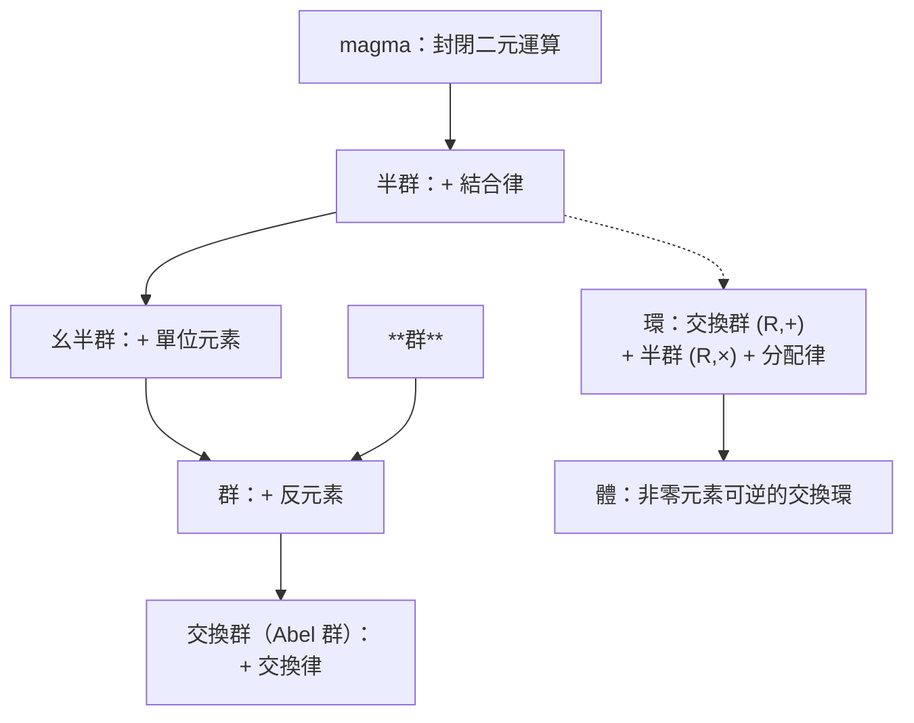
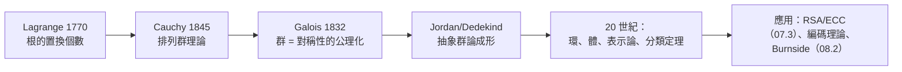

# 08.1 代數結構總覽：半群、群、環、體與 Lagrange 定理

## 0. 導言：公理化方法的勝利

19 世紀前，代數是「解方程」的技術。Galois 在 1832 年（決鬥前夜寫下的遺書中）證明：五次方程沒有根式解，關鍵不在方程本身，而在其**對稱性的結構**。他把對稱性公理化，代數從此變成「研究運算系統的學問」。

本章把第 7 章遇見的實例——$(\mathbb{Z}_m, +)$、$(\mathbb{Z}_m^*, \times)$、橢圓曲線點群——統一成一座公理金字塔：



**驅動關係**：Gauss 的 $\mathbb{Z}_m$（前因）→ Galois 抽象出群 → Lagrange/Cauchy 定理指引 Galois 理論 → 結構分類成為 20 世紀數學主軸 → 密碼學（07.3）直接消費這些結構（後果）。

## 1. 半群與幺半群：只要求結合律

### 定義 1.1（半群、幺半群）

- **半群** $(S, \cdot)$：$S$ 非空，$\cdot$ 是封閉且**結合**的二元運算：$(a \cdot b) \cdot c = a \cdot (b \cdot c)$。
- **幺半群**：半群再要求存在**單位元素** $e$：$e \cdot a = a \cdot e = a$。

### 範例 1.2

| 結構 | 運算 | 半群 | 幺半群 | 群 |
|---|---|---|---|---|
| $\mathbb{Z}^+$ | 加法 | ✓ | ✗（無 0） | ✗ |
| $\mathbb{N}$ | 加法 | ✓ | ✓（$e=0$） | ✗ |
| $\mathbb{Z}$ | 加法 | ✓ | ✓ | ✓ |
| $\mathbb{Z}_m$ | 乘法 | ✓ | ✓ | ✗（0 無逆） |
| $\mathbb{Z}_m^*$ | 乘法 | ✓ | ✓ | ✓ |
| 字串集合 $\Sigma^*$ | 串接 | ✓ | ✓（空字串） | ✗ |
| 函數 $X \to X$ | 合成 | ✓ | ✓（恆等） | 僅雙射函數 |

**注意最後一列**：雙射函數對合成成群——這不是巧合，而是 Cayley 定理「每個群都是排列群」的伏筆（08.2 詳述），也正是 07.2 證明中「乘 $a$ 是排列」想法的完全體。

### 定理 1.3（幺半群中可逆元素的結構）

幺半群 $(M, \cdot)$ 中所有可逆元素（存在 $a^{-1}$ 使 $aa^{-1} = e$）構成一個群 $M^{\times}$。

**證明**：封閉：$(ab)^{-1} = b^{-1}a^{-1}$。單位：$e^{-1} = e$。逆：$(a^{-1})^{-1} = a$。結合律繼承。$\blacksquare$

**實例對照**：$\mathbb{Z}_m$ 是幺半群（乘法），$M^{\times} = \mathbb{Z}_m^* = \{\gcd(a,m)=1\}$，其大小恰為 $\varphi(m)$——**Euler $\varphi$ 函數就是「幺半群的單位群的大小」**。07.2 與本章在此會合。

## 2. 群：對稱性的公理系統

### 定義 2.1（群）

$(G, \cdot)$ 是**群**，若：

1. 封閉性：$a, b \in G \Rightarrow ab \in G$；
2. 結合律：$(ab)c = a(bc)$；
3. 單位元素：$\exists e,\ ea = ae = a$；
4. 反元素：$\forall a,\ \exists a^{-1},\ aa^{-1} = a^{-1}a = e$。

若再加上交換律（$ab = ba$）則為**交換群**（Abel 群，紀念 Abel 1802–1829）。

### 定理 2.2（基本性質）

在群 $G$ 中：(a) 單位元素唯一；(b) 每個元素的反元素唯一；(c) 消去律成立：$ab = ac \Rightarrow b = c$；(d) 方程 $ax = b$ 有唯一解 $x = a^{-1}b$。

**證明**：(a) 若 $e, e'$ 皆為單位，$e = ee' = e'$。(b) 若 $b, b'$ 皆為 $a$ 的逆，$b = b(b'a) = (bb')a$… 用結合律得 $b = b'$。(c) 兩邊左乘 $a^{-1}$。(d) 同 (c)。$\blacksquare$

**與 $\mathbb{Z}_m$ 的對照**：07.1 定理 2.4 的消去律需要條件 $\gcd(c, m) = 1$——現在看清了：那是因為 $(\mathbb{Z}_m, \times)$ **不是群**；在群裡消去律無條件成立。這就是公理化的回報：**條件被吸收進結構**。

### 範例 2.3（三個經典群）

1. $(\mathbb{Z}_n, +)$：$n$ 階循環群，生成元 $[1]$。
2. $S_3$：三個元素的排列群，6 個元素，**非交換**：
   $$\sigma = (1\,2),\ \tau = (2\,3) \implies \sigma\tau = (1\,2\,3) \neq (1\,3\,2) = \tau\sigma.$$
3. 橢圓曲線點群 $E(\mathbb{F}_p)$（07.3 的 ECC 基礎）：交換群。

### 定義 2.4（子群）

$H \subseteq G$ 非空，對 $\cdot$ 封閉、含 $e$、對逆封閉，則 $(H, \cdot)$ 是 $G$ 的**子群**，記 $H \le G$。

**判定捷徑（子群測試法）**：非空 $H \subseteq G$ 是子群 $\iff$ 對任意 $a, b \in H$，$ab^{-1} \in H$。

### 定理 2.5（Lagrange 定理，1770s 原為分解敘述，1840s 群論形式）

設 $G$ 為**有限群**，$H \le G$，則 $|H|$ 整除 $|G|$。

**證明（陪集分解）**。對 $g \in G$，定義**左陪集** $gH = \{gh \mid h \in H\}$。

1. **每個陪集大小等於 $|H|$**：映射 $h \mapsto gh$ 是雙射（消去律保證單射，封閉性給出滿射到 $gH$）。
2. **兩個陪集要嘛相等要嘛不相交**：若 $g_1H \cap g_2H \neq \varnothing$，取共同元素 $g_1h_1 = g_2h_2$，則對任意 $h \in H$：$g_2h = g_1h_1h_2^{-1}h \in g_1H$，故 $g_2H \subseteq g_1H$；對稱地 $g_1H \subseteq g_2H$。
3. **陪集覆蓋 $G$**：每個 $g \in G$ 屬於 $gH$（因 $e \in H$）。

於是 $G$ 被劃分為若干個大小 $|H|$ 的等價類：$|G| = k \cdot |H|$。$\blacksquare$

> **歷史因果**：Lagrange 1770 年在解三次、四次方程時發現「根的置換個數是 $n!$ 的因數」（原始版本的敘述，且當時尚無「一般群的嚴格定義」）；Cauchy 1845 年建立排列群理論並證明 Cauchy 定理；Jordan 1870 年代才寫下今日的形式。**概念從問題中長出來，公理是最後的整理**——這是抽象代數的典型誕生史。

### 系理 2.6（Lagrange 的三個推論）

1. **Fermat/Euler 定理（07.2）是 Lagrange 的特例**：$\mathbb{Z}_m^*$ 中，元素 $a$ 生成的子群 $\langle a \rangle$ 的階（= $a$ 的 order，記 $\mathrm{ord}(a)$）整除 $\varphi(m)$，故 $a^{\varphi(m)} = e$。
2. **元素的階整除群階**：$\mathrm{ord}(a) \mid |G|$。
3. **素數階群必為循環群且無非平凡子群**。

```python
# 用 Z_15^* 驗證 Lagrange：|G| = φ(15) = 8，每個元素的階都整除 8
from math import gcd

G = [a for a in range(1, 15) if gcd(a, 15) == 1]   # [1,2,4,7,8,11,13,14]
def order(a, m):
    k, x = 1, a % m
    while x != 1:
        x = x * a % m
        k += 1
    return k

orders = {a: order(a, 15) for a in G}
print(orders)   # {1:1, 2:4, 4:2, 7:4, 8:4, 11:2, 13:4, 14:2} ← 全是 8 的因數
print(pow(2, 8, 15))   # 1 ← Euler 定理（Lagrange 的特例）成立
```

## 3. 環與體：兩種運算並存

### 定義 3.1（環）

**環** $(R, +, \times)$：$(R, +)$ 是交換群（單位 0）、$(R, \times)$ 是半群、乘法對加法**分配**：$a(b+c) = ab + ac$。若乘法有單位 1 且交換，稱**交換么環**。

### 定義 3.2（體）

**體**（field）：交換么環中每個非零元素皆可逆。等價地：$(R, +)$ 與 $(R \setminus \{0\}, \times)$ 都是交換群。

### 範例 3.3

| 結構 | 是環？ | 是體？ | 備註 |
|---|---|---|---|
| $\mathbb{Z}$ | ✓ | ✗ | 唯一分解（UFD），見 07.1 |
| $\mathbb{Z}_p$（$p$ 素數） | ✓ | ✓ | **每個素數階 $\mathbb{Z}_p$ 都是體** |
| $\mathbb{Z}_m$（$m$ 合成） | ✓ | ✗ | 零因子：$2 \cdot 3 \equiv 0 \pmod 6$ |
| $\mathbb{Q}, \mathbb{R}, \mathbb{C}$ | ✓ | ✓ | 經典數系 |

### 定理 3.4（$\mathbb{Z}_p$ 是體 $\iff p$ 是素數）

**證明**：若 $p$ 素數且 $a \not\equiv 0$，則 $\gcd(a, p) = 1$，Bézout 給出逆元素。若 $p = ab$ 合成且 $1 < a < p$，則 $a$ 無逆：若 $ax \equiv 1$，則 $1 \equiv ax \equiv a x + 0 \equiv ax + ab \cdot(-y)$ 型推導矛盾（或直接：$a \mid 0$ 與 $a \mid 1$ 同時成立不可能）。$\blacksquare$

**實務意義**：07.3 的 Diffie–Hellman 需要 $g$ 的所有冪次「跑遍整個群」，這要求 $\mathbb{Z}_p^*$ 是循環群——而循環群存在性的證明（$\mathbb{Z}_p^*$ 中必有階為 $p-1$ 的生成元）正是用 Lagrange 定理 + 多項式根的個數（體的性質）證出來的。**環、體、群三層結構在密碼學中缺一不可。**

### 零因子與消去律的生死

$\mathbb{Z}_6$ 中 $2 \cdot 3 = 0$：非零相乘得零的元素叫**零因子**。有零因子 ⟺ 消去律失效 ⟺ 不能當體。這統一了 07.1 的兩個「警告」（除法不封閉、消去要條件）。

## 4. 同態與商：結構之間的橋

### 定義 4.1（群同態）

$f: G \to G'$ 是**同態**，若 $f(ab) = f(a)f(b)$。核 $\ker f = \{g \mid f(g) = e'\}$。

### 定理 4.2（同態基本定理）

$\ker f$ 是 $G$ 的正規子群，且 $G / \ker f \cong \mathrm{im}(f)$（商群同構於像）。

**直觀**：把「被映射壓成 $e'$ 的部分」除掉，剩下的結構完整保留。07.1 的 $\mathbb{Z} \to \mathbb{Z}_m$（$a \mapsto a \bmod m$）就是同態，核為 $m\mathbb{Z}$，所以 $\mathbb{Z}/m\mathbb{Z} \cong \mathbb{Z}_m$——**我們從第一章就在用商群，只是現在才知道名字**。

## 5. 章末小結



| 結構 | 公理 | 本章實例 | 07 章出現處 |
|---|---|---|---|
| 半群 | 結合 | $(\mathbb{Z}^+, +)$ | — |
| 幺半群 | +單位 | $(\mathbb{Z}_m, \times)$ | 模乘法 |
| 群 | +逆 | $\mathbb{Z}_m^*, S_3$, 點群 | DH 的生成元 |
| 環 | 兩運算+分配 | $\mathbb{Z}, \mathbb{Z}_m$ | 07.1 全章 |
| 體 | 非零可逆 | $\mathbb{Z}_p$ | DH 的模數 |

**核心因果鏈**：解方程（Lagrange/Galois）→ 群公理 → Lagrange 定理 → 元素的階整除群階 → Euler/Fermat 定理成為特例 → RSA 正確性獲得結構論證。

## 6. 下一步

Lagrange 定理說「子群的階整除群階」，下一步自然要問：**如何數出「對稱性作用之下」本質不同的組態數？** 例如：正方形用兩種顏色塗四角，旋轉視為相同，有幾種塗法？這需要把群從「一個集合上的運算」升級為「作用在集合上的動作」——**群作用**，以及由此推出的 orbit-stabilizer 定理與 **Burnside 引理**。這正是 **08.2** 的主題：對稱性的計數工具。
