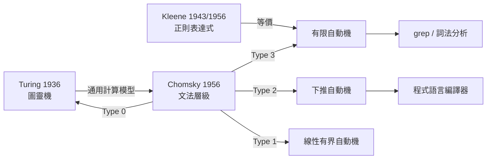
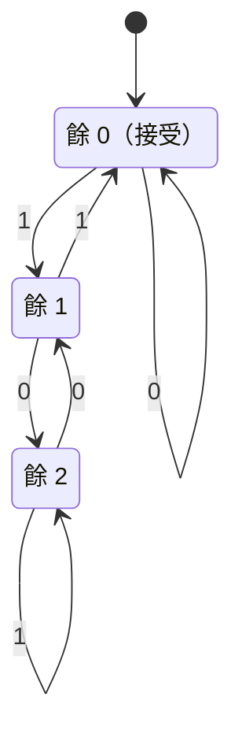

# 08.3 自動機與形式語言：從圖靈機 1936 到喬姆斯基層級 1956

## 0. 導言：兩個問題，一套理論

1936 年，24 歲的 Alan Turing 為了回答 Hilbert 的 *Entscheidungsproblem*（可判定性問題），發明了「圖靈機」——不是為了造電腦，而是為了**給「可計算」下一個數學定義**。1956 年，Noam Chomsky 為了刻畫自然語言的語法，提出了形式文法層級。兩人素不相識、目的迥異，理論卻在十年後完美咬合：**文法的四個層級，恰好對應四種自動機**。



> **驅動關係**：Hilbert 問「數學能被完全機械化嗎」→ Gödel 1931 不完備定理震撼數學界 → Turing 1936 用機器模型證明停機問題不可判定 → 二戰密碼破譯（與 07.3 遙相呼應）→ 電腦誕生 → 編譯器需要語法理論 → Chomsky 層級 → 今天每個編程語言、每個 grep、每個 JSON parser 都是這套理論的實作。**邏輯基礎危機 → 計算機革命 → 軟體工程**，前因後果綿延一世紀。

## 1. 圖靈機：可計算性的定義

### 定義 1.1（圖靈機，1936）

圖靈機是一個七元組 $M = (Q, \Sigma, \Gamma, \delta, q_0, q_{acc}, q_{rej})$：

- $Q$：有限狀態集；$\Sigma$：輸入字母表；$\Gamma \supseteq \Sigma \cup \{\blank\}$：帶字母表；
- $\delta: (Q \setminus \{q_{acc}, q_{rej}\}) \times \Gamma \to Q \times \Gamma \times \{L, R\}$：轉移函數（寫、移動）；
- 無限紙帶 + 讀寫頭。

「可計算」= 「某台圖靈機會停機並輸出」。這個定義的驚人之處在 **Church–Turing 論題**：所有合理的「有效計算」模型（λ-演算、遞迴函數、你的筆電、量子電腦）都被圖靈機涵蓋——**計算能力有天花板，而且天花板 1936 年就被找到了**。

### 定理 1.2（通用圖靈機）

存在一台通用圖靈機 $U$，輸入 $\langle M, w \rangle$（$M$ 的編碼與輸入 $w$），模擬 $M$ 在 $w$ 上的行為。

**意義**：這是「**程式 = 資料**」概念的誕生。$U$ 就是作業系統與直譯器的數學原型——現代軟體的一切都建在這條定理上。

### 定理 1.3（停機問題不可判定）

語言 $\mathrm{HALT} = \{\langle M, w\rangle \mid M \text{ 在 } w \text{ 上停機}\}$ 不可判定。

**證明（對角化，繼承 Gödel/Cantor 的手法）**。反設判定器 $H$ 存在，構造

$$D(\langle M \rangle):\ \text{若 } H(\langle M\rangle, \langle M\rangle) = \text{「停」則無限迴圈；否則停機}.$$

問：$D(\langle D \rangle)$ 停嗎？若停，依定義 $H$ 說它不停——矛盾；若不停，$H$ 說它停——矛盾。$\blacksquare$

**與前章的對照**：08.2 的對稱性是「可數範圍內的等價」；本章出現的是**不可計算的牆**。組合數學告訴我們「怎麼數」，計算理論告訴我們「哪些數不了」。

```python
# 停機問題的 Python 隱喻：無法寫出對所有程式都正確的 will_halt
import inspect

def will_halt(source_code, inp):
    raise NotImplementedError("定理 1.3 說：這個函數不可能存在且總是正確")

def loop_forever(x):
    while True: pass

# 但對特定簡單子類，我們可以可靠地分析（這就是為什麼有靜態分析工具）
def halts_on_simple(code: str, inp: int) -> bool | None:
    """僅對極小子集可判定；返回 None 表示『不知道』——保守近似"""
    ast_ok = code.count("while") == 0 and code.count("for") == 0
    return ast_ok if ast_ok else None   # 有迴圈就拒絕判斷：Rice 定理的日常體現
```

## 2. 有限自動機與正則語言

### 定義 2.1（DFA）

確定有限自動機（DFA）$A = (Q, \Sigma, \delta, q_0, F)$，其中 $\delta: Q \times \Sigma \to Q$（**每個狀態、每個符號恰有一條出邊**）。$A$ 接受 $w = a_1 \cdots a_n$ 若從 $q_0$ 逐字讀入後停在 $F$ 中狀態。$A$ 接受的語言 $L(A) = \{w \mid A \text{ 接受 } w\}$ 稱**正則語言**。

### 範例 2.2（二進位數模 3 餘 0 的辨識器）



**觀察**：狀態 $s_r$ = 「目前讀到的數 mod 3」。DFA 的狀態數有限 ⟺ 語言只需記住**有限種歷史摘要**——這正是 07 章模運算的精神：**同餘就是天然的有限狀態壓縮**。

```python
def mod3_dfa(s: str) -> bool:
    state = 0                       # 0,1,2 = 餘數
    for ch in s:
        state = (2 * state + int(ch)) % 3   # 左移一位再加新位
    return state == 0

print(mod3_dfa("1001"))   # 9 % 3 == 0 → True
print(mod3_dfa("1010"))   # 10 % 3 == 1 → False
```

### 定義 2.3（Kleene 星號）

對語言 $L$，定義

$$L^* = \bigcup_{n \ge 0} L^n, \qquad L^0 = \{\epsilon\},\ L^{n+1} = L^n \cdot L.$$

即「零個或多個 $L$ 中字串的串接」。例如 $\{a\}^* = \{\epsilon, a, aa, aaa, \dots\}$。**Kleene 星號是正則表達式的靈魂**：`grep` 的 `*`、`a+`、`[0-9]*` 全部源自這個 1956 年的定義（Kleene 為麥卡洛克–皮茨神經網路模型尋找「可表達的事件」時發明）。

### 定理 2.4（Kleene 定理，1956）

**正則語言 = DFA 認得的語言 = 正則表達式描述的語言**。

（證明方向一：Thompson 構造把正則表達式變 NFA，子集構造變 DFA；方向二：狀態消去法把 DFA 變正則表達式。細節見任何 automata 教科書；本節示範子集構造。）

### 定理 2.5（DFA 與 NFA 等價：子集構造）

NFA（允許多條出邊與 $\epsilon$ 邊）可轉為等價 DFA：DFA 的每個狀態 = NFA 狀態集合。代價是指數膨脹（$2^n$ 個狀態）。

```python
def nfa_to_dfa(nfa, alphabet):
    """nfa: dict[(state, sym)] -> set[state]；回傳 DFA 轉移表"""
    start = frozenset([nfa["start"]])
    dfa, work = {}, [start]
    seen = {start}
    while work:
        S = work.pop()
        for a in alphabet:
            T = frozenset().union(*(nfa["trans"].get((s, a), set()) for s in S)) or frozenset()
            dfa[(S, a)] = T
            if T not in seen:
                seen.add(T); work.append(T)
    return dfa   # 狀態數上限 2^n，實務通常小得多
```

## 3. Pumping Lemma：正則語言的極限

### 定理 3.1（正則語言的 Pumping Lemma）

若 $L$ 是正則語言，則存在 $p \ge 1$（pumping 長度，可取為 DFA 狀態數），使得任何 $w \in L$、$|w| \ge p$ 都可寫成 $w = xyz$ 滿足：

1. $|xy| \le p$；
2. $|y| \ge 1$；
3. 對所有 $i \ge 0$：$xy^i z \in L$。

**證明（鴿籠原理）**。$w$ 有 $p$ 個符號，DFA 讀 $w$ 經過 $p+1$ 個狀態 $q_0, \dots, q_p$，由鴿籠原理必有 $q_i = q_j$（$i < j \le p$）。令 $y$ 為 $i$ 到 $j$ 之間讀入的片段：這段路徑是**從 $q_i$ 回到 $q_i$ 的迴圈**，繞任意次 $i$ 之後都會回到同一狀態，故 $xy^iz$ 仍被接受。$\blacksquare$

**使用方式（反證工具）**：要證 $L$ **不**正則，假設它正則、選合適的 $w$，證明無論怎麼 pump 都會掉出 $L$。

### 範例 3.2（$\{a^n b^n\}$ 不是正則語言）

反設正則，pumping 長度 $p$。取 $w = a^p b^p \in L$。由條件 1、2，$y$ 只含 $a$（設 $|y| = k \ge 1$）。取 $i = 0$：$xy^0z = a^{p-k}b^p \notin L$（$a$ 的個數 $< b$ 的個數），與條件 3 矛盾。$\blacksquare$

**深意**：有限狀態**記不住任意深的計數**。$\{a^nb^n\}$ 需要「數到 $n$ 為止」的無界記憶——這正是「括號配對」「JSON 嵌套」需要更強機器的根本原因，也是編譯器分成「詞法（正則）」與「語法（上下文無關）」兩個階段的理論依據。

```python
# pumping lemma 的機械化驗證：窮舉所有合法切分都會失敗
def check_not_regular(L, p, w_builder, in_L):
    """對 w = w_builder(p)，檢查所有滿足 |xy|<=p, |y|>=1 的切分"""
    w = w_builder(p)
    cuts = []
    for i in range(p + 1):            # |xy| <= p
        for j in range(1, p - i + 1): # |y| >= 1
            x, y, z = w[:i], w[i:i+j], w[i+j:]
            bad = any(not in_L(x + y * k + z) for k in range(0, 4))
            if bad:
                cuts.append((i, j, k := next(kk for kk in range(4)
                             if not in_L(x + y * kk + z))))
    return f"w={w}: 所有切分皆可 pump 出語言 → {L.__name__} 非正則（若 cuts 非空）", cuts[:3]

is_anbn = lambda s: (n := s.count('a')) == s.count('b') and s == 'a'*n + 'b'*n
print(check_not_regular(is_anbn, 4, lambda p: 'a'*p + 'b'*p, is_anbn)[0])
```

## 4. 喬姆斯基層級：文法與機器的對位表

### 定義 4.1（形式文法）

文法 $G = (V, \Sigma, P, S)$：變數集 $V$、終端符 $\Sigma$、產生規則 $P$、起始符 $S$。$\Rightarrow$ 為一步推導，$L(G) = \{w \in \Sigma^* \mid S \Rightarrow^* w\}$。

Chomsky 依**產生規則的形式限制**分四層（1956 年原論文是為自然語言；1959 年論文才與自動機對上）：

| 層級 | 文法類型 | 規則限制 | 自動機 | 語言例子 | 實務 |
|---|---|---|---|---|---|
| 3 | 正則 | $A \to aB$ 或 $A \to a$ | DFA/NFA | $\{aw\}$、數字字面量 | lex、grep |
| 2 | 上下文無關 | $A \to \alpha$（左邊單一變數） | 下推自動機（PDA） | $\{a^nb^n\}$、平衡括號 | 編譯器 parser、YACC |
| 1 | 上下文有關 | $\alpha \to \beta$、$|\alpha| \le |\beta|$ | 線性有界自動機 | $\{a^{n^2}\}$ | 自然語言片段 |
| 0 | 無限制 | 任意 | 圖靈機 | 所有可枚舉語言 | 理論極限 |

**層級嚴格遞升**：$\text{正則} \subsetneq \text{CFL} \subsetneq \text{CSL} \subsetneq \text{RE}$，每一層的嚴格性都由 pumping 類論證（正則的 pumping lemma、CFL 的疊代引理）證明。

### 範例 4.2（CFG 描述平衡括號）

$$S \to (S)\,S \mid \epsilon$$

下推自動機用**一個堆疊**數括號深度：看到 `(` 壓入、`)` 彈出，空堆疊且輸入盡頭即接受。**堆疊就是 DFA 缺的那份無界記憶**——機器能力每升一級，記憶結構升一級：無記憶 → 堆疊 → 有限帶。

```python
# Type 2 語言的辨識：平衡括號（模擬 PDA 的堆疊）
def balanced(s: str) -> bool:
    depth = 0
    for c in s:
        if c == '(': depth += 1      # push
        elif c == ')':
            depth -= 1               # pop
            if depth < 0: return False
    return depth == 0

print(balanced("(()())"), balanced("())("))   # True False
```

## 5. 章末小結

| 年代 | 人物 | 貢獻 | 驅動 |
|---|---|---|---|
| 1931 | Gödel | 不完備定理 | 逼出「機械化證明」的極限問題 |
| 1936 | Turing | 圖靈機、停機問題、通用機 | 「可計算」的定義、程式=資料 |
| 1943 | Kleene/McCulloch–Pitts | 神經網路事件 | 正則表達式的起源 |
| 1956 | Chomsky | 文法層級 | 語言學 → 編譯理論 |
| 1956 | Kleene | 正則表達式 = DFA | grep、詞法分析 |
| 1959 | Chomsky | 層級對應自動機 | 編譯器架構定型 |

**核心因果鏈**：Hilbert 程式 → Gödel 不完備 → Turing 機器與不可判定性 → Kleene 正則語言 ↔ DFA → Chomsky 層級 ↔ 四種自動機 → pumping lemma 畫出能力邊界 → 編譯器、正則引擎、靜態分析的理論地基。

三個帶走的洞見：

1. **狀態數 = 記憶量**：DFA 能認什麼語言，取決於「歷史能否壓縮成有限摘要」（同餘、模運算是天然壓縮器）。
2. **pumping 類論證是通用武器**：有限記憶必有重複，重複即可 pump——同一招對付正則（鴿籠）與 CFL（疊代引理）。
3. **停機問題是所有「完美工具」的天花板**：任何非平凡語意性質都不可判定（Rice 定理），這解釋了為什麼 linter、防毒、AI 對齊都只能做保守近似。

## 6. 下一步

本章證明了「有些東西算不了」（停機問題），但沒有量化「算得了的東西有多難」——停機 vs. 多項式時間 vs. 指數時間的階梯，以及 $P \overset{?}{=} NP$、NP-完備性（Cook 1971、Karp 1972）、與 07.3 單向函數的關係，將在第 10 章**計算複雜度**中展開。到那裡，我們會看到：數論（07 章）提供難題、群論（08 章）提供結構、自動機（本章）提供計算模型——三條線終於匯流成現代密碼學與演算法理論的全圖。
